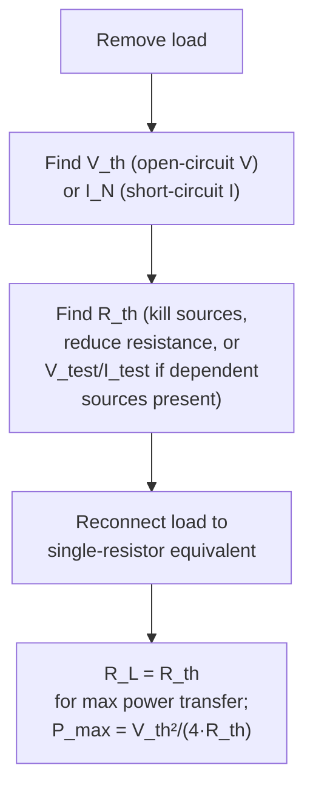

---
tags:
  - EE1100
  - week3
  - DC-circuits
up: "[[EE1100 MOC]]"
prev: "[[02 Methods of Circuit Analysis]]"
next: "[[04 Capacitors, Inductors and First Order Circuits]]"
---

# Week 3 — DC Network Theorems

← prev: [[02 Methods of Circuit Analysis|Week 2]] · up: [[EE1100 MOC|MOC]] · next: [[04 Capacitors, Inductors and First Order Circuits|Week 4 →]]

Playlist: lectures 19–23 of [Fundamentals of Electrical Engineering](https://www.youtube.com/playlist?list=PLbRMhDVUMngfdEXVcdf_ijj2Eub-UHs_y).

## Overview
Full definitions and the Thevenin/Norton diagram are in [[Concepts#Network Theorems|Network Theorems]]. This week is about *using* them — recognizing when a shortcut saves you from solving the whole circuit.

## Superposition — worked pattern
1. Pick one independent source, "kill" every other independent source (voltage source → short circuit / 0 V; current source → open circuit / 0 A). **Dependent sources are never killed** — they stay in the circuit and respond to whatever current/voltage is driving them in that step.
2. Solve the (now simpler) circuit for the variable of interest.
3. Repeat for each remaining independent source in turn.
4. Add all the individual contributions algebraically (respecting sign).

Superposition is a good sanity-check tool but is usually *more* work than nodal/mesh for circuits with many sources — its real value is conceptual (isolating each source's individual contribution) and it's required whenever a problem explicitly asks for it, as in [[Tutorial 1 - Circuit Laws and Theorems|Tutorial 1]] Q6.

## Thevenin/Norton — worked pattern
1. Remove the load (the element/resistor you're solving for).
2. Find V_th = open-circuit voltage at the now-open terminals (use nodal/mesh or superposition).
3. Find R_th: with all independent sources killed, find the resistance seen looking into the terminals via [[Series-Parallel Resistance Reduction]] (or, if dependent sources are present, apply a test source and compute R_th = V_test/I_test since "killing" alone isn't enough).
4. Reconnect the load to the single-resistor equivalent circuit — now trivial to solve.

Norton is the same procedure but stop at step 2 by finding I_N = short-circuit current instead of open-circuit voltage; R_N = R_th always.

## Maximum power transfer
Once you have R_th, the load resistor that extracts the most power is simply **R_L = R_th** — no further circuit analysis needed, which is why [[Tutorial 1 - Circuit Laws and Theorems|Tutorial 1]] Q5 and Q10 both reduce to "find R_th, done."

## Worked in
[[Tutorial 1 - Circuit Laws and Theorems|Tutorial 1]] Q5 (max power with a dependent source), Q6 (superposition), Q8 (Thevenin), Q9 (Norton), Q10 (max power transfer, plus the "half of P_max" follow-up — solve V_L² /R_L = P_max/2 for R_L, giving two roots).

## Related
- [[Concepts|Concepts glossary]]
- [[02 Methods of Circuit Analysis|Week 2 — Methods of Circuit Analysis]]
- [[07 AC Circuit Analysis and Network Theorems|Week 7 — AC Circuit Analysis and Network Theorems]]
