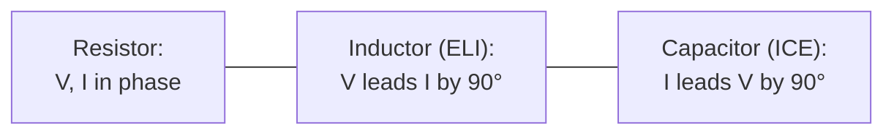

---
tags:
  - EE1100
  - week5
  - AC-circuits
up: "[[EE1100 MOC]]"
prev: "[[04 Capacitors, Inductors and First Order Circuits]]"
next: "[[06 Sinusoidal Steady-State Analysis]]"
---

# Week 5 — Sinusoids and Phasors

← prev: [[04 Capacitors, Inductors and First Order Circuits|Week 4]] · up: [[EE1100 MOC|MOC]] · next: [[06 Sinusoidal Steady-State Analysis|Week 6 →]]

Playlist: lectures covering sinusoids/phasors in [Fundamentals of Electrical Engineering](https://www.youtube.com/playlist?list=PLbRMhDVUMngfdEXVcdf_ijj2Eub-UHs_y).

## Overview
This week is the pivot of the whole course: everything before it was DC (constant sources); everything after assumes a sinusoidal source. The tool that makes that transition tractable is the [[Concepts#Phasors|phasor]] — full definition and diagram there.

## Describing a sinusoid
x(t) = X_m·cos(ωt + φ)
- **X_m:** amplitude (peak value)
- **ω = 2πf:** angular frequency (rad/s), f in Hz, related to period T by ω = 2π/T
- **φ:** phase angle — where in the cycle the wave sits at t = 0

Two sinusoids of the *same frequency* can be compared by their phase difference: if φ_1 > φ_2, waveform 1 **leads** waveform 2 (reaches its peak earlier).

## RMS and average value
See [[Concepts#Phasors|Phasors]] for the RMS definition (X_rms = X_m/√2) — this is the value used everywhere from here on for power calculations, and what's meant by quoted AC "voltage" values (e.g. 230 V mains is an RMS value, not the peak).

## From time domain to phasor and back
1. Write the sinusoid in cosine form: X_m·cos(ωt + φ). (Convert sin to cos first if needed: sin(θ) = cos(θ − 90°).)
2. Drop the ωt (it's implicit — same for every quantity in a fixed-frequency circuit) and the time dependence: phasor = X_m∠φ, or in rectangular form X_m cos φ + jX_m sin φ.
3. Do all circuit algebra with these complex numbers.
4. To go back to the time domain: take the resulting complex answer's magnitude as X_m and its angle as φ, and write X_m·cos(ωt + φ).

## Phasor relationships for R, L, C
The full impedance relationships are in [[Concepts#Impedance and Admittance|Impedance and Admittance]] (next week) — this week establishes the *phase* behavior specifically:
- **Resistor:** V and I are in phase (φ = 0).
- **Inductor:** V **leads** I by 90° (equivalently, I lags V) — "ELI": in an inductor, E (voltage) before I.
- **Capacitor:** I **leads** V by 90° — "ICE": in a capacitor, I before E (voltage).

The mnemonic **"ELI the ICE man"** ties both together in one line.

## Related
- [[Concepts|Concepts glossary]]
- [[06 Sinusoidal Steady-State Analysis|Week 6 — Sinusoidal Steady-State Analysis]]
- Elaborated further in [[Sinusoidal Waveforms, RMS and Average Value|Sinusoidal Waveforms, RMS and Average Value]] and [[Phasors and Complex Algebra|Phasors and Complex Algebra]] (Tutorial 3)

## Cross-domain links

- [[Rotating Vectors - Phasors, Velocity Polygons and Complex Kinematics|Rotating Vectors]] — the same rotating-vector construction as velocity polygons in KDoMs.
