---
tags:
  - EE1100
  - concepts
  - glossary
up: "[[EE1100 MOC]]"
---

# EE1100 — Core Concepts Glossary

← up: [[EE1100 MOC|MOC]]

Hub note for every recurring law, theorem, and quantity in the course. Each heading below is linked *from* the week note that introduces it and links *back* to every week that reuses it — that two-way linking is what turns the [[EE1100 MOC|MOC]] graph into a real web instead of a flat chain. See also the standalone atomic notes built while solving tutorials: [[Voltage Divider Rule|Voltage Divider Rule]], [[Series-Parallel Resistance Reduction]].

---

## Ohm's Law

**V = IR**. For a linear resistor, voltage across it is directly proportional to the current through it; R (in ohms, Ω) is the constant of proportionality.

- Power dissipated: P = VI = I²R = V²/R
- Only holds for *linear* elements (resistors) — sources and reactive elements (capacitors, inductors) need their own v-i relations, see [[Concepts#Capacitors and Inductors|Capacitors and Inductors]].
- Generalizes to AC circuits as **V = IZ**, replacing resistance with complex impedance — see [[Concepts#Impedance and Admittance|Impedance and Admittance]].

Introduced in [[01 Basic Concepts and Basic Laws|Week 1]]; the base relation for every resistive-circuit problem from there on, e.g. [[Tutorial 1 - Circuit Laws and Theorems|Tutorial 1]].

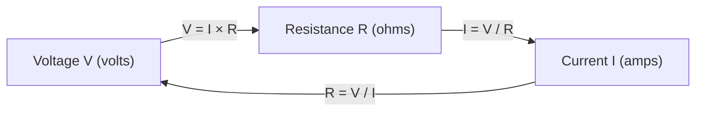

---

## Kirchhoff's Laws

Two conservation laws that hold in *every* lumped circuit, DC or AC, regardless of what's inside it.

- **KCL (Current Law):** the sum of currents *entering* a node equals the sum *leaving* it — charge can't pile up at a node. ΣI_in = ΣI_out.
- **KVL (Voltage Law):** the sum of voltage drops around any closed loop is zero — energy is conserved going around a loop. ΣV = 0.

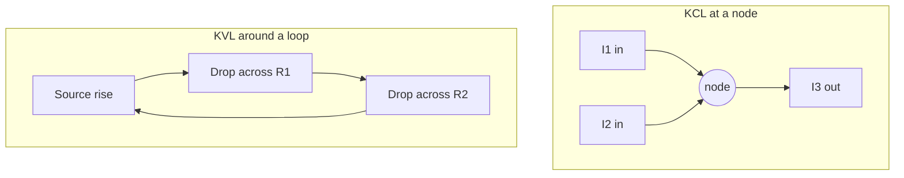

Introduced in [[01 Basic Concepts and Basic Laws|Week 1]]. These two laws *are* the derivation behind [[Concepts#Nodal and Mesh Analysis|nodal/mesh analysis]] ([[02 Methods of Circuit Analysis|Week 2]]), every [[Concepts#Network Theorems|network theorem]] ([[03 DC Network Theorems|Week 3]]), and reappear unchanged (just with complex numbers) in AC phasor analysis ([[07 AC Circuit Analysis and Network Theorems|Week 7]]).

---

## Nodal and Mesh Analysis

Two systematic, opposite ways to reduce "solve this messy circuit" to "solve a linear system."

- **Nodal analysis:** unknowns are node voltages. Write one KCL equation per non-reference node (express each branch current via Ohm's law in terms of node voltages), solve the resulting linear system. A **supernode** is used when a voltage source connects two non-reference nodes directly (its internal current is unknown, so you merge the two nodes' KCL equations and add the source's constraint equation).
- **Mesh analysis:** unknowns are loop (mesh) currents. Write one KVL equation per independent mesh. A **supermesh** is the dual trick, used when a current source sits on the boundary shared by two meshes.

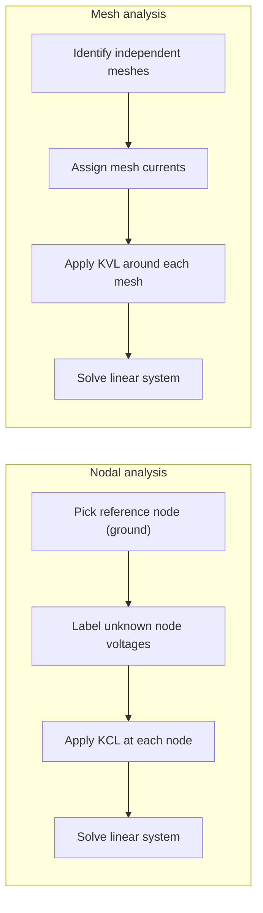

Choosing between them: nodal is usually faster when a circuit has many parallel branches / few nodes; mesh is faster when it has many series loops / is planar with few meshes.

Covered in [[02 Methods of Circuit Analysis|Week 2]] with worked supernode/supermesh problems in [[Tutorial 1 - Circuit Laws and Theorems|Tutorial 1]] (Q11, Q12, Q14). Reapplied directly in the phasor domain in [[07 AC Circuit Analysis and Network Theorems|Week 7]] — same procedure, complex arithmetic instead of real.

---

## Network Theorems

Four shortcuts that avoid solving the *whole* circuit when you only care about one part of it. All require **linearity** (only resistors/impedances and independent sources whose values don't depend on circuit variables — dependent sources are still fine).

- **Superposition:** the response (voltage or current) due to several independent sources acting together equals the sum of the responses to each source acting alone (all *other* independent sources killed — voltage sources shorted, current sources opened).
- **Thevenin's theorem:** any linear two-terminal network reduces to a single voltage source V_th in series with a resistance R_th. V_th = open-circuit voltage at the terminals; R_th = resistance seen at the terminals with all independent sources killed (or R_th = V_th / I_sc if dependent sources are present).
- **Norton's theorem:** the dual of Thevenin — a current source I_N in parallel with R_N. I_N = short-circuit current at the terminals; R_N = R_th (they're the same resistance, just a different equivalent form). V_th = I_N × R_N always.
- **Maximum power transfer theorem:** a load draws maximum power from a network when R_load = R_th (DC), or Z_load = Z_th* — the complex conjugate — in AC. Under this condition P_max = V_th² / (4·R_th).

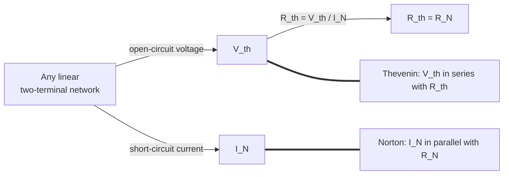

Covered for DC in [[03 DC Network Theorems|Week 3]] (worked in [[Tutorial 1 - Circuit Laws and Theorems|Tutorial 1]] Q6, Q8, Q9, Q10), extended to AC/phasor form in [[07 AC Circuit Analysis and Network Theorems|Week 7]].

---

## Series-Parallel Resistance Reduction

See the standalone note: [[Series-Parallel Resistance Reduction]]. Used constantly wherever a Thevenin/Norton resistance, ladder network, or bridge circuit needs to be collapsed to a single equivalent — [[01 Basic Concepts and Basic Laws|Week 1]] onward, and central to [[Tutorial 1 - Circuit Laws and Theorems|Tutorial 1]] Q1 (R-2R ladder) and Q13 (star-delta bridge).

---

## Capacitors and Inductors

Energy-*storage* elements — unlike a resistor, they don't dissipate energy, they hold it in an electric or magnetic field.

- **Capacitor:** i = C·(dv/dt). Voltage cannot change instantaneously (would need infinite current). Energy stored: W = ½CV².
- **Inductor:** v = L·(di/dt). Current cannot change instantaneously (would need infinite voltage). Energy stored: W = ½LI².

| | Capacitor | Inductor |
|---|---|---|
| Blocks (DC steady state) | acts as **open circuit** | acts as **short circuit** |
| Continuous variable | voltage | current |
| Series combination | 1/C_eq = Σ(1/C_i) | L_eq = ΣL_i |
| Parallel combination | C_eq = ΣC_i | 1/L_eq = Σ(1/L_i) |

Note the combination rules are the *opposite* of resistors' — a useful memory check.

Covered in [[04 Capacitors, Inductors and First Order Circuits|Week 4]], practiced extensively in [[Tutorial 2 - Transient Analysis of DC Circuits|Tutorial 2]]. Their AC steady-state behavior becomes complex impedance in [[06 Sinusoidal Steady-State Analysis|Week 6]].

---

## RC/RL Transients and Time Constant

When a circuit with one capacitor or inductor is disturbed (switch opens/closes), the response has the form:

**x(t) = x_∞ + (x_0 − x_∞)·e^(−t/τ)**

where x_0 is the initial value, x_∞ is the final (steady-state) value, and τ is the **time constant**: τ = RC for an RC circuit, τ = L/R for an RL circuit (R being the Thevenin resistance seen by the capacitor/inductor).

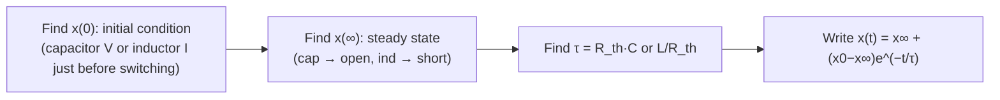

τ is the time to cover 63.2% of the total change; after 5τ the response is >99% settled — the standard "steady state reached" rule of thumb used throughout [[Tutorial 2 - Transient Analysis of DC Circuits|Tutorial 2]].

**Second-order (RLC) circuits** add a capacitor *and* inductor together, giving a differential equation with damping factor ζ and natural frequency ω_n:
- ζ > 1 → **overdamped** (slow, no oscillation)
- ζ = 1 → **critically damped** (fastest non-oscillatory return)
- ζ < 1 → **underdamped** (oscillates while decaying, at damped frequency ω_d = ω_n√(1−ζ²))
- ζ = 0 → **undamped** (oscillates forever)

Covered in [[04 Capacitors, Inductors and First Order Circuits|Week 4]] and extended to second-order circuits in [[Tutorial 2 - Transient Analysis of DC Circuits|Tutorial 2]] Q10–12; conceptually the DC-transient cousin of AC [[Concepts#Resonance|resonance]] in [[08 Resonance and Magnetically Coupled Circuits|Week 8]] — same ζ and ω_n show up in both.

---

## Phasors

A **phasor** is a complex number that packages a sinusoid's amplitude and phase, freezing out the (known, common) frequency and time dependence. For x(t) = X_m·cos(ωt + φ), the phasor is **X = X_m∠φ**.

Why bother: differentiating/integrating a sinusoid in the time domain becomes simple multiplication in the phasor domain (d/dt → multiply by jω), turning differential equations into algebra.

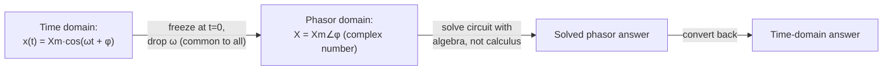

Two related quantities:
- **RMS (root-mean-square) value:** X_rms = X_m/√2 for a sinusoid — the DC-equivalent value that delivers the same average power. This is what a multimeter reads and what "230 V mains" means.
- **Average value** over a full cycle of a pure sinusoid is zero (equal positive/negative area) — RMS, not average, is the meaningful AC magnitude for power calculations.

Introduced in [[05 Sinusoids and Phasors|Week 5]]; used throughout [[06 Sinusoidal Steady-State Analysis|Week 6]]–[[09 Three Phase Circuits and Power Measurement|Week 9]].

---

## Impedance and Admittance

**Impedance Z = R + jX** (ohms) generalizes resistance to AC: it relates phasor voltage to phasor current, **V = IZ**, the AC form of [[Concepts#Ohm's Law|Ohm's Law]].

- Resistor: Z_R = R (real, no phase shift between V and I)
- Inductor: Z_L = jωL = jX_L (current *lags* voltage by 90°)
- Capacitor: Z_C = 1/(jωC) = −jX_C (current *leads* voltage by 90°)

**Admittance Y = 1/Z = G + jB** (siemens) is the reciprocal — convenient for parallel combinations, exactly as conductance is for parallel resistors.

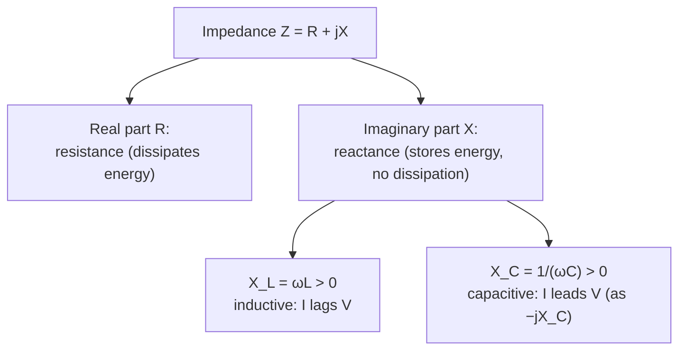

Defined and used to redo series/parallel AC circuits in [[06 Sinusoidal Steady-State Analysis|Week 6]] — the exact same [[Concepts#Series-Parallel Resistance Reduction|series-parallel reduction]] techniques from DC apply, just with complex numbers. Central to [[Concepts#Resonance|resonance]] in [[08 Resonance and Magnetically Coupled Circuits|Week 8]].

---

## Power in AC Circuits

Three related quantities, all connected by the **power triangle**:

- **Real (active) power P** (watts): the power actually converted to useful work/heat. P = V_rms·I_rms·cos φ
- **Reactive power Q** (VAR): power that sloshes back and forth into/out of L and C, doing no net work. Q = V_rms·I_rms·sin φ
- **Apparent power S** (VA): what the source "feels" it's supplying. S = V_rms·I_rms = P + jQ (as a complex quantity), |S| = √(P² + Q²)
- **Power factor** cos φ = P/S — how effectively the apparent power is being converted to real power. φ is the angle of Z (or equivalently, the phase difference between V and I).

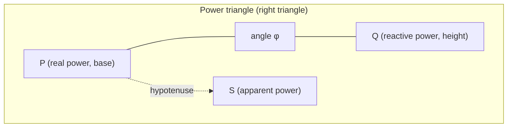

- Inductive load: φ > 0, "lagging" power factor (current lags voltage)
- Capacitive load: φ < 0, "leading" power factor
- Power-factor correction adds capacitance in parallel to cancel inductive Q, cutting S (and hence current/losses) for the same P.

Single-phase power in [[06 Sinusoidal Steady-State Analysis|Week 6]]; three-phase power and its measurement (two-wattmeter method) in [[09 Three Phase Circuits and Power Measurement|Week 9]].

---

## Resonance

In a circuit with both L and C, **resonance** occurs at the frequency where X_L = X_C, so the reactive parts cancel and the circuit behaves purely resistively.

Resonant angular frequency: **ω_0 = 1/√(LC)**

- **Series RLC:** at resonance, Z is at its **minimum** (=R), so current is at its **maximum** — a series resonant circuit is a band-*pass* for current.
- **Parallel RLC:** at resonance, Z is at its **maximum**, so line current is at its **minimum** — a band-*stop* (rejector) behavior for line current, while the L/C loop current can be large (circulating current).
- **Q-factor** measures how sharp the resonance peak is: Q = ω_0L/R (series) — higher Q means a narrower bandwidth BW = ω_0/Q and a "sharper" filter.

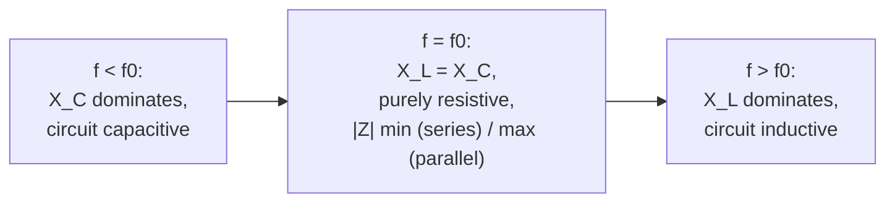

This is the AC-steady-state twin of the [[Concepts#RC/RL Transients and Time Constant|second-order transient damping]] discussed above — same ω_n, and Q relates directly to damping ratio ζ (Q = 1/2ζ). Covered in [[08 Resonance and Magnetically Coupled Circuits|Week 8]].

---

## Magnetic Coupling

Two coils sharing a common magnetic flux exhibit **mutual inductance M**: a changing current in coil 1 induces an EMF in coil 2 (and vice versa), on top of each coil's own self-inductance.

- Induced voltage: v_2 = M·(di_1/dt) (mutual term) added to each coil's self-inductance term.
- **Dot convention:** dots mark terminals with the same instantaneous polarity — current entering the dotted terminal of one coil induces a voltage that is *positive* at the dotted terminal of the other.
- **Coefficient of coupling** k = M/√(L_1L_2), 0 ≤ k ≤ 1. k = 1 is "perfect" coupling (all flux from coil 1 links coil 2) — the ideal-transformer assumption.

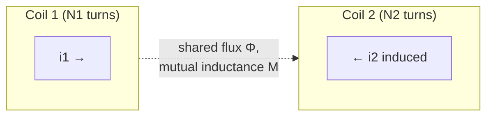

This is the physical mechanism behind a transformer. Introduced in [[08 Resonance and Magnetically Coupled Circuits|Week 8]]; applied directly (with near-unity k) in [[10 Single Phase Transformers|Week 10]].

---

## Three-Phase Systems

Three sinusoidal sources 120° apart in phase, feeding a balanced load, connected either:

- **Star (Y):** each phase winding has one end tied to a common neutral. Line voltage V_L = √3·V_phase (line voltage leads the corresponding phase voltage by 30°); line current = phase current.
- **Delta (Δ):** phase windings connected end-to-end in a loop, lines tapped at the corners. Line current I_L = √3·I_phase; line voltage = phase voltage.

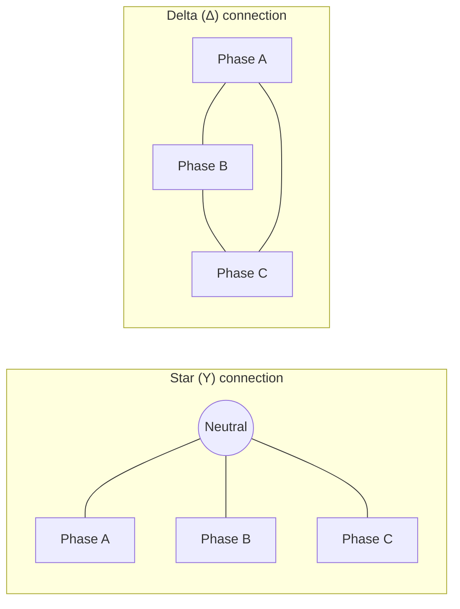

Balanced three-phase power (same formula regardless of connection, using *line* quantities): **P = √3·V_L·I_L·cos φ**.

**Two-wattmeter method** measures total power in a 3-phase 3-wire system with only two wattmeters: P_total = W1 + W2, and additionally reveals the power factor from W1, W2 individually (tan φ = √3(W1−W2)/(W1+W2)).

Covered in [[09 Three Phase Circuits and Power Measurement|Week 9]]; the supply configuration assumed for [[11 Three Phase Induction Machines|Week 11]] machines. Star-delta *transformation* (the resistive-network technique, different from this three-phase supply topology but same underlying Y-Δ geometry) is used in [[Tutorial 1 - Circuit Laws and Theorems|Tutorial 1]] Q13/Q14 — see [[Series-Parallel Resistance Reduction]].

---

## Rotating Magnetic Field

A three-phase stator winding, fed by three currents 120° apart in *time* from three windings 120° apart in *space*, produces a magnetic field of **constant magnitude that rotates** at synchronous speed — this is the entire working principle of the induction motor, requiring no commutator or external field excitation.

**Synchronous speed: N_s = 120f/P** (rpm), where f = supply frequency, P = number of poles.

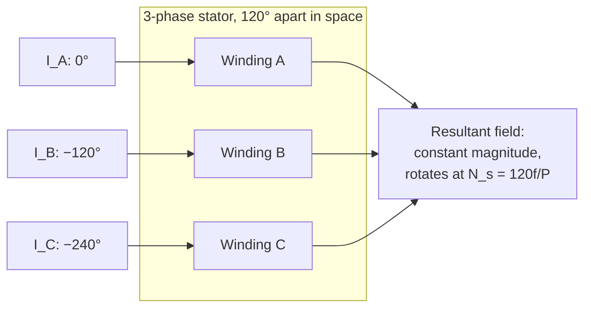

**Slip** s = (N_s − N_r)/N_s describes how far the rotor lags the field; the rotor can never reach N_s (zero relative speed → zero induced torque). See [[11 Three Phase Induction Machines|Week 11]]. Built directly on balanced [[Concepts#Three-Phase Systems|three-phase currents]] from [[09 Three Phase Circuits and Power Measurement|Week 9]].

---

## Back EMF

In a DC motor, as the armature rotates in the field's flux, it generates its *own* EMF (E_b) by the same generator action — but wired to *oppose* the applied terminal voltage (Lenz's law).

**V = E_b + I_a·R_a**, and E_b ∝ N (speed) × Φ (flux).

- At start (N = 0), E_b = 0, so the only thing limiting current is the small armature resistance R_a → very high starting current, hence the need for a starting rheostat.
- As speed rises, E_b rises, current falls, until equilibrium torque = load torque.
- Torque: T ∝ Φ·I_a.

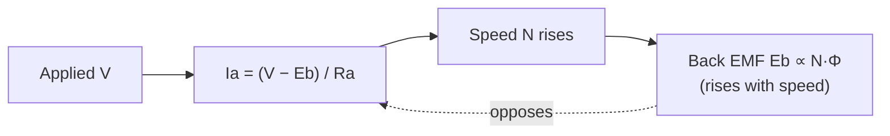

This self-regulating feedback loop is why DC motors are naturally speed-stabilizing. See [[12 DC Machines|Week 12]].

