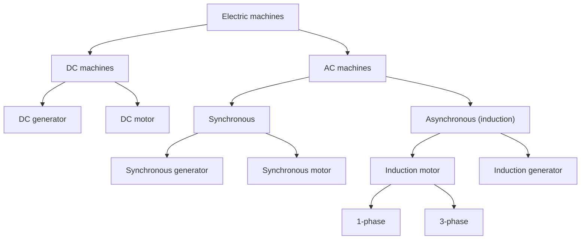

Related: [[11 Three Phase Induction Machines]] · [[12 DC Machines]] · [[Revolving Magnetic Field and Synchronous Speed]] · [[Induction Motor - Slip, Rotor Circuit and Power Flow]] · animation: [Three-phase revolving field](revolving%20field%20animation.html)

## Classification of electric machines

| Machine | Typical use |
|---|---|
| DC generator | electroplating, battery charging, DC welding, excitation of synchronous machines |
| DC motor | traction (trains, trolleys), rolling mills, cranes, elevators, variable-speed drives |
| synchronous generator | main source of power in thermal, hydro and nuclear stations |
| synchronous motor | constant-speed loads (compressors, pumps, conveyors), power-factor correction |
| induction motor, 1-phase | fans, mixers, washing machines, blowers |
| induction motor, 3-phase | pumps, compressors, conveyors, lathes, fans in power plants, EV traction |
| induction generator | wind turbines, micro-hydel, regenerative braking |

## Induction motor types
- **3-phase:** squirrel cage; slip-ring (wound rotor).
- **1-phase:** split-phase; capacitor start.

## Construction
- **Stator:** laminated **silicon-steel** core (laminations cut eddy-current loss, silicon steel cuts hysteresis loss) with slots carrying the distributed winding.
- **Squirrel-cage rotor:** bars short-circuited by end rings, no external connection. The bars are **skewed** slightly to prevent *cogging* (locking of rotor and stator teeth when slot numbers are equal or integer multiples) and to quieten the motor.
- **Slip-ring (wound) rotor:** a three-phase winding for the same number of poles as the stator (fewer slots, fewer turns per phase), brought out through **slip rings and brushes** so that external resistance or other circuits can be added for starting and speed control.

## Merits and demerits
| | Squirrel cage | Slip ring |
|---|---|---|
| **Pros** | cheaper and rugged; no brushes or slip rings to wear; no sparking (safe in mines); self-starting (unlike synchronous motors) | external rotor resistance cuts starting current and raises starting torque; speed control by rotor resistance or slip-power recovery; suits wind-turbine generators |
| **Cons** | low starting torque, high starting current (needs star–delta or auto-transformer starting); lagging power factor, poor at light load; poor speed control compared with DC | brushes and rings need maintenance and can spark; more sensitive to supply-voltage fluctuations |

## NEMA / IEC design classes (squirrel cage)
| Class | Starting torque | Starting current | Slip at rated speed |
|---|---|---|---|
| A | normal | normal | normal (popular: fans, compressors, conveyors, low-inertia loads) |
| B | normal | low | normal |
| C | high | low | normal |
| D | high | low | high |
| E | low | normal | low |

## Efficiency and power factor
Efficiency and power factor are the two parameters that matter when choosing a motor. Both rise with load and then flatten; at light load the power factor is poor. Squirrel-cage motors are more efficient than slip-ring motors, and higher-speed motors more than lower-speed ones. **Energy-efficient** motors use low-loss silicon steel, thinner laminations, a smaller air gap, copper in place of aluminium rotor bars and better ventilation, at higher cost.

## Single-phase split-phase motor
A main winding (high $X_M/R_M$) and an auxiliary winding (higher resistance, $R_A/X_A>R_M/X_M$) carry currents that differ in phase by $25^\circ$–$30^\circ$, so the machine behaves like a two-phase motor, produces a revolving flux and is self-starting. A centrifugal switch cuts the auxiliary winding out near rated speed.

## Cross-domain links
- [[Gears, Transformers and Reflected Impedance]] — squirrel-cage versus slip-ring is the question of *where the rotor resistance sits*: fixed inside the cage, or adjustable outside through the rings (like choosing a gear ratio at start-up).
- [[Rotating Vectors - Phasors, Velocity Polygons and Complex Kinematics]] — the two-winding split-phase starter is the minimal way to turn a pulsating phasor into a rotating one.
