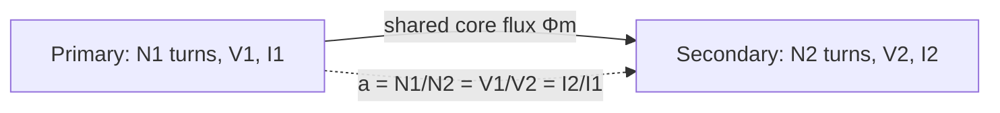
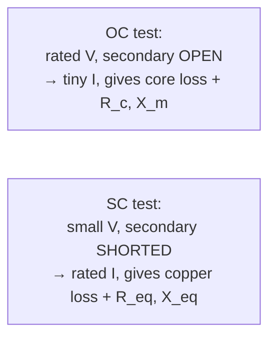

---
tags:
  - EE1100
  - week10
  - machines
up: "[[EE1100 MOC]]"
prev: "[[09 Three Phase Circuits and Power Measurement]]"
next: "[[11 Three Phase Induction Machines]]"
---

# Week 10 — Single Phase Transformers

← prev: [[09 Three Phase Circuits and Power Measurement|Week 9]] · up: [[EE1100 MOC|MOC]] · next: [[11 Three Phase Induction Machines|Week 11 →]]

Playlist: lectures covering transformers in [Fundamentals of Electrical Engineering](https://www.youtube.com/playlist?list=PLbRMhDVUMngfdEXVcdf_ijj2Eub-UHs_y).

## Overview
A transformer is [[Concepts#Magnetic Coupling|magnetic coupling]] ([[08 Resonance and Magnetically Coupled Circuits|Week 8]]) engineered for near-unity coupling (k ≈ 1) via a shared iron core, used to step voltage up or down while (ideally) conserving power.

## EMF equation and turns ratio
Faraday's law applied to a sinusoidally-varying flux Φ_m in the core gives the RMS induced EMF per winding:

**E = 4.44·f·N·Φ_m**

where f = frequency, N = number of turns, Φ_m = peak core flux. Since both windings share the same core flux, the ratio of EMFs equals the ratio of turns:

**a = N1/N2 = E1/E2 ≈ V1/V2 ≈ I2/I1**

(current ratio is *inverse* of the turns/voltage ratio — a step-down in voltage is a step-up in current, consistent with power conservation V1I1 ≈ V2I2 for an ideal transformer.)

## Equivalent circuit and voltage regulation
A real transformer isn't ideal — it has winding resistance (copper loss), leakage reactance (flux that doesn't fully link both windings), and core loss (hysteresis + eddy currents). These are modeled as an equivalent circuit: series R_eq and X_eq (referred to one side) plus a shunt branch (R_c for core loss, X_m for magnetizing reactance) near the primary.

**Voltage regulation** = (V_no-load − V_full-load)/V_full-load, expressed as a percentage — how much the secondary voltage droops from no-load to full-load, driven mainly by the series R_eq and X_eq.

## OC and SC tests
Rather than measure R_eq, X_eq, R_c, X_m directly (hard to isolate), two simple tests extract them:
- **Open-circuit (OC) test:** rated voltage applied to one side, other side left open. Since current is tiny, copper loss is negligible — the wattmeter reading is essentially the **core loss**, and the current drawn gives R_c and X_m.
- **Short-circuit (SC) test:** the secondary shorted, only a small voltage applied to the primary (just enough for rated current to flow). Since voltage — and hence flux — is tiny, core loss is negligible — the wattmeter reading is essentially the **copper loss** at rated current, and the applied voltage/current ratio gives R_eq and X_eq.

**Efficiency** η = output power / (output power + core loss + copper loss); since copper loss grows with load² while core loss is roughly constant, maximum efficiency occurs at the load where copper loss = core loss.

## Related
- [[Transformer Voltage Regulation and Efficiency]] — Lecture 39: regulation and efficiency in detail; practice in [[Tutorial 7 on Transformer]]
- [[Concepts|Concepts glossary]]
- [[08 Resonance and Magnetically Coupled Circuits|Week 8 — Magnetically Coupled Circuits]]
- [[11 Three Phase Induction Machines|Week 11 — Three Phase Induction Machines]]

## Cross-domain links

- [[Cross-Domain Synthesis/Gears, Transformers and Reflected Impedance|Gears, Transformers and Reflected Impedance]] — the turns ratio is the gear ratio; reflected impedance a²Z is reflected inertia (N_A/N_B)²J.
