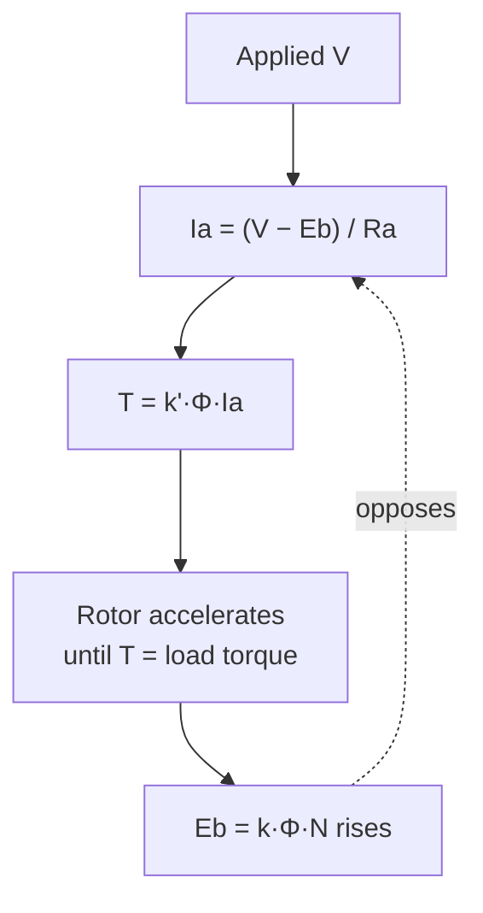

---
tags:
  - EE1100
  - week12
  - machines
up: "[[EE1100 MOC]]"
prev: "[[11 Three Phase Induction Machines]]"
---

# Week 12 — DC Machines

← prev: [[11 Three Phase Induction Machines|Week 11]] · up: [[EE1100 MOC|MOC]]

Playlist: lectures covering DC machines in [Fundamentals of Electrical Engineering](https://www.youtube.com/playlist?list=PLbRMhDVUMngfdEXVcdf_ijj2Eub-UHs_y).

## Overview
The [[Concepts#Back EMF|back EMF]] concept (definition and feedback-loop diagram there) is the key to everything about DC motor behavior this week — it's the *only* thing standing between the applied voltage and a short-circuit-level current.

## Construction
- **Armature:** the rotating winding where EMF is generated / torque is produced.
- **Field:** stationary winding (or permanent magnet) producing the main flux Φ.
- **Commutator + brushes:** mechanically reverses the armature winding connections every half-rotation, so that despite the AC nature of the induced EMF in each individual armature coil, the *external* terminals see a roughly steady DC — this is the essential difference from the induction machine of [[11 Three Phase Induction Machines|Week 11]], which needs no such mechanical rectification because its rotor never needs an external DC connection at all.

## Generator EMF equation
**E = (P·Φ·N·Z) / (60·A)**

where P = number of poles, Φ = flux per pole, N = speed (rpm), Z = total armature conductors, A = number of parallel paths in the armature winding. In practice this is usually written E = k·Φ·N with all the fixed machine constants absorbed into k.

## Motor equation and torque
**V = E_b + I_a·R_a**, with E_b = k·Φ·N (the same constant k as above — generator and motor action are the same physical law run in reverse). Rearranged for speed:

**N = (V − I_a·R_a) / (kΦ)**

Torque: **T = k'·Φ·I_a** (k' another machine constant related to k).

## Types and characteristics
- **Shunt:** field winding in parallel with armature — field current roughly constant regardless of load, so speed stays nearly constant across load changes ("constant speed" machine). Used where speed regulation matters.
- **Series:** field winding in series with armature — field current *is* the armature/load current, so flux rises with load, and speed must fall sharply to keep E_b in balance (high starting torque, dangerous at no load — speed can rise unboundedly). Used for traction/starting-torque applications (cranes, trains).
- **Compound:** both a shunt and a series field, combined either cumulatively (fields add, blending the two characteristics) or differentially (fields oppose, rarely used).

## Speed control methods
Directly readable off N = (V − I_aR_a)/(kΦ):
- **Armature voltage control:** vary V (via a series rheostat, or electronically) — used below rated speed.
- **Field control:** vary Φ (via a rheostat in the field circuit) — weakening the field *raises* speed (note the inverse relationship), used above rated speed but limited by commutation/torque constraints (T = k'ΦI_a falls if Φ falls faster than I_a can rise).
- **Armature resistance control:** insert resistance in series with R_a — simple but wastes power as heat, used mainly historically or for starting.

## Related
- [[Concepts|Concepts glossary]]
- [[11 Three Phase Induction Machines|Week 11 — Three Phase Induction Machines]]
- [[EE1100 MOC|Back to MOC]]

## Cross-domain links

- [[Cross-Domain Synthesis/Gears, Transformers and Reflected Impedance|Gears, Transformers and Reflected Impedance]] — E_b·I_a = T·ω makes the motor a gyrator between the electrical and mechanical sides; k′ = 60k/2π when N is in rpm.
