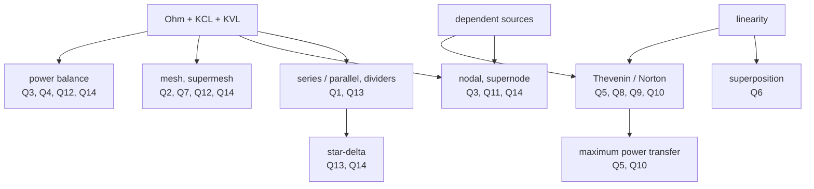

# EE1100 Tutorial 1: Circuit Laws and Theorems

← up: [[EE1100 MOC|MOC]] · [[Problems - MOC|all tutorials]] · Source: [[Tutorial 1_Circuit Laws and Theorems.pdf]] · Next: [[Tutorial 2 - Transient Analysis of DC Circuits|Tutorial 2]]

Theory: [[Theory - Circuit Laws and Network Theorems]] (read this first) · weeks [[01 Basic Concepts and Basic Laws]], [[02 Methods of Circuit Analysis]], [[03 DC Network Theorems]] · glossary [[Concepts]]

> [!abstract] How this folder is organised
> One note per question (`T1-Q1` … `T1-Q14`), each with the circuit redrawn, the principle and *why* it applies, the full solution, a check and a trap. Every number is recomputed in `../../Tools/ee_t1_t4_t8.py`; `python ee_figs_t1.py` redraws the figures.

## Questions

| Q | Topic | Answer | Note |
|---|---|---|---|
| 1 | R-2R ladder: node voltages, $R_{in}$, currents | $V_R,\tfrac{V_R}2,\tfrac{V_R}4,\tfrac{V_R}8$; $R_{in}=2R$ | [[T1-Q1 - R-2R Ladder]] |
| 2 | KVL with equal batteries | only the $12\ \Omega$ carries current, 0.833 A | [[T1-Q2 - KVL with Three Batteries]] |
| 3 | two current sources, node pair | $V_0=-12$ V (sheet −6), $I_1=-2,\ I_2=-4$ A, 24 W | [[T1-Q3 - Current Sources and Power]] |
| 4 | dependent current source, power in each element | (a) 24, 24, 48, 48 W (b) 120, 24, −48, 48 W | [[T1-Q4 - Dependent Source and Power Balance]] |
| 5 | max power with a dependent source | $R_L=16\ \Omega$, $V_{R_L}=5$ V | [[T1-Q5 - Maximum Power with a Dependent Source]] |
| 6 | superposition | $V_x=10.33$ V (sheet 10.4) | [[T1-Q6 - Superposition]] |
| 7 | meshes with current sources | $I=10,2,-4$ A; $V_1=8$, $V_2=3$ V | [[T1-Q7 - Mesh Analysis with Current Sources]] |
| 8 | Thevenin equivalent | $V_{th}=63$ V, $R_{th}=4.67\ \Omega$ | [[T1-Q8 - Thevenin Equivalent]] |
| 9 | Norton equivalent | $I_N=4.67$ A, $R_N=15\ \Omega$ | [[T1-Q9 - Norton Equivalent]] |
| 10 | maximum power, half-power loads | 42.19 W; $1\ \Omega$ (56.25 W); 5.83 Ω and 0.172 Ω | [[T1-Q10 - Maximum Power Transfer and Half Power]] |
| 11 | supernodes | $v_4=63.06$ V; $I_{ac}=8.063$ A … | [[T1-Q11 - Supernodes]] |
| 12 | mesh analysis, supermesh, power balance | 239.38 W supplied = consumed | [[T1-Q12 - Mesh Analysis and Power Balance]] |
| 13 | resistance between A and B (Y–Δ) | $R_{AB}=2.50\ \Omega$ | [[T1-Q13 - Star-Delta Reduction]] |
| 14 | bridge: Y–Δ, mesh, nodal, power balance | $I_s=11.978$ A, 2156 W | [[T1-Q14 - Bridge Network Three Ways]] |

## Concept map

## Pattern recognition

| You see | Do |
|---|---|
| repeated cells of the same two resistors | reduce from the far end, or notice each node halves |
| a source of fixed current in parallel with resistors | one node-pair KCL (Q3) |
| a voltage source joining two non-reference nodes | **supernode** (Q11) |
| a current source shared by two meshes | **supermesh** (Q12) |
| a current source on the outside edge of a mesh | that mesh current is the source current (Q7, Q12) |
| "find the equivalent seen by the load" | remove the load, $V_{oc}$ then $R_{th}$ (Q8–Q10) |
| a dependent source inside the Thevenin network | test source or $V_{oc}/i_{sc}$, never switch it off (Q5) |
| "power delivered / absorbed by each element" | keep signs; check the balance (Q4, Q12, Q14) |
| a bridge with no series/parallel pair | Y–Δ, or nodal with two unknowns (Q13, Q14) |

## Exam-pattern hints
Questions like Q8–Q10 are really one skill: **reduce to $(V_{th},R_{th})$ once**, then everything else (power, voltage, matching, half power) is one line. The supernode (Q11) and supermesh (Q12) questions are marked down mostly for **sign errors**: write the constraint equation first. Always finish with the power-balance check when the question mentions power.

## Sheet answers that differ from a direct calculation
- **Q3:** the printed $V_0=-6$ V contradicts the printed $I_1=-2$ A and $P_{6\Omega}=24$ W (they need $V_0=-12$ V). Taken as a misprint.
- **Q6:** printed $10.4$ V; exact $10.33$ V (0.7 % off).
- **Q13:** printed $2.5\ \Omega$; exact $2.503\ \Omega$.
- All other printed answers match to the digits quoted (see the 175 agreeing comparisons in `ee_t1_t4_t8.py`).

## Related
- [[Concepts|Concepts glossary]]
- [[Voltage Divider Rule]] · [[Series-Parallel Resistance Reduction]]
- Next: [[Tutorial 2 - Transient Analysis of DC Circuits]] (adds L and C to the same network methods)
