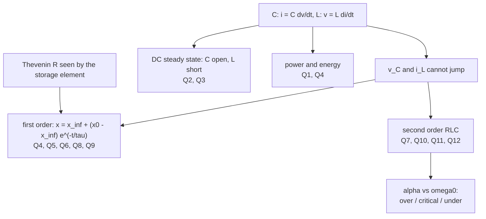

# EE1100 Tutorial 2: Transient Analysis of DC Circuits

← up: [[EE1100 MOC|MOC]] · [[Problems - MOC|all tutorials]] · builds on: [[Tutorial 1 - Circuit Laws and Theorems|Tutorial 1]] · Source: [[Tutorial 2 on Transient and steady state analysis of DC circuits.pdf]] · Next: [[Tutorial 3 - AC Circuit Analysis|Tutorial 3]]

Theory: [[Theory - Transients in RL, RC and RLC Circuits]] (read this first) · week [[04 Capacitors, Inductors and First Order Circuits]] · glossary [[Concepts#Capacitors and Inductors|Capacitors and Inductors]] · deeper RLC notes: [[RLC Circuits - Responses]], [[DC Step Response of RLC Circuits]]

> [!abstract] How this folder is organised
> One note per question (`T2-Q1` … `T2-Q12`) with the circuit redrawn, response plots, the full solution and a check. Every number is recomputed in `../../Tools/ee_t1_t4_t8.py`; `python ee_figs_t2.py` redraws the figures. The printed sheet answers disagree with a direct calculation in a few places; they are flagged in the notes.

## Questions

| Q | Topic | Answer | Note |
|---|---|---|---|
| 1 | $v$, $i$, $p$ waveforms of $C$ and $L$ | $v_C$ peaks at 10 V, $i_L$ at 2 mA; energy returned | [[T2-Q1 - Capacitor and Inductor Waveforms]] |
| 2 | DC steady state, energy → $C$ | $I_{in}=0.5$ A, $V_1=10$ V, $V_2=5$ V, $C=60\ \mu$F | [[T2-Q2 - DC Steady State with L and C]] |
| 3 | DC steady state, current source | $V_{in}=20$ V, $E_L=10$ mJ, $E_C=5$ mJ | [[T2-Q3 - DC Steady State with a Current Source]] |
| 4 | source-free RL: $L,R,\tau$, energy | $0.08$ H, $4\ \Omega$, 20 ms, 36 J, 6.93 ms | [[T2-Q4 - Source-Free RL Decay]] |
| 5 | RL, switch opens | $v=-4e^{-20t}$ V | [[T2-Q5 - RL Circuit with a Switch Opening]] |
| 6 | RC, two-position switch | $v_C=40e^{-10t}$ V, $i_C=-4e^{-10t}$ mA | [[T2-Q6 - RC Circuit with a Two-Position Switch]] |
| 7 | capacitor discharged through a coil | $i=0.01601e^{-50t}\sin312.25t$ A; $R_{ext}=1064.9\ \Omega$ | [[T2-Q7 - Discharging a Capacitor through a Coil]] |
| 8 | switch opens (RC network) | 100/38.4, 100/25.6, 59.45/**15.2** V | [[T2-Q8 - Switch Opens in an RC Network]] |
| 9 | switch closes (same network) | 0/0, 0/38.4, **78.99**/38.4 V | [[T2-Q9 - Switch Closes in an RC Network]] |
| 10 | series RLC, damping ranges | $R_c=89.44\ \Omega$, $\zeta=0.559$; $i=2.70e^{-250t}\sin371t$ | [[T2-Q10 - Series RLC Step Response]] |
| 11 | integro-differential equation, initial conditions | $i=28.87e^{-9t}\sin(12t+20.27^\circ)$ A | [[T2-Q11 - Second-Order Equation with Initial Conditions]] |
| 12 | parallel RLC, current step | $v=37.80e^{-12500t}\sin33072t$ V | [[T2-Q12 - Parallel RLC Step Response]] |

## Concept map

## Pattern recognition

| You see | Do |
|---|---|
| "after a long time", "steady state" | $C\to$ open, $L\to$ short; resistive circuit (Q2, Q3) |
| a switch operates, one $L$ or $C$ | five-step recipe: $x(0^-)$, continuity, $x_\infty$, $\tau=R_{th}C$ or $L/R_{th}$ (Q5, Q6, Q8, Q9) |
| "time for 50 % of the energy" | energy $\propto e^{-2t/\tau}$, so $t=\tfrac\tau2\ln2$ (Q4) |
| $v_o$ or $i_C$ at $0^+$ | they **jump**; recompute from the new circuit with $v_C(0^+)$ as a source (Q8, Q9) |
| $L$ and $C$ both present | compare $R$ with $R_c=2\sqrt{L/C}$ (series) (Q7, Q10) |
| an integro-differential equation | read off $L$, $R$, $1/C$, and the integral's initial value as $v_C(0)$ (Q11) |
| a current source into R∥L∥C | parallel: $\alpha=1/2RC$ (Q12) |

## Exam-pattern hints
Switching problems give marks for (i) the right initial condition (only $v_C$, $i_L$ carry over), (ii) the right $\tau$ from the **new** circuit, and (iii) sign: say whether a quantity is discharging. Second-order answers are checked for the amplitude factor $1/(\omega_dL)$ or $1/(\omega_dC)$ and for classifying damping by $R$ versus $R_c$. Q1 is a graph-reading question: label every corner value.

## Sheet answers that differ from a direct calculation
- **Q8:** printed $v_o(1.3\ \text{ms})=25.6$ V; it must decay with $\tau=2.5$ ms: **15.2 V**.
- **Q9:** printed $v_C(1.3\ \text{ms})=70.0$ V; $\tau=0.833$ ms gives **78.99 V**.
- **Q7:** the sheet's *figure* (10 µF, 100 Ω, 1 H) and its *text* (5 µF, 200 Ω, 2 H) differ; the printed answer matches the text and is the one solved.
- **Q12:** printed $\omega_d=33119.1$ and 37.74 V use $\zeta$ rounded to 0.35; exact $33072$ and 37.80 V. (The sheet also says "three-phase", which is a slip: the circuit is a single parallel RLC.)
- All other printed answers match.

## Related
- [[Concepts|Concepts glossary]]
- [[AC Transients|AC Transients]]: what changes when the source is AC (bridges to [[Tutorial 3 - AC Circuit Analysis|Tutorial 3]])
- [[08 Resonance and Magnetically Coupled Circuits|Week 8]]: the AC steady-state cousin of second-order damping
