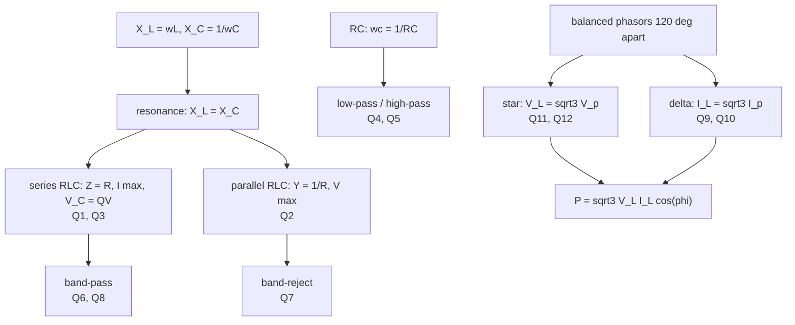

# EE1100 Tutorial 4: Resonance, Filters and Three-Phase Circuits

← up: [[EE1100 MOC|MOC]] · [[Problems - MOC|all tutorials]] · Previous: [[Tutorial 3 - AC Circuit Analysis|Tutorial 3]] · Source: [[Tutorial 4  on Resonance and  Three phase Circuits.pdf]] · Next: [[Tutorial 5 - Diode Circuits and Applications|Tutorial 5]]

Theory (read first): [[Theory - Resonance and Passive Filters]] (Q1–Q8) · [[Theory - Three-Phase Circuits]] (Q9–Q12) · weeks [[08 Resonance and Magnetically Coupled Circuits]], [[09 Three Phase Circuits and Power Measurement]] · deeper notes [[Frequency Response and Resonance Curves]], [[Filter Theory]], [[Series vs Parallel RLC - Key Distinctions]]

> [!abstract] How this folder is organised
> One note per question (`T4-Q1` … `T4-Q12`), each with the principle, the full solution, a check and a trap; response curves, filter Bode plots and phasor diagrams are in `assets/`. Every number is recomputed in `../../Tools/ee_t1_t4_t8.py`; `python ee_figs_t3_t4.py` redraws the figures. These notes replace the earlier unnumbered `Q1`–`Q12` notes (kept as aliases so old links still resolve); the old Q12 note had misread the impedance as $46\angle0^\circ$, the correct value is $4\angle60^\circ\ \Omega$.

## Questions

| Q | Topic | Answer | Note |
|---|---|---|---|
| 1 | series RLC: $\omega_0$, $Q$, $BW$, band edges, $V_C$ | 1000 rad/s, 1, 1000, 618/1618 rad/s, 1 V | [[T4-Q1 - Series RLC Resonance]] |
| 2 | parallel RLC (current source) | $Q=0.01$, $BW=10^5$, 10 V, 0.00707 A rms | [[T4-Q2 - Parallel RLC Resonance]] |
| 3 | series RLC from $Q$, $BW$, $R$ | 20 000 rad/s; 0.25 H, 0.01 µF | [[T4-Q3 - Series RLC from Q and Bandwidth]] |
| 4 | RC low-pass design | $R=100\ \Omega$ | [[T4-Q4 - RC Low-Pass Filter Design]] |
| 5 | RC high-pass design | $C=7.96$ nF | [[T4-Q5 - RC High-Pass Filter Design]] |
| 6 | series RLC band-pass transfer function | 1000, 618, 1618, 1000 rad/s | [[T4-Q6 - Series RLC Band-Pass Filter]] |
| 7 | band-reject filter at 400 Hz | $L=791.6\ \mu$H | [[T4-Q7 - Band-Reject Filter Design]] |
| 8 | FM band-pass, $-20$ dB neighbours | $Q=251.2$, 39.98 µH, 0.0634 pF | [[T4-Q8 - FM Receiver Band-Pass Design]] |
| 9 | balanced delta: currents, $P$, $R$ | 17.32 A; 5715.8 W, 3300 VAr; 19.05 Ω | [[T4-Q9 - Balanced Delta Load]] |
| 10 | delta load power; sum of line currents | $I_p=8.8$ A, $I_L=15.24$ A; 1161.6 W/phase; 0 | [[T4-Q10 - Delta Load Power]] |
| 11 | star load impedance from $P$, $I_L$ | $6\pm j10.39\ \Omega$ | [[T4-Q11 - Star Load Impedance from Power]] |
| 12 | star load: currents and $\bar V_{ac}$ | $5\angle-30^\circ$ A; $34.64\angle0^\circ$ V | [[T4-Q12 - Star Load Voltage and Current]] |

## Concept map

## Pattern recognition

| You see | Do |
|---|---|
| "resonant frequency, $Q$, bandwidth, band edges" | $\omega_0=1/\sqrt{LC}$, $Q$, $BW=\omega_0/Q$, exact edges if $Q\lesssim5$ (Q1, Q2) |
| "maximum voltage across $C$" | $V_C=QV$ at resonance (Q1, Q3) |
| a **current** source on R‖L‖C | parallel formulas: $Q=R/\omega_0L$, $BW=1/RC$ (Q2) |
| "design the filter, cut-off $f_c$, one component given" | $f_c=1/2\pi RC$ (Q4, Q5) or $\omega_0^2=1/LC$ (Q7) |
| "attenuate $f_1$ by $A$ dB" | $Q|x-1/x|=\sqrt{10^{A/10}-1}$ (Q8) |
| "line current/voltage" in a delta or star | the $\sqrt3$ and $30^\circ$ rules (Q9–Q12) |
| "total power, line current, line voltage" | $P=\sqrt3V_LI_L\cos\phi$, then $R=P/3I_p^2$ (Q11) |

## Exam-pattern hints
Resonance questions are marked on **exact versus approximate** band edges, **peak versus rms**, and on not mixing the series and parallel formulas. Three-phase questions are marked on the **line/phase** bookkeeping (which quantity is $\sqrt3$ larger in star and in delta) and on using the load's impedance angle in $\cos\phi$.

## Sheet answers that differ from a direct calculation
- **Q6:** upper half-power frequency printed $1818$ rad/s; it must be $\omega_1+BW=1618$ rad/s.
- **Q9:** printed $Q=2857.8$ VAr; $S\sin30^\circ=3300$ VAr (the printed value is $P/2$).
- **Q10:** the three phasors printed as "line currents" are the **phase** currents (8.8 A); the line currents are 15.24 A. The supply voltage (220 V) is implied, not stated.
- **Q2(f):** $0.00707$ A is the rms value of the 0.01 A peak capacitor current.
- **Q5, Q11:** rounding only ($7.95$ vs $7.96$ nF; $10.39$ vs $10.40\ \Omega$).

## Related
- [[Concepts|Concepts glossary]] · [[Revolving Magnetic Field and Synchronous Speed]] (the same $120^\circ$ phasor geometry makes the revolving field of Tutorial 8)
- Next: [[Tutorial 5 - Diode Circuits and Applications]]
