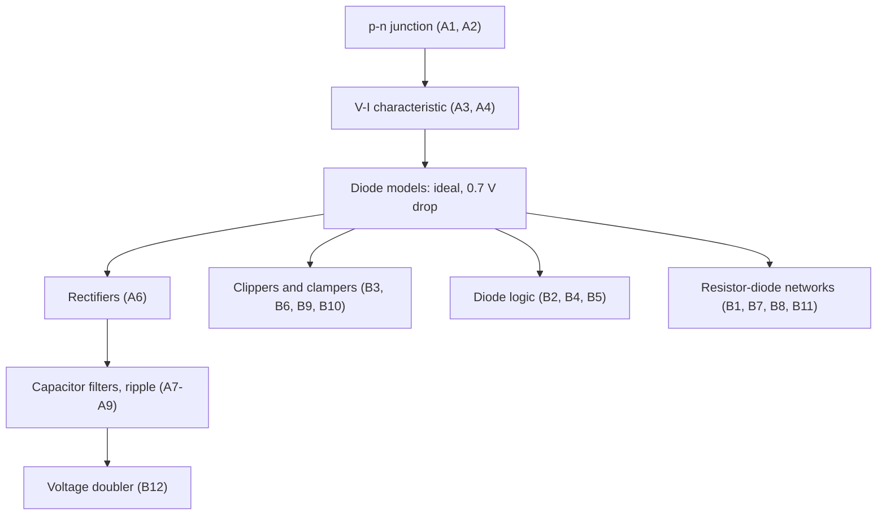

# EE1100 Tutorial 5 — Diode Circuits and Applications

Course index: [[EE1100 MOC|EE1100 MOC]] · Source: [[Tutorial 5 on Diode Circuits and Applications.pdf]] · Previous: [[Q1 - Series RLC Resonance|Tutorial 4]]

Method and models used throughout: [[Theory - Diode Models and Circuit Analysis]]

> [!abstract] How this folder is organised
> One note per question. Each note has the **theory** needed, the **solution**, and (where useful) figures. Waveforms, switching angles and averages were checked with a small piecewise-linear circuit simulator, which reproduces every answer printed on the sheet.

## Part A – Theory and rectifiers

| Q | Topic | Note |
|---|---|---|
| A-Q1 | How the p-n junction forms | [[A-Q1 - Formation of the p-n Junction]] |
| A-Q2 | Poisson's equation, $E(x)$, $V(x)$ | [[A-Q2 - Poisson Equation, Field and Potential]] |
| A-Q3 | V-I characteristic, diode equation | [[A-Q3 - V-I Characteristics of a p-n Diode]] |
| A-Q4 | Bias, cut-in voltage, $I_s$, resistances | [[A-Q4 - Bias, Cut-in Voltage, Saturation Current and Resistance]] |
| A-Q5 | Applications of diodes | [[A-Q5 - Applications of Diodes]] |
| A-Q6 | Rectifier circuits and waveforms | [[A-Q6 - Rectifier Circuits and Waveforms]] |
| A-Q7 | Ripple, RF, FF | [[A-Q7 - Ripple, Ripple Factor and Form Factor]] |
| A-Q8 | Capacitor for 10 % ripple (half-wave) | [[A-Q8 - Half-Wave Rectifier Filter Capacitor]] |
| A-Q9 | Capacitor for 5 % ripple (full-wave) | [[A-Q9 - Full-Wave Rectifier Filter Capacitor]] |

## Part B – Circuit problems

| Q | Circuit | Answer | Note |
|---|---|---|---|
| B-Q1 | two diodes, $R_1$, $R_2$ | $I_1=0.212$ mA, $I_2=3.321$ mA, $I_{D2}=3.109$ mA | [[B-Q1 - Two-Diode Circuit with 0.7 V Drop]] |
| B-Q2 | three-diode OR | $V_0=9.3$ V (both cases) | [[B-Q2 - Diode OR Gate]] |
| B-Q3 | battery in series with diode | $V_0=V_i+5$ for $V_i>-5$, else 0 | [[B-Q3 - Series Battery Rectifier]] |
| B-Q4 | three-diode AND | 0.7 V / 10 V → **AND gate** | [[B-Q4 - Diode AND Gate]] |
| B-Q5 | two diodes to −5 V and 0 V | $V_0=-5$ V | [[B-Q5 - Ideal Diodes with Negative Reference]] |
| B-Q6 | series C, shunt diode | positive clamper, $V_0\in[0,40]$ V | [[B-Q6 - Diode Clamper]] |
| B-Q7 | diode/$R_1$ in parallel with diode | $i_L=0.01V_S$ (+), $0.005V_S$ (−) | [[B-Q7 - Asymmetric Diode Resistor Network]] |
| B-Q8 | half-wave with $R_1$ | $V_0=5\sin100t$ (+), 0 (−) | [[B-Q8 - Half-Wave Rectifier with Series Resistor]] |
| B-Q9 | diode, $R$ and battery $E$ | $v_0=V_m\sin\omega t$ or $E$ | [[B-Q9 - Battery Charging Rectifier Circuit]] |
| B-Q10 | two-level clipper | ±: $+6$ V / $-4$ V; 36.87°, 143.13°, 203.58°, 336.42° | [[B-Q10 - Two-Level Clipper]] |
| B-Q11 | full-wave with 50 V battery | $I_{avg}=0.0214$ A | [[B-Q11 - Full-Wave Rectifier with Battery]] |
| B-Q12 | diodes and capacitors | $V_R=2V_m$ | [[B-Q12 - Voltage Doubler]] |

## Quick map of the ideas

## Answer sheet (all questions)

| Q | Result |
|---|---|
| A-Q7 | HW: $V_{dc}=V_m/\pi$, FF $=\pi/2=1.571$, RF $=1.211$ · FW: $V_{dc}=2V_m/\pi$, FF $=1.111$, RF $=0.483$ · filtered: RF $\approx\dfrac1{2\sqrt3fRC}$ (HW), $\dfrac1{4\sqrt3fRC}$ (FW), FF → 1 |
| A-Q8 | $C=\dfrac1{fR\,r}=200\ \mu$F (formula); 176 µF from the exact exponential discharge |
| A-Q9 | $C=\dfrac1{2fR\,r}=200\ \mu$F (formula); 175 µF exact |
| B-Q10(e) | clip levels $+6.7$ V and $-4.7$ V; D₂ on/off at 42.07°, 137.93°; D₁ on/off at 208.03°, 331.97° |
