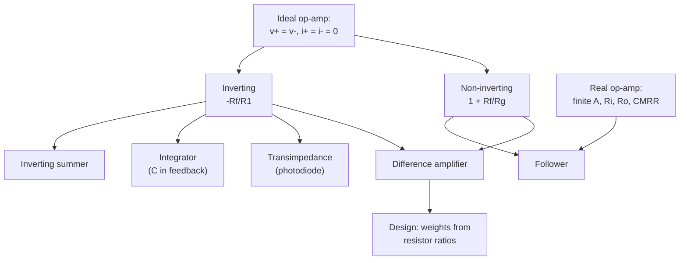

# EE1100 Tutorial 6 — Operational Amplifiers

Course index: [[EE1100 MOC|EE1100 MOC]] · Source: [[Tutorial 6 on OP-AMP.pdf]] · Previous: [[Tutorial 5 on Diode Circuits and Applications|Tutorial 5]] · Next: [[Tutorial 7 on Transformer|Tutorial 7]]

Method and models used throughout: [[Theory - Operational Amplifiers]]. Lectures: [[Lecture 32 Introduction to Operational Amplifiers.pdf]], [[Lecture 33 OP-AMP Circuits and Applications.pdf]], [[Lecture 34 OP-AMP Circuits and Applications (Contd…).pdf]].

> [!abstract] How this folder is organised
> One note per question, each with the circuit (redrawn), the rule that applies and why, the solution, a check and the usual trap. Every number is recomputed in `Tools/ee_t6_t7.py`.

## Questions

| Q | Circuit | Answer | Note |
|---|---|---|---|
| 1 | gain from waveforms, linearity, design | gain 2000, linear; non-inverting, $R_g=1$ kΩ, $R_f\approx2$ MΩ | [[T6-Q1 - Amplifier Gain and Design]] |
| 2 | inverting, 15 kΩ / 1.2 MΩ | $-80$; $-80$ mV | [[T6-Q2 - Inverting Amplifier]] |
| 3 | non-inverting, 15 kΩ / 6.8 kΩ | $3.206$; $-1.603$ V | [[T6-Q3 - Non-inverting Amplifier]] |
| 4 | inverting summer of three inputs | $-3.9$ V | [[T6-Q4 - Inverting Summer]] |
| 5 | difference amplifier, 8 k / 120 k | $15(V_2-V_1)$: $-60,\,90,\,-150,\,225$ mV | [[T6-Q5 - Difference Amplifier]] |
| 6 | integrator, 200 kΩ and 2.5 µF | $-0.15$ V at 100 ms | [[T6-Q6 - Integrator]] |
| 7 | follower with finite $A$, $R_i$, $R_o$ | $V_s=10.0001$ V, ratio $0.99999$ | [[T6-Q7 - Follower with Finite Gain]] |
| 8 | photodiode, two stages | 60 µA, **6 mW** (sheet says "6 W": unit slip) | [[T6-Q8 - Photodiode Amplifier]] |
| 9 | one-source circuit with both inputs driven | $V_0=-2$ V, $i_0=-1$ mA | [[T6-Q9 - Differential Circuit Analysis]] |
| 10 | condition for $v_0=v_2-v_1$ | $R_2/R_1=R_4/R_3=1$ | [[T6-Q10 - Difference Amplifier Condition]] |
| 11 | design $z=2x-3y$ | one stage: $R_1=10$ k, $R_2=30$ k, $R_3=R_4=10$ k | [[T6-Q11 - Design for z = 2x - 3y]] |
| 12 | four-pad weighing summer | non-inverting summer, $R_g=10$ k, $R_f=30$ k | [[T6-Q12 - Weighing Summer]] |

## Concept map

## Pattern recognition
| You see | Do |
|---|---|
| input on $-$, $+$ grounded | inverting: $-R_f/R_1$ |
| input on $+$, divider to $-$ | non-inverting: $1+R_f/R_g$ |
| several resistors into the $-$ node | inverting summer: add $V_k/R_k$ |
| two inputs, four resistors | difference amplifier; check $R_2/R_1=R_4/R_3$ |
| capacitor in the feedback | integrator: ramp, $-\frac{1}{RC}\int V_i\,dt$ |
| current source into the $-$ node | transimpedance: $V=-R_fi$ |
| "design a circuit for $z=ax+by$" | pick the stage (weights of $\pm$ signs), then resistor ratios |
| finite $A$, $R_i$, $R_o$ given | use the model, not the ideal rules |

## Exam-pattern hints
Questions are either **analysis** (apply the rules, KCL at $v_-$) or **design** (pick a topology that produces the sign and the weights, then resistor ratios; use standard values and 1 kΩ–1 MΩ). Always check polarity (inverting stages flip it) and units (Q8).
