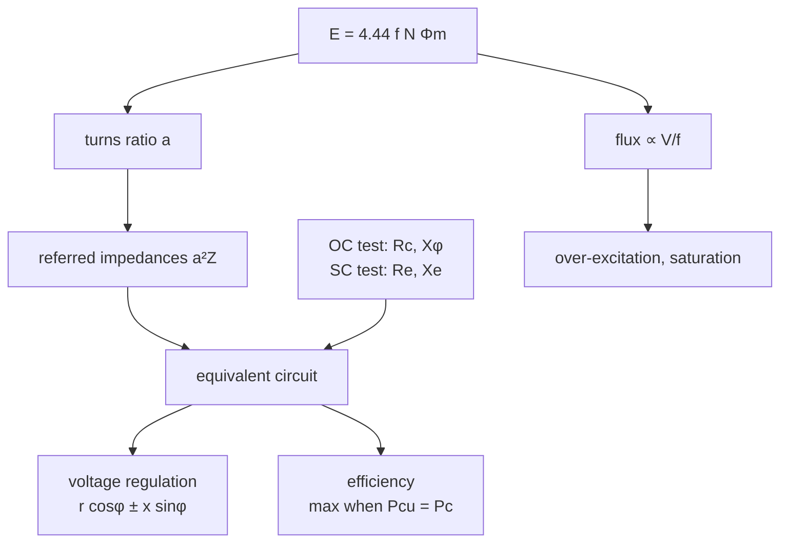

# EE1100 Tutorial 7 — Transformers

Course index: [[EE1100 MOC|EE1100 MOC]] · Source: [[Tutorial 7 on Transformer.pdf]] · Previous: [[Tutorial 6 on OP-AMP|Tutorial 6]]

Theory: [[10 Single Phase Transformers]] (EMF equation, equivalent circuit, OC/SC tests) · [[Transformer Voltage Regulation and Efficiency]] (Lecture 39) · lectures [[Lecture 35 Transformers Introduction.pdf]] to [[Lecture 39 Transformer- Voltage Regulation and Efficiency.pdf]] · animation: [Parallel flux lines](transformer-current-flux-animation.html).

> [!abstract] How this folder is organised
> One note per question, with the circuit or plot where it helps. All numbers are recomputed in `../Tools/ee_t6_t7.py` (`python ee_t6_t7.py --figs` redraws the figures).

## Questions

| Q | Topic | Answer | Note |
|---|---|---|---|
| 1 | EMF per turn, turns, core area | $N_1=189$, $N_2=18$, $A=393$ cm² | [[T7-Q1 - Turns and Core Area]] |
| 2 | exciting current, load current | $I_c=0.164$, $I_\phi=0.577$ A; $I_1=6.49$ A, pf 0.765 lag | [[T7-Q2 - Exciting Current and Primary Current]] |
| 3 | other voltage and frequency | 120 V/40 Hz (over-flux), 60 V/25 Hz, 60 V/50 Hz, overrated, DC burns | [[T7-Q3 - Voltage and Frequency Other Than Rated]] |
| 4 | referred impedances, SC test | $0.024, 0.06, 3, 7, 5.4, 13\ \Omega$; 1215 W; 225 V, 1382 W | [[T7-Q4 - Referred Impedances and Short-Circuit Voltage]] |
| 5 | load voltage | 241.7 V; 241.5 V | [[T7-Q5 - Secondary Voltage Under Load]] |
| 6 | equivalent circuit on the LT side | 222 V; 5.10 A, 0.794 lag; 9500 W, 93.8 % | [[T7-Q6 - Equivalent Circuit on the LT Side]] |
| 7 | OC and SC test parameters | $R_c=595.2\ \Omega$, $X_\phi=187.2\ \Omega$, $R_e=5\ \Omega$, $X_e=12\ \Omega$ (HV) | [[T7-Q7 - OC and SC Test Parameters]] |
| 8 | regulation, lag and lead | 10.59 %, 447.0 V; $-2.66\ \%$, 513.3 V | [[T7-Q8 - Voltage Regulation at Full Load]] |
| 9 | efficiency and regulation from tests | 97.32, 98.28, 98.40, 98.28 %; 7.906 kVA, 98.44 %; 2.50 %, $-1.22\ \%$ | [[T7-Q9 - Efficiency and Regulation from Tests]] |
| 10 | regulation from the maximum-efficiency condition | 3.75 % | [[T7-Q10 - Maximum Efficiency and Regulation]] |

## Concept map

## Pattern recognition
| You see | Do |
|---|---|
| emf per turn, flux density | $E=4.44fN\Phi_m$, $A=\Phi_m/B_m$ |
| another voltage or frequency | flux $\propto V/f$; output voltage $=V/a$ |
| series parameters on both sides | refer to one side ($a^2$), add |
| OC and SC readings | OC gives $R_c$, $X_\phi$ at rated V; SC gives $R_e$, $X_e$ at test current: **scale copper loss to rated current** |
| "find regulation" | $r_{pu}\cos\phi\pm x_{pu}\sin\phi$; check lag vs lead sign |
| "load for maximum efficiency" | $x=\sqrt{P_c/P_{cu,FL}}$ |
| given $\eta_{max}$ and impedance, no voltage | per unit, $r_e$ from copper loss, $x_e=\sqrt{z_e^2-r_e^2}$ |

## Exam-pattern hints
Test-data questions (Q7, Q9) nearly always hide one trap: the SC test is **not** at rated current, or the OC test is on the LV side. Regulation answers depend on whether the exact or approximate formula is used: say which. Q8 and Q9(c) show why a leading load gives negative regulation.

## Sheet answers that differ from a direct calculation
- Q1 uses $12.2$ V/turn (the 189:18 turns pair), not exactly 13 V.
- Q4(d): $1215$ W against the printed $1216$ W (rounding).
- Q8, Q9(c): the printed values use the approximate regulation formula; exact values are given in the notes.
- Q10: $3.75\ \%$ is correct; the Lecture 39 handwritten solution (3.82 %) takes $x_e=0.05$ pu instead of $\sqrt{0.05^2-r_e^2}$.
