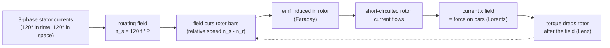

# T8-Q1: Operating Principle of the Induction Machine

Hub: [[Tutorial 8 - Induction Machines]] · Theory: [[Theory - Three-Phase Induction Machines]] · Next: [[T8-Q2 - The Revolving Field]]

> [!question] Explain the operating principle of the induction machine.

**Tests:** electromagnetic induction and the Lorentz force in a machine, why the rotor must run slower than the field, motor versus generator operation.

## Principle and why it applies
An induction machine converts electrical to mechanical energy by **induction**, with no electrical connection to the rotor. Three physical laws do all the work:

1. **A three-phase stator winding produces a rotating magnetic field** (Q2), speed $n_s=120f/P$.
2. **Faraday's law of induction.** The rotating field cuts the rotor conductors, so an emf $e=Blv_{rel}$ (equivalently $e=-d\Phi/dt$) is induced in them. The rotor is short-circuited (cage bars joined by end rings, or a wound rotor closed through slip rings), so the emf drives **rotor currents**.
3. **Lorentz force.** A conductor of length $l$ carrying current $i$ in a field $B$ feels a force $F=Bil$. The sum over all rotor bars is a **torque** on the rotor.

**Lenz's law** fixes the direction: the torque acts to reduce the *relative motion* between rotor and field, i.e. it drags the rotor *in the direction the field rotates*.

## Diagram

## Solution (the argument in words)
1. The stator, fed from the three-phase supply, **magnetises** the machine and sets up the revolving field.
2. At standstill the relative speed between field and rotor is the full $n_s$, so the induced rotor emf and current are **largest**, and a starting torque is produced.
3. The rotor accelerates. As it speeds up the *relative* speed $n_s-n_r$ falls, so the emf, the rotor current and (beyond a point) the torque fall.
4. It settles where the torque equals the load torque, at a speed $n_r$ that is **slightly below** $n_s$. It can never reach $n_s$: at that speed there would be no relative motion, hence no emf, no current and no torque. The fractional difference $s=(n_s-n_r)/n_s$ is the **slip** (Q4); this is why the machine is called *asynchronous*.
5. Increase the load and the rotor slows a little: the slip grows, the rotor current and torque rise to meet the demand. The machine therefore **self-regulates** its torque with a small change of speed, and the stator current rises to supply the power (transformer action: the stator is the primary, the rotor a short-circuited secondary, [[10 Single Phase Transformers]]).
6. If the rotor is driven *above* $n_s$ by a prime mover the slip is negative, the torque reverses and the machine acts as an **induction generator**, returning power to the supply (it still takes its magnetising current from the grid).

## Result
Rotating stator field $\to$ induced rotor emf and current (Faraday) $\to$ force on rotor conductors (Lorentz) $\to$ torque in the direction of the field (Lenz), with the rotor always running at $n_r<n_s$, $s=(n_s-n_r)/n_s$.

## Check
Limiting cases: $s=0\Rightarrow$ torque $0$; $s=1$ (standstill) $\Rightarrow$ starting torque and a large starting current ($5$–$7\times$ rated); $s<0\Rightarrow$ generator. These match the shape of the torque–slip curve of [[T8-Q5 - Torque-Slip Characteristic]].

## Trap / alternative
- "Induction" refers to the **rotor**: the stator is supplied directly and only the rotor current is induced.
- Don't say the rotor "follows" the field at the same speed; that would be a **synchronous** machine, in which the rotor carries DC and locks onto the field.
- The torque exists only because of *relative* motion: the rotor currents and field are stationary relative to each other only when both are described from the stator ([[Induction Motor - Slip, Rotor Circuit and Power Flow]]).

## Concepts used
- Faraday's law, Lorentz force, rotating field, slip ([[Theory - Three-Phase Induction Machines]], [[Induction Machines - Types, Construction and Applications]], [[11 Three Phase Induction Machines]])
