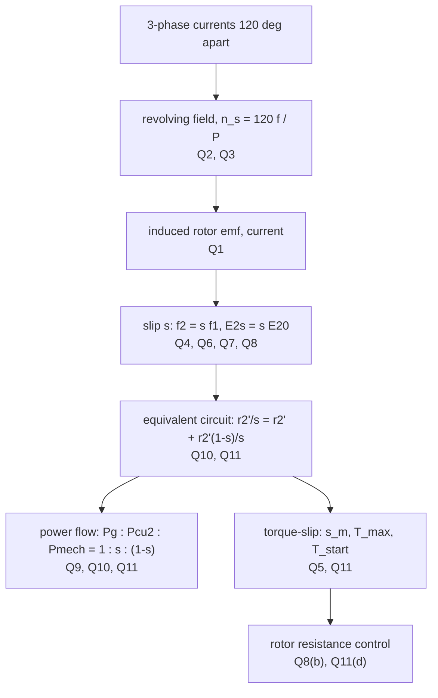

# EE1100 Tutorial 8: Induction Machines

← up: [[EE1100 MOC|MOC]] · [[Problems - MOC|all tutorials]] · Previous: [[Tutorial 7 - Transformers|Tutorial 7]] · Source: [[Tutorial 8 on Induction Machine new.pdf]]

Theory (read first): [[Theory - Three-Phase Induction Machines]] · week [[11 Three Phase Induction Machines]] · lectures [[Lecture 40 Electric Machines.pdf]], [[Lecture 41 Induction Machine-Circuit Representation.pdf]] · concept notes [[Revolving Magnetic Field and Synchronous Speed]], [[Induction Motor - Slip, Rotor Circuit and Power Flow]], [[Induction Machines - Types, Construction and Applications]] · animation: [Three-phase revolving field](revolving%20field%20animation.html)

> [!abstract] How this folder is organised
> One note per question (`T8-Q1` … `T8-Q11`): Q1–Q5 are the theory questions (principle, revolving field proof, synchronous speed, slip, torque–slip curve) answered in full; Q6–Q11 are numerical. Every number is recomputed in `../../Tools/ee_t1_t4_t8.py`; `python ee_figs_t8.py` redraws the figures.

## Questions

| Q | Topic | Answer | Note |
|---|---|---|---|
| 1 | operating principle | induction (Faraday) + Lorentz force + Lenz, $n_r<n_s$ | [[T8-Q1 - Operating Principle of the Induction Machine]] |
| 2 | revolving field and its proof | $F_R=\tfrac32F_m\sin(\omega t-\alpha)$ | [[T8-Q2 - The Revolving Field]] |
| 3 | synchronous speed | $n_s=120f/P$ | [[T8-Q3 - Synchronous Speed]] |
| 4 | slip and typical value | $s=(n_s-n_r)/n_s$; 2–6 % | [[T8-Q4 - Slip]] |
| 5 | torque–slip characteristic | linear near 0, peak at $s_m=r_2'/Z_k$ | [[T8-Q5 - Torque-Slip Characteristic]] |
| 6 | 4 pole, 50 Hz, 6 % slip | 1500, 1410 rpm, 3 Hz | [[T8-Q6 - Speeds and Rotor Frequency]] |
| 7 | 1440 rpm motor: poles, slip, relative speeds | 4 poles, 0.04, 2 Hz; 1500/60/60/1500/0 rpm | [[T8-Q7 - Relative Speeds of the Fields]] |
| 8 | rotor current, pf, torque (start, full load) | 117.67 / 23.53 A; 52.9 N·m; with $R_{ext}$: 135.25 N·m | [[T8-Q8 - Rotor Current, Power Factor and Torque]] |
| 9 | 10 kW delta motor: losses, speed, torques, $\eta$ | 163.3 W, 648 W, 228 W; 1468 rpm; 67.8/65.1 N·m; 89.3 % | [[T8-Q9 - Power Flow and Efficiency of a Delta-Connected Motor]] |
| 10 | 50 hp motor, approximate circuit | 58.2 A, pf 0.897; 200.6 N·m; 48.15 hp; ≈90 % | [[T8-Q10 - Induction Motor with the Approximate Equivalent Circuit]] |
| 11 | 400 V motor, exact circuit | 71.0 A, 274.3 N·m, 90.4 %; $s_m=0.1325$, 469.7 N·m; 243.9 A, 136.3 N·m; 0.5455 Ω | [[T8-Q11 - Equivalent Circuit and Starting of an Induction Motor]] |

## Concept map

## Pattern recognition

| You see | Do |
|---|---|
| "rpm, poles, frequency" | $n_s=120f/P$ with $n_s$ the speed just above the rated rpm (Q6, Q7) |
| "rotor frequency", "rotor induced emf at slip" | $f_2=sf_1$, $E_{2s}=sE_{20}$, $X_{2s}=sX_{20}$ (Q6, Q8) |
| "torque at starting / full load" | $T=3I_2^2R_2/(s\omega_s)$ (Q8) |
| losses and efficiency from a no-load test | core loss $=P_0-P_{cu0}-P_{F\&W}$; $P_g=P_{in}-P_{cu1}-P_{core}$; $s=P_{cu2}/P_g$ (Q9) |
| equivalent-circuit parameters given | $\bar I_1=\bar I_2'+\bar I_0$ (approximate) or exact; $P_g=3I_2'^2r_2'/s$, $T=P_g/\omega_s$ (Q10, Q11) |
| "maximum torque", "slip at maximum torque" | $s_m=r_2'/Z_k$, $T_{max}=3V_{th}^2/[2\omega_s(R_{th}+Z_k)]$ (Q11) |
| "external rotor resistance for max starting torque" | $r_2'+R_{ext}'=Z_k$, then divide by $a^2$ (Q11d) |

## Exam-pattern hints
Theory Q1–Q5 are answered with a **labelled sketch** (the revolving-field proof and the torque–slip curve with its regions). Numerical questions are marked on (i) $n_s$ from the poles, (ii) using $s$ in the rotor quantities, (iii) torque from $P_g/\omega_s$, (iv) the $a^2$ factor when referring the rotor resistance, and (v) the Y/Δ phase-current bookkeeping of Q9.

## Sheet answers that differ from a direct calculation
Everything reproduces to the digits printed, within rounding, with these notes:
- **Q9:** $n_r=1467.9$ rpm (sheet $1468.2$), core loss $163.2$ W (sheet $163.3$), $\eta=89.3\ \%$ (sheet $89.2\ \%$): all rounding.
- **Q10:** efficiency depends on the loss bookkeeping: $90.2\ \%$ from the circuit's input power, $89.7\ \%$ with the stator copper on the full line current (sheet $89.6\ \%$); output $48.15$ hp (sheet $48.25$ hp).
- **Q11:** $71.0$ A, $274.3$ N·m, $469.7$ N·m, $0.5455\ \Omega$ against the sheet's $71.06$, $274.12$, $469.1$, $0.5452$ (≤ 0.2 %); output at $T_{max}$ $63.6$ kW against $63.5$ kW.

## Related
- [[Concepts|Concepts glossary]] · [[Tutorial 4 - Resonance, Filter and Three-Phase Circuits|Tutorial 4]] (the three-phase phasors behind the revolving field) · [[Tutorial 7 - Transformers|Tutorial 7]] (the transformer the equivalent circuit is built on)
- [[Gears, Transformers and Reflected Impedance]]
