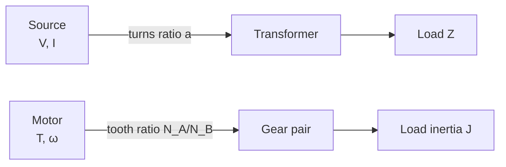

# Gears, Transformers and Reflected Impedance

← up: [[Cross-Domain Synthesis/Cross-Domain Synthesis - MOC|Cross-Domain Synthesis MOC]]

A gear pair and an ideal transformer are the same device: a **lossless two-port that trades one half of a power product for the other at a fixed ratio**. Using the force-voltage dictionary already fixed in [[Cross-Domain Synthesis/The Mechanical-Electrical Analogy (Impedance Analogy)|The Mechanical-Electrical Analogy]] (effort ↔ voltage, flow ↔ current), torque plays the role of voltage and angular speed the role of current.

## The dictionary

| Gear pair (A drives B) | Ideal transformer (1 → 2) |
|---|---|
| torque $T$ (effort) | voltage $V$ |
| angular speed $\omega$ (flow) | current $I$ |
| tooth numbers $N_A,\,N_B$ | turns $N_1,\,N_2$ |
| $\dfrac{\omega_A}{\omega_B}=\dfrac{N_B}{N_A}$ | $\dfrac{I_1}{I_2}=\dfrac{N_2}{N_1}$ |
| $\dfrac{T_B}{T_A}=\dfrac{N_B}{N_A}$ (magnitudes) | $\dfrac{V_2}{V_1}=\dfrac{N_2}{N_1}$ |
| $T_A\omega_A=T_B\omega_B$ (no friction) | $V_1I_1=V_2I_2$ (ideal) |
| external mesh reverses sense | dot convention / winding sense |
| friction, tooth losses | copper and core loss |

Gear side: speed ratio from [[KDoMs/Formula-Bank/Gear Formula Bank|Gear Formula Bank]] §10, $n_A/n_B=N_B/N_A$; the power statement is the epicyclic relation $M_1\omega_1+M_2\omega_2+M_3\omega_3=0$ of §12 specialised to two members. Transformer side: [[10 Single Phase Transformers|Week 10]], $a=N_1/N_2\approx V_1/V_2\approx I_2/I_1$.

**Figure:** the two chains are one diagram. Reading either one tells you the other: the box in the middle never creates power, it only rescales the two factors.

## Reflected impedance = reflected inertia

Move a load across the box and it is scaled by the **square** of the ratio.

- Transformer: a load $Z_L$ on the secondary looks like $Z'=a^{2}Z_L$ from the primary, $a=N_1/N_2$.
- Gears: a load inertia $J_L$ on shaft B looks like $J_{\rm ref}=(N_A/N_B)^2J_L$ from shaft A.

The square comes from conserving energy, not from the geometry. Equate kinetic energies, $\tfrac12J_{\rm ref}\omega_A^2=\tfrac12J_L\omega_B^2$, and use $\omega_B/\omega_A=N_A/N_B$. For the transformer, a quantity that scales as $V/I$ scales as (ratio)$\times$(ratio). Inertia is the mechanical "inductance" in the dictionary, so a load inertia reflects exactly like a load inductance.

## A consequence from either side: matching

With a motor of rotor inertia $J_m$ and torque $T_m$ driving a load $J_L$ through speed ratio $n=\omega_m/\omega_L$, the load acceleration is

$$\alpha_L=\frac{nT_m}{n^2J_m+J_L}.$$

Setting $\partial\alpha_L/\partial n=0$ gives $n^2J_m=J_L$, i.e. $J_L/n^2=J_m$: **the reflected load inertia equals the rotor inertia**. This is the same stationarity condition as [[Cross-Domain Synthesis/Energy Methods - A Unified View|maximum power transfer]], $Z_L=Z_{\rm Th}^{*}$: a transformer or gear is the knob that makes the reflected load match the source. The gear ratio is chosen, not the load.

## The motor sits between: a gyrator

[[12 DC Machines|DC Machines]] give $E_b=k\Phi N$ and $T=k'\Phi I_a$. Electrical power converted equals mechanical power, $E_bI_a=T\omega$, so with $N$ in rpm the two constants are tied: $k'=60k/2\pi$. In SI units both constants are the same $K$: $E_b=K\omega$, $T=KI_a$. That swaps the roles: voltage ↔ speed, current ↔ torque. A two-port that does this is a **gyrator**, not a transformer. A whole drive train reads as

> electrical source $(V,I)$ → **gyrator** (motor) → $(T,\omega)$ → **transformer-like** (gears) → shaft → load

The shaft in the middle is a torsional spring of stiffness $GJ/L$ ([[Strength of materials/03 Torsion/Torsion of Circular Shafts|Torsion of Circular Shafts]]) and carries power $P=T\omega$ ([[Strength of materials/03 Torsion/Power Transmission by Shafts|Power Transmission by Shafts]]), the mechanical twin of $P=VI$.

## Common traps

- Reflecting stiffness or inertia by the ratio instead of its **square**.
- Forgetting the sign on external meshes: the transformer dot convention is the same bookkeeping.
- Treating the gear ratio like a free design parameter in a drive train: the matching condition above fixes the optimum.

## Related
- [[KDoMs/KDoMs - MOC|KDoMs MOC]]
- [[10 Single Phase Transformers|Week 10 — Single Phase Transformers]]
- [[12 DC Machines|Week 12 — DC Machines]]
- [[Cross-Domain Synthesis/The Mechanical-Electrical Analogy (Impedance Analogy)|The Mechanical-Electrical Analogy]]

## Cross-domain links
- [[Introduction to Machine Design - MOC]] — spur-gear design uses the torque-speed relations through the gear train.
- [[Manufacturing Technology - MOC]] — machine-tool drive trains and motor drives apply the same reflected-inertia idea.
