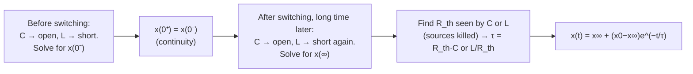

# Week 4 — Capacitors, Inductors and First-Order Circuits

← prev: [[EE1100 Basic Electrical Engineering/03 DC Network Theorems|Week 3]] · up: [[EE1100 Basic Electrical Engineering/EE1100 MOC|MOC]] · next: [[EE1100 Basic Electrical Engineering/05 Sinusoids and Phasors|Week 5 →]]

Playlist: lectures 24–30 of [Fundamentals of Electrical Engineering](https://www.youtube.com/playlist?list=PLbRMhDVUMngfdEXVcdf_ijj2Eub-UHs_y).

## Overview
Definitions of C and L, and the general x(t) = x_∞ + (x_0−x_∞)e^(−t/τ) template, live in [[EE1100 Basic Electrical Engineering/Concepts#Capacitors and Inductors|Capacitors and Inductors]] and [[EE1100 Basic Electrical Engineering/Concepts#RC/RL Transients and Time Constant|RC/RL Transients and Time Constant]]. This week is the *procedure* for applying that template to real switched circuits.

## The three-value recipe
Every first-order transient problem reduces to finding three numbers, then plugging into the template:

1. **x(0⁻):** the value of v_C or i_L the instant *before* switching (circuit was presumably in DC steady state — capacitor is an open, inductor is a short). By continuity, x(0⁺) = x(0⁻) — the storage element's value can't jump.
2. **x(∞):** the *new* DC steady-state value, long after switching, again treating C as open and L as short in the *new* circuit configuration.
3. **τ:** find R_th seen by the capacitor/inductor (kill independent sources, reduce via [[Series-Parallel Resistance Reduction]]), then τ = R_th·C or L/R_th.

## Why "steady state = open/short"
A capacitor at constant voltage has i = C·dv/dt = 0 → behaves as an open circuit. An inductor at constant current has v = L·di/dt = 0 → behaves as a short circuit. This single fact is what makes steps 1 and 2 of the recipe pure resistive-circuit problems — no calculus needed until step 5.

## A subtlety worth noticing
In problems where the switch changes *which* resistors are connected to the source (rather than connecting/disconnecting the storage element itself), R_th for step 3 must be computed in the **new** (post-switch) configuration — it's easy to accidentally reuse the pre-switch resistance.

## Second-order (RLC) preview
When a circuit has *both* an L and a C, one differential equation isn't enough — see the damping cases (over/critical/under/undamped) in [[EE1100 Basic Electrical Engineering/Concepts#RC/RL Transients and Time Constant|RC/RL Transients and Time Constant]]. Fully worked in [[EE1100 Basic Electrical Engineering/Tutorial 2 - Transient Analysis of DC Circuits|Tutorial 2]] Q10–12.

## Worked in
[[EE1100 Basic Electrical Engineering/Tutorial 2 - Transient Analysis of DC Circuits|Tutorial 2]] Q1 (i-v-p sketches from a piecewise waveform), Q2–Q3 (DC steady-state values plus stored energy), Q4 (extracting R and L from a given exponential response), Q5–Q9 (full switched RC/RL transients).

## Related
- [[EE1100 Basic Electrical Engineering/Concepts|Concepts glossary]]
- [[EE1100 Basic Electrical Engineering/06 Sinusoidal Steady-State Analysis|Week 6 — Sinusoidal Steady-State Analysis]] (same C, L — now under AC forcing instead of a DC step)
