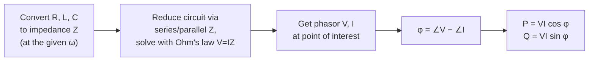

# Week 6 — Sinusoidal Steady-State Analysis

← prev: [[EE1100 Basic Electrical Engineering/05 Sinusoids and Phasors|Week 5]] · up: [[EE1100 Basic Electrical Engineering/EE1100 MOC|MOC]] · next: [[EE1100 Basic Electrical Engineering/07 AC Circuit Analysis and Network Theorems|Week 7 →]]

Playlist: lectures covering steady-state AC analysis in [Fundamentals of Electrical Engineering](https://www.youtube.com/playlist?list=PLbRMhDVUMngfdEXVcdf_ijj2Eub-UHs_y).

## Overview
With phasors ([[EE1100 Basic Electrical Engineering/05 Sinusoids and Phasors|Week 5]]) in hand, this week defines [[EE1100 Basic Electrical Engineering/Concepts#Impedance and Admittance|impedance]] so that Ohm's law and every series/parallel technique from [[EE1100 Basic Electrical Engineering/01 Basic Concepts and Basic Laws|Week 1]] work unchanged on AC circuits.

## Series and parallel AC circuits
Exactly the DC rules from [[Series-Parallel Resistance Reduction]], with impedance Z (complex) replacing resistance R (real):
- Series: Z_eq = Z_1 + Z_2 + ...
- Parallel: 1/Z_eq = 1/Z_1 + 1/Z_2 + ... (or use admittance Y directly: Y_eq = Y_1 + Y_2 + ...)
- [[EE1100 Basic Electrical Engineering/Voltage Divider Rule|Voltage divider]] and current divider both carry over verbatim, just with complex arithmetic.

The one new bookkeeping step: convert every R, L, C to its impedance *first* (Z_R = R, Z_L = jωL, Z_C = 1/jωC — note these depend on ω, so a given L or C has a different impedance at every frequency), then treat the circuit as if it were resistive.

## Power in AC circuits
Full definitions of P, Q, S, and the power triangle are in [[EE1100 Basic Electrical Engineering/Concepts#Power in AC Circuits|Power in AC Circuits]]. The practical workflow:

1. Find the phasor V and I at the element/circuit of interest (via the series/parallel + divider steps above).
2. φ = angle of V minus angle of I (or directly, the angle of Z).
3. P = V_rms·I_rms·cos φ, Q = V_rms·I_rms·sin φ, S = V_rms·I_rms.

## Related
- [[EE1100 Basic Electrical Engineering/Concepts|Concepts glossary]]
- [[EE1100 Basic Electrical Engineering/07 AC Circuit Analysis and Network Theorems|Week 7 — AC Circuit Analysis and Network Theorems]]
- [[EE1100 Basic Electrical Engineering/09 Three Phase Circuits and Power Measurement|Week 9 — Three Phase Power]]
- Elaborated further in [[EE1100 Basic Electrical Engineering/Tutorial 3 - AC Circuit Analysis/Impedance and Series-Parallel AC Circuits|Impedance and Series-Parallel AC Circuits]] and [[EE1100 Basic Electrical Engineering/Tutorial 3 - AC Circuit Analysis/AC Power and Power Factor|AC Power and Power Factor]] (Tutorial 3)
- What happens right after switching into an AC-driven RLC circuit: [[EE1100 Basic Electrical Engineering/AC Transients/AC Transients|AC Transients]]
