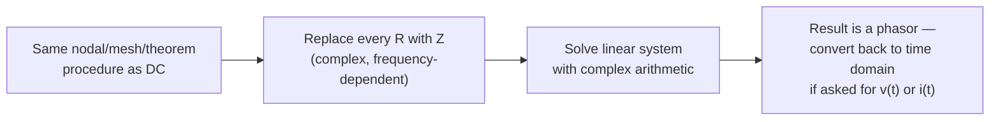

# Week 7 — AC Circuit Analysis and Network Theorems

← prev: [[EE1100 Basic Electrical Engineering/06 Sinusoidal Steady-State Analysis|Week 6]] · up: [[EE1100 Basic Electrical Engineering/EE1100 MOC|MOC]] · next: [[EE1100 Basic Electrical Engineering/08 Resonance and Magnetically Coupled Circuits|Week 8 →]]

Playlist: lectures covering AC network analysis in [Fundamentals of Electrical Engineering](https://www.youtube.com/playlist?list=PLbRMhDVUMngfdEXVcdf_ijj2Eub-UHs_y).

## Overview
The payoff week for phasors: every technique from [[EE1100 Basic Electrical Engineering/02 Methods of Circuit Analysis|Week 2]] and [[EE1100 Basic Electrical Engineering/03 DC Network Theorems|Week 3]] carries over **unchanged in structure**, only the arithmetic becomes complex-number arithmetic.

## Nodal / mesh analysis in the phasor domain
Identical algorithm to [[EE1100 Basic Electrical Engineering/Concepts#Nodal and Mesh Analysis|Nodal and Mesh Analysis]]: pick reference node or independent meshes, write KCL/KVL, use Z instead of R in every Ohm's-law substitution, solve the (now complex-valued) linear system. Supernodes/supermeshes work exactly the same way.

## Network theorems in the phasor domain
Same procedures as [[EE1100 Basic Electrical Engineering/Concepts#Network Theorems|Network Theorems]]:
- **Superposition:** kill independent sources one at a time as before — but note AC sources at *different frequencies* can never be combined by simple phasor addition (phasors only make sense at one fixed frequency), so superposition becomes *mandatory*, not just convenient, when a circuit has multiple sources at different frequencies — solve each frequency's phasor circuit separately and add the resulting **time-domain** waveforms.
- **Thevenin/Norton:** V_th, I_N, Z_th found exactly as V_th, I_N, R_th were in DC — just complex-valued now.
- **Maximum power transfer:** the condition changes subtly — for a load that can be any complex impedance, max power transfer requires **Z_load = Z_th\*** (complex conjugate, cancelling the reactive part entirely so only resistances remain matched). If the load is constrained to be purely resistive, the optimal condition is instead R_load = |Z_th|.

## Related
- [[EE1100 Basic Electrical Engineering/Concepts|Concepts glossary]]
- [[EE1100 Basic Electrical Engineering/02 Methods of Circuit Analysis|Week 2]] · [[EE1100 Basic Electrical Engineering/03 DC Network Theorems|Week 3]] (the DC originals)
- [[EE1100 Basic Electrical Engineering/08 Resonance and Magnetically Coupled Circuits|Week 8 — Resonance and Magnetically Coupled Circuits]]
- Elaborated further, with worked Q1–Q12 patterns, in [[EE1100 Basic Electrical Engineering/Tutorial 3 - AC Circuit Analysis/Tutorial 3 - AC Circuit Analysis|Tutorial 3 — AC Circuit Analysis]] (see especially [[EE1100 Basic Electrical Engineering/Tutorial 3 - AC Circuit Analysis/Nodal and Mesh Analysis (AC)|Nodal and Mesh Analysis (AC)]], [[EE1100 Basic Electrical Engineering/Tutorial 3 - AC Circuit Analysis/Thevenin, Norton and Maximum Power Transfer (AC)|Thevenin/Norton and Max Power Transfer (AC)]], [[EE1100 Basic Electrical Engineering/Tutorial 3 - AC Circuit Analysis/Power Factor Correction|Power Factor Correction]])
