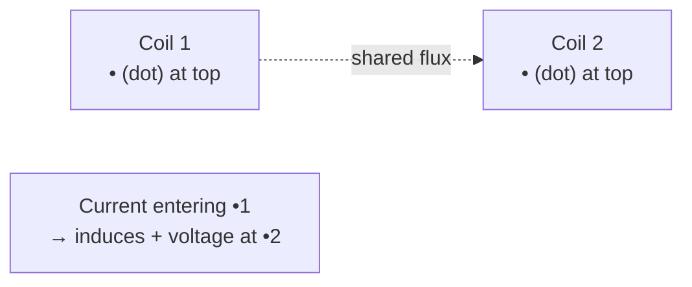

# Week 8 — Resonance and Magnetically Coupled Circuits

← prev: [[EE1100 Basic Electrical Engineering/07 AC Circuit Analysis and Network Theorems|Week 7]] · up: [[EE1100 Basic Electrical Engineering/EE1100 MOC|MOC]] · next: [[EE1100 Basic Electrical Engineering/09 Three Phase Circuits and Power Measurement|Week 9 →]]

Playlist: lectures covering resonance and coupled circuits in [Fundamentals of Electrical Engineering](https://www.youtube.com/playlist?list=PLbRMhDVUMngfdEXVcdf_ijj2Eub-UHs_y).

## Overview
Two distinct topics that share this week: resonance (what happens to an RLC circuit's impedance as frequency sweeps through ω_0), and mutual inductance (what happens when two separate coils share flux). Both concepts and their diagrams are in [[EE1100 Basic Electrical Engineering/Concepts#Resonance|Resonance]] and [[EE1100 Basic Electrical Engineering/Concepts#Magnetic Coupling|Magnetic Coupling]] respectively.

## Series resonance — working through it
For a series RLC circuit: Z(ω) = R + j(ωL − 1/ωC). At ω_0 = 1/√(LC), the imaginary part vanishes, Z = R (minimum possible |Z|), so current I = V/R is maximum, and the current is exactly **in phase** with the source voltage.

- **Bandwidth** BW = ω_0/Q = R/L — the range of ω over which the power delivered stays above half its peak value.
- **Q-factor** Q = ω_0L/R = (1/R)√(L/C) — also equals the voltage magnification: at resonance, V_L and V_C individually can be **Q times larger** than the source voltage (they're equal and opposite, so they cancel in KVL, but each alone can be huge) — this is exactly why resonant circuits need care in practice (component voltage ratings).

## Parallel resonance
The dual case: for a parallel RLC (or a practical parallel-tuned circuit with the coil's own resistance), impedance is *maximum* at resonance and the line current is minimum, while a large circulating current can flow around the L-C loop itself.

## Magnetically coupled circuits — the dot convention in practice
Given a dot on each coil: if you assume current *enters* the dotted terminal of coil 1, the mutually-induced voltage in coil 2 is *positive* at coil 2's dotted terminal. Getting this sign right is the single most common source of error in these problems — always redraw the dots and check current direction relative to them before writing the coupled-inductor voltage equations.

Coupling energy: for two coupled coils, total stored energy is W = ½L₁i₁² + ½L₂i₂² ± Mi₁i₂ (sign depends on whether currents enter at like or unlike dots).

## Related
- [[EE1100 Basic Electrical Engineering/Concepts|Concepts glossary]]
- [[EE1100 Basic Electrical Engineering/Concepts#RC/RL Transients and Time Constant|RC/RL Transients]] (the time-domain twin — same ζ, ω_n)
- [[EE1100 Basic Electrical Engineering/RLC Circuits - Responses/Frequency Response and Resonance Curves|Plotted resonance curves for different R, and the |Z| vs frequency graphs for series/parallel]]
- [[EE1100 Basic Electrical Engineering/10 Single Phase Transformers|Week 10 — Single Phase Transformers]]
