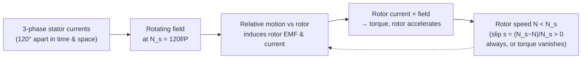

# Week 11 — Three Phase Induction Machines

← prev: [[EE1100 Basic Electrical Engineering/10 Single Phase Transformers|Week 10]] · up: [[EE1100 Basic Electrical Engineering/EE1100 MOC|MOC]] · next: [[EE1100 Basic Electrical Engineering/12 DC Machines|Week 12 →]]

Playlist: lectures covering induction machines in [Fundamentals of Electrical Engineering](https://www.youtube.com/playlist?list=PLbRMhDVUMngfdEXVcdf_ijj2Eub-UHs_y).

## Overview
The [[EE1100 Basic Electrical Engineering/Concepts#Rotating Magnetic Field|rotating magnetic field]] concept (full definition and diagram there) is *why* this machine spins with no electrical connection to the rotor at all — this week works out the consequences.

## Construction
- **Stator:** three-phase winding, same as the source side of [[EE1100 Basic Electrical Engineering/09 Three Phase Circuits and Power Measurement|Week 9]], produces the rotating field.
- **Rotor:** either **squirrel-cage** (short-circuited conducting bars, no external connection — rugged, simple, most common) or **wound rotor** (three-phase winding brought out via slip rings, allowing external resistance to be added for starting/speed control).

## Slip and why the rotor never catches up
The rotating field sweeps past the rotor conductors, inducing current in them (transformer action — the rotor is like a short-circuited secondary), and that current interacting with the field produces torque that drags the rotor along. But if the rotor ever reached the field's own speed (N_s), there would be *no relative motion*, no induced EMF, no rotor current, and hence **no torque** — so the rotor always settles at some N < N_s, described by slip s = (N_s − N)/N_s.

- s = 1 at standstill (N = 0)
- s → 0 as the rotor approaches synchronous speed (never quite reaching it under load)
- Rotor-induced frequency f_r = s·f (the rotor "sees" the field sweep past more slowly as it speeds up, so the induced frequency drops proportionally)

## Torque-slip characteristic
Torque starts at a moderate value at s=1 (standstill), rises to a **maximum (breakdown/pull-out) torque** at some intermediate slip, then falls back toward zero as s→0. Normal running operation sits on the steep, near-linear part of the curve just past the low-slip side of the peak, where small speed changes produce large torque changes — this is what lets the motor self-regulate against varying load.

## Equivalent circuit and power flow
Modeled like a transformer ([[EE1100 Basic Electrical Engineering/10 Single Phase Transformers|Week 10]]) with the rotor as a short-circuited secondary, except the rotor-side resistance appears divided by slip (R_2/s) — splitting naturally into R_2 (actual rotor copper loss) plus R_2(1−s)/s (the term that represents mechanical power output). This split is *why* the equivalent circuit directly shows both losses and useful output in one model.

## Related
- [[EE1100 Basic Electrical Engineering/Concepts|Concepts glossary]]
- [[EE1100 Basic Electrical Engineering/09 Three Phase Circuits and Power Measurement|Week 9 — Three Phase Circuits]]
- [[EE1100 Basic Electrical Engineering/12 DC Machines|Week 12 — DC Machines]]
