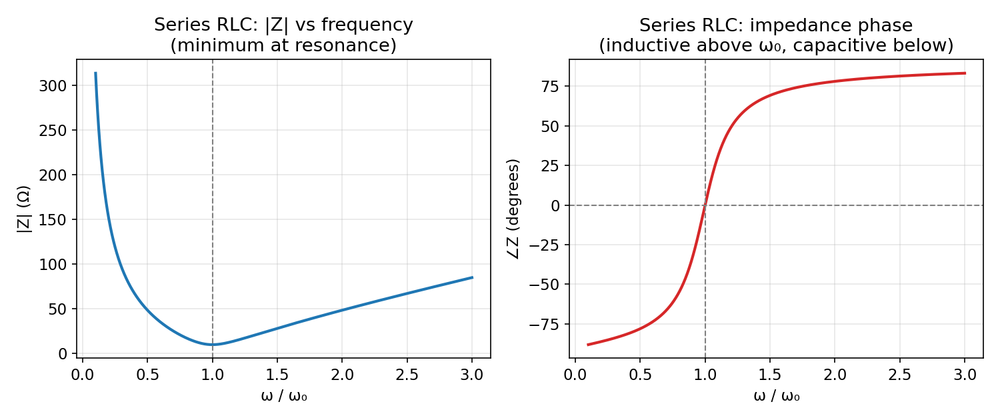
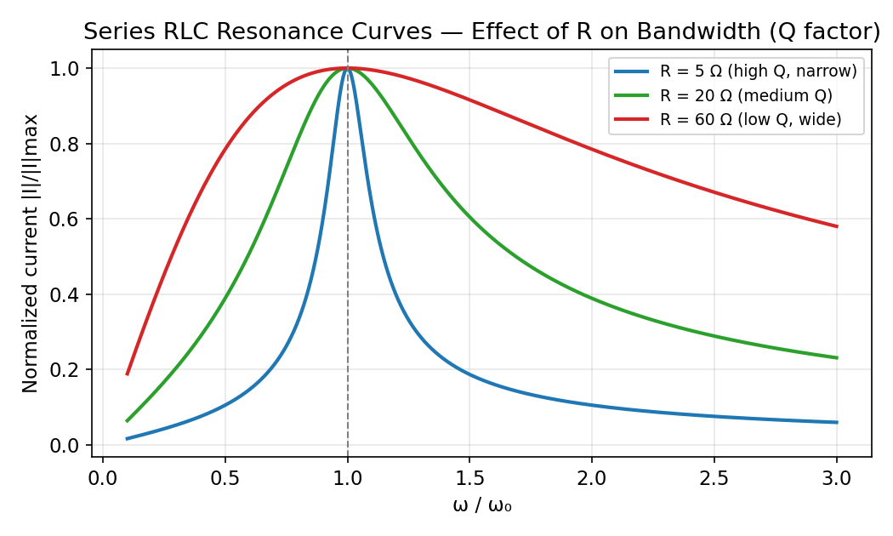
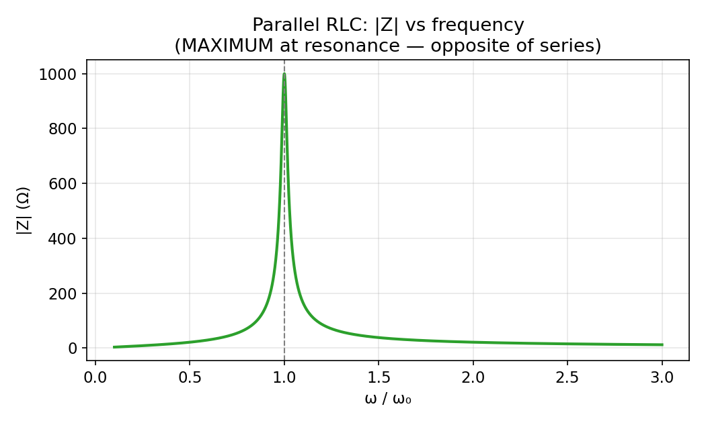

# Frequency Response and Resonance Curves

← up: [[EE1100 Basic Electrical Engineering/RLC Circuits - Responses/RLC Circuits - Responses|RLC Circuits — Responses]] · builds on: [[EE1100 Basic Electrical Engineering/08 Resonance and Magnetically Coupled Circuits|Week 8]], [[EE1100 Basic Electrical Engineering/RLC Circuits - Responses/Series vs Parallel RLC - Key Distinctions|Series vs Parallel RLC — Key Distinctions]]

## Impedance/phase vs frequency (series RLC)

Left: $|Z(\omega)|=\sqrt{R^2+(\omega L-1/\omega C)^2}$ dips to its minimum ($=R$) exactly at $\omega_0=1/\sqrt{LC}$. Right: the phase $\angle Z$ crosses zero at $\omega_0$, is **negative** (capacitive, current leads) below resonance, and **positive** (inductive, current lags) above resonance — the sign of the reactive term $\omega L-1/\omega C$ flips exactly at $\omega_0$ because $X_C=1/\omega C$ falls with frequency while $X_L=\omega L$ rises, and they're equal only at one point.

## Resonance curves for different $R$ — bandwidth and quality factor

All three curves share the same $\omega_0$ (same $L,C$) but differ in **sharpness**: smaller $R$ (blue, high $Q$) gives a tall, narrow resonance peak; larger $R$ (red, low $Q$) gives a shallow, wide one. This is the direct graphical meaning of the **quality factor**:

$$\boxed{Q=\frac{\omega_0L}{R}=\frac1R\sqrt{\frac LC}}\qquad(\text{series RLC})$$

and the **half-power bandwidth**:

$$\boxed{BW=\frac{\omega_0}{Q}=\frac RL}$$

— the range of $\omega$ over which the current stays above $1/\sqrt2\approx0.707$ of its peak value. **Larger $R\Rightarrow$ smaller $Q\Rightarrow$ wider bandwidth** (more damping smears the resonance out) — the frequency-domain restatement of exactly the same fact used in the time domain: larger $R$ in series RLC means more damping, and more damping always trades sharpness/persistence for speed/robustness, whether you're looking at a step response ringing out or a resonance peak narrowing in.

## Why $Q$ also measures "how underdamped"

$$Q=\frac{\omega_0L}R=\frac{\omega_n}{2\alpha}=\frac1{2\zeta}$$

$Q$ is literally the reciprocal of (twice) the damping ratio $\zeta$ from [[EE1100 Basic Electrical Engineering/RLC Circuits - Responses/Series RLC Natural Response - Damping Cases|Series RLC Natural Response]] — a high-$Q$ (sharp resonance) circuit is *exactly* the same circuit that would show heavy ringing/overshoot in its time-domain step response, and a low-$Q$ (broad resonance) circuit is the same one that would show a slow, overdamped step response. The frequency-domain "sharpness" picture and the time-domain "ringing" picture are two views of the identical $\zeta$.

## Parallel RLC: the mirror-image resonance curve

Parallel RLC's $|Z(\omega)|$ **peaks** at $\omega_0$ instead of dipping — see [[EE1100 Basic Electrical Engineering/RLC Circuits - Responses/Series vs Parallel RLC - Key Distinctions|Series vs Parallel RLC — Key Distinctions]] for the full duality table (parallel $Q=R\sqrt{C/L}$, note $R$ appears in the **numerator** here, the opposite of series $Q$, exactly mirroring the $\alpha$ sign-flip already seen in the time domain).

## Related
- [[EE1100 Basic Electrical Engineering/08 Resonance and Magnetically Coupled Circuits|Week 8 — Resonance]]
- [[EE1100 Basic Electrical Engineering/RLC Circuits - Responses/Series vs Parallel RLC - Key Distinctions|Series vs Parallel RLC — Key Distinctions]]
- [[EE1100 Basic Electrical Engineering/RLC Circuits - Responses/Series RLC Natural Response - Damping Cases|Series RLC Natural Response — Damping Cases]]
