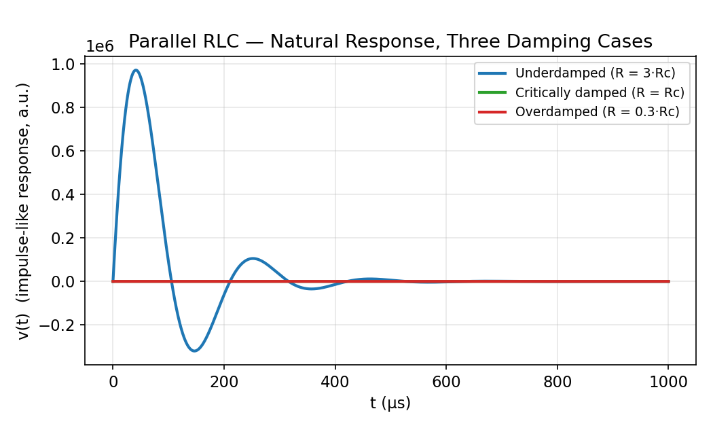

# Parallel RLC Natural Response — Damping Cases

← up: [[EE1100 Basic Electrical Engineering/RLC Circuits - Responses/RLC Circuits - Responses|RLC Circuits — Responses]] · builds on: [[EE1100 Basic Electrical Engineering/AC Transients/Second-Order AC Transients (Series and Parallel RLC)|Second-Order AC Transients]]

## Circuit and governing equation

$R$, $L$, $C$ all connected across the **same pair of nodes** (parallel), released from an initial energy state (e.g. capacitor pre-charged, or a current impulse injected):

$$\frac{d^2v}{dt^2}+\frac1{RC}\frac{dv}{dt}+\frac1{LC}v=0$$

$$\alpha=\frac1{2RC},\qquad \omega_n=\frac1{\sqrt{LC}},\qquad \zeta=\frac\alpha{\omega_n}=\frac1{2R}\sqrt{\frac LC}$$

Critical resistance: $R_c=\tfrac12\sqrt{L/C}$ (the $R$ at which $\zeta=1$).

## The graph

This is the **natural (source-free) response** shape — decaying from an initial disturbance back to zero — rather than a step response to a nonzero final value, because a parallel RLC circuit's natural response is most commonly excited by an initial condition (charged capacitor or an impulsive current) rather than a sustained step source.

## Reading the three curves

**Underdamped ($R=3R_c$, large $R$, blue):** decaying oscillation, exactly as for the series case, but note **large $R$ underdamps** a parallel circuit.

**Critically damped ($R=R_c$, green):** fastest non-oscillatory decay to zero.

**Overdamped ($R=0.3R_c$, small $R$, red):** slow monotonic decay, no oscillation.

## The sign-flipped role of $R$ — the single most important distinction in this folder

$$\boxed{\text{Series RLC: }\alpha=\frac R{2L}\ \ (\text{large }R\Rightarrow\text{ more damping, overdamped})}$$
$$\boxed{\text{Parallel RLC: }\alpha=\frac1{2RC}\ \ (\text{large }R\Rightarrow\text{ less damping, underdamped})}$$

This is not a typo or a coincidence — it's a direct consequence of $R,L,C$ swapping roles under series-vs-parallel duality: in series, $R$ is directly in the energy-dissipating path of the *current* everything shares; in parallel, $R$ is a *bypass* for the current — a **larger** parallel $R$ diverts *less* current away from the oscillatory $L$-$C$ pair, so the "ringing" survives longer (less damped). See [[EE1100 Basic Electrical Engineering/RLC Circuits - Responses/Series vs Parallel RLC - Key Distinctions|Series vs Parallel RLC — Key Distinctions]] for the full duality table this belongs to.

## Related
- [[EE1100 Basic Electrical Engineering/RLC Circuits - Responses/Series RLC Natural Response - Damping Cases|Series RLC Natural Response — Damping Cases]]
- [[EE1100 Basic Electrical Engineering/RLC Circuits - Responses/Series vs Parallel RLC - Key Distinctions|Series vs Parallel RLC — Key Distinctions]]
