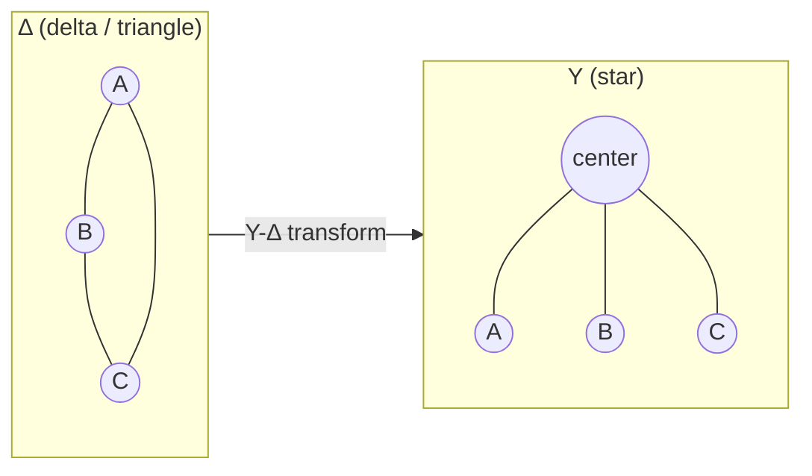

# Series-Parallel Resistance Reduction

## The idea
Most networks aren't purely series or purely parallel — but you can often collapse them by finding small series or parallel groups, replacing each with one equivalent resistor, and repeating until only one resistor is left.

- **Series** (same current through both, end-to-end, no branch point between them): R_eq = R1 + R2 + ...
- **Parallel** (same voltage across both, both ends shared): 1/R_eq = 1/R1 + 1/R2 + ...

## Self-similar (ladder) networks
Some networks — like an R-2R ladder — repeat the same stage over and over. The trick is to reduce from the *far end inward*: start at the last stage (where the network terminates, nothing further right), fold it into the stage before it, and keep folding leftward one stage at a time. Because every stage is identical, you'll find the "resistance looking right" from each node is the *same* value at every stage — that self-similarity is what makes the whole ladder solvable in a few lines instead of a giant simultaneous system. See the worked example in [[EE1100 Basic Electrical Engineering/Voltage Divider Rule|Voltage Divider Rule]].

## When plain series/parallel isn't enough
Some networks (e.g. a bridge, or a triangle/mesh of resistors like a **delta**) have no two resistors purely in series or purely in parallel — no "obvious" starting point. The fix is a **Y-Δ (star-delta) transformation**, which algebraically swaps a triangle (Δ) of three resistors for an equivalent star (Y) of three resistors (or vice versa), after which ordinary series-parallel reduction becomes possible again.

Given a delta with resistors R_ab, R_bc, R_ca, the equivalent star resistors are:

**R_a = (R_ab·R_ca) / (R_ab+R_bc+R_ca)**, and similarly (cyclically) for R_b and R_c.

## Where this shows up
Plain series-parallel folding solves [[EE1100 Basic Electrical Engineering/Tutorial 1 - Circuit Laws and Theorems|Tutorial 1]] Q1 (R-2R ladder, alongside the [[EE1100 Basic Electrical Engineering/Voltage Divider Rule|Voltage Divider Rule]]) and Q5 (Thevenin resistance for max power transfer). Star-delta transformation is the direct method for Q13 (bridge network) and one of three methods asked for in Q14. It's also how [[EE1100 Basic Electrical Engineering/Concepts#Network Theorems|Thevenin/Norton resistance]] is found whenever the network isn't simple series-parallel.

← used from [[EE1100 Basic Electrical Engineering/Concepts#Series-Parallel Resistance Reduction|Concepts glossary]]
