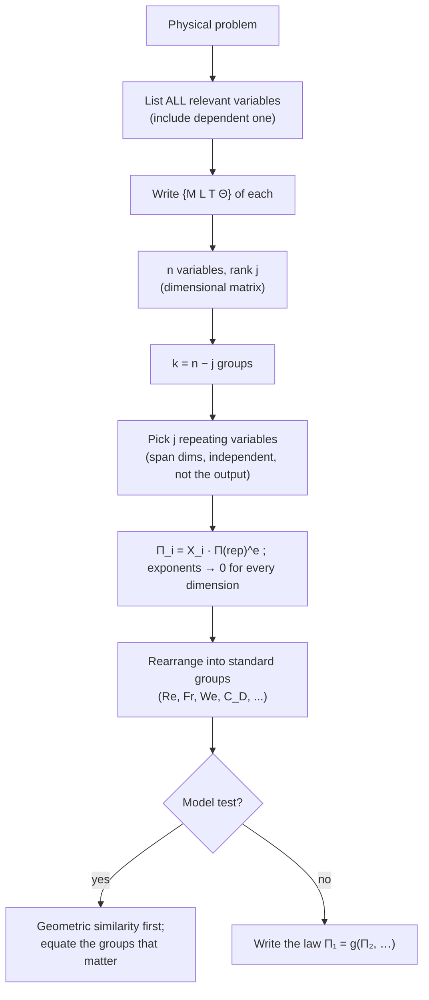

# Dimensional Analysis and Similitude – Formula Bank

← up: [[Fluid Mechanics/Fluid Mechanics - MOC|Fluid Mechanics MOC]] · concept note: [[Fluid Mechanics/01 Dimensionless Numbers/Buckingham Pi Theorem|Buckingham π Theorem]] · worked problems: [[Fluid Mechanics/06 Dimensional Analysis and Similitude/Dimensional Analysis and Similitude - Solved Problems|Solved Problems]] · tools: `Tools/fm_core.py` (Pi-group solver), `Tools/fm_viz.py`

Equation numbers are White's. Everything marked ✓ is re-derived or recomputed in `fm_core.check()`.

> [!abstract] Contents
> [[#1. Dimensions]] · [[#2. Dimensional homogeneity]] · [[#3. Pi theorem]] · [[#4. Choosing repeating variables]] · [[#5. The important dimensionless groups]] · [[#6. Where the groups come from: the nondimensional equations]] · [[#7. Similarity and model laws]] · [[#8. Procedure and traps]]

---

## 1. Dimensions

Primary dimensions: **{M L T Θ}** (mass, length, time, temperature) or **{F L T Θ}**. They are linked by $F=MLT^{-2}$.

| Quantity | {MLT} | {FLT} | Quantity | {MLT} |
|---|---|---|---|---|
| velocity $V$ | $LT^{-1}$ | $LT^{-1}$ | density $\rho$ | $ML^{-3}$ |
| acceleration, $g$ | $LT^{-2}$ | $LT^{-2}$ | dynamic viscosity $\mu$ | $ML^{-1}T^{-1}$ |
| force $F$ | $MLT^{-2}$ | $F$ | kinematic viscosity $\nu$ | $L^{2}T^{-1}$ |
| pressure, stress $p,\tau$ | $ML^{-1}T^{-2}$ | $FL^{-2}$ | surface tension $\sigma$ | $MT^{-2}$ |
| energy, torque, work | $ML^{2}T^{-2}$ | $FL$ | angular velocity $\Omega,\omega$ | $T^{-1}$ |
| power $P$ | $ML^{2}T^{-3}$ | $FLT^{-1}$ | bulk modulus $K$ | $ML^{-1}T^{-2}$ |
| specific weight $\gamma$ | $ML^{-2}T^{-2}$ | $FL^{-3}$ | volume flow $Q$ | $L^{3}T^{-1}$ |
| gas constant $R$, specific heat $c_p$ | $L^{2}T^{-2}\Theta^{-1}$ | | thermal conductivity $k$ | $MLT^{-3}\Theta^{-1}$ |
| pressure gradient $dp/dx$ | $ML^{-2}T^{-2}$ | | speed of sound $a$ | $LT^{-1}$ |

Angles, strains, ratios of like quantities and all Pi groups are **dimensionless** ($M^0L^0T^0$).

---

## 2. Dimensional homogeneity

$$\boxed{\text{Every additive term in a physical equation has the same dimensions}}$$

- It forces the *form* of a law (e.g. $F=f(L,U,\rho,\mu)\Rightarrow\dfrac{F}{\rho U^2L^2}=g(Re)$, Eq. 5.2).
- **Scaling-parameter nondimensionalisation:** divide every term of an equation by a combination of the scaling variables. Example, Bernoulli $p=p_0-\tfrac12\rho V^2-\rho gz$ becomes, using $p_0,\ \rho,\ V_0$ as scales, $\dfrac{p}{p_0}=1-\dfrac12\dfrac{\rho V_0^2}{p_0}\Big(\dfrac{V}{V_0}\Big)^2-\dots$ with one **dimensionless parameter** ($\rho V_0^2/p_0$) left over.
- Dimensionally inhomogeneous "engineering formulas" (such as $h=1.42(\Delta T/L)^{1/4}$) hide a dimensional constant (units of $W\,m^{-7/4}K^{-5/4}$ here) and are valid in one unit system only.

---

## 3. Pi theorem

> [!important] Buckingham Π theorem
> If a process involves **$n$** dimensional variables and the **dimensional matrix** has rank **$j$** (usually the number of primary dimensions needed, $j\le3$ for {MLT}), it can be written as a relation between
> $$\boxed{k=n-j}\quad\text{independent dimensionless groups:}\qquad \Pi_1=G(\Pi_2,\Pi_3,\dots,\Pi_k)\qquad(5.29)$$

**Dimensional matrix.** Rows = primary dimensions, columns = variables, entries = exponents. $j=\operatorname{rank}$ (size of the largest nonzero determinant). Example, $F=f(L,U,\rho,\mu)$:

$$
\begin{array}{c|ccccc}
 & F & L & U & \rho & \mu\\\hline
M&1&0&0&1&1\\
L&1&1&1&-3&-1\\
T&-2&0&-1&0&-1
\end{array}\qquad j=3,\ n=5,\ k=2
$$

**Six-step procedure** (White Sec. 5.3):

1. List the $n$ variables (the output / dependent one included) and count them.
2. Write each variable's dimensions.
3. Find $j$ (rank). Initially guess the number of primary dimensions; reduce it only if no group of $j$ variables fails to form a Π.
4. Select **$j$ repeating variables** (see §4).
5. Add one non-repeating variable at a time to the repeating set, in a power product, and solve for the exponents so that every primary dimension cancels:
$$\Pi_i=X_i\,\rho^{a}V^{b}L^{c}\quad\Rightarrow\quad\text{sum of exponents of }M,L,T=0$$
   This gives $k$ groups.
6. Write $\Pi_1=G(\Pi_2,\dots,\Pi_k)$ and check that every group really is dimensionless.

**Linear-algebra view.** For a trial group $\prod X_i^{e_i}$ we need $\mathbf A\,\mathbf e=\mathbf 0$ with $\mathbf A$ the dimensional matrix, so the groups are a basis of the null-space of $\mathbf A$ and $\dim=n-\operatorname{rank}\mathbf A=n-j$. `fm_core.pi_groups(names, repeating)` does step 5 symbolically.

**Special cases.**
- $j<3$: if time never appears (e.g. cantilever deflection $\delta=f(P,L,I,E)$ in {FL}) then $j=2$ and $k=n-2$ (Example 5.5).
- With temperature, $j$ can be 4 (heat transfer): $k=n-4$.
- $k=1$: the single group must equal a **constant** (e.g. Poiseuille flow $Q\mu/(R^4\,dp/dx)=\text{const}=\pi/8$, Ex. 5.4; the constant itself needs theory or experiment).
- Non-uniqueness: you may invert, multiply or raise Π groups to powers; the *number* $k$ is fixed. Three different repeating sets give three equivalent forms (Ex. 5.3, falling body).

---

## 4. Choosing repeating variables

| Rule | Why |
|---|---|
| Together they must contain **all** $j$ primary dimensions | otherwise a dimension can't cancel |
| They must **not form a Π among themselves** (dimensionally independent) | the exponent system must be solvable |
| Never include the **dependent** variable | you want it isolated in $\Pi_1$ |
| Never include dimensionless variables ($\theta$, $\varepsilon/L$) | those are already Π groups |
| Never include two variables with the same dimensions | not independent |
| Prefer **one geometric, one kinematic, one fluid property** | typical choice $\{\rho,\ V,\ L\}$ |
| Prefer variables that appear in many groups and are *easy to vary independently* in tests | a group changes only one thing at a time |

Typical choices: $\{\rho,V,D\}$ for external flow; $\{\Omega,\rho,D\}$ for turbomachinery (P5.20); $\{\lambda,\rho,g\}$ for waves (P5.19); $\{\rho,\lambda,R,T\}$ for kinetic-theory conductivity (P5.34).

---

## 5. The important dimensionless groups

White Table 5.2 (p. 297), plus a few standard additions marked *.

| Name | Definition | Ratio of effects | Matters for |
|---|---|---|---|
| **Reynolds** | $Re=\dfrac{\rho UL}{\mu}=\dfrac{UL}{\nu}$ | inertia / viscous | always (laminar ⇄ turbulent) |
| **Mach** | $Ma=\dfrac Ua$ | flow speed / sound speed | compressible flow ($>0.3$) |
| **Froude** | $Fr=\dfrac{U^2}{gL}$ (White) $\ \big(\sqrt{\ }\text{ is also called Fr}\big)$ | inertia / gravity | free surface, waves, ships |
| **Weber** | $We=\dfrac{\rho U^2L}{\sigma}$ | inertia / surface tension | droplets, bubbles, capillary |
| **Cavitation (Euler)** | $Ca=\dfrac{p-p_v}{\tfrac12\rho U^2}$ | pressure / inertia | cavitation |
| **Prandtl** | $Pr=\dfrac{\mu c_p}{k}$ | momentum diffusion / heat diffusion | heat convection |
| **Eckert** | $Ec=\dfrac{U^2}{c_pT_0}$ | kinetic energy / enthalpy | dissipation, high-speed heating |
| **Specific-heat ratio** | $k=\dfrac{c_p}{c_v}$ | | compressible flow |
| **Strouhal** | $St=\dfrac{\omega L}{U}$ | oscillation / mean transport | vortex shedding, unsteady flow |
| **Roughness ratio** | $\varepsilon/L$ | wall roughness / body length | turbulent rough walls |
| **Grashof** | $Gr=\dfrac{\beta\,\Delta T\,g\,L^3\rho^2}{\mu^2}$ | buoyancy / viscous | natural convection |
| **Temperature ratio** | $T_w/T_0$ | | heat transfer |
| **Pressure coeff.** | $C_p=\dfrac{p-p_\infty}{\tfrac12\rho U^2}$ | static p.d. / dynamic p. | aerodynamics |
| **Lift / drag coeff.** | $C_L=\dfrac{L}{\tfrac12\rho U^2A},\ C_D=\dfrac{D}{\tfrac12\rho U^2A}$ | force / (dynamic p. × area) | $A$ = planform (wings) or projected frontal area (bodies) |
| *Euler | $Eu=\dfrac{\Delta p}{\rho U^2}$ | pressure / inertia | internal flows |
| *Bond | $Bo=\dfrac{\rho gL^2}{\sigma}$ | gravity / surface tension | capillary waves, $\lambda$ in P5.19 |
| *Stanton | $St_h=\dfrac{h}{\rho c_pV}$ | | P5.16 |
| *Knudsen, Deborah | see [[Fluid Mechanics/01 Dimensionless Numbers/Knudsen Number\|Kn]], [[Fluid Mechanics/01 Dimensionless Numbers/Deborah Number\|De]] | | |

**Drag coefficient** uses the area one sees from upstream: cylinder $C_D=\dfrac{D}{\tfrac12\rho U^2\,(\text{length}\times d)}$, sphere $C_D=\dfrac{D}{\tfrac12\rho U^2\,(\pi d^2/4)}$; always check the area definition before using literature data.

**Typical resulting laws.**

| Problem | Dimensional relation | Dimensionless result |
|---|---|---|
| drag on a body | $F=f(L,U,\rho,\mu)$ | $\dfrac{F}{\rho U^2L^2}=g(Re)$ (5.2) |
| pump | $P=f(Q,D,\Omega,\rho,\mu)$ ✓ | $\dfrac{P}{\rho\Omega^3D^5}=g\!\left(\dfrac{Q}{\Omega D^3},\dfrac{\rho\Omega D^2}{\mu}\right)$ |
| wave period | $T=f(\rho,\lambda,h,g,\sigma)$ ✓ | $T\sqrt{g/\lambda}=g\!\left(\dfrac h\lambda,\dfrac{\rho g\lambda^2}{\sigma}\right)$ |
| capillary rise | $h=f(d,g,\rho,\sigma,\theta)$ | $\dfrac hd=F\!\left(\dfrac{\rho gd^2}{\sigma},\theta\right)$ (Ex. 5.6) |
| laminar tube | $Q=f(R,\mu,dp/dx)$ | $\dfrac{Q\mu}{R^4(dp/dx)}=\text{const}$ (Ex. 5.4) |
| weir | $Q=f(g,b,H)$, $Q\propto b$ | $Q=C\,b\sqrt g\,H^{3/2}$ (P5.32) |
| blast wave | $\Delta p=f(r,t,a,E)$ ✓ | $\dfrac{\Delta p\,r^3}{E}=g\!\left(\dfrac{at}{r}\right)$ (P5.37) |
| gas conductivity | $k=f(\rho,\lambda,R,T)$ ✓ | $k=C\,\rho\lambda R^{3/2}T^{1/2}$ (P5.34) |
| speed of sound | $a=f(p,\rho)$ | $a=C\sqrt{p/\rho}$ (P5.12) |
| capillary wave speed | $C=f(\rho,\lambda,\sigma)$ | $C=\text{const}\sqrt{\sigma/(\rho\lambda)}$ (P5.13) |

---

## 6. Where the groups come from: the nondimensional equations

Nondimensionalise the incompressible Navier–Stokes equation with $x^*=x/L,\ V^*=V/U,\ t^*=\omega t,\ p^*=(p-p_\infty)/(\rho U^2)$ (Sec. 5.4):

$$
\boxed{\ St\,\frac{\partial\mathbf V^*}{\partial t^*}+(\mathbf V^*\!\cdot\!\nabla^*)\mathbf V^*=-\nabla^*p^*-\frac{1}{Fr}\,\hat{\mathbf k}+\frac{1}{Re}\nabla^{*2}\mathbf V^*\ }\qquad \nabla^*\!\cdot\mathbf V^*=0
$$

- $St$ multiplies the **unsteady** term, $1/Fr$ the **gravity** term, $1/Re$ the **viscous** term.
- Free-surface boundary condition adds $We$; the energy equation adds $Pr$, $Ec$, $k$, $T_w/T_0$; compressibility adds $Ma$.
- So **the flow can depend only on $Re,\ Fr,\ St,\ldots$ and geometry**, which is exactly why matching these groups gives dynamic similarity.

![[FM-D1-scaling.png]]
**Figure:** Left, to match both $Re$ and $Fr$ in a model of scale $\alpha$ you need $\nu_m/\nu_p=\alpha^{3/2}$ (5.35); no ordinary fluid provides this (even mercury is only $0.115\,\nu_{water}$). Right, the Froude-scaling ratios.

---

## 7. Similarity and model laws

**Complete similarity.** Model and prototype are completely similar if all relevant dimensionless parameters have the same values (5.29): $\Pi_{2m}=\Pi_{2p},\ \Pi_{3m}=\Pi_{3p},\dots\Rightarrow\Pi_{1m}=\Pi_{1p}$.

| Type | Definition | Requirement |
|---|---|---|
| **Geometric** | all linear dimensions in the same ratio $\alpha=L_m/L_p$ (homologous points; same angles; roughness, trip wires, fasteners, nose radius scaled too) | prerequisite for everything |
| **Kinematic** | same length-scale *and* time-scale ratios ⇒ same velocity ratio; homologous particles at homologous points at homologous times | frictionless, no free surface: automatic; free surface: equal $Fr$ |
| **Dynamic** | same length, time and **force/mass** scale ratios; force polygons $F_p+F_g+F_f+F_i$ similar | see below |
| Thermal | same temperature ratios | + $Pr,Ec$, … |

**Dynamic-similarity conditions** (Sec. 5.5):
- compressible: equal $Re$, $Ma$, $k$;
- incompressible, **no** free surface: equal $Re$;
- incompressible, **free surface**: equal $Re$ and $Fr$ (and $We$, $Ca$ if relevant).

### Scaling relations

Length ratio $\alpha=L_m/L_p$, velocity ratio $\beta=V_m/V_p$.

**Froude scaling** ($Fr_m=Fr_p$; gravity same $g$):

$$
\boxed{\beta=\alpha^{1/2}},\quad \frac{T_m}{T_p}=\frac{L_m/V_m}{L_p/V_p}=\alpha^{1/2}\ (5.33),\quad \frac{Q_m}{Q_p}=\alpha^{5/2},\quad \frac{F_m}{F_p}=\frac{\rho_m}{\rho_p}\alpha^{3},\quad \frac{\Delta p_m}{\Delta p_p}=\frac{\rho_m}{\rho_p}\alpha,\quad \frac{P_m}{P_p}=\frac{\rho_m}{\rho_p}\alpha^{7/2}
$$

(5.31, 5.32). 1:25 model: $V_m=V_p/5$, $Q_m=3.2\times10^{-4}Q_p$, $F_m=F_p/15625$ (same fluid) ✓.

**Reynolds scaling** ($Re_m=Re_p$):

$$
\frac{V_m}{V_p}=\frac{\nu_m}{\nu_p}\frac{1}{\alpha},\qquad \frac{F_m}{F_p}=\frac{\rho_m\nu_m^2}{\rho_p\nu_p^2}\ (\text{independent of }\alpha),\qquad \frac{Q_m}{Q_p}=\frac{\nu_m}{\nu_p}\,\alpha
$$

(since $F=\rho V^2L^2C_F\propto\rho\nu^2Re^2$). Same fluid and a 1:20 model needs $V_m=20\,V_p$.

**Both $Re$ and $Fr$** (5.34, 5.35): $\ \dfrac{\nu_m}{\nu_p}=\alpha^{3/2}$. For $\alpha=0.1$: $0.032$ – impossible.

**$Re$ and $Ma$** (5.36, 5.37): $\ \dfrac{\nu_m}{\nu_p}=\dfrac{L_m}{L_p}\dfrac{a_m}{a_p}$.

### What is done in practice

| Situation | Practice |
|---|---|
| Hydraulic models (dams, ships, harbours) | Match $Fr$ (dominant); $Re$ is violated by a factor 10–1000; extrapolate the data in $Re$ (Fig. 5.8) |
| Wind tunnels | Match $Re$ **or** $Ma$; pressurised or cryogenic tunnels raise $Re$; if $Ma<0.3$ ignore $Ma$ |
| Rivers, estuaries | Distorted models (vertical scale $\gg$ horizontal scale) with added roughness |
| Model testing in water instead of air | $Re$ matching: $V_{air}=V_w\dfrac{D_w}{D_a}\dfrac{\nu_a}{\nu_w}$ (e.g. P5.4: 1.55 m/s) |
| $Re$-independent regime | for a smooth cylinder or sphere $C_D$ is nearly constant for $10^3\lesssim Re\lesssim2\times10^5$ (before the drag crisis, Fig. 5.3), so $Re$ need only lie in that band |

**Data reduction.** After tests, report $C_D=g(Re,\ \varepsilon/d,\ L/d,\dots)$; vary one group at a time (Fig. 5.3).

---

## 8. Procedure and traps

> [!warning] Common traps
> - **Forgetting a variable** (gravity for free surfaces, $\sigma$ for small scales, roughness) – dimensional analysis cannot tell you what you left out.
> - **Including a dimensionless variable** as a repeating variable, or choosing three variables that are not independent (e.g. $\rho,\ \mu,\ \nu$).
> - **Including the dependent variable** in the repeating set.
> - Using $Fr=U/\sqrt{gL}$ and $U^2/(gL)$ interchangeably; White uses the squared form in Table 5.2.
> - Reading Π results as exact: dimensional analysis never gives the **numerical constant** or the function $g$.
> - Comparing models that only **look** similar (different linear scale ratios in the three directions; Fig. 5.5).
> - Using **gage** pressures in $Ca$ (use absolute $p$ and $p_v$).
> - Applying Re-scaling from water to air without checking $Ma$.

---

## Prerequisites and next

- Prerequisites: [[Fluid Mechanics/00 Introduction and Fundamental Concepts/Viscosity and Newton's Law of Viscosity|Viscosity]], [[Fluid Mechanics/03 Fluid Kinematics/Material Derivative and Fluid Acceleration|Material derivative]]
- Next: [[Fluid Mechanics/07 Differential Kinematics and Mass Conservation/Differential Mass Conservation and Fluid Kinematics - Formula Bank|Differential kinematics]] (the equations being nondimensionalised), [[Fluid Mechanics/08 Incompressible Inviscid Flow/Incompressible Inviscid Flow and Bernoulli - Formula Bank|Bernoulli]]

## Cross-domain links

- The reduction $n\to n-j$ is the same move as the damping ratio $\zeta$ and slenderness ratio in [[Fluid Mechanics/01 Dimensionless Numbers/Buckingham Pi Theorem|the Π-theorem note]]; mechanical analogue: Froude scaling of a ship hull equals the geometric-similarity argument in [[Cross-Domain Synthesis/Cross-Domain Synthesis - MOC|Cross-Domain Synthesis]].
