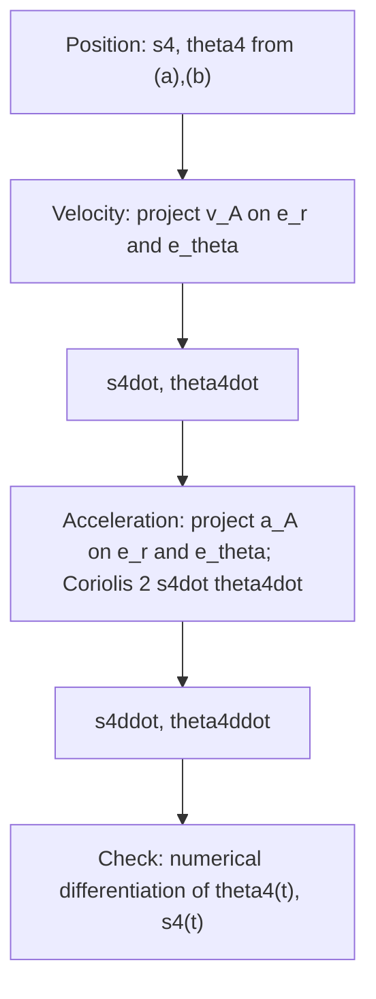

# Problem 2.19 – Quick-Return Mechanism

Related: [[Tutorial-5-solution]] (relative velocity and acceleration, polygons) · [[Tutorial-6-solution]]

> [!question] Problem 2.19
> Consider the quick-return mechanism of Fig. 2.9a. With prescribed values of $l_1$, $l_2$, $\theta_2$, $\dot\theta_2$ and $\ddot\theta_2$, determine the angular velocity and angular acceleration of the slotted lever (link 4), i.e. $\dot\theta_4$ and $\ddot\theta_4$.

> [!note] The geometry (Fig. 2.9a is not in the screenshot)
> The image shows Fig. 2.38, which belongs to the previous problem. The geometry of Fig. 2.9a follows from the book's equations (a) and (b):
> $$s_4\cos\theta_4=l_2\cos\theta_2,\qquad -l_1+s_4\sin\theta_4=l_2\sin\theta_2.$$
> So: $O_4$ is the pivot of the slotted lever 4, $O_2$ is the crank pivot **a distance $l_1$ vertically above $O_4$**, the crank $O_2A$ has length $l_2$ at angle $\theta_2$ from the horizontal, and a sliding block at $A$ runs in the slot of link 4. $s_4=O_4A$ and $\theta_4$ is the lever angle from the horizontal. For a quick-return action $l_1>l_2$.

> [!summary] Result
> With $\delta=\theta_4-\theta_2$:
> $$\dot\theta_4=\frac{l_2\dot\theta_2}{s_4}\cos\delta,\qquad \dot s_4=l_2\dot\theta_2\sin\delta$$
> $$\boxed{\ddot\theta_4=\frac{l_2}{s_4}\Big[\ddot\theta_2\cos\delta+\dot\theta_2^{\,2}\sin\delta\Big]-\frac{2\,l_2^{2}\dot\theta_2^{\,2}}{s_4^{2}}\sin\delta\cos\delta}\qquad
> \boxed{\ddot s_4=s_4\dot\theta_4^{\,2}+l_2\ddot\theta_2\sin\delta-l_2\dot\theta_2^{\,2}\cos\delta}$$
> with $s_4=\sqrt{l_1^2+l_2^2+2l_1l_2\sin\theta_2}$, $\ \theta_4=\operatorname{atan2}(l_1+l_2\sin\theta_2,\ l_2\cos\theta_2)$.

---

## 1. Theory

### 1.1 Mechanism and why it is "quick return"
A crank (2) rotating uniformly drives a block along the slot of the lever (4), which oscillates about $O_4$. Because the crank pivot $O_2$ lies off the lever's axis of rotation, the crank takes **more** than half a revolution for the forward (cutting) swing and **less** for the return swing.

The lever reaches its extreme positions when the slot is tangent to the crank circle, i.e. $\sin\frac\psi2=\dfrac{l_2}{l_1}$, where $\psi$ is the total lever swing. The crank angles of the two strokes are $180^\circ\pm\psi$:

$$\text{quick-return ratio}=\frac{\text{forward time}}{\text{return time}}=\frac{180^\circ+\psi}{180^\circ-\psi},\qquad \psi=2\arcsin\frac{l_2}{l_1}$$

### 1.2 Vector-loop (position) equation
$$\underbrace{s_4e^{i\theta_4}}_{\overrightarrow{O_4A}}=\underbrace{i\,l_1}_{\overrightarrow{O_4O_2}}+\underbrace{l_2e^{i\theta_2}}_{\overrightarrow{O_2A}}$$
Real and imaginary parts give (a) and (b). Unknowns: $s_4$ and $\theta_4$ (given $\theta_2$). Squaring and adding:
$$s_4^2=l_1^2+l_2^2+2l_1l_2\sin\theta_2,\qquad \tan\theta_4=\frac{l_1+l_2\sin\theta_2}{l_2\cos\theta_2}.$$

### 1.3 Two ways to differentiate
**(i) Direct differentiation of the loop equations** (the route in the book).
**(ii) Polar components in the frame of the lever.** The point $A$ moves on link 4 with polar coordinates $(s_4,\theta_4)$ about $O_4$. With unit vectors $\mathbf e_r=(\cos\theta_4,\sin\theta_4)$, $\mathbf e_\theta=(-\sin\theta_4,\cos\theta_4)$:

$$\mathbf v_A=\dot s_4\,\mathbf e_r+s_4\dot\theta_4\,\mathbf e_\theta$$

$$\mathbf a_A=\big(\ddot s_4-s_4\dot\theta_4^2\big)\mathbf e_r+\big(s_4\ddot\theta_4+2\dot s_4\dot\theta_4\big)\mathbf e_\theta$$

The term $2\dot s_4\dot\theta_4$ is the **Coriolis acceleration**. The same result follows from the coincident-point method: $A_2$ (on the crank) and $A_4$ (on the lever) coincide, and
$$\mathbf a_{A_2}=\mathbf a_{A_4}+\mathbf a^{\,c}+\mathbf a_{A_2/A_4},\qquad
\begin{cases}\mathbf a_{A_4}=-s_4\dot\theta_4^2\mathbf e_r+s_4\ddot\theta_4\mathbf e_\theta\\ \mathbf a^{\,c}=2\dot\theta_4\dot s_4\,\mathbf e_\theta\\ \mathbf a_{A_2/A_4}=\ddot s_4\,\mathbf e_r\ (\text{along the slot})\end{cases}$$

The crank end moves on a circle, so its velocity and acceleration are known:
$$\mathbf v_{A_2}=l_2\dot\theta_2\,(-\sin\theta_2,\cos\theta_2),\qquad \mathbf a_{A_2}=l_2\ddot\theta_2(-\sin\theta_2,\cos\theta_2)-l_2\dot\theta_2^2(\cos\theta_2,\sin\theta_2).$$



---

## 2. Solution

### Step 1 – Position
$$s_4=\sqrt{l_1^2+l_2^2+2l_1l_2\sin\theta_2},\qquad \theta_4=\operatorname{atan2}\big(l_1+l_2\sin\theta_2,\ l_2\cos\theta_2\big)$$
(equations (a), (b) of the book).

### Step 2 – Velocity (equations (c)–(f) of the book)
Differentiate (a) and (b):

$$\dot s_4\cos\theta_4-s_4\sin\theta_4\,\dot\theta_4=-l_2\sin\theta_2\,\dot\theta_2\tag{c}$$
$$\dot s_4\sin\theta_4+s_4\cos\theta_4\,\dot\theta_4=\ \ l_2\cos\theta_2\,\dot\theta_2\tag{d}$$

Multiply (c) by $\cos\theta_4$ and (d) by $\sin\theta_4$ and add; then multiply (d) by $\cos\theta_4$ and (c) by $\sin\theta_4$ and subtract:

$$\dot s_4=l_2\dot\theta_2\big(\cos\theta_2\sin\theta_4-\sin\theta_2\cos\theta_4\big)=l_2\dot\theta_2\sin(\theta_4-\theta_2)\tag{f}$$
$$s_4\dot\theta_4=l_2\dot\theta_2\big(\cos\theta_2\cos\theta_4+\sin\theta_2\sin\theta_4\big)\ \Rightarrow\ \dot\theta_4=\frac{l_2\dot\theta_2}{s_4}\cos(\theta_4-\theta_2)\tag{e}$$

*Geometric meaning:* $\dot s_4$ and $s_4\dot\theta_4$ are the components of $\mathbf v_{A_2}$ along and perpendicular to the slot (angle $\delta$ between the crank direction normal and the slot).

### Step 3 – Acceleration (the part left as an exercise)
Differentiate (c) and (d) once more:

$$\ddot s_4\cos\theta_4-2\dot s_4\dot\theta_4\sin\theta_4-s_4\dot\theta_4^2\cos\theta_4-s_4\ddot\theta_4\sin\theta_4=-l_2\dot\theta_2^2\cos\theta_2-l_2\ddot\theta_2\sin\theta_2\tag{g}$$
$$\ddot s_4\sin\theta_4+2\dot s_4\dot\theta_4\cos\theta_4-s_4\dot\theta_4^2\sin\theta_4+s_4\ddot\theta_4\cos\theta_4=-l_2\dot\theta_2^2\sin\theta_2+l_2\ddot\theta_2\cos\theta_2\tag{h}$$

Form $(g)\cos\theta_4+(h)\sin\theta_4$:
$$\ddot s_4-s_4\dot\theta_4^2=l_2\ddot\theta_2\sin\delta-l_2\dot\theta_2^2\cos\delta$$

Form $(h)\cos\theta_4-(g)\sin\theta_4$:
$$s_4\ddot\theta_4+2\dot s_4\dot\theta_4=l_2\ddot\theta_2\cos\delta+l_2\dot\theta_2^2\sin\delta$$

Hence, with $\delta=\theta_4-\theta_2$,

$$\boxed{\ddot s_4=s_4\dot\theta_4^2+l_2\ddot\theta_2\sin\delta-l_2\dot\theta_2^2\cos\delta}$$

$$\boxed{\ddot\theta_4=\frac{l_2\ddot\theta_2\cos\delta+l_2\dot\theta_2^2\sin\delta-2\dot s_4\dot\theta_4}{s_4}}$$

Substituting (e) and (f) for $\dot\theta_4$ and $\dot s_4$ gives the fully explicit form
$$\ddot\theta_4=\frac{l_2}{s_4}\Big[\ddot\theta_2\cos\delta+\dot\theta_2^2\sin\delta\Big]-\frac{2\,l_2^2\dot\theta_2^2}{s_4^2}\sin\delta\cos\delta .$$

> [!tip] Special case: constant crank speed
> If $\ddot\theta_2=0$:
> $$\ddot\theta_4=\frac{l_2\dot\theta_2^2}{s_4}\sin\delta\Big[1-\frac{2\,l_2\cos\delta}{s_4}\Big].$$

---

## 3. Worked numerical example

Data (the problem gives symbols only, so I choose representative values): $l_1=200$ mm, $l_2=100$ mm, $\theta_2=60^\circ$, $\dot\theta_2=10$ rad/s (CCW), $\ddot\theta_2=0$.

![[P219-fig1-mechanism.png]]

| Quantity | Value |
|---|---|
| $A=(l_2\cos\theta_2,\ l_1+l_2\sin\theta_2)$ | $(50,\ 286.60)$ mm |
| $s_4=\sqrt{200^2+100^2+2(200)(100)\sin60^\circ}$ | $290.93$ mm |
| $\theta_4=\operatorname{atan2}(286.60,\,50)$ | $80.10^\circ$ |
| $\delta=\theta_4-\theta_2$ | $20.10^\circ$ |
| $\dot s_4=1000\sin\delta$ | $343.72$ mm/s |
| $\dot\theta_4=\dfrac{1000\cos\delta}{290.93}$ | **3.228 rad/s** (CCW) |
| $\ddot s_4=s_4\dot\theta_4^2-l_2\dot\theta_2^2\cos\delta$ $=3031.1-9390.7$ | $-6359.6$ mm/s² |
| $\ddot\theta_4=\dfrac{l_2\dot\theta_2^2\sin\delta-2\dot s_4\dot\theta_4}{s_4}$ $=\dfrac{3437.2-2219.0}{290.93}$ | **4.188 rad/s²** (CCW) |

With an angular acceleration of the crank, $\ddot\theta_2=50$ rad/s²: $\ddot\theta_4=20.33$ rad/s² and $\ddot s_4=-4640.9$ mm/s² ($\dot\theta_4$ and $\dot s_4$ are unchanged).

### Composition of the acceleration of $A$ (polar components)

| Term | Value (mm/s²) |
|---|---|
| radial: $\ddot s_4-s_4\dot\theta_4^2$ | $-9390.7$ |
| transverse: $s_4\ddot\theta_4+2\dot s_4\dot\theta_4$ | $+3437.2$ ($=1218.3+2219.0$) |
| magnitude $\sqrt{9390.7^2+3437.2^2}$ | $10000=l_2\dot\theta_2^2$ ✔ (pure centripetal, since $\ddot\theta_2=0$) |

The Coriolis part $2\dot s_4\dot\theta_4=2219$ mm/s² is **larger than the tangential acceleration of the lever** $s_4\ddot\theta_4=1218$ mm/s²: it cannot be neglected.

![[P219-fig3-accel-quickreturn.png]]

---

## 4. Verification

I drove the crank with $\theta_2(t)=60^\circ+10t+\tfrac12\ddot\theta_2t^2$ and differentiated $\theta_4(t)$ and $s_4(t)$ numerically (central differences):

| | $\ddot\theta_2=0$: analysis | numerical | $\ddot\theta_2=50$: analysis | numerical |
|---|---|---|---|---|
| $\dot\theta_4$ | 3.22781 | 3.22781 | 3.22781 | 3.22781 |
| $\ddot\theta_4$ | 4.18755 | 4.18755 | 20.32659 | 20.32659 |
| $\dot s_4$ | 343.724 | 343.724 | 343.724 | 343.724 |
| $\ddot s_4$ | −6359.57 | −6359.57 | −4640.95 | −4640.95 |

The closure equations also check: $s_4\cos\theta_4=50.000=l_2\cos\theta_2$ and $-l_1+s_4\sin\theta_4=-200+286.60=86.60=l_2\sin\theta_2$, and the polar components of $\mathbf a_{A_2}$ equal $(\ddot s_4-s_4\dot\theta_4^2,\ s_4\ddot\theta_4+2\dot s_4\dot\theta_4)$ exactly.

---

## 5. Behaviour over a full crank revolution

![[P219-fig2-kinematics.png]]

- $\theta_4$ oscillates between $60^\circ$ and $120^\circ$: the swing $\psi=2\arcsin(l_2/l_1)=60^\circ$.
- $\dot\theta_4$ changes sign at $\theta_2=210^\circ$ and $330^\circ$ (extreme lever positions). The lever turns CCW ($\dot	heta_4>0$) while the crank turns through $240^\circ$ (from $330^\circ$ round to $210^\circ$) and CW during the remaining $120^\circ$.
- **Quick-return ratio** $=\dfrac{180^\circ+60^\circ}{180^\circ-60^\circ}=2$.

### Animation

![[P219-anim.gif]]

---

## 6. Summary

> [!success] Results
> $$\dot\theta_4=\frac{l_2\dot\theta_2}{s_4}\cos(\theta_4-\theta_2)$$
> $$\ddot\theta_4=\frac{l_2\ddot\theta_2\cos\delta+l_2\dot\theta_2^2\sin\delta-2\dot s_4\dot\theta_4}{s_4},\qquad \dot s_4=l_2\dot\theta_2\sin\delta,\quad \ddot s_4=s_4\dot\theta_4^2+l_2\ddot\theta_2\sin\delta-l_2\dot\theta_2^2\cos\delta$$
> Example ($l_1=200$, $l_2=100$ mm, $\theta_2=60^\circ$, $\dot\theta_2=10$ rad/s, $\ddot\theta_2=0$): $\dot\theta_4=3.23$ rad/s, $\ddot\theta_4=4.19$ rad/s².

### Quick revision
- [ ] Loop: $s_4e^{i\theta_4}=il_1+l_2e^{i\theta_2}$; differentiate twice
- [ ] Polar components along and ⊥ to the slot: $\dot s_4=l_2\dot\theta_2\sin\delta$, $s_4\dot\theta_4=l_2\dot\theta_2\cos\delta$
- [ ] Acceleration: radial $\ddot s_4-s_4\dot\theta_4^2$, transverse $s_4\ddot\theta_4+\underbrace{2\dot s_4\dot\theta_4}_{\text{Coriolis}}$
- [ ] Quick-return ratio $=(180^\circ+\psi)/(180^\circ-\psi)$, $\sin(\psi/2)=l_2/l_1$

## Appendix: core code (Python)

```python
import numpy as np
l1, l2 = 200., 100.                       # mm

def kin(th2, w2, a2):
    A = np.array([l2*np.cos(th2), l1 + l2*np.sin(th2)])
    s4, th4 = np.hypot(*A), np.arctan2(A[1], A[0])
    d = th4 - th2
    s4d = l2*w2*np.sin(d)
    w4  = l2*w2*np.cos(d)/s4
    s4dd = s4*w4**2 + l2*a2*np.sin(d) - l2*w2**2*np.cos(d)
    a4  = (l2*a2*np.cos(d) + l2*w2**2*np.sin(d) - 2*s4d*w4)/s4
    return s4, th4, s4d, w4, s4dd, a4

print(kin(np.radians(60), 10., 0.))       # (290.93, 1.398, 343.72, 3.228, -6359.6, 4.188)
```
