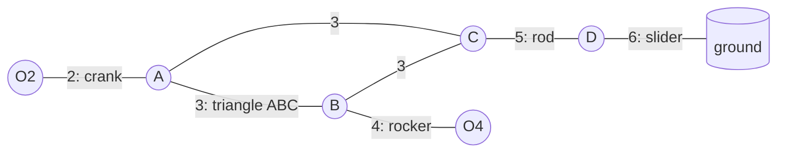
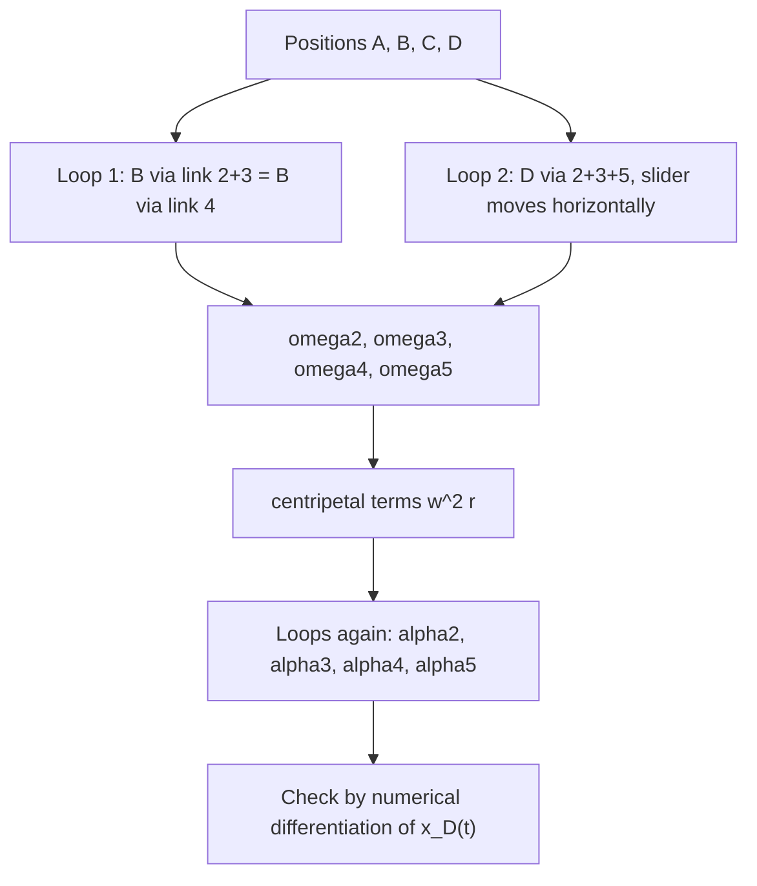

# Tutorial 5 – Atkinson Engine Mechanism

Source: [[Tutorial 5.pdf]] · Next: [[Tutorial-6-solution]], [[Tutorial-7-solution]]

> [!question] Problem
> In the Atkinson engine mechanism of Fig. 1 the velocity and acceleration of the slider at D are $40$ cm/s and $450$ cm/s². Determine $\omega_2,\ \alpha_2,\ \omega_3,\ \alpha_3$.
> $O_2A=4.5$ cm, $AB=12$ cm, $O_4B=6$ cm, $BC=2$ cm, $AC=13$ cm, $CD=14$ cm.

> [!summary] Answer (counter-clockwise positive)
> | $\omega_2$ | $\alpha_2$ | $\omega_3$ | $\alpha_3$ |
> |---|---|---|---|
> | **26.9 rad/s** CCW | **57.5 rad/s²** CCW | **8.58 rad/s** CCW | **151.8 rad/s²** CW |
>
> (Also: $\omega_4=7.95$ rad/s CW, $\omega_5=3.60$ rad/s CCW, $\alpha_4=388$ rad/s² CW, $\alpha_5=141$ rad/s² CCW.)

---

## 1. Theory

### 1.1 Mechanism
Links: **1** frame ($O_2$, $O_4$, slider guide), **2** crank $O_2A$, **3** the rigid triangle $ABC$ (a ternary link), **4** rocker $O_4B$, **5** connecting rod $CD$, **6** slider $D$ on the horizontal ground line.



Degrees of freedom (Gruebler): $n=6$ links; joints: turning pairs at $O_2$, $A$, $B$, $C$, $O_4$, $D$ (6) plus the sliding pair of the slider (1), so $j=7$ lower pairs and
$$F=3(n-1)-2j=3(5)-2(7)=1.$$
One input (the crank) therefore drives everything.

### 1.2 Rigid-body relations (planar, $\mathbf k$ out of the page)
For two points $P,Q$ on the same link, with $\mathbf r_{Q/P}=\mathbf r_Q-\mathbf r_P$:

$$\mathbf v_Q=\mathbf v_P+\boldsymbol\omega\times\mathbf r_{Q/P},\qquad |\mathbf v_{Q/P}|=\omega\,|PQ|,\ \ \perp PQ$$

$$\mathbf a_Q=\mathbf a_P+\underbrace{\boldsymbol\alpha\times\mathbf r_{Q/P}}_{\text{tangential},\ \perp PQ}\ \underbrace{-\ \omega^2\mathbf r_{Q/P}}_{\text{normal (centripetal)},\ \text{towards }P}$$

In components, $\boldsymbol\omega\times\mathbf r=\omega\,(-r_y,\ r_x)$.

### 1.3 Method
1. **Position**: locate $A,B,C,D$ (Step 1).
2. **Velocity**: two closed loops give four linear equations for $\omega_2,\omega_3,\omega_4,\omega_5$ (the slider velocity is given).
3. **Acceleration**: the same loops give four linear equations for $\alpha_2,\alpha_3,\alpha_4,\alpha_5$, with the centripetal terms (already known from step 2) on the right-hand side.



### 1.4 Instantaneous centres (a check)
The instant centre $I_{13}$ of link 3 is the intersection of the normals to the velocities of two of its points: the lines $O_2A$ (normal to $\mathbf v_A$) and $O_4B$ (normal to $\mathbf v_B$). Then
$$\omega_3=\frac{v_A}{I_{13}A}=\frac{v_B}{I_{13}B}.$$

### 1.5 Assumptions (stated because the figure is only a sketch)
- $O_4$ at the origin, ground along the $x$-axis, $O_2=(2,\,10)$ cm (the 2 cm and 10 cm dimensions).
- $O_2A$ makes $60^\circ$ with the **upward vertical through $O_2$**, with $A$ up-left of $O_2$ (as drawn).
- $B$ is the intersection of the circles about $O_4$ (radius 6) and $A$ (radius 12) on the side shown; $C$ lies on the lower-left side of $AB$ as drawn.
- $D$ moves to the **right** (+$x$) with $v_D=40$ cm/s and $a_D=450$ cm/s² also towards +$x$. Other sign choices are given in §6.

---

## 2. Step 1 – Position analysis

$$A=O_2+4.5(\cos150^\circ,\ \sin150^\circ)=(-1.897,\ 12.250)\ \text{cm}$$

**B:** $|B-O_4|=6$ and $|B-A|=12$ with $|O_4A|=12.40$:
$$B=(5.361,\ 2.694)\ \text{cm}$$

**C:** the triangle $ABC$ has sides $AB=12$, $BC=2$, $AC=13$. In the frame along $AB$:
$$c_\parallel=\frac{AC^2-BC^2+AB^2}{2\,AB}=\frac{169-4+144}{24}=12.875,\qquad c_\perp=\sqrt{13^2-12.875^2}=1.80$$
$$C=(4.458,\ 0.909)\ \text{cm}$$

**D:** on $y=0$ with $CD=14$: $x_D=4.458+\sqrt{14^2-0.909^2}=18.429$, so
$$D=(18.429,\ 0)\ \text{cm}$$

Position vectors used below:

| Vector | Components (cm) | Length |
|---|---|---|
| $\mathbf r_A=A-O_2$ | $(-3.897,\ 2.250)$ | 4.5 |
| $\mathbf r_{B/A}$ | $(7.258,\ -9.556)$ | 12 |
| $\mathbf r_{B/O_4}$ | $(5.361,\ 2.694)$ | 6 |
| $\mathbf r_{C/A}$ | $(6.355,\ -11.341)$ | 13 |
| $\mathbf r_{D/C}$ | $(13.971,\ -0.909)$ | 14 |

![[T5-fig1-mechanism.png]]

---

## 3. Step 2 – Velocity analysis

Unknowns $\omega_2,\omega_3,\omega_4,\omega_5$ (CCW positive).

**Loop 1** ($B$ reached through links 2–3 equals $B$ on link 4):
$$\omega_2\,\mathbf k\times\mathbf r_A+\omega_3\,\mathbf k\times\mathbf r_{B/A}=\omega_4\,\mathbf k\times\mathbf r_{B/O_4}$$

$$\begin{aligned}
-2.250\,\omega_2+9.556\,\omega_3+2.694\,\omega_4&=0\\
-3.897\,\omega_2+7.258\,\omega_3-5.361\,\omega_4&=0
\end{aligned}$$

**Loop 2** ($D$ through links 2, 3 (point $C$) and 5; $\mathbf v_D=(40,\,0)$):
$$\omega_2\,\mathbf k\times\mathbf r_A+\omega_3\,\mathbf k\times\mathbf r_{C/A}+\omega_5\,\mathbf k\times\mathbf r_{D/C}=(40,\ 0)$$

$$\begin{aligned}
-2.250\,\omega_2+11.341\,\omega_3+0.909\,\omega_5&=40\\
-3.897\,\omega_2+6.355\,\omega_3+13.971\,\omega_5&=0
\end{aligned}$$

Solving the $4\times4$ system:

$$\boxed{\omega_2=26.91\ \text{rad/s (CCW)},\quad \omega_3=8.577\ \text{rad/s (CCW)}},\qquad \omega_4=-7.949,\quad \omega_5=3.605\ \text{rad/s}$$

Point velocities (cm/s):

| Point | $\mathbf v$ | Magnitude | Check |
|---|---|---|---|
| A | $(-60.55,\ -104.87)$ | 121.1 | $\omega_2\cdot4.5=121.1$ ✔ |
| B | $(21.42,\ -42.62)$ | 47.7 | $\omega_4\cdot6=47.7$ ✔ |
| C | $(36.72,\ -50.36)$ | 62.3 | |
| D | $(40,\ 0)$ | 40 | given ✔ |

**Instant-centre check.** $I_{13}=(10.33,\ 5.19)$ (intersection of the lines $O_2A$ and $O_4B$). $I_{13}A=14.12$ cm, so
$$\omega_3=\frac{121.1}{14.12}=8.577\ \text{rad/s}\ ✔$$

---

## 4. Step 3 – Acceleration analysis

Known centripetal terms ($\omega_2^2=724.2$, $\omega_3^2=73.56$, $\omega_4^2=63.19$, $\omega_5^2=13.00$).

**Loop 1:**
$$\alpha_2\,\mathbf k\times\mathbf r_A+\alpha_3\,\mathbf k\times\mathbf r_{B/A}-\alpha_4\,\mathbf k\times\mathbf r_{B/O_4}=\omega_2^2\mathbf r_A+\omega_3^2\mathbf r_{B/A}-\omega_4^2\mathbf r_{B/O_4}$$

**Loop 2** ($\mathbf a_D=(450,\,0)$):
$$\alpha_2\,\mathbf k\times\mathbf r_A+\alpha_3\,\mathbf k\times\mathbf r_{C/A}+\alpha_5\,\mathbf k\times\mathbf r_{D/C}=(450,\ 0)+\omega_2^2\mathbf r_A+\omega_3^2\mathbf r_{C/A}+\omega_5^2\mathbf r_{D/C}$$

The coefficient matrix is the same as in the velocity problem (only the right-hand side differs). Solving:

$$\boxed{\alpha_2=57.55\ \text{rad/s}^2\ (\text{CCW}),\quad \alpha_3=-151.84\ \text{rad/s}^2\ (\text{CW})},\qquad \alpha_4=-388.4,\quad\alpha_5=141.2\ \text{rad/s}^2$$

Point accelerations (cm/s²):

| Point | $\mathbf a$ | Components |
|---|---|---|
| A | $(2692.7,\ -1853.6)$ | $\mathbf a^n=-\omega_2^2\mathbf r_A=(2822.1,\,-1629.5)$, $\mathbf a^t=\alpha_2\mathbf k\times\mathbf r_A=(-129.5,\,-224.3)$ |
| B | $(707.7,\ -2252.7)$ | identical along link 3 and along link 4 ✔ |
| C | $(503.1,\ -1984.3)$ | |
| D | $(450.0,\ 0)$ | given ✔ |

![[T5-fig2-polygons.png]]

Velocity polygon (left): $oa\perp O_2A$, $ab\perp AB$, $ob\perp O_4B$ (so $b$ is found), $ac\perp AC$ with $c$ on triangle $abc\sim ABC$, $cd\perp CD$ and $od$ horizontal. Acceleration polygon (right): dashed = centripetal parts, solid = tangential parts; the two routes to $b'$ meet.

---

## 5. Verification

Using the position model of Step 1 as a closed-form function of the crank angle, I drove the crank with $\theta_2(t)=150^\circ+\omega_2t+\tfrac12\alpha_2t^2$ and differentiated numerically:

| Quantity | Analysis | From numerical differentiation of the position model |
|---|---|---|
| $v_D$ | 40 | 39.9999 |
| $a_D$ | 450 | 449.996 |
| $\omega_3$ | 8.5771 | 8.5771 |
| $\alpha_3$ | −151.841 | −151.842 |

### Behaviour over a full crank rotation

![[T5-fig3-sweep.png]]

At the given configuration $v_D/\omega_2=1.49$ cm/rad (red dot).

### Animation

![[T5-anim.gif]]

---

## 6. Sign conventions

The linear velocity equations scale with $v_D$, so reversing $\mathbf v_D$ reverses $\omega_2,\omega_3$ (the accelerations depend on $\omega^2$ and on $\mathbf a_D$ only):

| $v_D$ | $a_D$ | $\omega_2$ | $\omega_3$ | $\alpha_2$ | $\alpha_3$ |
|---|---|---|---|---|---|
| →  40 | →  450 | **+26.91** | **+8.58** | **+57.55** | **−151.84** |
| →  40 | ←  450 | +26.91 | +8.58 | −547.9 | −344.8 |
| ←  40 | →  450 | −26.91 | −8.58 | +57.55 | −151.84 |
| ←  40 | ←  450 | −26.91 | −8.58 | −547.9 | −344.8 |

> [!warning] Reading the figure
> The sketch is not to scale: the 60° reading ($O_2A$ at $60^\circ$ to the vertical, $A$ up-left) reproduces the drawn positions of $B$ and $C$ to within about 0.5 cm, so I used it. The answer would change if the intended angle were measured differently.

## 7. Summary

> [!success] Results
> $\omega_2=26.9$ rad/s CCW · $\alpha_2=57.5$ rad/s² CCW · $\omega_3=8.58$ rad/s CCW · $\alpha_3=151.8$ rad/s² CW.

### Quick revision
- [ ] $\mathbf v_Q=\mathbf v_P+\omega\times\mathbf r_{Q/P}$; $\mathbf a_Q=\mathbf a_P+\alpha\times\mathbf r-\omega^2\mathbf r$
- [ ] Two loops give four linear equations for the four angular velocities; the same matrix gives the angular accelerations
- [ ] $I_{13}$: intersection of the normals to two velocities; $\omega_3=v_A/I_{13}A$
- [ ] Check with the velocity and acceleration polygons and by numerical differentiation

## Appendix: core code (Python)

```python
import numpy as np
O4, O2 = np.array([0., 0.]), np.array([2., 10.])
perp = lambda v: np.array([-v[1], v[0]])
rA, rBA, rBO, rCA, rDC = A-O2, B-A, B-O4, C-A, D-C          # position vectors (cm)
M = np.zeros((4, 4))
M[0:2] = np.column_stack([perp(rA), perp(rBA), -perp(rBO), [0, 0]])
M[2:4] = np.column_stack([perp(rA), perp(rCA), [0, 0], perp(rDC)])
w = np.linalg.solve(M, [0, 0, 40, 0])                          # w2, w3, w4, w5
rhs = np.r_[w[0]**2*rA + w[1]**2*rBA - w[2]**2*rBO,
            np.array([450, 0]) + w[0]**2*rA + w[1]**2*rCA + w[3]**2*rDC]
alpha = np.linalg.solve(M, rhs)                                # a2, a3, a4, a5
```
