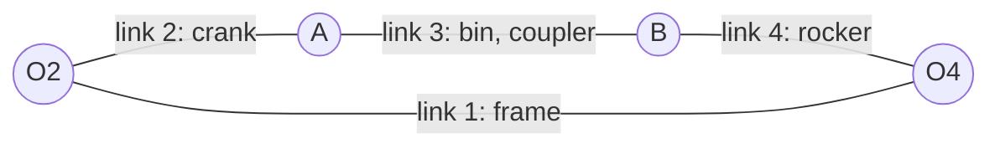
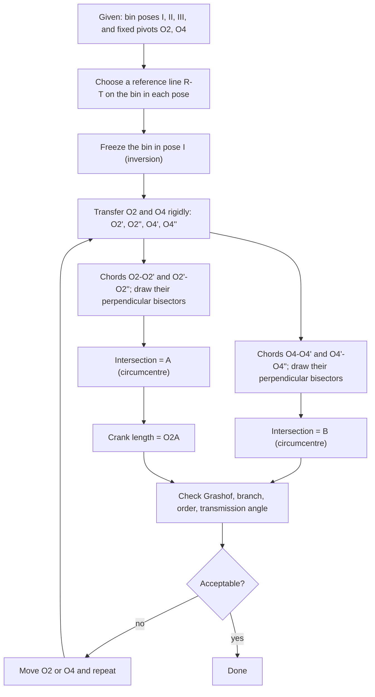

# Tutorial 6 – Tipper-Dumper Truck

> [!question] Problem (Q1)
> Fig. 1 shows a tipper-dumper truck. The fixed pivots $O_2$ and $O_4$ are chosen conveniently on the truck body. Given the **transport (I)**, **intermediate (II)** and **dumping (III)** configurations of the bin, locate **A** and **B** on the bin.
> • Determine the length of the crank.

Source: [[Tutorial 6.pdf]] · Neighbours: [[Tutorial 5.pdf]], [[Tutorial 7.pdf]]

> [!abstract] Contents
> 1. [[#1. Theory]] · 2. [[#2. Data read from the figure]] · 3. [[#3. Solution]] · 4. [[#4. Verification and animation]] · 5. [[#5. Kinematic quality checks]] · 6. [[#6. Sensitivity and design space]] · 7. [[#7. Answer]] · 8. [[#8. Appendix]]

> [!summary] Answer in one line
> **A ≈ (28.9, −41.0) mm** and **B ≈ (25.1, −23.9) mm** from the bin's top-left corner; **crank $O_2A \approx 21.9$ mm** (printed-figure scale).

---

## 1. Theory

### 1.1 Where this sits in synthesis

Kinematic synthesis asks the reverse of analysis: *given the motion, find the mechanism*. Three classical tasks:

| Task                         | What is prescribed                                       | This problem?                    |
| ---------------------------- | -------------------------------------------------------- | -------------------------------- |
| **Function generation**      | Input–output angle relation $\theta_4=f(\theta_2)$       | No                               |
| **Path generation**          | A path for one coupler point                             | No                               |
| **Motion (body) generation** | Successive **positions and orientations** of the coupler | **Yes – the bin is the coupler** |

The bin must be at three prescribed poses, so this is **three-position motion generation**.

### 1.2 The mechanism

| Link | Name | Role in the truck |
|---|---|---|
| 1 | Frame | Chassis with pivots $O_2$, $O_4$ |
| 2 | **Crank** $O_2A$ | Driven link (the hydraulic ram 5–6 pushes it) |
| 3 | **Coupler** $AB$ | **The bin** |
| 4 | Rocker $O_4B$ | Swinging support |



### 1.3 Counting the unknowns (why this problem is solvable)

A planar position of a rigid body has 3 degrees of freedom ($x$, $y$, $\phi$). A displacement between two positions is therefore defined by 3 numbers.

| Quantity | Count |
|---|---|
| Unknowns to design a four-bar: $O_2$ (2), $A$ (2), $O_4$ (2), $B$ (2) | 8 coordinates |
| Constraint per precision position beyond the first, for each dyad | 1 (constant link length) |
| Constraints for 3 positions, two dyads | $2\times2=4$ |
| Fixed pivots chosen (given) | $-4$ unknowns |
| **Remaining** | **4 unknowns, 4 equations → unique** |

> [!info] More or fewer positions
> | Positions | Solutions | Remark |
> |---|---|---|
> | 2 | ∞⁴ (choose both pivots of each dyad freely on bisector lines) | Easy: $A$ lies anywhere on the perpendicular bisector of $O_2O_2'$ |
> | **3** | **∞² per dyad (choose the fixed pivot)** | **This problem** – the answer is a circumcentre |
> | 4 | ∞¹ (Burmester curves: circle-point and centre-point curves) | Pivots must be on these curves |
> | 5 | ≤ 4 pairs (finite) | Burmester points |
> | ≥ 6 | None in general | Use optimisation |

### 1.4 The circle-point idea

A point **A** on the bin is connected to $O_2$ by a rigid link of fixed length. In *every* bin position, A must lie on one circle centred at $O_2$. Hence, in the three positions, $A_1, A_2, A_3$ must be **concyclic**, with centre $O_2$.

We do not yet know where A is on the bin, which is why we invert.

### 1.5 Kinematic inversion (the central trick)

Relative motion is unchanged if we freeze the bin and let the frame move instead.

- Freeze the bin in pose I.
- The frame, together with $O_2$ and $O_4$, appears to translate and rotate into new places.
- $O_2$ appears at three places: $O_2$ (pose I), $O_2'$ (pose II), $O_2''$ (pose III).

A is a **fixed point of the frozen bin**, and the distance $|AO_2|$ never changes. So A is **equidistant from $O_2, O_2', O_2''$**.

> [!important] Key result
> **A = circumcentre of $(O_2,\,O_2',\,O_2'')$** and **B = circumcentre of $(O_4,\,O_4',\,O_4'')$.**
> The circumcentre is the intersection of the **perpendicular bisectors** of the chords.
> Crank $=|O_2A|$ · rocker $=|O_4B|$ · coupler $=|AB|$.

### 1.6 Algebraic form (what a computer does)

Describe bin pose $j$ by a reference point $R_j$ and the orientation $\phi_j$ of the line $R_jT_j$. The inverted image of a frame point $Q$ is

$$
Q^{(j)} \;=\; R_1 \;+\; \mathbf{R}(\phi_1-\phi_j)\,\big(Q-R_j\big),
\qquad
\mathbf{R}(\alpha)=\begin{bmatrix}\cos\alpha&-\sin\alpha\\ \sin\alpha&\cos\alpha\end{bmatrix}
$$

The circumcentre $C$ of three points $P_1,P_2,P_3$ solves the linear system

$$
\begin{bmatrix} 2(P_2-P_1)^{T}\\ 2(P_3-P_1)^{T}\end{bmatrix} C=
\begin{bmatrix}|P_2|^2-|P_1|^2\\ |P_3|^2-|P_1|^2\end{bmatrix},
\qquad r=|C-P_1|
$$

The system is singular when $P_1,P_2,P_3$ are collinear. Then the circle has infinite radius, meaning a **slider** instead of a crank (this is how a sliding-pivot solution arises).

### 1.7 Rotation poles of the displacements

Each displacement (I→II, I→III, II→III) is equivalent to a pure rotation about a **pole**. A pole is the intersection of the perpendicular bisectors of the displacements of any two points of the body. The three poles form the **pole triangle**, a standard tool in Burmester theory.

For two positions, $A$ and $O_2$ are related through the pole $P_{12}$ by $|P_{12}A_1|=|P_{12}A_2|$. The three-position solution used here is equivalent to finding the circle through $O_2$ and its two images.

### 1.8 Quality checks every synthesis needs

A mathematically valid answer can still be useless. Always check:

1. **Grashof criterion** – can any link rotate fully? $s+l\le p+q$.
2. **Branch defect** – are all poses on the same assembly circuit? (A linkage cannot jump branches without disassembly.)
3. **Order defect** – is the sequence I→II→III reached in the same *order* of crank angle?
4. **Transmission angle** $\mu$ – the angle between coupler and rocker. For good force transfer, $40^\circ\lesssim\mu\lesssim140^\circ$.
5. **Mechanical advantage** – the ratio $\omega_4/\omega_2$ or $\omega_3/\omega_2$ (via instant centres).

$$
\cos\mu=\frac{|AB|^2+|O_4B|^2-|AO_4|^2}{2\,|AB|\,|O_4B|}
$$

$$
\text{Grashof: } s+l\le p+q
\quad (s=\text{shortest},\ l=\text{longest},\ p,q=\text{the others})
$$

### 1.9 Graphical procedure



### 1.10 Glossary

| Term | Meaning |
|---|---|
| Precision position | A pose the mechanism must hit exactly |
| Dyad | Two-link chain $O_2A$ + half the coupler; each dyad is solved separately |
| Inversion | Freezing one link and moving the frame instead |
| Pole | Centre of the pure rotation equivalent to a displacement |
| Toggle | A position where $\mu\to0^\circ$ or $180^\circ$; the linkage locks |

---

## 2. Data read from the figure

I measured Fig. 1(b) from the PDF at 300 dpi and used **mm on the printed page** (x right, y up). The reference line is the top edge $R_jT_j$ of the bin (top-left corner to tip).

![[T6-fig1-given.png]]

| Pose | $R_j$ (mm) | $T_j$ (mm) | Bin angle $\phi_j$ |
|---|---|---|---|
| I (transport) | (45.0, −11.2) | (117.2, −14.1) | −2.3° |
| II (intermediate) | (73.7, −3.0) | (131.1, −46.2) | −37.0° |
| III (dumping) | (96.1, −6.4) | (120.2, −72.4) | −69.9° |

Fixed pivots: $O_2=(53.2,\,-64.1)$ and $O_4=(71.1,\,-66.5)$, so the frame length is $|O_2O_4|=18.1$ mm.

Bin rotations: I→II $=34.6^\circ$, II→III $=32.9^\circ$, I→III $=67.6^\circ$ (clockwise as drawn).

> [!warning] Accuracy of the readings
> These are graphical readings, accurate to roughly ±0.4 mm. The **method is exact**, but the numbers move a little with the reading (quantified in [[#6. Sensitivity and design space]]). If your printed sheet is scaled, multiply all lengths by the same factor.

---

## 3. Solution

### Step 1 – Choose the reference line and the three poses
The line $R_jT_j$ gives each pose of the bin (table above).

### Step 2 – Invert the motion (freeze the bin in pose I)

Moving the frame rigidly so that the bin returns to pose I gives:

| Point | From I | From II (′) | From III (″) |
|---|---|---|---|
| $O_2$ | (53.2, −64.1) | (62.9, −73.1) | (82.0, −72.9) |
| $O_4$ | (71.1, −66.5) | (79.0, −64.9) | (91.1, −57.2) |

### Step 3 – Perpendicular bisectors → A and B

![[T6-fig2-inversion.png]]

The bisectors of $O_2O_2'$ and $O_2'O_2''$ meet at **A**. The bisectors of $O_4O_4'$ and $O_4'O_4''$ meet at **B**.

**Worked arithmetic for A.** Take $P_1=O_2=(53.17,-64.09)$, $P_2=O_2'=(62.89,-73.13)$, $P_3=O_2''=(82.05,-72.88)$.

$$
\begin{bmatrix}19.44&-18.08\\57.76&-17.58\end{bmatrix}C=
\begin{bmatrix}|P_2|^2-|P_1|^2\\|P_3|^2-|P_1|^2\end{bmatrix}
\;\Rightarrow\;
C=A=(72.2,\,-53.4)
$$

with radius $r=|A-P_1|=21.9$ mm. The same procedure for $O_4$ gives $B=(69.2,\,-36.1)$ with radius 30.4 mm.

In the bin's own frame (origin at the top-left corner $R_1$, x along the top edge):

$$
A_{\text{bin}}=(28.9,\,-41.0)\ \text{mm},\qquad B_{\text{bin}}=(25.1,\,-23.9)\ \text{mm}
$$

### Step 4 – Step-by-step construction (drawing-board view)

![[T6-fig8-steps.png]]

### Step 5 – Crank length and other links

$$
\ell_{\text{crank}}=|O_2A|=\sqrt{(72.2-53.2)^2+(-53.4+64.1)^2}\approx\mathbf{21.9\ mm}
$$

| Link | Symbol | Length (mm) |
|---|---|---|
| Frame | $O_2O_4$ | 18.1 |
| **Crank** | $O_2A$ | **21.9** |
| Coupler (bin) | $AB$ | 17.5 |
| Rocker | $O_4B$ | 30.4 |

![[T6-fig6-links.png]]

> [!note] Scale
> This is the length **on the sheet**. Real length = measured length × drawing scale.

### Step 6 – Cross-check with the rotation poles

![[T6-fig7-poles.png]]

The poles are $P_{12}=(72.4,-52.5)$, $P_{13}=(74.0,-45.5)$, $P_{23}=(79.5,-40.2)$. $P_{12}$ falls almost exactly on A. That is expected: the bin's first move is almost a pure rotation about A's neighbourhood, because the crank is short and near toggle there.

---

## 4. Verification and animation

Placing A and B rigidly on the bin in each pose, the distances $|O_2A|$ and $|O_4B|$ stay constant (numerical error below $10^{-13}$ mm). The bin therefore passes exactly through all three poses.

![[T6-fig3-poses.png]]

### Animation of the synthesized mechanism

Crank (red), bin = coupler (green), rocker (blue); dotted outlines are the three required poses; the teal line is the path of the bin tip.

![[T6-anim.gif]]

### Paths of bin points

![[T6-fig4-paths.png]]

The tip and lower corner sweep smooth arcs with no loops in the working range.

### Bin tilt against crank angle

![[T6-fig10-tilt.png]]

The bin tilts steadily with the crank, which is what a dumper needs (no reversal of the tilt direction). The three poses sit at crank angles $29.4^\circ$, $30.2^\circ$ and $49.1^\circ$.

---

## 5. Kinematic quality checks

### 5.1 Grashof condition

With $s=17.5$ (coupler) and $l=30.4$ (rocker):

$$
s+l=47.9\;>\;p+q=18.1+21.9=40.0
$$

The linkage is **non-Grashof (a triple-rocker)**: no link rotates fully. For a tipper this is fine because the crank (driven by the ram) only has to rock through the dump range.

![[T6-fig13-grashof.png]]

### 5.2 Branch and order
All three poses are on the same assembly branch (the same sign of the coupler–rocker "elbow"). The crank angles $29.4^\circ\to30.2^\circ\to49.1^\circ$ increase monotonically, so there is **no branch defect and no order defect**.

The linkage can be assembled for crank angles from $29.0^\circ$ to $316^\circ$ (about 80 % of a turn). **Pose I sits only $0.4^\circ$ from the lower limit**, i.e. close to a toggle.

### 5.3 Transmission angle

![[T6-fig5-transmission.png]]

| Pose | Crank angle | $\mu$ |
|---|---|---|
| I | 29.4° | ≈ 6° |
| II | 30.2° | ≈ 9° |
| III | 49.1° | ≈ 36° |

> [!warning] Weak point
> $\mu$ is small near poses I and II (target 40°–140°). Near pose I the linkage is almost locked in a toggle. That is helpful for holding the bin down in transport, but the ram needs a large force to start the lift.

### 5.4 Velocity ratio (mechanical advantage)

![[T6-fig9-velratio.png]]

The bin-to-crank angular-velocity ratio $\omega_3/\omega_2$ is about **10.4, 7.7 and 2.1** at poses I, II and III. At the start, a small crank motion gives a large bin rotation, so the ram sees a high load. The ratio falls as the bin rises, which suits a dumping action (load shrinks as the contents slide out).

---

## 6. Sensitivity and design space

### 6.1 Effect of reading error (Monte Carlo)

I perturbed every read coordinate ($R_j$, $T_j$, $O_2$, $O_4$) by Gaussian noise of σ = 0.4 mm and re-solved 3000 times.

![[T6-fig12-montecarlo.png]]

| Output | Median | Spread |
|---|---|---|
| Crank $O_2A$ | 21.8 mm | 5–95 %: 19.6–24.4 mm (stable) |
| Rocker $O_4B$ | 30.3 mm | 5–95 %: 22.7–48.3 mm (**very sensitive**) |
| $\mu$ at pose I | 5.9° | ± 2.8° |

> [!tip] Reading the table
> The **crank length is robust** (±1.5 mm), so the requested answer is reliable. The rocker is not, because the three images of $O_4$ are almost collinear, making the circle through them poorly conditioned. This is a genuine property of the given geometry, not only a reading error.

### 6.2 What if $O_2$ were placed elsewhere?

Pivots are "chosen conveniently", so we may move them. Keeping $O_4$ and B fixed, the map shows the worst transmission quality $\min(\mu,180^\circ-\mu)$ over the three poses for each trial $O_2$, and the crank length that results.

![[T6-fig11-designspace.png]]

- Dark band: toggle-prone choices (the chosen $O_2$ sits in a dark region, which explains $\mu\approx6^\circ$).
- Brighter region at the upper right: better force transmission (up to ~69° near $O_2\approx(90,-47)$), but the crank becomes about 68 mm long and moves off the chassis, so it is a trade-off.
- A practical improvement is to shift $O_2$ rightwards and upwards a few mm and redo Step 3.

---

## 7. Answer

> [!success] Result
> - **A** and **B** are the circumcentres of $(O_2,O_2',O_2'')$ and $(O_4,O_4',O_4'')$.
> - In the bin's frame, $A\approx(28.9,-41.0)$ mm and $B\approx(25.1,-23.9)$ mm from the top-left corner.
> - **Crank length $O_2A\approx21.9$ mm** (figure scale, robust to ±1.5 mm).
> - Rocker $O_4B\approx30.4$ mm, coupler $AB\approx17.5$ mm, frame $O_2O_4\approx18.1$ mm.
> - Non-Grashof triple-rocker; no branch or order defect; poor $\mu$ near the closed pose (toggle).

### Quick revision

- [ ] Three poses + chosen pivots → **inversion** → **circle through three points**
- [ ] Moving pivot = **circumcentre** (perpendicular bisectors)
- [ ] 2 poses: A anywhere on a bisector · 3 poses: unique · 4 poses: Burmester curves
- [ ] Check **Grashof**, **branch**, **order**, **transmission angle**
- [ ] Always verify by re-assembling the linkage in each pose

### Common mistakes

| Mistake | Fix |
|---|---|
| Rotating the bin instead of inverting the frame | Move the **frame points** $O_2$, $O_4$, keep the bin fixed |
| Using the same rotation angle for both poses | Each pose has its own angle $\phi_j$ |
| Bisecting $O_2O_2''$ and $O_2O_2'$ inconsistently | Any two of the three chords work, but use two well-separated ones |
| Forgetting the checks | Verify branch and $\mu$ before declaring the design done |

---

## 8. Appendix

### 8.1 Core code (Python)

```python
import numpy as np

def rot(a): return np.array([[np.cos(a), -np.sin(a)], [np.sin(a), np.cos(a)]])

def pose(R, T, j):                    # reference point and angle of pose j
    u = T[j] - R[j]
    return R[j], np.arctan2(u[1], u[0])

def to_local(q, R, T, j):
    r, a = pose(R, T, j); return rot(-a) @ (q - r)

def from_local(l, R, T, j):
    r, a = pose(R, T, j); return rot(a) @ l + r

def circumcentre(p1, p2, p3):
    M = 2 * np.array([p2 - p1, p3 - p1])
    b = np.array([p2 @ p2 - p1 @ p1, p3 @ p3 - p1 @ p1])
    c = np.linalg.solve(M, b)
    return c, np.linalg.norm(c - p1)

# inversion: seen from the bin frozen in pose I
inv = lambda q: [from_local(to_local(q, R, T, j), R, T, 0) for j in range(3)]
A, crank = circumcentre(*inv(O2))
B, rocker = circumcentre(*inv(O4))
```

### 8.2 Numerical summary

| Item | Value |
|---|---|
| $O_2$, $O_4$ | (53.2, −64.1), (71.1, −66.5) mm |
| $A$, $B$ (frame coordinates, pose I) | (72.2, −53.4), (69.2, −36.1) mm |
| $A$, $B$ (bin coordinates) | (28.9, −41.0), (25.1, −23.9) mm |
| Link lengths (frame / crank / coupler / rocker) | 18.1 / 21.9 / 17.5 / 30.4 mm |
| Grashof $s+l$ vs $p+q$ | 47.9 > 40.0 (non-Grashof) |
| Crank angles at poses | 29.4°, 30.2°, 49.1° |
| $\mu$ at poses | 6°, 9°, 36° |
| Feasible crank range | 29.0° – 316° |
| Poles | (72.4, −52.5), (74.0, −45.5), (79.5, −40.2) |

### 8.3 Figure index

`T6-fig1` given poses · `fig2` inversion · `fig3` three poses · `fig4` paths · `fig5` transmission angle · `fig6` link lengths · `fig7` poles · `fig8` construction steps · `fig9` velocity ratio · `fig10` bin tilt · `fig11` design space · `fig12` Monte Carlo · `fig13` Grashof map · `T6-anim.gif` animation. All are in the `assets` folder.
