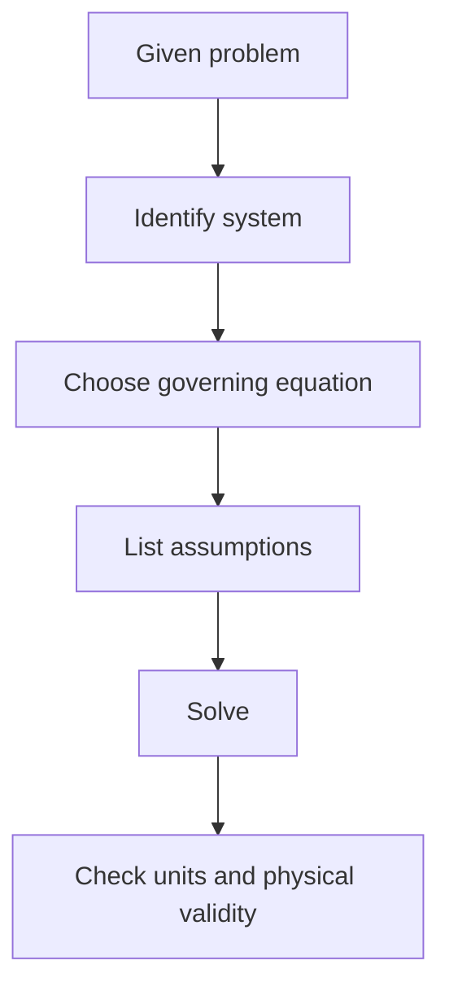

# LLM Wiki Guide

This note tells any LLM how to work inside this vault without flattening it into disconnected summaries.

## Purpose

The vault is a personal engineering wiki. It should help with recall, problem solving, exam preparation, and cross-domain insight. Notes should be useful to a student returning later, not just a transcript of source material.

The wiki should support **multiple ways of understanding a concept**:

* concise written explanations,
* equations and derivations,
* worked examples,
* diagrams and technical sketches,
* flowcharts and process maps,
* graphs and plots,
* infographics,
* cross-domain connections.

Visuals are not decoration. They should be used when they make a concept easier to understand, remember, derive, or apply.

## Structure Rules

* Every major subject needs a map of content ending in `- MOC`.
* Every new concept note should be linked from the nearest MOC.
* Keep notes atomic unless the note is explicitly a MOC, tutorial index, or synthesis page.
* Put solved tutorial questions in the relevant tutorial folder and link them from the tutorial index.
* Use Obsidian links, not bare paths, for internal navigation.
* Use aliases when the display title should be cleaner than the file path.
* Concept notes should be reusable building blocks rather than chronological records of conversations.
* Do not create duplicate notes when an existing note already covers the concept adequately. Extend or link the existing note instead.

## Note Style

Each concept note should usually include:

* a short definition or core idea,
* the governing equation or theorem,
* physical/intuitive interpretation,
* when to use it,
* a worked mini-example or problem-solving pattern when useful,
* links to prerequisites and next concepts,
* cross-domain links when the same math appears elsewhere,
* a visual when a visual representation materially improves understanding.

The exact structure can vary depending on the subject.

For example:

```md
# Concept Name

## Core idea

Short explanation.

## Governing equation

$$
...
$$

## Intuition

Physical/geometric interpretation.

## When to use

- ...
- ...

## Problem-solving pattern

1. ...
2. ...
3. ...

## Visual

[diagram / graph / flowchart when useful]

## Common traps

- ...

## Prerequisites

- [[...]]

## Next concepts

- [[...]]

## Cross-domain links

- This is the same mathematical structure as [[...]] because ...
```

Do not force every heading into every note. The goal is **useful structure, not template compliance**.

# Visual & Diagram Protocol

Visuals should be created whenever they provide substantial explanatory value.

## When to create a visual

Prefer a diagram, graph, flowchart, or infographic when the concept involves:

* spatial relationships,
* geometry,
* mechanisms,
* forces or vectors,
* motion,
* physical systems,
* coordinate systems,
* transformations,
* processes or algorithms,
* cause-and-effect relationships,
* comparisons,
* hierarchical structures,
* multi-step workflows,
* changing quantities,
* mathematical functions,
* experimental setups,
* system architecture,
* cycles,
* timelines,
* state transitions.

Examples:

* **Fluid mechanics:** control volume, streamline, velocity profile, pressure distribution, deformation of a fluid element.
* **Mechanics:** free-body diagrams, mechanisms, velocity polygons, acceleration polygons, kinematic inversions.
* **Strength of materials:** Mohr's circle, stress transformation, beam loading, shear-force/bending-moment relationships.
* **Electrical engineering:** phasor diagrams, circuit topology, impedance relationships, transient-response curves.
* **Differential equations:** direction fields, solution curves, phase portraits, characteristic-root diagrams.
* **Linear algebra:** vector spaces, transformations, eigenvectors/eigenvalues, matrix transformations.
* **Thermodynamics:** PV/TS diagrams, control volumes, cycles, property relationships.
* **Programming:** architecture diagrams, data flow, request/response flow, database relationships.
* **Data science:** distributions, regression plots, confusion matrices, feature relationships.

## Choose the visual type based on the problem

Use the simplest visual that communicates the idea.

### Technical diagram

Use for:

* geometry,
* mechanics,
* physical systems,
* circuits,
* mechanisms,
* free-body diagrams,
* experimental setups.

Example:

```md
## Diagram

[technical diagram showing the relevant physical quantities]
```

The diagram should label only the quantities necessary for understanding.

### Flowchart

Use for:

* algorithms,
* problem-solving procedures,
* decision processes,
* derivations with branching logic,
* experimental procedures.

Example:

```text
Given problem
     ↓
Identify system
     ↓
Choose governing equation
     ↓
List assumptions
     ↓
Substitute known quantities
     ↓
Solve
     ↓
Check units / physical validity
```

### Graph

Use when the relationship between variables matters.

Always label:

* x-axis,
* y-axis,
* units where applicable,
* important points,
* relevant curves.

Do not create decorative graphs with no explanatory purpose.

### Infographic

Use when several related ideas need to be remembered together.

Good uses include:

* formula sheets,
* comparison of methods,
* exam revision summaries,
* concept families,
* "when to use which equation" guides,
* common mistakes,
* process summaries.

An infographic should **compress information without removing the reasoning needed to understand it**.

## Visual-first principle

If a concept is difficult primarily because of its **geometry, spatial relationship, motion, structure, or process**, prefer a visual explanation before a long textual explanation.

For example:

> Instead of explaining a four-bar mechanism entirely through paragraphs, show the mechanism first, label the links and joints, then explain the kinematics.

Similarly:

> Instead of explaining a velocity polygon only through equations, show the vector construction and then explain what each vector represents.

## Mathematical visuals

When a mathematical relationship benefits from visualization, include the relevant graph or geometric interpretation.

Examples:

* derivative → tangent/slope interpretation,
* integral → area interpretation,
* eigenvectors → invariant directions,
* Fourier series → waveform + component interpretation,
* ODE → solution curves,
* resonance → amplitude-frequency curve,
* stability → pole/eigenvalue location,
* second moment → area distribution about an axis.

The visual should reinforce the mathematical definition rather than replace it.

## Diagrams must be technically faithful

For engineering diagrams:

* preserve correct physical relationships,
* use standard symbols where appropriate,
* label forces, dimensions, axes, nodes, joints, or variables clearly,
* maintain consistent notation with the surrounding note,
* do not invent physically meaningful quantities merely to make a diagram look complete,
* distinguish assumptions from known facts,
* do not sacrifice technical accuracy for aesthetics.

For diagrams involving equations, the symbols in the diagram must match the symbols used in the equations.

## Visual captions

Every non-obvious visual should have a short caption explaining what the reader should notice.

Example:

```md
**Figure:** Velocity polygon for the mechanism. The vector
$\vec{v}_{BA}$ represents the relative velocity of B with respect to A.
```

Avoid captions that merely repeat the title.

# Diagram Generation & Implementation

When the environment supports image/diagram generation, use it when a visual would materially improve the note.

For simple diagrams, prefer reproducible formats where practical:

* Mermaid for flowcharts and relationship diagrams,
* SVG for technical diagrams,
* LaTeX/TikZ when mathematical precision is important,
* Python/Matplotlib for plots,
* tables when a diagram would add no meaningful information.

For complex illustrative visuals, an image-generation workflow may be used.

Generated visuals should be stored in the appropriate attachments/assets location and embedded from the note.

Prefer **editable/reproducible diagrams** over opaque images when the diagram is fundamentally geometric, mathematical, or procedural.

## Mermaid example



## Diagram decision rule

Before adding a visual, ask:

1. Does the concept involve geometry, structure, motion, or a process?
2. Would seeing the relationship be faster to understand than reading it?
3. Would the visual help recall the concept later?
4. Can the visual be made technically accurate?
5. Will it add information rather than merely decorate the page?

If the answer to at least one of the first three is strongly yes, consider adding a visual.

Do **not** generate visuals merely to make every note look visually rich.

# LLM Editing Protocol

Before making broad changes:

1. Read [[Home]].
2. Read the relevant subject MOC.
3. Read two or three nearby notes to match notation and style.
4. Preserve existing content unless it is clearly duplicated, broken, or empty.
5. After adding or moving notes, update links in the nearest MOC.
6. Determine whether the new/modified note requires a diagram, graph, flowchart, or infographic.
7. If a visual is required, create or update it and embed it in the note.
8. Log large structural changes in [[Wiki Maintenance Log]].

## Linking Priorities

Use links aggressively where they support learning:

* prerequisite concepts,
* sibling methods,
* common equations,
* solved examples,
* cross-domain analogies,
* common traps or contrasting cases.

Avoid links that only repeat the same folder hierarchy without adding conceptual value.

## Cross-Domain Pattern

When a concept appears in multiple subjects, add a short bridge:

```md
## Cross-domain links

- This is the same mathematical structure as [[...]] because ...
```

Good recurring structures in this vault include:

* linear ODEs,
* eigenvalue problems,
* conservation laws,
* energy methods,
* time constants,
* resonance,
* stability,
* impedance,
* second moments.

When useful, cross-domain links may also include a small comparison diagram or visual showing how the same mathematical structure appears in different subjects.

# Tags

Use tags sparingly. Prefer links and MOCs for structure.

Good tags include:

* `MOC`
* `course`
* `concept`
* `tutorial`
* `synthesis`
* `llm`
* subject tags such as `EE1100`, `fluid-mechanics`, `strength-of-materials`, `differential-equations`

Do not create a tag when an Obsidian link or MOC provides better structure.

# Tutorial & Problem-Solving Notes

Tutorial questions should not become disconnected answer dumps.

A solved problem should make clear:

1. **What concept is being tested?**
2. **What information is given?**
3. **Which governing principle applies?**
4. **Why does it apply?**
5. **Step-by-step solution**
6. **Final result**
7. **Common trap / alternative approach**
8. **Links to the underlying concept notes**

When a problem depends strongly on geometry or a physical setup, include the relevant diagram.

For multi-question tutorials, maintain a tutorial index linking each problem to the concepts it tests.

Example:

````md
# Tutorial 4 - MOC

## Questions

- [[Tutorial 4 Q1]] — [[Resonance]], [[Three Phase Circuits]]
- [[Tutorial 4 Q2]] — [[Impedance]], [[Phasors]]
- [[Tutorial 4 Q3]] — [[Power Factor]]

## Concept map

```mermaid
graph TD
    A[AC Circuits] --> B[Phasors]
    B --> C[Impedance]
    C --> D[Resonance]
    C --> E[Power Factor]
````

````

# Exam-Revision Visuals

When preparing revision material, prefer high-information visuals such as:

- formula maps,
- decision trees,
- method-selection flowcharts,
- comparison tables,
- annotated diagrams,
- concept maps,
- process diagrams,
- one-page infographics.

For example:

```text
What is the problem asking?
          ↓
   ┌──────┼──────┐
   ↓      ↓      ↓
Velocity Accel. Force
   ↓      ↓      ↓
Velocity Acceleration Newton's
analysis  analysis    2nd Law
````

The goal is to help the student answer:

> **"I see this type of problem — what should I do next?"**

rather than merely memorizing formulas.

# Empty Or Untitled Notes

Do not build on empty `Untitled` notes unless the user asks.

If an empty note is clearly a misplaced duplicate, mention it before deleting or repurposing it.

# Quality Standard

A good wiki note should answer four questions:

1. **What is it?**
2. **Why does it work?**
3. **When do I use it?**
4. **How is it connected to everything else I know?**

A strong engineering note should additionally answer:

5. **Can I visualize it?**
6. **Can I apply it to a problem?**
7. **Where does the same mathematical structure appear elsewhere?**

The objective is not to maximize the number of notes, links, equations, or images.

The objective is to build a **connected mental model** that becomes more useful every time the vault is revisited.
