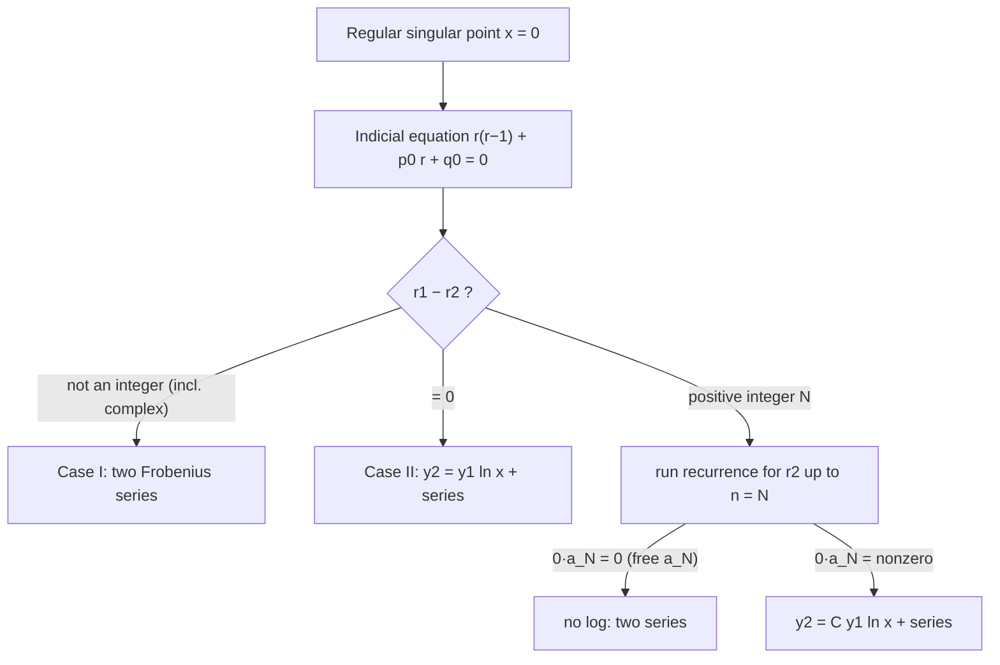

Related: [[Frobenius Theorem]] · [[Regular and Irregular Singular Points]] · [[Cauchy-Euler Equations]] · [[Frobenius Method - Worked Examples]] · [[Bessel's Equation and Bessel Functions of the First Kind]] · [[Series Solutions - MOC]]

The [[Frobenius Theorem]] guarantees a solution $y=x^r\sum a_nx^n$ near a regular singular point. This note derives the equation that fixes $r$ (the **indicial equation**) and explains why the second solution sometimes needs a **logarithm**.

## 1. Derivation of the indicial equation

Let $x=0$ be a regular singular point of $y''+P(x)y'+Q(x)y=0$, so
$$x^2y''+x\,[xP(x)]\,y'+[x^2Q(x)]\,y=0,\qquad xP(x)=p_0+p_1x+\cdots,\quad x^2Q(x)=q_0+q_1x+\cdots$$
Substitute $y=\sum_{n\ge0}a_nx^{n+r}$, $y'=\sum(n+r)a_nx^{n+r-1}$, $y''=\sum(n+r)(n+r-1)a_nx^{n+r-2}$. The **lowest power** $x^r$ (from $n=0$) must have zero coefficient, and $a_0\ne0$:

$$\boxed{r(r-1)+p_0\,r+q_0=0},\qquad p_0=\lim_{x\to0}xP(x),\quad q_0=\lim_{x\to0}x^2Q(x)$$

This is a quadratic in $r$ with roots $r_1\ge r_2$ (if real). It is exactly the auxiliary equation of the Euler equation $x^2y''+p_0xy'+q_0y=0$, which is what the ODE looks like very close to $x=0$ (see [[Cauchy-Euler Equations]]).

Higher powers $x^{n+r}$ give a **recurrence** $a_n=\dfrac{(\text{lower }a\text{'s})}{F(n+r)}$ with $F(s)=s(s-1)+p_0s+q_0$ (so $F(r)$ is the indicial polynomial). The trouble is the denominator: the recurrence breaks down when $F(n+r)=0$ for some $n\ge1$.

- $r=r_1$ (the larger root): $F(n+r_1)\ne0$ for $n\ge1$ ⇒ **always** yields a valid series $y_1$.
- $r=r_2$: $F(n+r_2)=0$ happens exactly when $n=r_1-r_2$, if that is a positive integer.

## 2. The three cases

![[DE-N1-frobenius-cases.png]]
**Figure:** Indicial roots for each case (left) and the corresponding solutions near $x=0$: Case I two pure power-type series; Case II a logarithm (J₀ with its partner); Case III either no logarithm (orders ±½) or a forced one (order 1).

| Case | Condition | Solutions |
|---|---|---|
| **I** | $r_1-r_2\notin\{0,1,2,\dots\}$ | $y_1=x^{r_1}\sum a_nx^n,\ \ y_2=x^{r_2}\sum b_nx^n$ — both from the same recurrence, **no log** |
| **II** | $r_1=r_2=r$ | $y_1=x^{r}\sum a_nx^n,\ \ y_2=y_1\ln x+x^{r}\sum_{n\ge1}b_nx^n$ — **log always** |
| **III** | $r_1-r_2=N\in\mathbb N$ | $y_1=x^{r_1}\sum a_nx^n,\ \ y_2=C\,y_1\ln x+x^{r_2}\sum_{n\ge0}b_nx^n$, with $C$ possibly $0$ |

**Case III test.** Run the recurrence with $r=r_2$ up to $n=N$. At $n=N$ you meet $0\cdot a_N=R$, where $R$ is built from the earlier coefficients:
- $R\ne0$: contradiction ⇒ the logarithm is **forced** ($C\ne0$).
- $R=0$: $a_N$ is a free constant ⇒ **no log**; the second solution is an ordinary series (Bessel order $\tfrac12$).

Constants $C$ and $b_n$ are found by substituting the trial form into the ODE, or by reduction of order ($y_2=y_1\int e^{-\int P}/y_1^2$), or by differentiating the recurrence with respect to $r$.

**Why a logarithm?** When roots coincide (or differ by an integer) the two Euler-type solutions $x^{r_1},x^{r_2}$ collapse into a pair like $x^r,\ x^r\ln x$ — exactly as for a repeated root in a Cauchy–Euler equation. $\ln x\to-\infty$ at $0$, so such solutions are unbounded; this is why Bessel functions $Y_n$ blow up at 0.

## 3. Complex roots

If $r_{1,2}=\alpha\pm i\beta$, $x^{r}=x^\alpha\,[\cos(\beta\ln x)+i\sin(\beta\ln x)]$; take real and imaginary parts (as in the Euler equation case). The difference $2i\beta$ is not an integer, so Case I applies.

## 4. Recipe (10 steps)

1. Verify $x=0$ is a regular singular point ($xP$ and $x^2Q$ analytic).
2. Write $x^2y''+x[xP]y'+[x^2Q]y=0$.
3. Substitute $y=\sum a_nx^{n+r}$.
4. Lowest power ⇒ indicial equation.
5. Solve for $r_1\ge r_2$.
6. Decide Case I, II or III.
7. Collect the coefficient of $x^{n+r}$ ⇒ recurrence.
8. $r=r_1$ ⇒ $y_1$.
9. Build $y_2$ according to the case.
10. $y=Ay_1+By_2$.

## 5. Convergence

The series converge for $0<x<R$ where $R$ is the distance to the next singular point (as in [[Radius of Convergence of Series Solutions]]). If $x=0$ is the only singular point (all Euler-type or Bessel examples), the series converge for all $x>0$.

## Where this appears in the problems
- Case I/II/III classification of nine equations: [[Assignment 4 - Series Solutions - Solutions#Q3 Frobenius method|Assignment 4, Q3]].
- Worked lecture problems: [[Frobenius Method - Worked Examples]].

## Next
[[Frobenius Method - Worked Examples]] → [[Bessel's Equation and Bessel Functions of the First Kind]] (the Frobenius method applied to $x^2y''+xy'+(x^2-\nu^2)y=0$).

## See also
- [[Bessel Functions of the Second Kind and General Solution]] — equal or integer-separated roots force the logarithmic $Y_\nu$.
