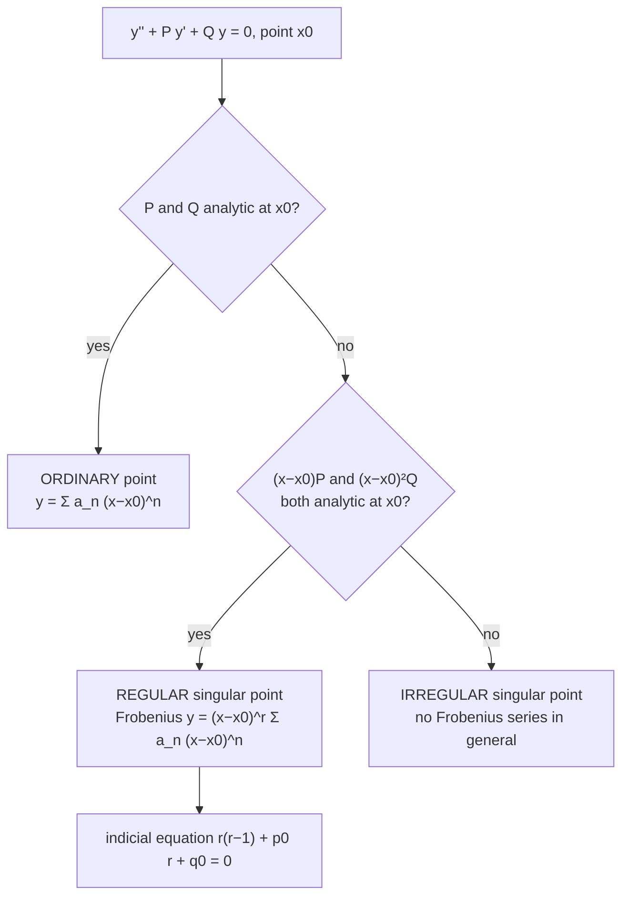

Related: [[Ordinary and Singular Points]] · [[Radius of Convergence of Series Solutions]] · [[Frobenius Theorem]]

We now study $y''+P(x)y'+Q(x)y=0$ near points where $P,Q$ are *not* analytic — **singular points** of the equation. A simple power series $y=\sum a_nx^n$ may fail to exist at a singular point.

**Frobenius** (1849–1917) developed a generalized series method for such points, applicable when the singularity is of a mild type called **regular**. It extends the power series method by allowing a fractional or negative leading power — essential for solving Bessel's equation, Legendre's equation (at $x=\pm1$), and Euler (Cauchy-Euler) equations. See [[Cauchy-Euler Equations]] in the 2nd Order DE folder for the constant-power-law special case that motivates the Frobenius ansatz. Frobenius solutions appear widely in physics: heat flow, waves, quantum mechanics.

## Recap: Ordinary vs Singular

- $x_0$ is **ordinary** if $P(x),Q(x)$ are both analytic at $x_0$ — a power series $y=\sum a_n(x-x_0)^n$ always solves the ODE there.
- $x_0$ is **singular** if $P(x)$ or $Q(x)$ fails to be analytic there. Singular points arise where the leading coefficient $a_0(x)$ of the ODE vanishes.

Not every singular point behaves the same way: some still permit a generalized series solution; others are too severe for any series method to work. The distinction is based on the growth rate of $P(x),Q(x)$ near $x_0$.

## Regular Singular Point

> $x_0$ is a **regular singular point** of $y''+P(x)y'+Q(x)y=0$ if
> (i) $(x-x_0)P(x)$ is analytic at $x_0$, and
> (ii) $(x-x_0)^2Q(x)$ is analytic at $x_0$.

Equivalently: $P(x)$ has at most a simple pole at $x_0$, and $Q(x)$ has at most a pole of order two there. This mild singularity still permits a Frobenius-type series solution.

**Examples:**
- $x^2y''+xy'+(x^2-n^2)y=0$ (Bessel's equation) has $x_0=0$ regular.
- [[Legendre's Equation]] has regular singular points at $x=\pm1$.

## Irregular Singular Point

If $x_0$ is singular but not regular, it is an **irregular singular point** — either $(x-x_0)P(x)$ or $(x-x_0)^2Q(x)$ fails to be analytic at $x_0$.

**Example:** $x^3y''+y'+xy=0$ has $P(x)=1/x^3$, so $(x-0)P(x)=1/x^2$ is not analytic at $x=0$ — hence $x=0$ is an irregular singular point.

Near an irregular singular point, the Frobenius method generally fails; solutions may involve essential singularities or asymptotic (non-convergent) series, requiring more advanced techniques. Fortunately, most classical ODEs of physics have only regular singular points, making the Frobenius method broadly applicable.

## Standard Form Near a Regular Singular Point

Let $x=0$ be a regular singular point (shift $x_0$ to the origin if needed). Then $xP(x)$ and $x^2Q(x)$ are analytic at $x=0$:
$$xP(x) = p_0+p_1x+p_2x^2+\cdots, \qquad x^2Q(x) = q_0+q_1x+q_2x^2+\cdots$$
Multiplying the ODE by $x^2$:
$$x^2y'' + x[xP(x)]y' + [x^2Q(x)]y = 0.$$
This makes the regular singular structure explicit — the equation resembles a Cauchy-Euler equation (recall $ax^2y''+bxy'+cy=0$ from [[Cauchy-Euler Equations]]) but with variable coefficients. This motivates seeking solutions of Euler-type ($x^r$) times a power series — exactly the trial solution Frobenius proposed.

## Visual: classifying a point

Examples: $x=0$ for $y''+xy'+y=0$ is ordinary; $x=0$ for Bessel's $x^2y''+xy'+(x^2-\nu^2)y=0$ is regular; $x=0$ for $x^3y''+y'+xy=0$ is irregular. The indicial equation and its three cases are in [[Frobenius Method - Indicial Equation and Three Cases]].

---
Next: [[Frobenius Theorem]]
