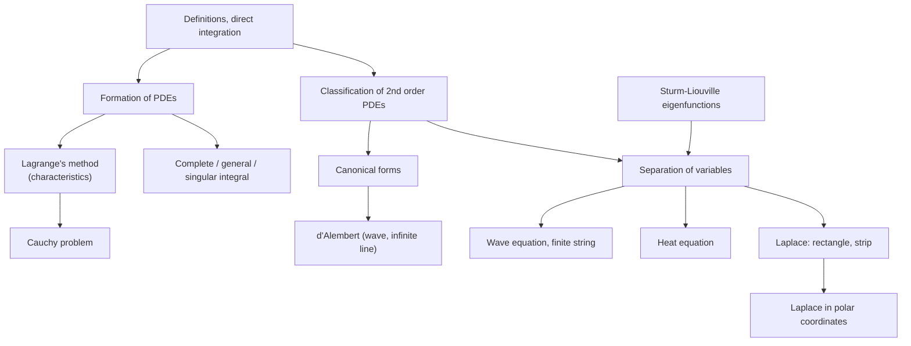

# Partial Differential Equations — Map of Content

Lectures 29–37 of MA 2102 (and Assignments 8–10). Builds on [[Special Functions - MOC]] (Sturm–Liouville eigenfunctions are the building blocks of separation of variables) and on the ODE methods in [[First Order ODEs - MOC]] and [[2nd Order ODEs - MOC]]. Back to [[Differential Equations - MOC]].

## First order (Lectures 30–32)
1. [[Partial Differential Equations - Definitions and Direct Integration]] — order, linear / semilinear / quasi-linear / nonlinear, arbitrary functions · *L30*
2. [[Formation of PDEs - Eliminating Constants and Functions]] — why the general solution of a first-order PDE carries one arbitrary function · *L31*
3. [[Lagrange's Method for Quasi-linear PDEs]] — characteristics, grouping, multipliers, the eigenvalue method · *L31–32*
4. [[Cauchy Problem for First Order PDEs]] — fitting an integral surface to data on a curve; when it fails · *L32*
5. [[Complete, General and Singular Integrals]] — Clairaut's equation and envelopes · *L31*

## Second order and the three model equations (Lectures 33–37)
6. [[Classification of Second Order PDEs]] — $B^2-4AC$, hyperbolic / parabolic / elliptic, regions where the type changes · *L33*
7. [[Canonical Forms of Second Order PDEs]] — characteristic coordinates, the three reduction recipes · *L33*
8. [[D'Alembert's Solution of the Wave Equation]] — travelling waves, domain of dependence, reflection at a boundary · *L33–34*
9. [[Separation of Variables]] — product solutions, eigenvalue problems, superposition · *L34*
10. [[Wave Equation on a Finite Interval]] — vibrating string, normal modes, plucked string · *L34*
11. [[Heat Equation - Separation of Variables]] — decay of modes, insulated and heated ends, steady-state shift · *L34–35*
12. [[Laplace Equation on Rectangles and Strips]] — $\sinh$/$\cosh$ in $y$, four-edge superposition, semi-infinite strip · *L36*
13. [[Laplace Equation in Polar Coordinates]] — disk, annulus, sector, Poisson's formula · *L37*

## Lecture-to-note map

| Lecture | Topic | Note |
|---|---|---|
| 29 | extra Sturm–Liouville examples (Cauchy–Euler SLP, change of variable) | [[Sturm-Liouville Problems#Worked examples (Lecture 29)]] |
| 30 | what a PDE is, classes, direct integration | [[Partial Differential Equations - Definitions and Direct Integration]] |
| 31 | formation of PDEs, complete / general / singular integral, integral surfaces, Lagrange's theorem | [[Formation of PDEs - Eliminating Constants and Functions]], [[Complete, General and Singular Integrals]], [[Lagrange's Method for Quasi-linear PDEs]] |
| 32 | multipliers, eigenvalue method, Cauchy problem | [[Lagrange's Method for Quasi-linear PDEs]], [[Cauchy Problem for First Order PDEs]] |
| 33 | second-order types, canonical forms | [[Classification of Second Order PDEs]], [[Canonical Forms of Second Order PDEs]] |
| 33–34 | d'Alembert, separation of variables, string | [[D'Alembert's Solution of the Wave Equation]], [[Separation of Variables]], [[Wave Equation on a Finite Interval]] |
| 34–35 | heat equation, non-homogeneous boundary conditions | [[Heat Equation - Separation of Variables]] |
| 36 | Laplace equation, rectangle and strip | [[Laplace Equation on Rectangles and Strips]] |
| 37 | polar coordinates | [[Laplace Equation in Polar Coordinates]] |

## Problem sheets
- [[Assignment 8 - First Order PDEs and Canonical Forms - Solutions]] — formation, Lagrange, Cauchy problems, classification, canonical forms
- [[Assignment 9 - D'Alembert, Wave and Heat Equations - Solutions]]
- [[Assignment 10 - Laplace Equations - Solutions]]

Verification scripts and figures: `Tools/de_a8_first_order.py`, `de_a8_second_order.py`, `de_a8_solutions_check.py`, `de_a9_a10.py`, `de_pde_figs.py`.

## Method chooser

| You see | Use |
|---|---|
| $a p+bq=c$ (first order, two variables) | [[Lagrange's Method for Quasi-linear PDEs]] |
| first order, nonlinear, planes/spheres family | [[Complete, General and Singular Integrals]] |
| extra data on a curve | [[Cauchy Problem for First Order PDEs]] |
| second order, constant coefficients, infinite domain | [[Canonical Forms of Second Order PDEs]] then integrate, or [[D'Alembert's Solution of the Wave Equation]] |
| second order, bounded domain, homogeneous boundary conditions | [[Separation of Variables]] |
| non-homogeneous boundary data | subtract a steady (or simple) solution first, see [[Heat Equation - Separation of Variables]] |
| circular or sector region | [[Laplace Equation in Polar Coordinates]] |

## Cross-domain links
- [[Cross-Domain Synthesis/Cross-Domain Synthesis - MOC|Cross-Domain Synthesis]]: the wave equation is the continuous version of [[The Universal Second-Order Linear System]], the heat equation the continuous version of [[Exponential Decay - Time Constants, Damping and Spatial Relaxation]], and every separation of variables is an eigenvalue problem ([[Eigenvalues, Rotation and Diagonalization Everywhere]]).
- Continues in [[Heat Transfer - MOC]] (conduction, fins) and [[Measurements, Instrumentation and Control - MOC]] (first- and second-order response).
