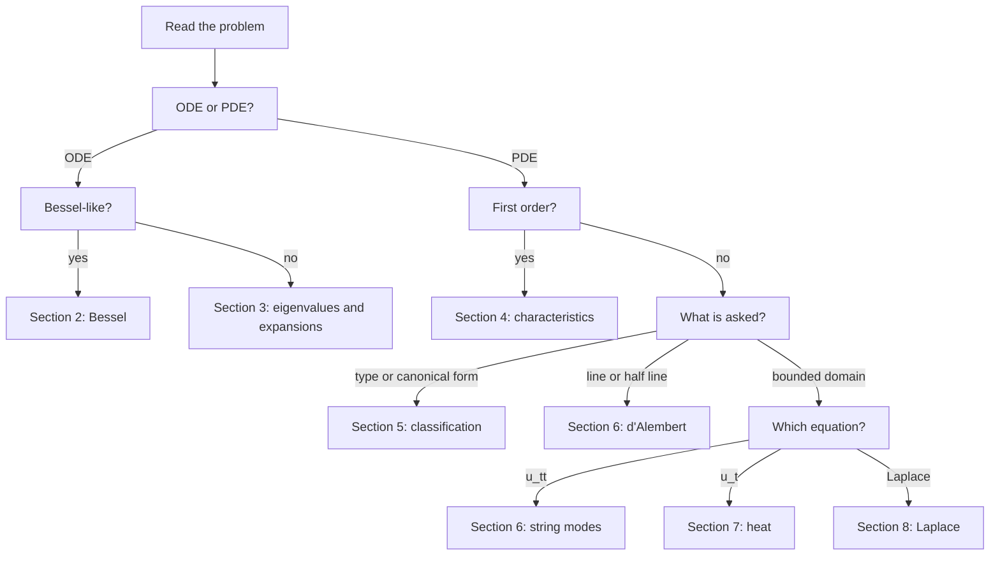
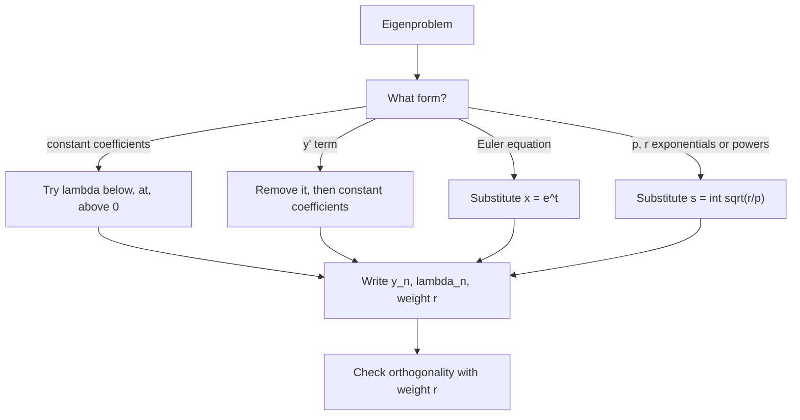

# Assignments 6–10 – How to Solve

Part of [[Problems - MOC]] · formulas: [[Assignments 6-10 - Formula Bank]] · practice: [[Assignments 6-10 - Question Bank]] · theory: [[Special Functions - MOC]], [[PDEs - MOC]]

> [!abstract] What this page is for
> "I see this kind of problem: what do I do, in what order, and how do I know I am right?" A recognition table for **every problem type on Assignments 6–10** (§1), then a **recipe with one worked example** for each family (§2–§8), a list of **30-second checks** (§9) and a map from each sheet to the skills it tests (§10). The formulas themselves are in the [[Assignments 6-10 - Formula Bank]]; this page is about choosing and sequencing.

## 0. First decision: what is the object?

---

## 1. Recognition table (every problem type on the five sheets)

| Problem type | Method | Watch for |
|---|---|---|
| Prove an identity among $J_\nu$, $J_\nu'$, $J_{\nu\pm1}$ | Differentiate $x^{\pm\nu}J_\nu$ (R1, R2), then add and subtract for R3, R4: [[Bessel Function Properties and Recurrence Relations]] | R3 builds upwards, R4 gives derivatives |
| Express $J_n$ through $J_0$ and $J_1$ | Upward recurrence $J_{k+1}=\frac{2k}xJ_k-J_{k-1}$ from $J_0,J_1$: [[Bessel Function Properties and Recurrence Relations]] | stable only while $k<x$ numerically |
| Evaluate $\int x^pJ_\nu\,dx$ | Reduce by parts until the integrand is $x^{\nu+1}J_\nu$ or $x^{-\nu}J_{\nu+1}$; a closed form exists only if $p+\nu$ is a positive odd integer: [[Bessel Function Properties and Recurrence Relations]] | differentiate the answer to check the sign |
| Half-integer order $J_{n+1/2}$ or spherical $j_n$ | Start from $J_{\pm1/2}$ (sine and cosine over $\sqrt x$) and apply R3: [[Bessel Function Properties and Recurrence Relations]] | elementary functions only |
| ODE that looks like Bessel's equation | Divide by the leading coefficient and match $y=x^au(bx^c)$ to read off $a,b,c,n$: [[Reducing Equations to Bessel Form]] | integer $n$: second solution is $Y_n$ |
| Wronskian of two Bessel solutions | Abel's formula $W=c/x$; $c=\frac2\pi$ for $(J_\nu,Y_\nu)$: [[Bessel Functions of the Second Kind and General Solution]] | $c=0$ means dependent ($J_n,J_{-n}$) |
| Sum of $J_n$ over all $n$, or $\sin x$, $\cos x$, $J_0^2+2\sum J_n^2$ | Generating function with $t=e^{i\theta}$, then Parseval or $\theta=0,\frac\pi2$: [[Bessel Generating Function]] | $J_{-n}=(-1)^nJ_n$ |
| Expand $f$ in $J_\nu(\alpha_nx/L)$ | $a_n=\frac2{L^2J_{\nu+1}(\alpha_n)^2}\int_0^Lxf\,J_\nu\big(\frac{\alpha_nx}L\big)dx$, weight $x$: [[Fourier-Bessel Series]] | every term vanishes at $x=L$ |
| Show $J_\nu(ax),J_\nu(bx)$ are orthogonal; find a norm | Write both in S–L form, subtract, integrate (Lommel); the norm is the limit $b\to a$: [[Fourier-Bessel Series]] | boundary term vanishes at $0$ for $\nu>0$ |
| Interlacing or location of zeros of Bessel functions | Rolle on $x^{\mp\nu}J_\nu$; McMahon $j_{\nu,s}\approx(s+\frac\nu2-\frac14)\pi$ for large $s$: [[Bessel Function Properties and Recurrence Relations]] | zeros are simple for $x>0$ |
| Put an ODE in Sturm–Liouville form | Multiply by $p=e^{\int f}$, then $q=pg$, $r=hp$: [[Sturm-Liouville Problems]] | the weight multiplies $\lambda$ |
| Eigenvalues of a constant-coefficient problem | Split $\lambda<0,\ \lambda=0,\ \lambda>0$ and apply both boundary conditions: [[Sturm-Liouville Problems]] | $\lambda=0$ for Neumann; Robin with a negative sign |
| Euler-type eigenproblem ($x^2y''+\dots$) | Substitute $x=e^t$, move the interval to $[\ln x_1,\ln x_2]$: [[Sturm-Liouville Problems]] | $y'(x)=Y'(t)/x$ |
| Eigenproblem with a first-derivative term | Remove it with $y=e^{-\frac12\int f}z$, or use $s=\int\sqrt{r/p}\,dx$: [[Sturm-Liouville Problems]] | transformed boundary conditions |
| State the orthogonality relation (and weight) of an S–L problem | Weight $r$ from the S–L form; norm by direct integration: [[Sturm-Liouville Problems]] | Bessel weight $x$, Chebyshev $1/\sqrt{1-x^2}$ |
| Expand $f$ in the eigenfunctions of an S–L problem | $a_n=\int rfy_n\big/\int ry_n^2$; compare $f$ with the basis boundary conditions to predict the decay rate: [[Inner Product Spaces and Orthogonal Functions]] | Gibbs at jumps; midpoint value |
| Boundary condition at a singular endpoint ($p(0)=0$) | Not a regular S–L problem: demand a bounded solution and check the Lagrange boundary term: [[Sturm-Liouville Problems]] | continuous spectrum or none |
| Prove Lagrange's or Green's identity, or self-adjointness | Expand $[p(uv'-u'v)]'$, integrate: [[Sturm-Liouville Problems]] | boundary term must vanish |
| Eliminate constants or an arbitrary function to form a PDE | Differentiate for $p,q$ and eliminate; for $F(\varphi,\psi)=0$ use the Jacobians $P,Q,R$: [[Formation of PDEs - Eliminating Constants and Functions]] | count constants against functions |
| General solution of $Pp+Qq=R$ | Solve $\frac{dx}P=\frac{dy}Q=\frac{du}R$ by grouping, multipliers or the eigen-method: [[Lagrange's Method for Quasi-linear PDEs]] | verify $P\varphi_x+Q\varphi_y+R\varphi_u=0$ |
| First-order PDE through data on a curve | Two integrals, impose the data, eliminate the parameter, check transversality: [[Cauchy Problem for First Order PDEs]] | $Py_0'-Qx_0'\ne0$ |
| Data on a characteristic: existence and uniqueness | None or infinitely many; compare $u_0'$ with $Rx_0'/P$: [[Cauchy Problem for First Order PDEs]] | explain geometrically |
| Burgers-type $uu_x+u_y=0$: when does it break? | Straight characteristics $x=x_0+u_0y$; breaking at $y_b=-1/\min u_0'$: [[Cauchy Problem for First Order PDEs]] | needs $u_0'<0$ somewhere |
| Nonlinear first order: complete or singular integral | Clairaut $u=ax+by+g(a,b)$; the envelope $f_a=f_b=0$: [[Complete, General and Singular Integrals]] | $p^2+q^2=1$ has no singular integral |
| Type of a second-order PDE, and where it changes | Sign of $b^2-4ac$ of the principal part only: [[Classification of Second Order PDEs]] | Tricomi $yu_{xx}+u_{yy}$ |
| Reduce a second-order PDE to canonical form | Characteristic ODE $\frac{dy}{dx}=\frac{b\pm\sqrt\Delta}{2a}$, then $\xi,\eta$ and the chain rule: [[Canonical Forms of Second Order PDEs]] | divide by the leading coefficient |
| General solution of a constant-coefficient second-order PDE | $f(y+\lambda_1x)+g(y+\lambda_2x)$ with $a\lambda^2+b\lambda+c=0$: [[Canonical Forms of Second Order PDEs]] | repeated root adds $x\,g$ |
| Remove first-order terms from a constant-coefficient PDE | $u=e^{\alpha x+\beta y}v$ with $\alpha=-d/2,\ \beta=-e/2$: [[Canonical Forms of Second Order PDEs]] | read off the new constant $c$ |
| Wave equation on the whole line | d'Alembert $\frac{f(x+ct)+f(x-ct)}2+\frac1{2c}\int_{x-ct}^{x+ct}g$: [[D'Alembert's Solution of the Wave Equation]] | domain of dependence |
| Wave equation on a half line | Odd extension for $u(0,t)=0$, even for $u_x(0,t)=0$: [[D'Alembert's Solution of the Wave Equation]] | $f(0)\ne0$ gives a jump |
| Vibrating string with fixed ends | Modes $\sin\frac{n\pi x}L$; $A_n$ from $f$, $B_n\omega_n$ from $g$: [[Wave Equation on a Finite Interval]] | the factor $1/\omega_n$ in $B_n$ |
| String fixed at one end and free at the other | Modes $\sin\frac{(2n-1)\pi x}{2L}$: [[Wave Equation on a Finite Interval]] | frequencies $\frac{(2n-1)\pi c}{2L}$ |
| PDE that separates as $u=XY$ | Both sides equal to $k$, solve two ODEs, fit the data: [[Separation of Variables]] | match data term by term |
| Heat in a rod, ends at $0$ | Sine series with $e^{-c^2n^2\pi^2t/L^2}$: [[Heat Equation - Separation of Variables]] | $b_n=\frac2L\int f\sin$ |
| Heat with insulated ends | Cosine series, constant term is the mean: [[Heat Equation - Separation of Variables]] | mean is conserved |
| Heat with ends held at $A$, $B$, or changed suddenly | Subtract the steady line $w$ and expand $f-w$: [[Heat Equation - Separation of Variables]] | expand the difference |
| Heat with a radiating or flux end | Robin: $\tan\mu L=-\mu/h$; flux: subtract a quadratic in $x$: [[Heat Equation - Separation of Variables]] | no steady state if the net flux is nonzero |
| How long until a rod reaches a given temperature | First-mode estimate $t\approx\tau_1\ln(\text{ratio})$, $\tau_1=\frac{L^2}{c^2\pi^2}$: [[Heat Equation - Separation of Variables]] | check the neglected mode |
| Laplace equation on a rectangle | Sines along the zero pair of edges, $\sinh$ across, vanishing on the opposite edge: [[Laplace Equation on Rectangles and Strips]] | add one solution per driven edge |
| Laplace with an insulated side | $\cos$ and $\cosh$ with zero slope, include $n=0$: [[Laplace Equation on Rectangles and Strips]] | the $n=0$ term is the edge mean |
| Laplace on a semi-infinite strip | Keep $e^{-n\pi y/a}$ only: [[Laplace Equation on Rectangles and Strips]] | decay length $\frac a{n\pi}$ |
| Laplace in a disk, sector or annulus | $r^n$ and $r^{-n}$ with Fourier modes in $\theta$ (and $\ln r$ for $n=0$): [[Laplace Equation in Polar Coordinates]] | bounded at the centre drops $r^{-n}$ |
| Value at the centre, extremes, uniqueness of a harmonic function | Mean value property and the maximum principle: [[Laplace Equation in Polar Coordinates]] | $u(0)=\frac1{2\pi}\int f$ |

---

## 2. Bessel problems (Assignment 6)

### Recipe A: an integral of $x^pJ_\nu$
1. Write $x^pJ_\nu=x^{p-\nu-1}\cdot x^{\nu+1}J_\nu$ and note $x^{\nu+1}J_\nu=(x^{\nu+1}J_{\nu+1})'$.
2. Integrate by parts: $\int x^pJ_\nu=x^pJ_{\nu+1}-(p-\nu-1)\int x^{p-1}J_{\nu+1}$.
3. Repeat. It **stops** when the power reaches the matching exponent (closed form), or ends in $\int J_0$ (no closed form).
4. Differentiate the result.

> [!example]- Worked: $\int_0^1x^3J_0(x)\,dx$
> $p=3,\ \nu=0$, so $p+\nu=3$ is odd: a closed form exists. $\int x^3J_0=\int x^2(xJ_1)'=x^3J_1-2\int x^2J_1=x^3J_1-2x^2J_2$ (since $(x^2J_2)'=x^2J_1$). At the limits: $J_1(1)-2J_2(1)=0.44005-0.22981=0.21024$. Quadrature agrees.

### Recipe B: reduce an ODE to Bessel form
1. Make the equation monic: $y''+\dots$.
2. Compare with $y''+\frac{1-2a}xy'+\big(b^2c^2x^{2c-2}+\frac{a^2-n^2c^2}{x^2}\big)y=0$.
3. Read $a$ from the $y'$ term, $c$ from the exponent in the $y$ term, then $b$, then $n$.
4. Write $y=x^a\big[AJ_n(bx^c)+BJ_{-n}(bx^c)\big]$ (use $Y_n$ if $n$ is an integer).

> [!example]- Worked: $y''+9xy=0$
> No $y'$ term: $1-2a=0$, so $a=\tfrac12$. $b^2c^2x^{2c-2}=9x$: $2c-2=1$, $c=\tfrac32$, $b^2\cdot\tfrac94=9$, $b=2$. $a^2-n^2c^2=0$: $n=a/c=\tfrac13$. Hence $y=\sqrt x\big[AJ_{1/3}(2x^{3/2})+BJ_{-1/3}(2x^{3/2})\big]$. (Residual $<10^{-8}$ at three points.)

### Recipe C: Fourier–Bessel coefficients
1. Find $\alpha_n$ from the boundary condition ($J_\nu(\alpha)=0$ for $y(L)=0$).
2. Substitute $t=\alpha_nx/L$: $\int_0^Lx\,f(x)\,J_\nu\big(\frac{\alpha_nx}L\big)dx=\big(\frac L{\alpha_n}\big)^2\int_0^{\alpha_n}t\,f\big(\frac{Lt}{\alpha_n}\big)J_\nu(t)\,dt$.
3. Close the integral with Recipe A (at a zero of $J_\nu$, R3 simplifies the result).
4. Divide by the norm $\frac{L^2}2J_{\nu+1}(\alpha_n)^2$. Check with $f=x^\nu$: $a_n=\frac2{\alpha_nJ_{\nu+1}(\alpha_n)}$.

---

## 3. Sturm–Liouville eigenproblems (Assignment 7)

### Recipe D: eigenvalues
1. Put the equation in S–L form to get the weight $r$ (the only thing orthogonality needs).
2. Reduce to $z''+\mu z=0$ if possible (the diagram above).
3. For each sign of $\mu$ write the general solution and impose **both** boundary conditions; the nontrivial case is where the determinant of the $2\times2$ system vanishes.
4. List $\lambda_n$, $y_n$, the weight; check that $\lambda=0$ was not missed; check the number of interior zeros ($n-1$ for Dirichlet).

> [!example]- Worked: $x^2y''+xy'+\lambda y=0$, $y(1)=0$, $y'(e^2)=0$
> $t=\ln x$: $Y''+\lambda Y=0$, $Y(0)=0$, $Y'(2)=0$ (since $y'=Y'/x$). Dirichlet–Neumann on length $2$: $Y=\sin\mu t$, $\mu\cos2\mu=0$, $\mu_n=\frac{(2n-1)\pi}4$. So $\lambda_n=\mu_n^2$, $y_n=\sin(\mu_n\ln x)$, weight $\frac1x$ (S–L form $(xy')'+\frac\lambda xy=0$).

### Recipe E: expand a function
1. Match the basis to the **boundary conditions** (sine for Dirichlet, cosine for Neumann).
2. $a_n=\int rfy_n\big/\int ry_n^2$ with the weight.
3. Predict convergence: $f$ breaks a boundary condition of the basis (or jumps) $\Rightarrow a_n\sim n^{-1}$ and Gibbs; matches it $\Rightarrow a_n\sim n^{-2}$ or faster.
4. Check with $x=$ a convenient point (a series of known sum) or Parseval.

---

## 4. First-order PDEs (Assignment 8)

### Recipe F: Lagrange
1. Write $P,Q,R$ from $Pp+Qq=R$.
2. Two independent first integrals: try the **pair of ratios** that omit the third variable; then **multipliers** $(1,1,1)$, $(x,y,u)$, $(\frac1x,\frac1y,\frac1u)$; then, if the coefficients are linear, the **eigen-method**.
3. Verify each integral: $P\varphi_x+Q\varphi_y+R\varphi_u=0$.
4. General solution $F(\varphi,\psi)=0$, or solve for $u$.
5. With data on a curve: parametrize, find $c_1(s),c_2(s)$, eliminate $s$, check transversality $Py_0'-Qx_0'\ne0$.

> [!example]- Worked: $xp+yq=2u$
> $\frac{dx}x=\frac{dy}y=\frac{du}{2u}$: $\frac yx=c_1$ and $\frac u{x^2}=c_2$. General solution $u=x^2f(y/x)$: every homogeneous function of degree $2$ (Euler's theorem). With $u(1,y)=y$ one gets $f(y)=y$, so $u=x\,y$.

### Recipe G: when it goes wrong
| Symptom | Reason | Action |
|---|---|---|
| $\partial(\varphi,\psi)$ degenerate | the two integrals are dependent | find another |
| Data curve is a characteristic | no or infinitely many solutions | compare $u_0'$ with $Rx_0'/P$ |
| Solution blows up at finite $y$ | characteristics cross (Burgers) | $y_b=-1/\min u_0'$ |
| No singular integral | envelope equations inconsistent ($\partial_b f=1$) | say so; do not invent one |

---

## 5. Second-order classification and canonical form (Assignment 8)

### Recipe H
1. Read $a,b,c$; compute $\Delta=b^2-4ac$; state the type **and the region** if it varies.
2. Solve $\frac{dy}{dx}=\frac{b\pm\sqrt\Delta}{2a}$. Hyperbolic: two real families; parabolic: one; elliptic: complex conjugates.
3. Set $\xi,\eta$ (parabolic: second variable any independent function; elliptic: real and imaginary parts).
4. Compute $A',B',C',D',E'$ (they must give $A'=C'=0$, $B'\ne0$ for hyperbolic).
5. Divide by the leading coefficient. If the constants are constant, remove first-order terms by $u=e^{\alpha\xi+\beta\eta}v$.

> [!example]- Worked: $u_{xx}+2u_{xy}-3u_{yy}=0$
> $\Delta=4+12=16>0$ (hyperbolic). $\frac{dy}{dx}=\frac{2\pm4}2=3,\ -1$: $\xi=y-3x$, $\eta=y+x$, $u_{\xi\eta}=0$, so $u=f(y-3x)+g(y+x)$. Check: $f(y-3x)\to9-6-3=0$ ✓, $g(y+x)\to1+2-3=0$ ✓.

---

## 6. Wave problems (Assignment 9)

| Domain and conditions | Method | First check |
|---|---|---|
| $-\infty<x<\infty$ | d'Alembert | $u(x,0)=f$, $u_t(x,0)=g$ |
| $x>0$, $u(0,t)=0$ | odd extension of $f,g$ | $u(0,t)=0$; is $f(0)=0$? |
| $x>0$, $u_x(0,t)=0$ | even extension | $u_x(0,t)=0$ |
| $0<x<L$, fixed ends | $\sum(A_n\cos\omega_nt+B_n\sin\omega_nt)\sin\frac{n\pi x}L$ | $u=0$ at both ends |
| fixed–free | $\sin\frac{(2n-1)\pi x}{2L}$ | $u(0)=0$, $u_x(L)=0$ |

**Recipe I (separation for a string).**
1. Eigenfunctions from the boundary conditions. 2. $\omega_n=c\sqrt{\lambda_n}$. 3. $A_n$ = coefficients of $f$; $B_n=\frac1{\omega_n}\times$ coefficients of $g$. 4. Simplify with parity: a product of sines may reduce by $2\sin A\cos B=\sin(A+B)+\sin(A-B)$ so that only a few modes appear.

---

## 7. Heat problems (Assignment 9)

### Recipe J (the four steps)
1. **Homogenise.** Find a simple $w(x)$ (or $w(x,t)$) that satisfies the PDE and the *non-zero* boundary conditions: steady line for Dirichlet, quadratic for flux, parabola for a source.
2. **Eigenfunctions** of the homogeneous boundary conditions for $v=u-w$.
3. **Coefficients** from $f-w$ (not $f$).
4. **Attach** $e^{-c^2\lambda_nt}$ and add $w$ back.

> [!example]- Worked: ends $u(0,t)=0$, $u(L,t)=10$, $u(x,0)=0$
> $w=10x/L$. $v(x,0)=-10x/L$, $b_n=-\frac2L\cdot\frac{10}L\cdot\frac{(-1)^{n+1}L^2}{n\pi}=-\frac{20(-1)^{n+1}}{n\pi}$. So
>
> $\displaystyle u=\frac{10x}L-\frac{20}\pi\sum_{n\ge1}\frac{(-1)^{n+1}}n\sin\frac{n\pi x}Le^{-c^2n^2\pi^2t/L^2}.$
>
> Check: at $t=0$ the series is the sine series of $\frac{\pi x}{2L}$, giving $u=0$ ✓; at $x=L$ every sine vanishes so $u=10$ ✓.

---

## 8. Laplace problems (Assignment 10)

### Recipe K: rectangle
1. List the four edges. The **pair** of opposite edges with zero data fixes the eigenfunctions (Dirichlet: $\sin$; Neumann: $\cos$).
2. Across: $\sinh$ (or $\cosh$) built to **vanish** (or have zero slope) on the opposite edge.
3. One driven edge: one series. Two driven edges: **add** two one-edge problems.
4. Coefficients: $b_n=\frac2a\int_0^af\sin\frac{n\pi x}a\,dx$, divided by $\sinh$ at the driven edge.

> [!example]- Worked: $a=3,\ b=2$, top edge $u=\sin\frac{\pi x}3+2\sin\frac{2\pi x}3$, others $0$
> The data are already eigenfunctions: $u=\sin\frac{\pi x}3\frac{\sinh\frac{\pi y}3}{\sinh\frac{2\pi}3}+2\sin\frac{2\pi x}3\frac{\sinh\frac{2\pi y}3}{\sinh\frac{4\pi}3}$. At $y=b=2$: $\sinh\frac{n\pi\cdot2}3/\sinh\frac{n\pi\cdot2}3=1$ ✓; at $y=0$, $x=0$, $x=3$: $0$ ✓; $\nabla^2u=0$ term by term ✓.

### Recipe L: polar
1. Disk: $r^n$ (drop $r^{-n}$ and $\ln r$ at the centre); exterior: $r^{-n}$; annulus: both, and $A+B\ln r$.
2. Sector: Dirichlet on the rays gives $\sin\frac{n\pi\theta}\alpha$ with $r^{\pm n\pi/\alpha}$.
3. Coefficients: full Fourier series on a circle; sine series on a sector.
4. Checks: $u(0)=$ mean of $f$; $\min f\le u\le\max f$.

---

## 9. Thirty-second checks

| Type | Check |
|---|---|
| Any series solution | plug in $t=0$ (or the data edge): does it reproduce the data? |
| Boundary conditions | substitute each; do all modes satisfy them? |
| Heat | $t\to\infty$ limit equals the steady state (or the mean if insulated); amplitudes decay |
| Wave | energy-like quantity conserved; parity of modes matches the symmetry of the data |
| Laplace | boundedness: no $r^{-n}$ at the centre, no growing exponential in a strip; max principle |
| Bessel identity | test at $x=0$ and at one number ($J_0(2)=0.2239$, $J_1(2)=0.5767$) |
| Bessel integral | differentiate the answer |
| Fourier–Bessel | $a_n$ for $f=1,\ \nu=0$ should be $\frac2{\alpha_nJ_1(\alpha_n)}$ (compare) |
| Eigenproblem | $\lambda=0$ tried? number of zeros of $y_n$ is $n-1$? |
| Lagrange | $P\varphi_x+Q\varphi_y+R\varphi_u=0$ |
| Cauchy data | substitute the solution back on the data curve |
| Canonical form | coefficients $A',C'$ vanish as predicted; $B'^2-4A'C'=J^2\Delta$ |

---

## 10. What each sheet tests (and where the solved version is)

| Sheet | Skills | Solved note |
|---|---|---|
| 6 Bessel | parity and negative order; recurrences; integrals; Wronskian; interlacing; reduction to Bessel form; sum of squares; Fourier–Bessel series; Lommel; spherical Bessel; Jacobi–Anger; Laplace transform | [[Assignment 6 - Bessel Functions - Solutions]] |
| 7 Sturm–Liouville | S–L form; eigenvalues for 13 boundary-value problems; orthogonality and norms; eigenfunction expansions; Lagrange and Green identities | [[Assignment 7 - Sturm-Liouville Problems - Solutions]] |
| 8 First-order PDEs, canonical forms | formation; Lagrange (26 equations); Cauchy problems; classification; canonical forms; singular integral; invariance of $\Delta$ | [[Assignment 8 - First Order PDEs and Canonical Forms - Solutions]] |
| 9 Wave and heat | d'Alembert; half line; separation; strings; rods; steady-state shift; Robin end | [[Assignment 9 - D'Alembert, Wave and Heat Equations - Solutions]] |
| 10 Laplace | rectangle, insulated sides, strip; polar form; disk, sector | [[Assignment 10 - Laplace Equations - Solutions]] |

### Same structure, different disguise

| In | Looks like | Is the same as |
|---|---|---|
| Fourier–Bessel, order $\frac12$ | a Bessel expansion | a sine series ($J_{1/2}\propto\sin x/\sqrt x$) |
| S–L problem (i), $\arctan x$ | a hard problem with $x^2+1$ | $y_{\theta\theta}+\lambda y=0$ on an interval of length $\frac\pi4$ |
| Heat with a steady-state shift | a new problem | the homogeneous problem for $u-w$ |
| Laplace on a disk | Poisson's integral | the Fourier series summed with $\sum r^ne^{in\theta}$ |
| Wave on a half line | a boundary problem | d'Alembert on the whole line after an odd or even extension |

Practice all of it in [[Assignments 6-10 - Question Bank]].
