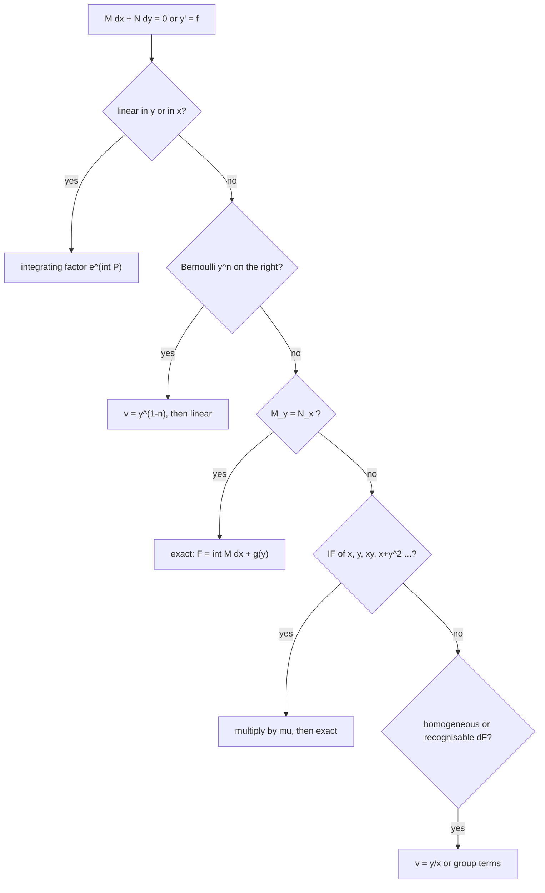

# Assignment 1 – First Order ODEs

Source: [[A1-2026.pdf]] · Theory: [[First Order ODEs - MOC]] · [[Isoclines]] · [[Exact Differential Equations]] · [[Integrating Factors]] · [[Finding h and k for x^h y^k Integrating Factors]] · [[Linear Differential Equations]] · [[Bernoulli Differential Equations]] · Index: [[Problems - MOC]] · Next: [[Assignment 2 - Second Order ODEs - Solutions]]

> [!abstract] Contents
> [[#0. Theory toolkit]] · [[#Q1 – Direction fields and isoclines]] · [[#Q2 – Exactness]] · [[#Q3 – Integrating factor of a sum]] · [[#Q4 – Solve by integrating factor]] · [[#Q5 – Solve by recognising dF]] · [[#Q6]] · [[#Q7 – Linear equations]] · [[#Q8 – Nonlinear to linear]] · [[#Q9 – x as dependent variable]] · [[#Summary]]

> [!warning] Corrections to the previous version of this note
> Every answer below was re-derived and **checked symbolically (SymPy)**. Differences from the earlier write-up:
> - **2(v)**: the equation is $dx=\frac{y\,dx+x\,dy}{1-x^2y^2}$, so the potential is $x-\operatorname{artanh}(xy)$ (the lone $dx$ was dropped before).
> - **2(vii)** *as printed* ($N=3x^2y^2+\sin x$) is **not exact**; it is exact only for $N=4x^2y^3+\sin x$. Both cases are discussed.
> - **2(ix)** *as printed* ($+2\sin x\sin y\cos y\,dy$) is **not exact**, but it has the integrating factor $\csc^2x$; the sign-flipped version is exact.
> - **4(viii)** *is* solvable: $\mu=y^{-4}$ (the note previously suspected a typo).
> - **5(viii)** was wrong; the correct solution is $\operatorname{arcsinh}(y/x)=x+C$.

---

## 0. Theory toolkit

### 0.1 Direction fields and isoclines
For $y'=f(x,y)$ the slope at $(x,y)$ is $f(x,y)$. The **isocline** of slope $m$ is the curve $f(x,y)=m$; along it every solution crosses with the same slope ([[Isoclines]]).

### 0.2 Exact equations
$M\,dx+N\,dy=0$ is **exact** iff $M_y=N_x$ (on a simply connected domain). Then there is a potential $F$ with $F_x=M$, $F_y=N$ and the solutions are $F(x,y)=C$.

$$F=\int M\,dx+g(y),\qquad g'(y)=N-\partial_y\!\int M\,dx$$

### 0.3 Integrating factors (IF)
If $M_y\ne N_x$, find $\mu$ with $(\mu M)_y=(\mu N)_x$, i.e. $\mu_yM-\mu_xN=\mu\,(N_x-M_y)$.

| Situation                       | Test                                    | Integrating factor                                                    |
| ------------------------------- | --------------------------------------- | --------------------------------------------------------------------- |
| $\mu=\mu(x)$                    | $\dfrac{M_y-N_x}{N}=g(x)$               | $\mu=e^{\int g\,dx}$                                                  |
| $\mu=\mu(y)$                    | $\dfrac{N_x-M_y}{M}=h(y)$               | $\mu=e^{\int h\,dy}$                                                  |
| $\mu=\mu(z)$, $z=z(x,y)$        | $\dfrac{M_y-N_x}{z_xN-z_yM}=\varphi(z)$ | $\mu=e^{\int\varphi\,dz}$                                             |
| $z=xy$                          | $\dfrac{M_y-N_x}{yN-xM}=\varphi(xy)$    | $\mu=e^{\int\varphi\,dz}$                                             |
| Homogeneous $M,N$ (same degree) | $Mx+Ny\ne0$                             | $\mu=\dfrac1{Mx+Ny}$                                                  |
| $M=yf(xy),\,N=xg(xy)$           | $xM-yN\ne0$                             | $\mu=\dfrac1{xM-yN}$                                                  |
| Trial                           | $\mu=x^ay^b$                            | solve for $a,b$ ([[Finding h and k for x^h y^k Integrating Factors]]) |

### 0.4 Linear and Bernoulli equations
- **Linear:** $y'+P(x)y=Q(x)$, IF $=e^{\int P}$, $\ y\,e^{\int P}=\int Qe^{\int P}dx+C$.
- **Bernoulli:** $y'+Py=Qy^n$ ($n\ne0,1$): substitute $v=y^{1-n}$, which gives the linear equation $v'+(1-n)Pv=(1-n)Q$.
- If the equation is linear in $x$ as a function of $y$ ($dx/dy+P(y)x=Q(y)$), swap the roles of the variables.

### 0.5 Useful exact differentials

| Expression | Equals |
|---|---|
| $y\,dx+x\,dy$ | $d(xy)$ |
| $\dfrac{x\,dy-y\,dx}{x^2}$ | $d(y/x)$ |
| $\dfrac{y\,dx-x\,dy}{y^2}$ | $d(x/y)$ |
| $x\,dx+y\,dy$ | $\tfrac12d(x^2+y^2)$ |
| $\dfrac{x\,dy-y\,dx}{x^2+y^2}$ | $d\arctan(y/x)$ |
| $\dfrac{y\,dx+x\,dy}{1-x^2y^2}$ | $d\,\operatorname{artanh}(xy)$ |

### 0.6 Which method?

---

## Q1 – Direction fields and isoclines

> [!question] Sketch the direction field and isoclines for $m=-2,-1,0,1,2$: (i) $y'=y(2-x)$ (ii) $y'=x^2-y$ (iii) $y'=(x+1)(y-5)$.

| | $f(x,y)$ | Isocline $f=m$ | $m=0$ |
|---|---|---|---|
| (i) | $y(2-x)$ | $y=\dfrac{m}{2-x}$ hyperbolas, vertical asymptote $x=2$ | lines $y=0$ and $x=2$ |
| (ii) | $x^2-y$ | $y=x^2-m$ parabolas | $y=x^2$ |
| (iii) | $(x+1)(y-5)$ | $y=5+\dfrac{m}{x+1}$ hyperbolas centred at $(-1,5)$ | lines $y=5$ and $x=-1$ |

![[A1-fig1-direction-fields.png]]

> [!note] Reading the pictures
> - (i) $y=0$ is a solution; solutions leave it for $x<2$ and approach it for $x>2$ (for $y>0$ the slope changes sign at $x=2$).
> - (ii) every solution is asymptotic to the particular solution $y=x^2-2x+2$ as $x\to\infty$; it crosses $y=x^2$ (the $m=0$ isocline) at its minima.
> - (iii) $y=5$ is a solution; crossing $x=-1$ is a switch of the sign of the slope.

---

## Q2 – Exactness

> [!question] Test for exactness and solve if exact.

Test $M_y\overset?=N_x$; if exact, integrate. Here $\mathrm{pot}$ means the potential $F$ with $F=C$.

| | $M,\ N$ | $M_y$ | $N_x$ | Exact? | Solution |
|---|---|---|---|---|---|
| (i) | $y,\ x+\frac2y$ | 1 | 1 | ✔ | $xy+2\ln\lvert y\rvert=C$ |
| (ii) | $y-x^3,\ x+y^3$ | 1 | 1 | ✔ | $xy-\frac{x^4}4+\frac{y^4}4=C$ |
| (iii) | $e^y,\ xe^y+2y$ | $e^y$ | $e^y$ | ✔ | $xe^y+y^2=C$ |
| (iv) | $\sin x\tan y+1,\ \cos x\sec^2y$ | $\sin x\sec^2y$ | $-\sin x\sec^2y$ | ✘ | see below |
| (v) | $1-\frac y{1-x^2y^2},\ -\frac x{1-x^2y^2}$ | $-\frac{1+x^2y^2}{(1-x^2y^2)^2}$ | same | ✔ | $x-\operatorname{artanh}(xy)=C$ |
| (vi) | $-\frac1y\sin\frac xy,\ \frac x{y^2}\sin\frac xy$ | $\frac{\sin(x/y)}{y^2}+\frac{x\cos(x/y)}{y^3}$ | same | ✔ | $\cos\frac xy=C$ |
| (vii) | $2xy^4+y\cos x,\ 3x^2y^2+\sin x$ | $8xy^3+\cos x$ | $6xy^2+\cos x$ | ✘ (as printed) | see below |
| (viii) | $\frac y{1-x^2y^2}+x,\ \frac x{1-x^2y^2}$ | $\frac{1+x^2y^2}{(1-x^2y^2)^2}$ | same | ✔ | $\operatorname{artanh}(xy)+\frac{x^2}2=C$ |
| (ix) | $\cos x\cos^2y,\ 2\sin x\sin y\cos y$ | $-\cos x\sin2y$ | $+\cos x\sin2y$ | ✘ (as printed) | see below |
| (x) | $y^2e^{xy^2}+4x^3,\ 2xye^{xy^2}-3y^2$ | $2ye^{xy^2}(1+xy^2)$ | same | ✔ | $e^{xy^2}+x^4-y^3=C$ |

**How the exact ones are integrated** (sample (iii)): $F=\int e^y\,dx=xe^y+g(y)$; $F_y=xe^y+g'=xe^y+2y\Rightarrow g=y^2$.

**(v)** The equation reads $\Big(1-\dfrac{y}{1-x^2y^2}\Big)dx-\dfrac x{1-x^2y^2}dy=0$, i.e. $dx=d\operatorname{artanh}(xy)$, so $x-\operatorname{artanh}(xy)=C$ (valid for $|xy|<1$).

**(vi)** With $u=x/y$: $F_x=-\frac1y\sin u$ gives $F=\cos u+g(y)$ and $F_y=\frac x{y^2}\sin u$ forces $g'=0$.

**(viii)** $\dfrac{y\,dx+x\,dy}{1-x^2y^2}=d\operatorname{artanh}(xy)$ and $x\,dx=d(x^2/2)$.

**(x)** $\int(y^2e^{xy^2}+4x^3)dx=e^{xy^2}+x^4$, then $g'=-3y^2$.

### The three non-exact cases

**(iv)** $\dfrac{M_y-N_x}{N}=\dfrac{2\sin x\sec^2y}{\cos x\sec^2y}=2\tan x$, a function of $x$, so $\mu=\exp\!\int2\tan x\,dx=\sec^2x$. After multiplying, $F=\sec x\tan y+\tan x$:
$$\sec x\tan y+\tan x=C\iff \tan y+\sin x=C\cos x.$$

**(vii)** As printed, $M_y-N_x=2xy^2(4y-3)$, which does not simplify to $\mu(x)$ or $\mu(y)$; the equation is **not exact** and no standard IF applies. If the intended $N$ is $4x^2y^3+\sin x$ the equation is exact with
$$x^2y^4+y\sin x=C.$$

**(ix)** As printed, $\dfrac{M_y-N_x}{N}=\dfrac{-4\cos x\sin y\cos y}{2\sin x\sin y\cos y}=-2\cot x$, so $\mu=\csc^2x$. Then $F=-\cos^2y/\sin x$:
$$\cos^2y=C\sin x.$$
(If the sign of $N$ is flipped to $-2\sin x\sin y\cos y$, the equation is exact: $\sin x\cos^2y=C$.)

![[A1-fig2-exact.png]]

---

## Q3 – Integrating factor of a sum

> [!question] When does $M\,dx+N\,dy=0$ have an integrating factor that is a function of (i) $z=x-y$, (ii) $z=x^2-3y$?

Put $\mu=\mu(z)$ in $(\mu M)_y=(\mu N)_x$:
$$\mu'(z)\,(z_yM-z_xN)=\mu\,(N_x-M_y)\ \Longrightarrow\ \frac{\mu'}{\mu}=\frac{M_y-N_x}{z_xN-z_yM}.$$
An IF of the form $\mu(z)$ exists **iff the right side is a function of $z$ alone**; then $\mu=\exp\int\varphi(z)\,dz$.

**(i)** $z=x-y$: $z_x=1,\ z_y=-1$, so $z_xN-z_yM=M+N$.
$$\boxed{\frac{M_y-N_x}{M+N}\ \text{is a function of }(x-y)\text{ only}},\qquad\mu=\exp\!\int\frac{M_y-N_x}{M+N}\,dz.$$

**(ii)** $z=x^2-3y$: $z_x=2x,\ z_y=-3$, so $z_xN-z_yM=2xN+3M$.
$$\boxed{\frac{M_y-N_x}{2xN+3M}\ \text{is a function of }(x^2-3y)\text{ only}},\qquad\mu=\exp\!\int\frac{M_y-N_x}{2xN+3M}\,dz.$$

*Examples (checked):* (i) $e^{x-y}dx+e^{x-y}dy=0$ gives ratio $-1$, so $\mu=e^{-z}$ and the equation becomes $dx+dy=0$. (ii) $e^{-(x^2-3y)}dx=0$ gives ratio $1$, so $\mu=e^{z}$.

---

## Q4 – Solve by finding an integrating factor

> [!question] Solve (i)–(ix).

| | $M,\ N$ | Test | $\mu$ | Solution $F=C$ |
|---|---|---|---|---|
| (i) | $-2xy,\ 3x^2-y^2$ | $\frac{N_x-M_y}M=\frac{8x}{-2xy}=-\frac4y$ | $y^{-4}$ | $\dfrac{y^2-x^2}{y^3}=C$ |
| (ii) | $x^2y,\ -(x^3+y^3)$ | homogeneous, $Mx+Ny=-y^4$ | $-y^{-4}$ | $\ln\lvert y\rvert-\dfrac{x^3}{3y^3}=C$ |
| (iii) | $(x+2)\sin y,\ x\cos y$ | $\frac{M_y-N_x}N=\frac{x+1}x$ | $xe^x$ | $x^2e^x\sin y=C$ |
| (iv) | $y\ln y-2xy,\ x+y$ | $\frac{N_x-M_y}M=-\frac1y$ | $y^{-1}$ | $x\ln y-x^2+y=C$ |
| (v) | $y^2+xy+1,\ x^2+xy+1$ | $\frac{M_y-N_x}{yN-xM}=\frac{y-x}{y-x}=1$ | $e^{xy}$ | $(x+y)e^{xy}=C$ |
| (vi) | $x^2y-2xy^2,\ -x^3+3x^2y$ | homogeneous, $Mx+Ny=x^2y^2$ | $\frac1{x^2y^2}$ | $\dfrac xy-2\ln\lvert x\rvert+3\ln\lvert y\rvert=C$ |
| (vii) | $x^3+xy^4,\ 2y^3$ | $\frac{M_y-N_x}N=2x$ | $e^{x^2}$ | $e^{x^2}(x^2+y^4-1)=C$ |
| (viii) | $2xy^4e^y+2xy^3+y,\ x^2y^4e^y-x^2y^2-3x$ | $M_y-N_x=\frac4yM$ | $y^{-4}$ | $x^2e^y+\dfrac{x^2}y+\dfrac x{y^3}=C$ |
| (ix) | $(x^2y^2+xy+1)y,\ -(x^2y^2-xy+1)x$ | $\frac{M_y-N_x}{yN-xM}=-\frac{3z^2+1}{z(z^2+1)}$, $z=xy$ | $\frac1{xy(1+x^2y^2)}$ | $\ln\left\lvert\dfrac xy\right\rvert+\arctan(xy)=C$ |

**Details worth showing**

- **(i)** $\mu M=-2xy^{-3}$, $\mu N=3x^2y^{-4}-y^{-2}$; $F=-x^2y^{-3}+y^{-1}$.
- **(viii)** $M_y-N_x=8xy^3e^y+8xy^2+4=\dfrac4y\big(2xy^4e^y+2xy^3+y\big)=\dfrac4yM$, so $\mu'/\mu=(N_x-M_y)/M=-4/y$ and $\mu=y^{-4}$. Then $\mu M=2xe^y+\dfrac{2x}y+y^{-3}$ gives $F=x^2e^y+\dfrac{x^2}y+\dfrac x{y^3}$ and $F_y=\mu N$ ✔.
- **(ix)** $\dfrac{3z^2+1}{z(z^2+1)}=\dfrac1z+\dfrac{2z}{z^2+1}$, so $\ln\mu=-\ln z-\ln(1+z^2)$. After multiplying, $\mu M=\dfrac1x+\dfrac y{1+x^2y^2}$ and $\mu N=-\dfrac1y+\dfrac x{1+x^2y^2}$, which is $d\big(\ln x-\ln y+\arctan xy\big)$.

![[A1-fig4-integrating-factors.png]]

---

## Q5 – Solve by recognising $dF$

> [!question] Solve (i)–(x).

| | Rewrite | Result |
|---|---|---|
| (i) | $x\,dy-y\,dx=-y^2d(x/y)\cdot(-1)$; $\ d(x/y)=-\big(\frac1{y^2}+1\big)dy$ | $x+y^2-1=Cy$ |
| (ii) | $y\,dx-x\,dy=y^2d(x/y)$, so $d(x/y)=\frac xy\,y^2dy$, i.e. $\frac{dv}v=y^2dy$ with $v=\frac xy$ | $x=Cy\,e^{y^3/3}$ |
| (iii) | $x\,dy-y\,dx=x^2d(y/x)$; with $v=y/x$: $\frac{dv}{1+v^2}=x^3dx$ | $\arctan\frac yx=\frac{x^4}4+C$ |
| (iv) | $x\,dx+y\,dy+(x\,dy-y\,dx)=0$; polar: $r\,dr+r^2d\theta=0$ | $\tfrac12\ln(x^2+y^2)+\arctan\frac yx=C$ |
| (v) | separable: $\frac{dx}x=-\frac{dy}{y(y-1)}$ | $x\,\dfrac{y-1}y=C$ |
| (vi) | $d(xy)=\sqrt{xy}\,dy$; with $w=xy$: $\frac{dw}{\sqrt w}=dy$ | $2\sqrt{xy}=y+C$ |
| (vii) | linear: $d(xy)=x\sin x\,dx$ | $xy=\sin x-x\cos x+C$ |
| (viii) | $v=y/x$: $x^2v'=x\cdot x\sqrt{1+v^2}$, so $\frac{dv}{\sqrt{1+v^2}}=dx$ | $\operatorname{arcsinh}\frac yx=x+C$, i.e. $y+\sqrt{x^2+y^2}=Cxe^{x}$ |
| (ix) | $\frac{M_y-N_x}N=-\frac4x$, $\mu=x^{-4}$ | $2e^{1/x^3}-\dfrac{3y^2}{x^2}=C$ |
| (x) | polar: $r\,dr=r^2d\theta$, so $\frac{dr}r=d\theta$ | $\sqrt{x^2+y^2}=Ce^{\arctan(y/x)}$ |

> [!warning] (viii) corrected
> For $x>0$: $x\,y'-y=x\sqrt{x^2+y^2}$. With $y=xv$, $xy'-y=x^2v'$ and $\sqrt{x^2+y^2}=x\sqrt{1+v^2}$, so $v'=\sqrt{1+v^2}$ and $\operatorname{arcsinh}v=x+C$. The earlier answer $y+\sqrt{x^2+y^2}=Cx^2$ does not satisfy the equation.

![[A1-fig5-exact-forms.png]]

---

## Q6

> [!question] Show $(3y^2-x)dx+2y(y^2-3x)dy=0$ has an IF that is a function of $x+y^2$; solve.

Here $M=3y^2-x$, $N=2y(y^2-3x)$, $z=x+y^2$ ($z_x=1$, $z_y=2y$):

- $M_y-N_x=6y-(-6y)=12y$
- $z_xN-z_yM=2y(y^2-3x)-2y(3y^2-x)=-4y(x+y^2)=-4yz$

$$\frac{M_y-N_x}{z_xN-z_yM}=\frac{12y}{-4yz}=-\frac3z,$$
a function of $z$ alone, so an IF exists: $\mu=\exp\!\big(-3\!\int\!\frac{dz}z\big)=\dfrac1{(x+y^2)^3}$.

Potential: with $x=z-y^2$, $\mu M=\dfrac{4y^2-z}{z^3}$, and integrating in $x$ (i.e. in $z$ at fixed $y$) gives $F=\dfrac1z-\dfrac{2y^2}{z^2}=\dfrac{x-y^2}{(x+y^2)^2}$. Check: $F_y=\mu N$ ✔.

$$\boxed{x-y^2=C\,(x+y^2)^2}$$

![[A1-fig6-q6.png]]

---

## Q7 – Linear equations

> [!question] Solve (i)–(viii).

Standard form $y'+Py=Q$, IF $=e^{\int P}$.

| | Standard form | IF | Solution |
|---|---|---|---|
| (i) | $y'-\frac3xy=x^3$ | $x^{-3}$ | $y=x^4+Cx^3$ |
| (ii) | $y'+\big(\frac1x+\cot x\big)y=1$ | $x\sin x$ | $y=\dfrac{\sin x-x\cos x+C}{x\sin x}$ |
| (iii) | $y'+y=2xe^{-x}+x^2$ | $e^x$ | $y=x^2e^{-x}+x^2-2x+2+Ce^{-x}$ |
| (iv) | $y'+\frac1{x\ln x}y=\frac{3x^2}{\ln x}$ | $\ln x$ | $y=\dfrac{x^3+C}{\ln x}$ |
| (v) | $y'+y\cot x=2x\csc x$ | $\sin x$ | $y=(x^2+C)\csc x$ |
| (vi) | $y'+\frac{1-2x}{x^2}y=1$ | $x^{-2}e^{-1/x}$ | $y=x^2+Cx^2e^{1/x}$ |
| (vii) | $y'+\big(\tan x+\frac1x\big)y=\frac{\sec x}x$ | $x\sec x$ | $y=\dfrac{\sin x+C\cos x}x$ |
| (viii) | $y'+\frac nxy=\frac a{x^n}\cdot\frac1x\cdot x$ ($=ax^{-n}$) | $x^n$ | $y=ax^{1-n}+Cx^{-n}$ |

**Integrals used:** (ii) $\int x\sin x=\sin x-x\cos x$; (iii) $\int x^2e^x=(x^2-2x+2)e^x$; (vi) $\int x^{-2}e^{-1/x}dx=e^{-1/x}$; (vii) $\int\sec^2x=\tan x$.

> [!note] (viii) read as $\dfrac{dy}{dx}+\dfrac nxy=\dfrac a{x^n}$
> With IF $x^n$: $(x^ny)'=a$, so $x^ny=ax+C$ and $y=ax^{1-n}+Cx^{-n}$ ✔.

![[A1-fig7-linear.png]]

---

## Q8 – Nonlinear to linear

> [!question] Convert to a linear equation and solve.

| | Equation | Substitution | Linear equation | Result |
|---|---|---|---|---|
| (i) | $y'+xy=e^xy^{-n}$ | $v=y^{n+1}$ | $v'+(n+1)xv=(n+1)e^x$ | $y^{n+1}e^{(n+1)x^2/2}=(n+1)\!\int e^{x+(n+1)x^2/2}dx+C$ |
| (ii) | $y'+xy=x^2y^5$ | $v=y^{-4}$ | $v'-4xv=-4x^2$ | $y^{-4}=e^{2x^2}\Big[C-4\!\int x^2e^{-2x^2}dx\Big]$ |
| (iii) | $xy'+y=x^4y^3$ | $v=y^{-2}$ | $v'-\frac2xv=-2x^3$ | $y^{-2}=Cx^2-x^4$ |
| (iv) | $y'+\frac yx=y^2$ | $v=y^{-1}$ | $v'-\frac vx=-1$ | $y=\dfrac1{x(C-\ln x)}$ |
| (v) | $y^2y'+\frac{y^3}x=\cos x$ | $v=y^3$ | $v'+\frac3xv=3\cos x$ | $x^3y^3=3x^3\sin x+9x^2\cos x-18x\sin x-18\cos x+C$ |
| (vi) | $y(2xy+e^x)dx-e^xdy=0$ | $v=1/y$ | $v'+v=-2xe^{-x}$ | $x^2+\dfrac{e^x}y=C$ |
| (vii) | $\sin y\,y'=\cos x(2\cos y-\sin^2x)$ | $v=\cos y$ | $v'+2\cos x\,v=\cos x\sin^2x$ | $\cos y=\tfrac12\sin^2x-\tfrac12\sin x+\tfrac14+Ce^{-2\sin x}$ |
| (viii) | $y'-\frac{\tan y}{1+x}=(1+x)e^x\sec y$ | $v=\sin y$ | $v'-\frac v{1+x}=(1+x)e^x$ | $\sin y=(1+x)(e^x+C)$ |

**(vi) in detail.** Dividing by $y^2$: $\Big(2x+\dfrac{e^x}y\Big)dx-\dfrac{e^x}{y^2}dy=0$. Since $d\big(e^x/y\big)=\dfrac{e^x}ydx-\dfrac{e^x}{y^2}dy$, this is $d(x^2)+d(e^x/y)=0$ and $x^2+e^x/y=C$. (In the Bernoulli form $y'-y=2xe^{-x}y^2$ with $v=1/y$: $v'+v=-2xe^{-x}$, IF $e^x$, $(ve^x)'=-2x$, giving the same result $e^x/y=C-x^2$.)

**(vii) in detail.** $v=\cos y$, $v'=-\sin y\,y'$, so $v'=-\cos x(2v-\sin^2x)$, i.e. $v'+2\cos x\,v=\cos x\sin^2x$; IF $e^{2\sin x}$; with $s=\sin x$: $\int s^2e^{2s}ds=e^{2s}\big(\tfrac{s^2}2-\tfrac s2+\tfrac14\big)$.

![[A1-fig8-bernoulli.png]]

(Solutions in (i), (ii), (v) were integrated numerically for the picture; the others use the closed forms.)

---

## Q9 – $x$ as the dependent variable

> [!question] Solve by treating $x$ as a function of $y$.

With $y'=1/x'$ ($x'=dx/dy$):

| | Rewrite | Type | Result |
|---|---|---|---|
| (i) | $(e^y-2xy)=y^2x'\ \Rightarrow\ x'+\frac2yx=\frac{e^y}{y^2}$ | linear, IF $y^2$ | $x=\dfrac{e^y+C}{y^2}$ |
| (ii) | $x+2x'=x^3(y-1)\ \Rightarrow\ x'+\frac x2=\frac{y-1}2x^3$ | Bernoulli $n=3$, $v=x^{-2}$: $v'-v=1-y$ | $\dfrac1{x^2}=y+Ce^y$ |
| (iii) | $y\,x'-x=y^2e^y\ \Rightarrow\ x'-\frac xy=ye^y$ | linear, IF $1/y$ | $x=ye^y+Cy$ |
| (iv) | $y^2x'+x=\frac1y\ \Rightarrow\ x'+\frac x{y^2}=\frac1{y^3}$ | linear, IF $e^{-1/y}$ | $x=1+\dfrac1y+Ce^{1/y}$ |

**(iv)** $\int y^{-3}e^{-1/y}dy$ with $u=1/y$ is $\int-ue^{-u}du=(u+1)e^{-u}$, so $xe^{-1/y}=\big(1+\tfrac1y\big)e^{-1/y}+C$.

![[A1-fig9-x-dependent.png]]

---

## Summary

> [!success] Verification
> Every final answer (Q2, Q4–Q9) was substituted back symbolically: for implicit answers, $F_xN-F_yM\equiv0$; for explicit answers, the ODE residual is $0$.

### Quick revision
- [ ] Exact: $M_y=N_x$, then $F=\int M\,dx+g(y)$
- [ ] IF tests: $\frac{M_y-N_x}N$, $\frac{N_x-M_y}M$, $\frac{M_y-N_x}{yN-xM}$, general $z$
- [ ] Homogeneous: $\mu=\frac1{Mx+Ny}$
- [ ] Polar groupings: $x\,dx+y\,dy=r\,dr$, $x\,dy-y\,dx=r^2d\theta$
- [ ] Bernoulli: $v=y^{1-n}$; if $x$ appears linearly, take $x$ as the unknown
- [ ] Always re-check problems "as printed": two sign or coefficient typos change exactness

### Figure index
`A1-fig1` direction fields · `fig2` exact (Q2) · `fig4` integrating factors · `fig5` Q5 · `fig6` Q6 · `fig7` linear · `fig8` Bernoulli · `fig9` x-dependent. All in the `assets` folder.
