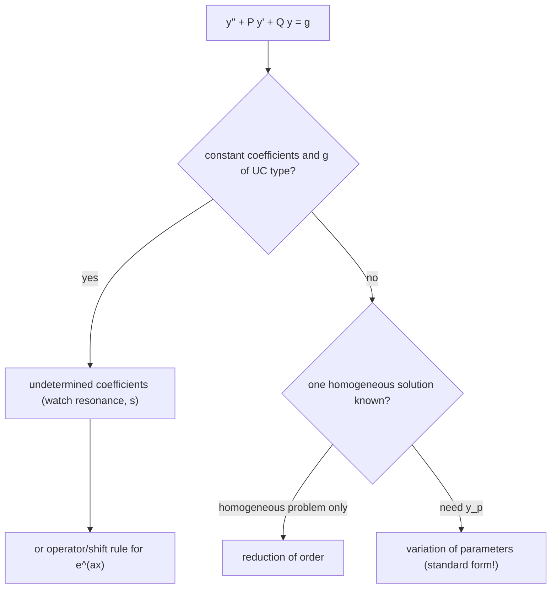

# Assignment 2 – Second Order ODEs

Source: [[A2-2026.pdf]] · Theory: [[2nd Order ODEs - MOC]] · [[Linear Independence and the Wronskian]] · [[Abel's Formula]] · [[General Solution Structure Theorem]] · [[Existence, Uniqueness, and Fundamental Sets]] · [[Reduction of Order]] · [[2nd Order Linear ODE with Constant Coefficients]] · [[Undetermined Coefficients]] · [[Variation of Parameters]] · [[Higher Order Homogeneous ODEs]] · [[Undetermined Coefficients - Higher Order]] · Index: [[Problems - MOC]] · Previous: [[Assignment 1 - First Order ODEs - Solutions]] · Next: [[Assignment 3 - Cauchy-Euler and Higher Order ODEs - Solutions]]

> [!abstract] Contents
> [[#0. Theory toolkit]] · [[#Q1–Q4 Fundamental sets]] · [[#Q5–Q7 Wronskian theory]] · [[#Q8 Inspection]] · [[#Q9 Reduction of order]] · [[#Q10 Constant coefficients]] · [[#Q11 IVPs]] · [[#Q12 Undetermined coefficients]] · [[#Q13 Variation of parameters]] · [[#Q14 Operator equations]] · [[#Summary]]

> [!warning] Corrections to the previous version
> All answers were re-checked symbolically (SymPy) and numerically (every particular/general solution below was compared with a numerical ODE solve).
> - **13(c)** was wrong. Correct: $y_p=(e^x+e^{2x})\big(\ln(1+e^x)-x\big)$.
> - **9(c)**: the second solution is expressible with the exponential integral: $y_2=4x\,\mathrm{Ei}\!\big(\tfrac2{1-x}\big)-(1-x^2)e^{2/(1-x)}$ (it was left as an unevaluated integral).
> - **Q7**: the stated reason for non-contradiction with Q6 was inaccurate; the correct reason is given below ($f,g$ both solve $x^2y''-3xy'+3y=0$, whose coefficients are singular at $0$).

---

## 0. Theory toolkit

### 0.1 Linear equations and the Wronskian
$y''+P(x)y'+Q(x)y=R(x)$ with $P,Q,R$ continuous on $I$ has a unique solution for given $y(x_0),y'(x_0)$, $x_0\in I$, and it exists on **all of $I$** ([[Existence, Uniqueness, and Fundamental Sets]]).

$$W(y_1,y_2)=\begin{vmatrix}y_1&y_2\\y_1'&y_2'\end{vmatrix}=y_1y_2'-y_2y_1'$$

| Fact | Statement |
|---|---|
| Dependent ⇒ $W\equiv0$ | proved in Q5 |
| Abel's formula | if $y_1,y_2$ solve the homogeneous equation: $W(x)=W(x_0)\,e^{-\int_{x_0}^xP(t)dt}$ |
| Dichotomy | for solutions, $W\equiv0$ or $W$ never $0$ (Q6) |
| Fundamental set | two solutions with $W\ne0$; then every solution is $c_1y_1+c_2y_2$ |
| Non-homogeneous | $y=y_c+y_p$ |

### 0.2 Constant coefficients $ay''+by'+cy=0$
Characteristic equation $ar^2+br+c=0$:

| Roots | Solution |
|---|---|
| real, distinct $r_1,r_2$ | $c_1e^{r_1x}+c_2e^{r_2x}$ |
| real double $r$ | $(c_1+c_2x)e^{rx}$ |
| complex $\alpha\pm i\beta$ | $e^{\alpha x}(c_1\cos\beta x+c_2\sin\beta x)$ |

![[A2-fig6-roots.png]]

### 0.3 Reduction of order
Given $y_1$ for $y''+Py'+Qy=0$, put $y=vy_1$:
$$y_2=y_1\int\frac{e^{-\int P\,dx}}{y_1^2}\,dx$$

### 0.4 Undetermined coefficients (UC)
For $R(x)$ made of $x^m e^{\alpha x}\cos\beta x$ / $\sin\beta x$ terms, guess $y_p=x^s\,(\text{same form with unknown coefficients})$, with $s$ the multiplicity of $\alpha\pm i\beta$ as a root of the characteristic polynomial (**resonance** if $s>0$).

| $R(x)$ | Trial $y_p$ |
|---|---|
| polynomial of degree $m$ | $x^s(A_mx^m+\dots+A_0)$ |
| $e^{\alpha x}$ | $x^sAe^{\alpha x}$ |
| $\cos\beta x$ or $\sin\beta x$ | $x^s(A\cos\beta x+B\sin\beta x)$ |
| $e^{\alpha x}\sin\beta x$ | $x^se^{\alpha x}(A\cos\beta x+B\sin\beta x)$ |

Superposition: split $R$ into pieces and add the pieces. **Shift rule:** for $y=e^{\alpha x}u$, $\ p(D)\big(e^{\alpha x}u\big)=e^{\alpha x}p(D+\alpha)u$.

### 0.5 Variation of parameters (VOP)
For $y''+Py'+Qy=g$ with homogeneous solutions $y_1,y_2$ and $W=W(y_1,y_2)$:
$$y_p=u_1y_1+u_2y_2,\qquad u_1'=-\frac{y_2\,g}W,\quad u_2'=\frac{y_1\,g}W$$
(the equation must be in standard form, with leading coefficient 1; divide first).

### 0.6 Which method for a particular solution?

---

## Q1–Q4 Fundamental sets

### Q1
> [!question] Show $y=c_1e^{-x}+c_2e^{2x}$ is the general solution of $y''-y'-2y=0$ on any interval.

Characteristic equation $r^2-r-2=(r-2)(r+1)=0$, so $e^{-x}$ and $e^{2x}$ are solutions. Their Wronskian is
$$W=e^{-x}\cdot2e^{2x}-e^{2x}\cdot(-e^{-x})=3e^{x}\neq0\quad\text{for all }x.$$
Since $P=-1$, $Q=-2$ are continuous on $\mathbb R$, $\{e^{-x},e^{2x}\}$ is a fundamental set on every interval, so $y=c_1e^{-x}+c_2e^{2x}$ is the general solution. ∎

### Q2
> [!question] Verify $y=c_1x^{-1}+c_2x^5$ solves $x^2y''-3xy'-5y=0$ on any interval not containing $0$.

For $y=x^m$: $\ x^2y''-3xy'-5y=\big(m(m-1)-3m-5\big)x^m=(m-5)(m+1)x^m$, which vanishes for $m=5,-1$. So both are solutions and, by linearity, so is $c_1x^{-1}+c_2x^5$.
$$W(x^{-1},x^5)=x^{-1}\cdot5x^4-x^5\cdot(-x^{-2})=6x^3.$$
On any interval $[a,b]\not\ni0$, $W\ne0$ and $P=-3/x$, $Q=-5/x^2$ are continuous, so this is the general solution. At $x=0$ the coefficients blow up (the Wronskian vanishes there). ∎

### Q3
> [!question] $x^2y''+xy'-4y=0$: (a) $x^2$, $1/x^2$ independent solutions on $(0,\infty)$; (b) general solution; (c) the solution with $y(2)=3,\ y'(2)=-1$; uniqueness and interval.

**(a)** For $y=x^m$: $m(m-1)+m-4=m^2-4$, zero for $m=\pm2$, so $x^2$ and $x^{-2}$ are solutions.
$$W=x^2(-2x^{-3})-x^{-2}(2x)=-\frac4x\ne0\ \text{on }(0,\infty)\ \Rightarrow\ \text{linearly independent.}$$

**(b)** $y=c_1x^2+c_2x^{-2}$.

**(c)** $y(2)=4c_1+\tfrac{c_2}4=3$ and $y'(2)=4c_1-\tfrac{c_2}{4}=-1$ (since $y'=2c_1x-2c_2x^{-3}$). Adding: $8c_1=2\Rightarrow c_1=\tfrac14$; subtracting: $\tfrac{c_2}2=4\Rightarrow c_2=8$.
$$\boxed{y=\frac{x^2}4+\frac8{x^2}}$$
**Uniqueness.** In standard form $y''+\frac1xy'-\frac4{x^2}y=0$ the coefficients are continuous on $(0,\infty)\ni2$, so by the existence–uniqueness theorem the IVP has exactly one solution there. **Interval:** the largest interval containing $x_0=2$ on which $P,Q$ are continuous is $(0,\infty)$, and the solution is defined on all of it.

### Q4
> [!question] $x,x^2,x^4$ solve $x^3y'''-4x^2y''+8xy'-8y=0$; show independence on $(0,\infty)$ and give the general solution.

For $y=x^m$: $\ m(m-1)(m-2)-4m(m-1)+8m-8=m^3-7m^2+14m-8=(m-1)(m-2)(m-4)$, so $m=1,2,4$ work.
$$W=\begin{vmatrix}x&x^2&x^4\\1&2x&4x^3\\0&2&12x^2\end{vmatrix}=x(24x^3-8x^3)-x^2(12x^2)+x^4(2)=6x^4>0.$$
So they are independent and $\boxed{y=c_1x+c_2x^2+c_3x^4}$.

![[A2-fig1-wronskian-basics.png]]

---

## Q5–Q7 Wronskian theory

### Q5
> [!question] Define $W(y_1,y_2)$ and show it vanishes if $y_1,y_2$ are linearly dependent.

$W(y_1,y_2)=y_1y_2'-y_2y_1'$. If dependent, there are constants $(c_1,c_2)\neq(0,0)$ with $c_1y_1+c_2y_2\equiv0$ on $(a,b)$. Differentiating gives $c_1y_1'+c_2y_2'\equiv0$. At each $x$ the homogeneous system
$$\begin{pmatrix}y_1&y_2\\y_1'&y_2'\end{pmatrix}\begin{pmatrix}c_1\\c_2\end{pmatrix}=\begin{pmatrix}0\\0\end{pmatrix}$$
has a nonzero solution, so its determinant is zero: $W(x)=0$ for all $x$. ∎

### Q6
> [!question] For two solutions of a second-order linear homogeneous ODE, $W\equiv0$ or $W$ is nowhere zero.

Abel's formula: from $W'=y_1y_2''-y_2y_1''$ and $y_i''=-Py_i'-Qy_i$ we get $W'=-PW$, hence
$$W(x)=W(x_0)\exp\!\Big(-\!\int_{x_0}^xP(t)\,dt\Big).$$
The exponential is never zero, so $W(x)=0$ for one $x$ iff $W(x_0)=0$ iff $W\equiv0$. ∎

![[A2-fig3-abel.png]]

### Q7
> [!question] $f=x^3$, $g=x^2|x|$ on $[-1,1]$: (a) $W\equiv0$; (b) not linearly dependent.

**(a)** For $x\ge0$: $g=x^3=f$, so $W=0$. For $x<0$: $g=-x^3$, $g'=-3x^2$, so $W=x^3(-3x^2)-(-x^3)(3x^2)=0$. At $x=0$ both vanish with their derivatives. Hence $W\equiv0$ on $[-1,1]$.

**(b)** If $c_1f+c_2g\equiv0$: for $x>0$, $(c_1+c_2)x^3=0$ so $c_1+c_2=0$; for $x<0$, $(c_1-c_2)x^3=0$ so $c_1-c_2=0$. Hence $c_1=c_2=0$, and $f,g$ are linearly independent. ∎

> [!note] Why this does not contradict Q5/Q6
> $W\equiv0$ does *not* imply dependence for arbitrary functions (Q5 is one-directional). The converse holds only for **solutions of one linear ODE with continuous coefficients** (Q6). Here $f$ and $g$ are both $C^2$, and both solve $x^2y''-3xy'+3y=0$, but its coefficients $-3/x$ and $3/x^2$ are singular at $x=0$, so no such ODE exists on $[-1,1]$.

![[A2-fig2-q7.png]]

---

## Q8 Inspection

> [!question] Particular solutions of (a) $y''-2y=\sin x$; (b) $y''-2y'=6$.

**(a)** Try $y_p=A\sin x$: $-A\sin x-2A\sin x=-3A\sin x=\sin x\Rightarrow A=-\tfrac13$.
$$\boxed{y_p=-\tfrac13\sin x}$$
**(b)** A constant fails (the characteristic root $r=0$ makes it a homogeneous solution), so try $y_p=Ax$: $0-2A=6\Rightarrow A=-3$.
$$\boxed{y_p=-3x}$$

![[A2-fig4-inspection.png]]

---

## Q9 Reduction of order

> [!question] Find the general solution, given $y_1$.

Formula: $y_2=y_1\displaystyle\int\frac{e^{-\int P}}{y_1^2}dx$, with $P$ the $y'$-coefficient in standard form.

| | Equation | $P$ | $e^{-\int P}$ | $y_2$ | General solution |
|---|---|---|---|---|---|
| (a) | $x^2y''+xy'-y=0$, $y_1=x$ | $\frac1x$ | $\frac1x$ | $x\!\int x^{-3}dx=-\frac1{2x}$ | $y=c_1x+\dfrac{c_2}x$ |
| (b) | $y''+y=0$, $y_1=\sin x$ | $0$ | $1$ | $\sin x\!\int\csc^2x=-\cos x$ | $y=c_1\sin x+c_2\cos x$ |
| (c) | $(1-x)^2y''-2xy'+2y=0$, $y_1=x$ | $\frac{-2x}{(1-x)^2}$ | $(1-x)^2e^{2/(1-x)}$ | see below | $y=c_1x+c_2\big[4x\,\mathrm{Ei}(\tfrac2{1-x})-(1-x^2)e^{2/(1-x)}\big]$ |
| (d) | $x^2y''+xy'+(x^2-\frac14)y=0$, $y_1=x^{-1/2}\sin x$ | $\frac1x$ | $\frac1x$ | $y_1\!\int\csc^2x=-x^{-1/2}\cos x$ | $y=x^{-1/2}(c_1\sin x+c_2\cos x)$ |
| (e) | $xy''-(2x+1)y'+(x+1)y=0$, $y_1=e^x$ | $-(2+\frac1x)$ | $xe^{2x}$ | $e^x\!\int x\,dx=\frac{x^2}2e^x$ | $y=c_1e^x+c_2x^2e^x$ |
| (f) | $(x-1)y''-xy'+y=0$, $y_1=x$ | $-\frac x{x-1}$ | $(x-1)e^x$ | $x\!\int\frac{(x-1)e^x}{x^2}dx=x\cdot\frac{e^x}x=e^x$ | $y=c_1x+c_2e^x$ |

**(c) in detail.** $\int P\,dx=-2\int\frac{x\,dx}{(1-x)^2}=-\frac2{1-x}-2\ln|1-x|$, so $e^{-\int P}=(1-x)^2e^{2/(1-x)}$ and
$$y_2=x\int\frac{(1-x)^2e^{2/(1-x)}}{x^2}dx.$$
With $t=\frac1{1-x}$ the integrand becomes $\dfrac{e^{2t}}{t^2(t-1)^2}dt=e^{2t}\Big[\frac1{t^2}+\frac1{(t-1)^2}+\frac2t-\frac2{t-1}\Big]dt$, and the Ei terms combine to $4\,\mathrm{Ei}(2t)$ leaving $-e^{2t}\big(\frac1t+\frac1{t-1}\big)$. This gives the closed form above (verified numerically: the residual of the ODE is $\sim10^{-14}$). The solution is singular at $x=1$, where the leading coefficient vanishes.

**(f)** Check of the integral: $\dfrac d{dx}\dfrac{e^x}x=\dfrac{e^x(x-1)}{x^2}$ ✔.

![[A2-fig5-reduction.png]]

---

## Q10 Constant coefficients

> [!question] Solve (a)–(d).

| | Equation | Characteristic roots | Solution |
|---|---|---|---|
| (a) | $y''+3y'-54y=0$ | $r^2+3r-54=(r-6)(r+9)$: $6,\,-9$ | $c_1e^{6x}+c_2e^{-9x}$ |
| (b) | $y''+4y'+4y=0$ | $(r+2)^2$: $-2$ (double) | $(c_1+c_2x)e^{-2x}$ |
| (c) | $y''-6y'+13y=0$ | $r=3\pm2i$ | $e^{3x}(c_1\cos2x+c_2\sin2x)$ |
| (d) | $y''-9y'+20y=0$ | $(r-4)(r-5)$: $4,\,5$ | $c_1e^{4x}+c_2e^{5x}$ |

(See the root-plane figure in §0.2.)

---

## Q11 IVPs

> [!question] Solve (a)–(e).

**(a)** $4y''+24y'+37y=0$: $r=-3\pm\frac i2$, $y=e^{-3x}\big(c_1\cos\frac x2+c_2\sin\frac x2\big)$. At $x=\pi$: $y=e^{-3\pi}c_2=1\Rightarrow c_2=e^{3\pi}$; $y'(\pi)=e^{-3\pi}\big(-3c_2-\tfrac{c_1}2\big)=0\Rightarrow c_1=-6e^{3\pi}$.
$$\boxed{y=e^{3\pi-3x}\Big(\sin\tfrac x2-6\cos\tfrac x2\Big)}$$
**(b)** $16y''-40y'+25y=0$: $r=\tfrac54$ (double), $y=(c_1+c_2x)e^{5x/4}$. $y(0)=3\Rightarrow c_1=3$; $y'(0)=\tfrac54c_1+c_2=-\tfrac94\Rightarrow c_2=-6$.
$$\boxed{y=(3-6x)e^{5x/4}}$$
**(c)** $r=2,3$; $c_1e^2+c_2e^3=e^2$ and $2c_1e^2+3c_2e^3=3e^2$ give $c_2e=1$, $c_1=0$.
$$\boxed{y=e^{3x-1}}$$
**(d)** $r=1,-9$; $c_1e+c_2e^{-9}=2$ and $c_1e-9c_2e^{-9}=0$ give $c_2=\tfrac{e^9}5$, $c_1=\tfrac9{5e}$.
$$\boxed{y=\tfrac95e^{x-1}+\tfrac15e^{9-9x}}$$
**(e)** $r=-2\pm i$, $y=e^{-2x}(c_1\cos x+c_2\sin x)$. $c_1=1$; $y'(0)=-2c_1+c_2=0\Rightarrow c_2=2$.
$$\boxed{y=e^{-2x}(\cos x+2\sin x)}$$

![[A2-fig7-ivps.png]]

---

## Q12 Undetermined coefficients

> [!question] Solve (a)–(h).

Characteristic roots first, then the trial and the coefficient matching.

| | Roots | Trial and matching | $y_p$ |
|---|---|---|---|
| (a) | $1,\,2$ | $A\cos2x+B\sin2x$: $\ (-2A-6B)\cos2x+(6A-2B)\sin2x$; so $-2A-6B=-18$, $6A-2B=14$ ⇒ $A=3$, $B=2$ | $3\cos2x+2\sin2x$ |
| (b) | $2\pm\sqrt3$ | $ax^2+bx+c$: $ax^2+(b-8a)x+(2a-4b+c)=x^2-2x+2$ ⇒ $a=1,\,b=6,\,c=24$ | $x^2+6x+24$ |
| (c) | $\pm3i$ | $2\sin3x$: resonance $x(A\cos3x+B\sin3x)$: $-6A\sin3x+6B\cos3x=2\sin3x$ ⇒ $-\frac x3\cos3x$; $4\sin x$: $D\sin x$, $8D=4$ ⇒ $\frac12\sin x$; $-26e^{-2x}$: $13E=-26$ ⇒ $-2e^{-2x}$; $27x^3$: $9a=27,\,9c+6a=0$ ⇒ $3x^3-2x$ | $-\frac x3\cos3x+\frac12\sin x-2e^{-2x}+3x^3-2x$ |
| (d) | $1\pm i$ | $e^x\sin x$ is resonant ($s=1$): $y_p=xe^x(A\cos x+B\sin x)$ ⇒ $A=-\tfrac12$, $B=0$ | $-\frac x2e^x\cos x$ |
| (e) | $1,1$ | $y=e^xu$: $u''=x$ | $\frac{x^3}6e^x$ |
| (f) | $-5,-5$ | $y=e^{-5x}u$: $u''=14$ | $7x^2e^{-5x}$ |
| (g) | $0,\,3$ | $x$: $s=1$: $x(ax+b)$: $2a-3(2ax+b)=x$ ⇒ $a=-\frac16,\,b=-\frac19$; $e^x\sin x$: $e^x(A\cos x+B\sin x)$ ⇒ $A=\frac1{10},\,B=-\frac3{10}$ | $-\frac{x^2}6-\frac x9+e^x\big(\frac{\cos x}{10}-\frac{3\sin x}{10}\big)$ |
| (h) | $\pm i\sqrt2$ | $\alpha e^x+\beta$: $3\alpha=1$, $2\beta=2$ | $\frac13e^x+1$ |

General solutions $y=y_c+y_p$:

| | General solution |
|---|---|
| (a) | $c_1e^x+c_2e^{2x}+3\cos2x+2\sin2x$ |
| (b) | $c_1e^{(2+\sqrt3)x}+c_2e^{(2-\sqrt3)x}+x^2+6x+24$ |
| (c) | $c_1\cos3x+c_2\sin3x-\frac x3\cos3x+\frac12\sin x-2e^{-2x}+3x^3-2x$ |
| (d) | $e^x(c_1\cos x+c_2\sin x)-\frac x2e^x\cos x$ |
| (e) | $(c_1+c_2x)e^x+\frac{x^3}6e^x$ |
| (f) | $(c_1+c_2x)e^{-5x}+7x^2e^{-5x}$ |
| (g) | $c_1+c_2e^{3x}-\frac{x^2}6-\frac x9+e^x\big(\frac{\cos x}{10}-\frac{3\sin x}{10}\big)$ |
| (h) | $c_1\cos\sqrt2x+c_2\sin\sqrt2x+\frac13e^x+1$ |

![[A2-fig8-undetermined.png]]

![[A2-fig11-resonance.png]]

The resonant terms (c, d here; (e) of Q14) give oscillations whose amplitude grows linearly in $x$.

---

## Q13 Variation of parameters

> [!question] Solve (a)–(m).

Equation in standard form, $W=W(y_1,y_2)$, $u_1'=-y_2g/W$, $u_2'=y_1g/W$.

| | $y_1,\ y_2$ | $W$ | $g$ | $u_1,\ u_2$ | $y_p$ |
|---|---|---|---|---|---|
| (a) | $e^{-x},xe^{-x}$ | $e^{-2x}$ | $\frac{e^{-x}}{x^2}$ | $-\ln x,\ -\frac1x$ | $-e^{-x}\ln x$ |
| (b) | $\cos ax,\sin ax$ | $a$ | $\sec ax$ | $\frac1{a^2}\ln\lvert\cos ax\rvert,\ \frac xa$ | $\frac1{a^2}\cos ax\ln\lvert\cos ax\rvert+\frac xa\sin ax$ |
| (c) | $e^x,e^{2x}$ | $e^{3x}$ | $\frac{e^x}{1+e^x}$ | $-x+\ln(1+e^x),\ -e^{-x}-x+\ln(1+e^x)$ | $(e^x+e^{2x})\big(\ln(1+e^x)-x\big)$ |
| (d) | $e^{3x},e^{-x}$ | $-4e^{2x}$ | $64xe^{-x}$ | $-(4x+1)e^{-4x},\ -8x^2$ | $-(8x^2+4x+1)e^{-x}$ |
| (e) | $e^{-x},xe^{-x}$ | $e^{-2x}$ | $e^{-x}\ln x$ | $-\frac{x^2}2\ln x+\frac{x^2}4,\ x\ln x-x$ | $e^{-x}\big(\frac{x^2}2\ln x-\frac{3x^2}4\big)$ |
| (f) | $e^{-x/2},e^{-x}$ | $-\frac12e^{-3x/2}$ | $\frac12e^{-3x}$ | $-\frac25e^{-5x/2},\ \frac12e^{-2x}$ | $\frac1{10}e^{-3x}$ |
| (g) | $e^x,e^{3x}$ | $2e^{4x}$ | $\frac{e^x}{1+e^x}$ | see below | $\frac12e^{2x}+\frac12(e^{3x}-e^x)\big(x-\ln(1+e^x)\big)$ |
| (h) | $\cos x,\sin x$ | $1$ | $\sec x\tan x$ | $x-\tan x,\ -\ln\lvert\cos x\rvert$ | $x\cos x-\sin x\ln\lvert\cos x\rvert$ |
| (i) | $x^2,x^3$ | $x^4$ | $21x^{-6}$ | $\frac72x^{-6},\ -3x^{-7}$ | $\frac1{2x^4}$ |
| (j) | $x,x^2$ | $x^2$ | $x\cos x$ | $-x\sin x-\cos x,\ \sin x$ | $-x\cos x$ |
| (k) | $1,x^2$ | $2x$ | $(3+x)xe^x$ | $-\frac12x^3e^x,\ \frac12(x+2)e^x$ | $x^2e^x$ |
| (l) | $x,\frac1x$ | $-\frac2x$ | $\ln x$ | $\frac12(x\ln x-x),\ -\frac{x^3}6\ln x+\frac{x^3}{18}$ | $\frac{x^2\ln x}3-\frac{4x^2}9$ |
| (m) | $e^x,\frac1x$ | $-\frac{(1+x)e^x}{x^2}$ | $x+1$ | $-(x+1)e^{-x},\ -\frac{x^3}3$ | $-x-1-\frac{x^2}3$ |

(Homogeneous terms that appear in $y_p$ were absorbed into $c_1,c_2$.)

**Notes**
- **(c) (corrected).** $u_1'=-\dfrac1{1+e^x}$, $u_2'=\dfrac{e^{-x}}{1+e^x}=e^{-x}-\dfrac1{1+e^x}$, $\int\dfrac{dx}{1+e^x}=x-\ln(1+e^x)$.
- **(g)** $g=\dfrac1{1+e^{-x}}=\dfrac{e^x}{1+e^x}$; $u_1'=-\dfrac1{2(1+e^x)}$, $u_2'=\dfrac{e^{-2x}}{2(1+e^x)}$; with $t=e^x$, $\int\frac{dt}{t^3(1+t)}=-\frac1{2t^2}+\frac1t+\ln t-\ln(1+t)$.
- **(h)** $u_1'=-\tan^2x=1-\sec^2x$.
- **(i), (j), (k), (m)**: divide by the leading coefficient first ($x^2$, $x^2$, $x$, $x^2+x$); the right-hand sides in standard form are $21x^{-6}$, $x\cos x$, $(3+x)xe^x$, $x+1$.
- **(l), (m)**: the complementary functions are given in the statement.

General solutions $y=c_1y_1+c_2y_2+y_p$:

$$\begin{aligned}
&\text{(a) }(c_1+c_2x)e^{-x}-e^{-x}\ln x &&\text{(b) }c_1\cos ax+c_2\sin ax+\tfrac1{a^2}\cos ax\ln|\cos ax|+\tfrac xa\sin ax\\
&\text{(c) }c_1e^x+c_2e^{2x}+(e^x+e^{2x})\ln(1+e^x)-x(e^x+e^{2x}) &&\text{(d) }c_1e^{3x}+c_2e^{-x}-(8x^2+4x+1)e^{-x}\\
&\text{(e) }(c_1+c_2x)e^{-x}+e^{-x}\big(\tfrac{x^2}2\ln x-\tfrac{3x^2}4\big) &&\text{(f) }c_1e^{-x/2}+c_2e^{-x}+\tfrac1{10}e^{-3x}\\
&\text{(h) }c_1\cos x+c_2\sin x+x\cos x-\sin x\ln|\cos x| &&\text{(i) }c_1x^2+c_2x^3+\tfrac1{2x^4}\\
&\text{(j) }c_1x+c_2x^2-x\cos x &&\text{(k) }c_1+c_2x^2+x^2e^x\\
&\text{(l) }c_1x+\tfrac{c_2}x+\tfrac{x^2\ln x}3-\tfrac{4x^2}9 &&\text{(m) }c_1e^x+\tfrac{c_2}x-x-1-\tfrac{x^2}3
\end{aligned}$$

$$\text{(g) } c_1e^x+c_2e^{3x}+\tfrac12e^{2x}+\tfrac12(e^{3x}-e^x)\big(x-\ln(1+e^x)\big)$$

![[A2-fig9-vop.png]]

In every panel the closed form (line) coincides with the numerical solution of the ODE (dots).

---

## Q14 Operator equations

> [!question] Solve (a)–(g), $D=d/dx$.

| | Factorisation of $p(D)$ | Method | Result |
|---|---|---|---|
| (a) | $(D-1)^2(D-2)$ | roots $1,1,2$ | $y=(c_1+c_2x)e^x+c_3e^{2x}$ |
| (b) | $(D-1)(D-2)$ | $y=e^{3x}u$: $(D+2)(D+1)u=4x+5$, $u=2x-\frac12$ | $y=c_1e^x+c_2e^{2x}+\big(2x-\tfrac12\big)e^{3x}$ |
| (c) | roots $1\pm i\sqrt2$ | $y_p=e^{-x}(A\cos x+B\sin x)$; $D\to D-1$: $(D^2-4D+6)$ gives $5A-4B=3$, $4A+5B=0$ ⇒ $A=\frac{15}{41},B=-\frac{12}{41}$ | $y=e^x\big(c_1\cos\sqrt2x+c_2\sin\sqrt2x\big)+\frac{e^{-x}}{41}(15\cos x-12\sin x)$ |
| (d) | $(D-1)(D-3)(D+2)$ | $y=e^xu$: $D(D-2)(D+3)u=18$ ⇒ $u=-3x$ | $y=c_1e^x+c_2e^{3x}+c_3e^{-2x}-3xe^x$ |
| (e) | $D^2+25$ | resonance: $y_p=x(A\cos5x+B\sin5x)$: $10B\cos5x-10A\sin5x$ ⇒ $B=5,A=-3$ | $y=c_1\cos5x+c_2\sin5x+x(5\sin5x-3\cos5x)$ |
| (f) | $(D-2)(D^2+4)$ | $x^2$: $a=-1,\ b=-1,\ c=0$ ⇒ $-x^2-x$; $\cos2x$ resonant ⇒ $-\frac x2(\cos2x+\sin2x)$ | $y=c_1e^{2x}+c_2\cos2x+c_3\sin2x-x^2-x-\frac x2(\cos2x+\sin2x)$ |
| (g) | $(D-1)(D+2)^2$ | $12e^{-2x}$: $y=e^{-2x}u$, $(D-3)D^2u=12$ ⇒ $u=-2x^2$; $9e^x$: $y=e^xu$, $D(D+3)^2u=9$ ⇒ $u=x$ | $y=c_1e^x+(c_2+c_3x)e^{-2x}-2x^2e^{-2x}+xe^x$ |

**(f) coefficient check.** $(D^3-2D^2+4D-8)(ax^2+bx+c)=-8ax^2+(8a-8b)x+(-4a+4b-8c)=8x^2$ ⇒ $a=-1$, $b=a=-1$, $c=0$.

![[A2-fig10-operators.png]]

---

## Summary

> [!success] Verification
> Each entry in Q9–Q14 was checked by (i) symbolic substitution into the ODE, and (ii) comparison with a numerical integration of the ODE from the same initial data (the figures).

### Quick revision
- [ ] $W=y_1y_2'-y_2y_1'$; $W\equiv0$ or never zero for solutions (Abel); $W\equiv0$ alone does not imply dependence
- [ ] Euler-type check: $y=x^m$ gives a polynomial in $m$
- [ ] Reduction of order: $y_2=y_1\int e^{-\int P}/y_1^2$
- [ ] UC: multiply the guess by $x^s$ when the forcing matches a root; shift rule $D\to D+\alpha$
- [ ] VOP: standard form first; $u_1'=-y_2g/W,\ u_2'=y_1g/W$

### Figure index
`A2-fig1` Wronskian basics · `fig2` Q7 · `fig3` Abel · `fig4` inspection · `fig5` reduction of order · `fig6` roots · `fig7` IVPs · `fig8` UC · `fig9` VOP · `fig10` operators · `fig11` resonance. All in the `assets` folder.
