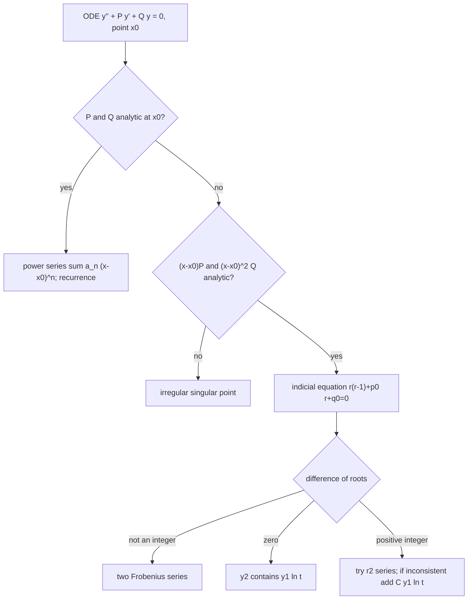

# Assignment 4 – Series Solutions at Ordinary Points and the Frobenius Method

Source: [[A4-2026.pdf]] · Theory: [[Series Solutions - MOC]] · [[Ordinary and Singular Points]] · [[Power Series Method]] · [[Series Solutions About x0 not equal to 0]] · [[Radius of Convergence of Series Solutions]] · [[Regular and Irregular Singular Points]] · [[Frobenius Theorem]] · [[Legendre's Equation]] · [[Reduction of Order]] · Index: [[Problems - MOC]] · Previous: [[Assignment 3 - Cauchy-Euler and Higher Order ODEs - Solutions]] · Next: [[Assignment 5 - Legendre Polynomials and Functions - Solutions]]

> [!abstract] Contents
> [[#0. Theory toolkit]] · [[#Q1 Power series at ordinary points]] · [[#Q2 Power series IVPs]] · [[#Q3 Frobenius method]] · [[#Summary]]

> [!warning] Corrections and notes
> Every series coefficient and every closed form below was computed exactly (SymPy) and compared with a numerical solution. Relative to the previous version:
> - **1(d)** was wrong: the correct series are $a_0\big(1+\tfrac14x^2-\tfrac1{24}x^3+\cdots\big)+a_1\big(x-\tfrac14x^2+\tfrac5{24}x^3-\cdots\big)$ (the sign of the $x^2$ term and a missing $-\tfrac14x^2$ term were wrong).
> - **3(c)** and **3(d)** are misprinted in the sheet (the factor $y$ is missing in 3(c); "$6-x^2y$" in 3(d)). I solved $16x^2y''+(x^2+3)y=0$ and $x^2y''+6xy'+(6-x^2)y=0$.
> - **3(d)** has **no** logarithm (the earlier note was unsure), 3(g) and 3(h) now have explicit second solutions, 3(a) and 3(c) have closed forms.

---

## 0. Theory toolkit

### 0.1 Ordinary points and the power-series method
For $y''+P(x)y'+Q(x)y=0$, $x_0$ is an **ordinary point** if $P,Q$ are analytic at $x_0$. Then there are two independent solutions $y=\sum a_n(x-x_0)^n$; put $t=x-x_0$, substitute, and read off a recurrence. $a_0=y(x_0)$ and $a_1=y'(x_0)$ are free.

**Radius of convergence.** $R\ge$ the distance from $x_0$ to the nearest singular point of the ODE in the complex plane (zeros of the leading coefficient, after dividing out common factors).

![[A4-fig5-radius.png]]

### 0.2 Regular singular points
$x_0$ is a **regular singular point** if $p_0=\lim_{x\to x_0}(x-x_0)P(x)$ and $q_0=\lim_{x\to x_0}(x-x_0)^2Q(x)$ exist (finite, with $(x-x_0)P$, $(x-x_0)^2Q$ analytic). Otherwise it is **irregular** (no Frobenius series in general).

### 0.3 Frobenius method
Try $y=t^r\sum_{n\ge0}a_nt^n$, $a_0\ne0$, $t=x-x_0$. The lowest-order terms give the **indicial equation**
$$r(r-1)+p_0r+q_0=0,\qquad\text{roots }r_1\ge r_2\ (\text{real parts}).$$

| Roots | Form of the solutions |
|---|---|
| $r_1-r_2\notin\mathbb Z$ | $y_i=t^{r_i}\sum a_n^{(i)}t^n$ (two Frobenius series) |
| $r_1=r_2$ | $y_1=t^{r_1}\sum a_nt^n,\ \ y_2=y_1\ln t+t^{r_1}\sum b_nt^n$ |
| $r_1-r_2=N\in\mathbb N$ | $y_1=t^{r_1}\sum a_nt^n,\ \ y_2=Cy_1\ln t+t^{r_2}\sum b_nt^n$ ($C=0$ is possible) |

Complex roots $\alpha\pm i\beta$: take real and imaginary parts of $t^{\alpha+i\beta}\sum a_nt^n$ (the factor $t^{i\beta}=e^{i\beta\ln t}$ gives oscillation in $\ln t$).

---

## Q1 Power series at ordinary points

> [!question] Find the power-series solutions at the indicated ordinary points.

Write $y=\sum a_nt^n$ ($t=x-x_0$). In each case I give the recurrence and then
$y=a_0\,y_{\rm even\text{-}type}+a_1\,y_{\rm odd\text{-}type}$ (the solution with $(a_0,a_1)=(1,0)$ and $(0,1)$).

### (a) $y''+xy'+(x^2+2)y=0$, $x_0=0$ — $R=\infty$
$$(n+2)(n+1)a_{n+2}+(n+2)a_n+a_{n-2}=0,\quad a_{-2}=a_{-1}=0$$
$$y=a_0\Big(1-x^2+\tfrac14x^4-\tfrac1{60}x^6-\tfrac1{480}x^8+\cdots\Big)+a_1\Big(x-\tfrac12x^3+\tfrac3{40}x^5-\tfrac1{1680}x^7-\tfrac{13}{13440}x^9+\cdots\Big)$$

### (b) $(1-x^2)y''-2xy'+p(p+1)y=0$, $x_0=0$ — $R=1$
This is [[Legendre's Equation]]:
$$a_{k+2}=\frac{k(k+1)-p(p+1)}{(k+1)(k+2)}\,a_k.$$
For integer $p$ the chain with the parity of $p$ **terminates** at $k=p$ (numerator zero), giving a polynomial $\propto P_p$; the other chain is an infinite series with logarithmic singularities at $x=\pm1$.

| $p$ | Polynomial solution | $=$ | Second solution (series) |
|---|---|---|---|
| 0 | $1$ | $P_0$ | $x+\frac{x^3}3+\frac{x^5}5+\cdots=\operatorname{artanh}x$ |
| 1 | $x$ | $P_1$ | $1-x^2-\frac{x^4}3-\frac{x^6}5-\cdots=1-x\operatorname{artanh}x$ |
| 2 | $1-3x^2$ | $-2P_2$ | $x-\frac23x^3-\frac15x^5-\frac4{35}x^7-\cdots$ |
| 3 | $x-\frac53x^3$ | $-\frac23P_3$ | $1-6x^2+3x^4+\frac45x^6+\frac37x^8+\cdots$ |
| 4 | $1-10x^2+\frac{35}3x^4$ | $\frac83P_4$ | $x-3x^3+\frac65x^5+\frac27x^7+\cdots$ |

$$\boxed{y=c_1P_p(x)+c_2\,Q_p(x)}$$
with $Q_p$ the non-terminating series.

![[A4-fig2-legendre.png]]

### (c) $(1+x^2)y''+2xy'-2y=0$, $x_0=0$ — $R=1$
$$a_{n+2}=-\frac{n-1}{n+1}\,a_n$$
$n=1$ gives $a_3=0$, so the odd chain is just $x$ ($y=x$ solves the ODE: $2x-2x=0$). The even chain is $1+x^2-\tfrac13x^4+\tfrac15x^6-\cdots=1+x\arctan x$:
$$\boxed{y=a_0\big(1+x\arctan x\big)+a_1x}$$

### (d) $2y''+(1-x)y'-y=0$, $x_0=0$ — $R=\infty$
$$a_{n+2}=\frac{a_n-a_{n+1}}{2(n+2)}$$
$$y=a_0\Big(1+\tfrac14x^2-\tfrac1{24}x^3+\tfrac7{192}x^4-\tfrac1{128}x^5+\cdots\Big)+a_1\Big(x-\tfrac14x^2+\tfrac5{24}x^3-\tfrac{11}{192}x^4+\tfrac{17}{640}x^5-\cdots\Big)$$
**Closed form.** $(1-x)y'-y=\big((1-x)y\big)'$, so the equation is $2y''+((1-x)y)'=0$, i.e. $2y'+(1-x)y=C$ ($C=2a_1+a_0$):
$$y=e^{(x^2-2x)/4}\Big[a_0+\tfrac C2\int_0^xe^{(2s-s^2)/4}ds\Big]$$

### (e) $y''+xy'+(3x+2)y=0$, $x_0=0$ — $R=\infty$
$$(n+2)(n+1)a_{n+2}+(n+2)a_n+3a_{n-1}=0$$
$$y=a_0\Big(1-x^2-\tfrac12x^3+\tfrac13x^4+\tfrac{11}{40}x^5-\cdots\Big)+a_1\Big(x-\tfrac12x^3-\tfrac14x^4+\tfrac18x^5+\tfrac1{10}x^6-\cdots\Big)$$

### (f) $(x+3)y''+(x+2)y'+y=0$, $x_0=0$ — $R=3$
Coefficient of $x^n$: $3(n+2)(n+1)a_{n+2}+(n+1)(n+2)a_{n+1}+(n+1)a_n=0$, i.e.
$$3(n+2)a_{n+2}=-(n+2)a_{n+1}-a_n$$
$$y=a_0\Big(1-\tfrac16x^2+\tfrac1{18}x^3-\tfrac1{216}x^4-\tfrac7{3240}x^5+\cdots\Big)+a_1\Big(x-\tfrac13x^2+\tfrac1{36}x^4-\tfrac1{108}x^5+\cdots\Big)$$

### (g) $xy''+y'+2y=0$, $x_0=1$ — $R=1$
With $t=x-1$: $(1+t)y''+y'+2y=0$,
$$(n+2)(n+1)a_{n+2}=-(n+1)^2a_{n+1}-2a_n$$
$$y=a_0\Big(1-t^2+\tfrac23t^3-\tfrac13t^4+\tfrac15t^5-\cdots\Big)+a_1\Big(t-\tfrac12t^2+\tfrac1{12}t^4-\tfrac1{15}t^5+\cdots\Big),\quad t=x-1$$

### (h) $y''+y'-xy=0$, $x_0=0$ — $R=\infty$
$$(n+2)(n+1)a_{n+2}+(n+1)a_{n+1}-a_{n-1}=0$$
$$y=a_0\Big(1+\tfrac16x^3-\tfrac1{24}x^4+\tfrac1{120}x^5+\tfrac1{240}x^6-\cdots\Big)+a_1\Big(x-\tfrac12x^2+\tfrac16x^3+\tfrac1{24}x^4-\tfrac1{30}x^5+\cdots\Big)$$

### (i) $(x^2+1)y''+xy'+2xy=0$, $x_0=0$ — $R=1$
$$(n+2)(n+1)a_{n+2}+n^2a_n+2a_{n-1}=0$$
$$y=a_0\Big(1-\tfrac13x^3+\tfrac3{20}x^5+\tfrac1{45}x^6-\cdots\Big)+a_1\Big(x-\tfrac16x^3-\tfrac16x^4+\tfrac3{40}x^5+\tfrac1{10}x^6-\cdots\Big)$$

### (j) $y''+(x^2+2x+1)y'-(4+4x)y=0$, $x_0=-1$ — $R=\infty$
With $t=x+1$: $y''+t^2y'-4ty=0$,
$$(n+2)(n+1)a_{n+2}=(5-n)\,a_{n-1}$$
The $a_1$-chain ($a_4=\tfrac14a_1$, then $a_7=0$) **terminates**:
$$y=a_0\Big(1+\tfrac23t^3+\tfrac1{45}t^6-\tfrac1{1620}t^9+\cdots\Big)+a_1\Big(t+\tfrac14t^4\Big),\quad t=x+1.$$
(Check: $y=t+\tfrac14t^4$: $y''=3t^2$, $t^2y'=t^2+t^5$, $-4ty=-4t^2-t^5$; sum $=0$.)

![[A4-fig1-ordinary.png]]

Each panel shows partial sums (degree 3, 6, 9, 13) of the series with $y(x_0)=1$, $y'(x_0)=1$ against the numerical solution (black). The partial sums track the true solution inside the radius of convergence (red dotted lines) and diverge outside it when $R$ is finite.

---

## Q2 Power series IVPs

> [!question] Solve the initial value problems by power series.

| | Recurrence | Series |
|---|---|---|
| (a) $(x^2-1)y''+3xy'+xy=0$, $y(0)=4,\,y'(0)=6$ | $(n+2)(n+1)a_{n+2}=n(n+2)a_n+a_{n-1}$ | $y=4+6x+\frac{11}3x^3+\frac12x^4+\frac{11}4x^5+\frac{47}{90}x^6+\frac{129}{56}x^7+\cdots$ |
| (b) $y''+xy'-2y=0$, $y(0)=0,\,y'(0)=1$ | $a_{n+2}=\dfrac{2-n}{(n+1)(n+2)}a_n$ | $y=x+\frac16x^3-\frac1{120}x^5+\frac1{1680}x^7-\frac1{24192}x^9+\cdots$ |
| (c) $(x^2+1)y''+xy'+2xy=0$, $y(0)=2,\,y'(0)=3$ | as in 1(i) | $y=2+3x-\frac76x^3-\frac12x^4+\frac{21}{40}x^5+\frac{31}{90}x^6-\cdots$ |
| (d) $(2x^2-3)y''-2xy'+y=0$, $y(0)=-1,\,y'(0)=5$ | $3(n+2)(n+1)a_{n+2}=(2n^2-4n+1)a_n$ | $y=-1+5x-\frac16x^2-\frac5{18}x^3-\frac1{216}x^4-\frac7{216}x^5-\cdots$ |
| (e) $xy''+y'+2y=0$, $y(1)=2,\,y'(1)=4$ | as in 1(g), $t=x-1$ | $y=2+4t-4t^2+\frac43t^3-\frac13t^4+\frac2{15}t^5-\frac4{45}t^6+\cdots$ |

**Notes**
- (a): $a_2=0$ because $n=0$ gives $2a_2=0\cdot a_0+a_{-1}=0$. Singular points $x=\pm1$, so $R=1$.
- (b): $a_0=0$ kills the whole even chain. A closed form: $y_1=1+x^2$ solves the ODE ($2+2x^2-2-2x^2=0$), so the solution with $y(0)=0$, $y'(0)=1$ is $y=(1+x^2)\int_0^x\dfrac{e^{-s^2/2}}{(1+s^2)^2}ds$, whose Taylor series is the one above.
- (d): singular points where $2x^2-3=0$, i.e. $x=\pm\sqrt{3/2}$, so $R=\sqrt{3/2}\approx1.22$.
- (e): singular point $x=0$, so $R=1$.

![[A4-fig3-ivps.png]]

---

## Q3 Frobenius method

> [!question] Identify the regular singular points and solve near them.

Summary of the singular-point analysis (standard form $P,Q$; $p_0,q_0$ as in §0.2):

| | Singular points | Regular? | Indicial equation at the point | Roots |
|---|---|---|---|---|
| (a) | $0,\ 1$ | both | $x=0$: $r(r-\frac73)=0$ · $x=1$: $r(r+\frac13)=0$ | $0,\ \frac73$ · $0,\ -\frac13$ |
| (b) | $0$ | yes | $r(r-1)=0$ | $0,\ 1$ |
| (c) | $0$ | yes | $16r^2-16r+3=(4r-1)(4r-3)$ | $\frac14,\ \frac34$ |
| (d) | $0$ | yes | $r^2+5r+6=(r+2)(r+3)$ | $-2,\ -3$ |
| (e) | $0,\ 2$ | $x=2$ yes, **$x=0$ irregular** | $x=2$: $4r^2-2r+3=0$ | $\frac{1\pm i\sqrt{11}}4$ |
| (f) | $0$ | yes | $2r^2-r-1=(2r+1)(r-1)$ | $-\frac12,\ 1$ |
| (g) | $0,\ \pm1$ | all | $x=0$: $r^2-1$ · $x=\pm1$: $r(r-2)$ | $\pm1$ · $0,\ 2$ |
| (h) | $0$ | yes | $r^2=0$ | $0,0$ |
| (i) | $0,\ 1$ | both | $r(r+1)=0$ (at each) | $0,\ -1$ |

### (a) $9x(1-x)y''-12y'+4y=0$
Divide by $9$: $x(1-x)y''-\tfrac43y'+\tfrac49y=0$, the **hypergeometric equation** with $c=-\tfrac43$, $a+b+1=0$, $ab=-\tfrac49$, so $a=\tfrac13$, $b=-\tfrac43$ (note $b=c$).

**Near $x=0$** ($p_0=-\tfrac43$, $q_0=0$; roots $0$ and $\tfrac73$ do not differ by an integer):
$$y_1=x^{7/3}\Big(1+\tfrac45x+\tfrac{44}{65}x^2+\tfrac{77}{130}x^3+\cdots\Big)=x^{7/3}\,{}_2F_1\big(\tfrac83,1;\tfrac{10}3;x\big)$$
$$y_2=1+\tfrac13x+\tfrac29x^2+\tfrac{14}{81}x^3+\cdots=(1-x)^{-1/3}$$
$$\boxed{y=c_1x^{7/3}\,{}_2F_1\big(\tfrac83,1;\tfrac{10}3;x\big)+c_2(1-x)^{-1/3}}$$
**Near $x=1$** ($t=x-1$): roots $0$ and $-\tfrac13$: $t^{-1/3}$ is an exact solution ($a_n=0$ for $n\ge1$), i.e. $(x-1)^{-1/3}$, and the $r=0$ solution is $1+\tfrac13t+\tfrac2{63}t^2-\tfrac2{405}t^3+\cdots$.

### (b) $xy''+y-xy=0$ (that is $xy''+(1-x)y=0$)
$p_0=q_0=0$, so $r(r-1)=0$: $r=1,0$ (difference $1$).
$$(n+r)(n+r-1)a_n=a_{n-2}-a_{n-1}$$
For $r=1$: $n(n+1)a_n=a_{n-2}-a_{n-1}$:
$$y_1=x\Big(1-\tfrac12x+\tfrac14x^2-\tfrac1{16}x^3+\tfrac1{64}x^4-\tfrac1{384}x^5+\cdots\Big)$$
For $r=0$ the equation at $n=1$ reads $0\cdot a_1=-a_0$: **inconsistent**, so a logarithm is required:
$$y_2=-y_1\ln x+1-\tfrac14x^2+\tfrac14x^3-\tfrac5{64}x^4+\tfrac3{128}x^5-\cdots$$
(the coefficient of $x$ in the series part is arbitrary: it only adds a multiple of $y_1$).
$$y=c_1y_1+c_2y_2$$

### (c) $16x^2y''+(x^2+3)y=0$ (as misprinted: $(x^2+3)$ is multiplied by $y$)
$p_0=0$, $q_0=\tfrac3{16}$, indicial $16r^2-16r+3=0$, $r=\tfrac34,\tfrac14$ (difference $\tfrac12$: no logarithm). Recurrence $[16(n+r)(n+r-1)+3]a_n=-a_{n-2}$, $a_{\rm odd}=0$:
$$y_1=x^{3/4}\Big(1-\tfrac1{80}x^2+\tfrac1{23040}x^4-\cdots\Big),\qquad y_2=x^{1/4}\Big(1-\tfrac1{48}x^2+\tfrac1{10752}x^4-\cdots\Big)$$
**Closed form.** With $y=\sqrt x\,w$ the equation becomes $x^2w''+xw'+\big(\tfrac{x^2}{16}-\tfrac1{16}\big)w=0$, Bessel's equation of order $\tfrac14$ in $x/4$:
$$\boxed{y=\sqrt x\,\big[c_1J_{1/4}(x/4)+c_2J_{-1/4}(x/4)\big]}$$

### (d) $x^2y''+6xy'+(6-x^2)y=0$ (as misprinted: $(6-x^2)$ multiplies $y$)
$r^2+5r+6=0$: $r=-2,-3$ (difference 1). Recurrence $[(n+r+2)(n+r+3)]a_n=a_{n-2}$ (even/odd steps decouple).
For $r=-2$: $a_n=\dfrac{a_{n-2}}{n(n+1)}$, $y_1=x^{-2}\big(1+\tfrac{x^2}6+\tfrac{x^4}{120}+\cdots\big)=\dfrac{\sinh x}{x^3}$.
For $r=-3$: $a_n=\dfrac{a_{n-2}}{(n-1)n}$ and the equation at $n=1$ is $0\cdot a_1=0$ (consistent), so $a_1$ is free and **no logarithm** appears: $y=x^{-3}\big(1+\tfrac{x^2}2+\tfrac{x^4}{24}+\cdots\big)=\dfrac{\cosh x}{x^3}$.
$$\boxed{y=\frac{c_1\cosh x+c_2\sinh x}{x^3}}$$

### (e) $x^2(x-2)^2y''+2(x-2)y'+(x+1)y=0$
- $x=0$: $xP=\dfrac{2}{x(x-2)}$ is unbounded, so $x=0$ is an **irregular** singular point.
- $x=2$ ($t=x-2$): $(x-2)P=\dfrac2{x^2}\to\tfrac12$, $(x-2)^2Q=\dfrac{x+1}{x^2}\to\tfrac34$ — **regular**. Indicial equation $r(r-1)+\tfrac r2+\tfrac34=0$, i.e. $4r^2-2r+3=0$:
$$r=\frac14\pm\frac{\sqrt{11}}4\,i.$$
The series $t^{r}(1+a_1t+a_2t^2+\cdots)$ with $a_1=\dfrac{7-i\sqrt{11}}{20}$, $a_2=\dfrac{-151-77i\sqrt{11}}{4320}$ gives two **real** solutions as real and imaginary parts, with $t^{1/4}\cos(\tfrac{\sqrt{11}}4\ln t)$ as the leading behaviour:
$$y=t^{1/4}\Big\{\big[c_1\cos\theta+c_2\sin\theta\big]\,\mathrm{Re}\,S-\big[c_1\sin\theta-c_2\cos\theta\big]\,\mathrm{Im}\,S\Big\},\quad \theta=\tfrac{\sqrt{11}}4\ln t,\ S=1+a_1t+a_2t^2+\cdots$$
The series converges for $|t|<2$ (distance to the irregular point $x=0$).

### (f) $2x^2y''+(x-x^2)y'-y=0$
$r=1,-\tfrac12$ (difference $\tfrac32$, no logarithm). The recurrence is $(2(n+r)+1)(n+r-1)a_n=(n+r-1)a_{n-1}$:
- $r=1$: $a_n=\dfrac{a_{n-1}}{2n+3}$, so $a_n=\dfrac3{(2n+3)!!}$: $y_1=x\big(1+\tfrac x5+\tfrac{x^2}{35}+\tfrac{x^3}{315}+\cdots\big)$.
- $r=-\tfrac12$: $a_n=\dfrac{a_{n-1}}{2n}$, so $a_n=\dfrac1{2^nn!}$: $y_2=x^{-1/2}\big(1+\tfrac x2+\tfrac{x^2}8+\tfrac{x^3}{48}+\cdots\big)=x^{-1/2}e^{x/2}$.
$$\boxed{y=c_1\,x\sum_{n\ge0}\frac{3\,x^n}{(2n+3)!!}+c_2\,x^{-1/2}e^{x/2}}$$

### (g) $x^2(x^2-1)y''-x(1+x^2)y'+(1+x^2)y=0$
**At $x=0$:** $p_0=1$, $q_0=-1$, $r^2-1=0$, $r=\pm1$ (difference 2). $r=1$: the series stops, $y_1=x$ (check: $-x(1+x^2)+(1+x^2)x=0$). For $r=-1$ the recurrence is inconsistent at $n=2$, so a logarithm is needed. By reduction of order ($P=-\dfrac{1+x^2}{x(x^2-1)}$, $e^{-\int P}=\dfrac{|x^2-1|}x$):
$$y_2=x\int\frac{x^2-1}{x^3}dx=x\ln x+\frac1{2x}$$
$$\boxed{y=c_1x+c_2\Big(x\ln x+\frac1{2x}\Big)}\quad(x>0)$$
(consistent with the Frobenius form $2y_1\ln x+x^{-1}(1+\dots)$ with $C=2$).

**At $x=\pm1$:** $(x-1)P\to-1$, $(x-1)^2Q\to0$, so $r(r-1)-r=r(r-2)=0$: $r=0,2$. Both $y_1=x$ and $y_2$ are analytic near $x=1$; the $r=2$ solution is the combination vanishing to second order: $2x\ln x+\tfrac1x-x=2t^2\big(1-\tfrac23t+\tfrac7{12}t^2-\cdots\big)$, and the $r=0$ solution has no logarithm ($C=0$). The equation is invariant under $x\to-x$, so $x=-1$ mirrors $x=1$.

### (h) $xy''+(1-2x)y'+(x-1)y=0$
Repeated root $r=0$. The Frobenius series is $y_1=1+x+\tfrac{x^2}2+\tfrac{x^3}6+\cdots=e^x$ (check: $xe^x+(1-2x)e^x+(x-1)e^x=0$). Reduction of order with $P=\tfrac1x-2$:
$$y_2=e^x\int\frac{e^{2x}/x}{e^{2x}}dx=e^x\ln x$$
$$\boxed{y=e^x\,(c_1+c_2\ln x)}$$

### (i) $x(x-1)y''+2(2x-1)y'+2y=0$
**At $x=0$:** $p_0=2$, $q_0=0$, $r(r+1)=0$: $r=0,-1$ (difference 1). Both give consistent geometric recurrences ($a_k=a_{k-1}$), so **no logarithm**:
$$y_1=\sum_{k\ge0}x^k=\frac1{1-x},\qquad y_2=\frac1x\quad(\text{the }r=-1\text{ series is }x^{-1}(1+a_1x+a_1x^2+\cdots))$$
$$\boxed{y=\frac{c_1}x+\frac{c_2}{1-x}}$$
**At $x=1$:** same exponents $0,-1$ (the roles of the two solutions swap: $\frac1x=1-t+t^2-\cdots$ is the $r=0$ solution and $\frac1{1-x}=-\frac1t$ the $r=-1$ solution).
Direct check: $y=1/x$: $x(x-1)\tfrac2{x^3}-\tfrac{2(2x-1)}{x^2}+\tfrac2x=\tfrac{2x-2-4x+2+2x}{x^2}=0$.

![[A4-fig4-frobenius.png]]

All closed forms in this figure were verified against their ODEs (relative residual $<10^{-15}$). Panel (e) compares the real/imaginary parts of the Frobenius solution (lines) with a numerical integration started at $t=0.05$ (dots).

---

## Summary

> [!success] Results
> | Q | Result |
> |---|---|
> | 1 | Series at ordinary points with the stated recurrences; closed forms: (b) Legendre polynomials, (c) $1+x\arctan x$ and $x$, (d) integral formula, (j) $t+\frac14t^4$ |
> | 2 | IVP series with coefficients listed above |
> | 3 | (a) hypergeometric/$(1-x)^{-1/3}$ · (b) log · (c) Bessel $\pm\frac14$ · (d) $x^{-3}(c_1\cosh x+c_2\sinh x)$ · (e) complex exponents at $x=2$ (irregular at 0) · (f) $x^{-1/2}e^{x/2}$ · (g) $x$, $x\ln x+\frac1{2x}$ · (h) $e^x(c_1+c_2\ln x)$ · (i) $\frac{c_1}x+\frac{c_2}{1-x}$ |

### Quick revision
- [ ] Ordinary point ⇒ recurrence; $R\ge$ distance to nearest singular point (complex plane)
- [ ] Regular singular point test: $(x-x_0)P$ and $(x-x_0)^2Q$ analytic ⇒ indicial equation $r(r-1)+p_0r+q_0=0$
- [ ] Root difference: non-integer ⇒ two series; zero ⇒ $\ln$; integer ⇒ check consistency at $n=N$ (a log is needed only if inconsistent)
- [ ] Recognise closed forms: Legendre, Bessel ($x^2w''+xw'+(k^2x^2-\nu^2)w=0$), hypergeometric
- [ ] Reduction of order gives the second solution when one is known in closed form

### Figure index
`A4-fig1` ordinary points (Q1) · `fig2` Legendre (Q1b) · `fig3` IVPs (Q2) · `fig4` Frobenius (Q3) · `fig5` radius of convergence. All in the `assets` folder.
