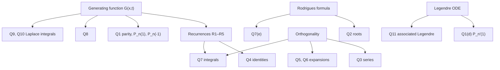

# Assignment 5 – Legendre Polynomials and Functions

Source: [[Assignment-5.pdf]] · Related theory: [[Legendre's Equation]] · [[Series Solutions - MOC]] · [[Power Series Method]] · [[Ordinary and Singular Points]] · [[Regular and Irregular Singular Points]] · Previous: [[Assignment 4 - Series Solutions - Solutions]] · Index: [[Problems - MOC]]

> [!abstract] Contents
> [[#0. Theory toolkit]] · [[#Q1]] · [[#Q2]] · [[#Q3]] · [[#Q4]] · [[#Q5]] · [[#Q6]] · [[#Q7]] · [[#Q8]] · [[#Q9]] · [[#Q10]] · [[#Q11]] · [[#Summary]]

> [!info] Concept notes for this sheet
> | Questions | Concept note |
> |---|---|
> | toolkit §0.1–0.2, Q1, Q2 | [[Legendre Polynomials and Rodrigues' Formula]] (series solution, $P_n(1)=1$, Rodrigues, roots by Rolle) |
> | toolkit §0.3–0.4, Q1, Q8, Q9, Q10 | [[Generating Function of Legendre Polynomials]] |
> | toolkit §0.5, Q7 (orthogonality integrals) | [[Orthogonality and Norm of Legendre Polynomials]] · [[Inner Product Spaces and Orthogonal Functions]] |
> | toolkit §0.6, Q3, Q5, Q6 | [[Legendre Series and Fourier-Legendre Expansions]] |
> | Q4, Q7 (recurrence-based integrals), toolkit R1–R5 | [[Legendre Recurrence Relations and Integrals]] |
> | Q7(e) (Gamma / Beta functions); Q7(h) uses the generating function | [[Gamma Function]] · [[Generating Function of Legendre Polynomials]] |
> | Q11 (associated Legendre) | [[Legendre Polynomials and Rodrigues' Formula]] + [[Special Functions - MOC]] |

> [!warning] Two statements in the sheet need correction
> Both were confirmed symbolically (SymPy) **and** numerically.
> - **Q4(c)** as printed has the wrong sign. The true identity is $(2n+1)(1-x^2)P_n'=n(n+1)\,[P_{n-1}-P_{n+1}]$. (Test $n=1$: LHS $=3-3x^2$, printed RHS $=2[P_2-P_0]=3x^2-3$.)
> - **Q7(d)** as printed is false. $\int_{-1}^1(x^2-1)P_{n-1}P_n'\,dx=-\dfrac{2n(n+1)}{(2n-1)(2n+1)}$ (for $n=1$: $-4/3$, not $4/15$). The printed value $\dfrac{2n(n+1)}{(2n+1)(2n+3)}$ is exactly $\int(x^2-1)P_{n+1}P_n'\,dx$, probably the intended integral. Both versions are proved below.

---

## 0. Theory toolkit

### 0.1 Legendre's equation and polynomials
$$(1-x^2)y''-2xy'+n(n+1)y=0$$
For $n=0,1,2,\dots$ it has a polynomial solution $P_n$ of degree $n$, normalised by $P_n(1)=1$ (see [[Legendre's Equation]]). 

Explicit form:
$$
P_n(x)=\sum_{k=0}^{\lfloor n/2\rfloor}\frac{(-1)^k(2n-2k)!}{2^n\,k!\,(n-k)!\,(n-2k)!}\,x^{n-2k},\qquad
\text{leading coeff. }\ \frac{(2n)!}{2^n(n!)^2}
$$

The equation in **Sturm–Liouville form** is $\big((1-x^2)y'\big)'+n(n+1)y=0$ (used repeatedly below).

![[A5-fig1-basics.png]]

### 0.2 Rodrigues' formula
$$P_n(x)=\frac1{2^nn!}\frac{d^n}{dx^n}(x^2-1)^n$$

### 0.3 Generating function
$$G(x,t)=\frac1{\sqrt{1-2xt+t^2}}=\sum_{n=0}^\infty P_n(x)\,t^n\qquad(|t|<1)$$

### 0.4 Recurrences (all derived from $G$)
Differentiate $G$ and use $D=1-2xt+t^2$:

| From | Identity | Coefficient of $t^n$ gives |
|---|---|---|
| $D\,G_t=(x-t)G$ | | $(n+1)P_{n+1}=(2n+1)xP_n-nP_{n-1}$  **(R1)** |
| $D\,G_x=tG$ | | $P_{n+1}'-2xP_n'+P_{n-1}'=P_n$  **(R2)** |
| $(x-t)G_x=tG_t$ | | $xP_n'-P_{n-1}'=nP_n$  **(R3)** |

Combining (R2) and (R3):

$$P_{n+1}'-xP_n'=(n+1)P_n\ \textbf{(R4)},\qquad P_{n+1}'-P_{n-1}'=(2n+1)P_n\ \textbf{(R5)}$$

### 0.5 Orthogonality and norm
$$\int_{-1}^1P_mP_n\,dx=\frac{2}{2n+1}\delta_{mn}$$
Consequence: $P_n\perp$ every polynomial of degree $<n$.

### 0.6 Legendre series
For $f$ piecewise smooth on $[-1,1]$,
$$f(x)\sim\sum_{n=0}^\infty c_nP_n(x),\qquad c_n=\frac{2n+1}{2}\int_{-1}^1f(x)P_n(x)\,dx$$

### 0.7 How the problems depend on each other

---

## Q1

> [!question] Show (a) $P_n(-x)=(-1)^nP_n(x)$ (b) $P_n(-1)=(-1)^n$ (c) $P_n'(-x)=(-1)^{n+1}P_n'(x)$ (d) $P_n'(\pm1)$ (e) $P_{2n}'(0)=0$, $P_{2n+1}'(0)=(-1)^n\frac{(2n+1)!}{2^{2n}(n!)^2}$

**(a)** $G(-x,-t)=\dfrac1{\sqrt{1-2(-x)(-t)+t^2}}=G(x,t)$. So $\sum P_n(-x)(-t)^n=\sum P_n(x)t^n$, and comparing coefficients, $(-1)^nP_n(-x)=P_n(x)$, i.e. $P_n(-x)=(-1)^nP_n(x)$. ∎

**(b)** $G(1,t)=\dfrac1{\sqrt{(1-t)^2}}=\dfrac1{1-t}=\sum t^n$, so $P_n(1)=1$. By (a), $P_n(-1)=(-1)^nP_n(1)=(-1)^n$. ∎

**(c)** Differentiate (a) with respect to $x$: $-P_n'(-x)=(-1)^nP_n'(x)$, so $P_n'(-x)=(-1)^{n+1}P_n'(x)$. ∎

**(d)** $P_n$ is a polynomial, so it is smooth at $x=1$. Put $x=1$ in the ODE:
$$(1-1)P_n''(1)-2P_n'(1)+n(n+1)P_n(1)=0\ \Rightarrow\ P_n'(1)=\frac{n(n+1)}2.$$
By (c) with $x=1$: $P_n'(-1)=(-1)^{n+1}\dfrac{n(n+1)}2=(-1)^{n-1}\dfrac{n(n+1)}2$. ∎

**(e)** $P_{2n}$ is even, so $P_{2n}'$ is odd and $P_{2n}'(0)=0$. For $N=2n+1$, only the $x^1$ term of $P_N$ contributes to $P_N'(0)$. In the explicit formula it has $N-2k=1$, i.e. $k=n$:
$$P_{2n+1}'(0)=\frac{(-1)^n(2n+2)!}{2^{2n+1}\,n!\,(n+1)!}
=\frac{(-1)^n\,2(n+1)\,(2n+1)!}{2^{2n+1}\,n!\,(n+1)\,n!}
=(-1)^n\frac{(2n+1)!}{2^{2n}(n!)^2}.\ ∎$$

*Check:* $n=1$: $P_3'(0)=-3/2$ ✓ (formula gives $-3!/(4\cdot1)=-1.5$). The numerical values in the figure above match to machine precision.

---

## Q2

> [!question] If $f$ is a polynomial with double roots at $a,b$, show $f''$ vanishes at least twice in $(a,b)$. Then prove $P_n$ has $n$ distinct roots in $(-1,1)$.

**Part 1.** A double root means $f(a)=f'(a)=0=f(b)=f'(b)$.
- $f(a)=f(b)=0$ ⇒ by Rolle, $f'(c)=0$ for some $c\in(a,b)$.
- Now $f'$ vanishes at $a$, $c$, $b$ (three distinct points) ⇒ by Rolle on $[a,c]$ and $[c,b]$, $f''$ has a zero in $(a,c)$ and another in $(c,b)$. So $f''$ vanishes at least twice in $(a,b)$. ∎

**Part 2 (Rodrigues).** Let $f(x)=(x^2-1)^n=(x-1)^n(x+1)^n$, with $P_n=\dfrac1{2^nn!}f^{(n)}$.

*Claim:* for $0\le k\le n$, $f^{(k)}$ has $k$ distinct zeros in $(-1,1)$, and vanishes at $\pm1$ (to order $n-k$).

- $k=0$: zero interior roots; $\pm1$ are roots of multiplicity $n$. ✓
- Step $k\to k+1$ ($k<n$): $f^{(k)}$ vanishes at $-1$, at $k$ interior points, and at $1$: that is $k+2$ distinct zeros. By Rolle, $f^{(k+1)}$ has a zero in each of the $k+1$ gaps, all inside $(-1,1)$ and distinct, so $k+1$ interior zeros. Also $f^{(k+1)}(\pm1)=0$ as long as $k+1<n$.

At $k=n$, $f^{(n)}$ has $n$ distinct zeros in $(-1,1)$. Since $\deg P_n=n$, these are *all* its roots, and they are simple. ∎

![[A5-fig2-roots.png]]

The middle panel shows the Rodrigues chain $D^k(x^2-1)^4$ gaining one interior root per derivative; the right panel shows that the zeros of $P_4$ and $P_5$ interlace.

---

## Q3

> [!question] First three terms of the Legendre series.

I use $c_n=\tfrac{2n+1}2\int_{-1}^1fP_n\,dx$ with $P_0=1,\ P_1=x,\ P_2=\tfrac12(3x^2-1),\ P_3=\tfrac12(5x^3-3x),\ P_4=\tfrac18(35x^4-30x^2+3)$.

For even $f$ all odd $c_n$ vanish, so I list both the terms $n=0,1,2$ and the **first three non-zero terms**.

### (a) $f=|x|$ (even)
$c_0=\int_0^1x\,dx=\tfrac12$; $c_2=5\int_0^1x\cdot\tfrac12(3x^2-1)dx=\tfrac52(\tfrac34-\tfrac12)=\tfrac58$; $c_4=-\tfrac3{16}$.

$$f\sim\tfrac12P_0+\tfrac58P_2-\tfrac3{16}P_4+\cdots\qquad(c_1=0)$$

### (b) step function
$c_0=\tfrac12$, $c_1=\tfrac32\int_0^1x\,dx=\tfrac34$, $c_2=\tfrac54\int_0^1(3x^2-1)dx=0$, $c_3=\tfrac74\int_0^1(5x^3-3x)dx=-\tfrac7{16}$.

$$f\sim\tfrac12P_0+\tfrac34P_1+0\cdot P_2-\tfrac7{16}P_3+\cdots$$

### (c) $f=e^x$
Using $\int_{-1}^1e^x=e-e^{-1}$, $\int xe^x=2e^{-1}$, $\int x^2e^x=e-5e^{-1}$:

$$c_0=\sinh1\approx1.1752,\quad c_1=\frac3e\approx1.1036,\quad c_2=\frac52\Big(e-\frac7e\Big)\approx0.3578$$

$$e^x\sim\sinh1\,P_0+\frac3e\,P_1+\frac52\Big(e-\frac7e\Big)P_2+\cdots$$

### (d) $f=1-|x|$ (even)
$c_0=\tfrac12$, $c_1=0$, $c_2=\tfrac52\int_0^1(1-x)(3x^2-1)dx=-\tfrac58$, $c_4=\tfrac3{16}$.

$$f\sim\tfrac12P_0-\tfrac58P_2+\tfrac3{16}P_4+\cdots$$
(consistent with $1-|x|=1-(\text{series of }|x|)$).

### (e) $f=\cos\pi x$ (even)
$c_0=0$; $c_2=\tfrac54\Big(3\int_{-1}^{1}x^2\cos\pi x\,dx-0\Big)=\tfrac54\cdot3\cdot\Big(-\tfrac4{\pi^2}\Big)=-\dfrac{15}{\pi^2}$; $c_4=\dfrac{45(21-2\pi^2)}{\pi^4}$.

$$f\sim-\frac{15}{\pi^2}P_2+\frac{45(21-2\pi^2)}{\pi^4}P_4+\cdots\qquad(c_0=c_1=0)$$

### (f) $f=7x^4-3x+1$ (a polynomial: the series terminates)
Using $x^4=\tfrac{8}{35}P_4+\tfrac47P_2+\tfrac15P_0$:
$$f=\tfrac85P_4+4P_2-3P_1+\tfrac{12}5P_0$$
so $c_0=\tfrac{12}5,\ c_1=-3,\ c_2=4$ (and $c_3=0,\ c_4=\tfrac85$).

### Numerical summary

| | $c_0$ | $c_1$ | $c_2$ | $c_3$ | $c_4$ |
|---|---|---|---|---|---|
| (a) | 1/2 | 0 | 5/8 | 0 | −3/16 |
| (b) | 1/2 | 3/4 | 0 | −7/16 | 0 |
| (c) | 1.1752 | 1.1036 | 0.3578 | 0.0705 | 0.0100 |
| (d) | 1/2 | 0 | −5/8 | 0 | 3/16 |
| (e) | 0 | 0 | −1.5198 | 0 | 0.5824 |
| (f) | 12/5 | −3 | 4 | 0 | 8/5 |

![[A5-fig3-series-approx.png]]

Red = the three-term answer; orange = up to $P_4$; blue dotted = up to $P_{12}$. Note the overshoot near the jump in (b) (Gibbs phenomenon) and the exactness for (f) from $N=4$.

![[A5-fig4-coeffs.png]]

![[A5-fig5-convergence.png]]

> [!tip] Reading the convergence plot
> Smooth functions ($e^x$, $\cos\pi x$) converge geometrically. The kinks of $|x|$ and $1-|x|$ give algebraic decay, the jump of (b) is slowest, and the polynomial (f) is exact once $N\ge4$.

---

## Q4

> [!question] Prove (a) $(1-x^2)P_n'=n[P_{n-1}-xP_n]$ (b) $(1-x^2)P_n'=(n+1)[xP_n-P_{n+1}]$ (c) $(2n+1)(1-x^2)P_n'=n(n+1)[P_{n+1}-P_{n-1}]$ (d) $P_7'=13P_6+9P_4+5P_2+P_0$ (e) $P_6'=11P_5+7P_3+3P_1$

**(a)** (R4) with $n\to n-1$: $P_n'-xP_{n-1}'=nP_{n-1}$. (R3): $P_{n-1}'=xP_n'-nP_n$. Substitute:
$$P_n'-x(xP_n'-nP_n)=nP_{n-1}\ \Rightarrow\ (1-x^2)P_n'+nxP_n=nP_{n-1}\ \Rightarrow\ (1-x^2)P_n'=n\,[P_{n-1}-xP_n].\ ∎$$

**(b)** (R4): $P_{n+1}'=xP_n'+(n+1)P_n$. (R3) with $n\to n+1$: $xP_{n+1}'-P_n'=(n+1)P_{n+1}$. Substitute:
$$x^2P_n'+(n+1)xP_n-P_n'=(n+1)P_{n+1}\ \Rightarrow\ (1-x^2)P_n'=(n+1)\,[xP_n-P_{n+1}].\ ∎$$

**(c)** Form $(n+1)\times$(a) $+\ n\times$(b); the $xP_n$ terms cancel:
$$(2n+1)(1-x^2)P_n'=n(n+1)\big[P_{n-1}-xP_n+xP_n-P_{n+1}\big]=n(n+1)\,[P_{n-1}-P_{n+1}].$$

> [!warning] Sign in the printed statement
> The sheet writes $[P_{n+1}-P_{n-1}]$; the correct combination is $[P_{n-1}-P_{n+1}]$. Counter-check with $n=1$: $3(1-x^2)\cdot1=3-3x^2$, and $2[P_0-P_2]=2\big[1-\tfrac12(3x^2-1)\big]=3-3x^2$ ✓. The printed form would give $3x^2-3$. SymPy confirms the difference $6-6x^2$ for $n=1$.

**(d)** Apply (R5) $P_{k+1}'=(2k+1)P_k+P_{k-1}'$ repeatedly:
$$P_7'=13P_6+P_5'=13P_6+9P_4+P_3'=13P_6+9P_4+5P_2+P_1'=13P_6+9P_4+5P_2+P_0.\ ∎$$
(using $P_1'=1=P_0$.)

**(e)** Likewise
$$P_6'=11P_5+P_4'=11P_5+7P_3+P_2'=11P_5+7P_3+3P_1+P_0'=11P_5+7P_3+3P_1,$$
since $P_0'=0$. ∎

![[A5-fig6-identities.png]]

Left: the residuals of (a), (b) and the corrected (c) are $\sim10^{-14}$, while the printed (c) misses by up to ≈ 30. Right: $P_7'$ is rebuilt term by term.

---

## Q5

> [!question] Express in Legendre polynomials.

Use $1=P_0,\ x=P_1,\ x^2=\tfrac23P_2+\tfrac13P_0,\ x^3=\tfrac25P_3+\tfrac35P_1$.

**(a)** $x^2-5=\tfrac23P_2+\tfrac13P_0-5P_0=\boxed{\tfrac23P_2-\tfrac{14}3P_0}$

**(b)** $x^3+x+1=\tfrac25P_3+\tfrac35P_1+P_1+P_0=\boxed{\tfrac25P_3+\tfrac85P_1+P_0}$

**(c)** $x^3+2x^2-x-3=\tfrac25P_3+\tfrac35P_1+\tfrac43P_2+\tfrac23P_0-P_1-3P_0$
$$=\boxed{\tfrac25P_3+\tfrac43P_2-\tfrac25P_1-\tfrac73P_0}$$

![[A5-fig7-q5.png]]

Dots (hand results) coincide with the bars computed by numerical integration.

---

## Q6

> [!question] Show $x^n=\sum_{m=0}^na_mP_m$ and $a_n=\dfrac{2^n(n!)^2}{(2n)!}$.

**Existence.** $P_0,\dots,P_n$ have exact degrees $0,\dots,n$, so they are linearly independent and span the $(n+1)$-dimensional space of polynomials of degree $\le n$. Hence $x^n$ is a unique combination $\sum_{m\le n}a_mP_m$. (By parity only $m\equiv n \pmod 2$ appear.)

**The top coefficient.** The leading coefficient of $P_n$ is $\dfrac{(2n)!}{2^n(n!)^2}$ (§0.1), and $P_m$ with $m<n$ cannot produce an $x^n$ term. Matching the $x^n$ coefficient:
$$1=a_n\,\frac{(2n)!}{2^n(n!)^2}\ \Rightarrow\ a_n=\frac{2^n(n!)^2}{(2n)!}.\ ∎$$

*Cross-check by induction.* From (R1), $xP_{n-1}=\dfrac{nP_n+(n-1)P_{n-2}}{2n-1}$, so $a_n=\dfrac n{2n-1}a_{n-1}$, which gives $a_n=\dfrac{n!}{(2n-1)!!}=\dfrac{2^n(n!)^2}{(2n)!}$ ✓.

![[A5-fig8-q6.png]]

Left: the matrix $a_{nm}$ in $x^n=\sum_ma_{nm}P_m$ (checkerboard parity pattern, diagonal = $a_n$). Right: $a_n$ against the formula.

---

## Q7

> [!question] Evaluate/prove the integrals (a)–(l).

Common tools: orthogonality (§0.5), (R1), (R3)–(R5), and $P_n(\pm1)=(\pm1)^n$.

**(a)** For $m<n$, $x^m\in\operatorname{span}(P_0,\dots,P_m)$, so $\int x^mP_n=0$. For $m=n$, $x^n=a_nP_n+(\text{lower})$:
$$\int_{-1}^1x^nP_n\,dx=a_n\cdot\frac2{2n+1}=\frac{2^n(n!)^2}{(2n)!}\cdot\frac2{2n+1}=\frac{2^{n+1}(n!)^2}{(2n+1)!}.\ ∎$$

**(b)** Integrate by parts with the Sturm–Liouville form $\big((1-x^2)P_n'\big)'=-n(n+1)P_n$:
$$\int(1-x^2)P_n'P_n'=\underbrace{\big[(1-x^2)P_n'P_n\big]_{-1}^{1}}_{=0}-\int P_n\big((1-x^2)P_n'\big)'=n(n+1)\int P_n^2=\frac{2n(n+1)}{2n+1}.\ ∎$$

**(c)** (R1): $xP_n=\dfrac{(n+1)P_{n+1}+nP_{n-1}}{2n+1}$. Multiply by $P_{n-1}$ and integrate:
$$\int xP_nP_{n-1}=\frac n{2n+1}\cdot\frac2{2n-1}=\frac{2n}{4n^2-1}.\ ∎$$

**(d)** Using (a) of Q4 in the form $(x^2-1)P_n'=n\,[xP_n-P_{n-1}]$:

*As printed, with $P_{n-1}$:*
$$\int(x^2-1)P_{n-1}P_n'=n\!\int xP_nP_{n-1}-n\!\int P_{n-1}^2=n\Big[\frac{2n}{4n^2-1}-\frac2{2n-1}\Big]=-\frac{2n(n+1)}{(2n-1)(2n+1)}$$
This is **negative** and differs from the printed value (check $n=1$: $\int(x^2-1)dx=-\tfrac43$).

*With $P_{n+1}$ (which gives the printed value):*
$$\int(x^2-1)P_{n+1}P_n'=n\!\int xP_nP_{n+1}-n\!\int P_{n-1}P_{n+1}=n\cdot\frac{2(n+1)}{(2n+1)(2n+3)}-0=\frac{2n(n+1)}{(2n+1)(2n+3)}\ ∎$$
(here (c) was applied with $n\to n+1$).

**(e)** Rodrigues + $n$ integrations by parts. Let $p=n+2k$. The boundary terms vanish because $D^j(x^2-1)^n=0$ at $\pm1$ for $j<n$:
$$\int_{-1}^1x^pP_n=\frac{(-1)^n}{2^nn!}\frac{p!}{(p-n)!}\int_{-1}^1x^{2k}(x^2-1)^ndx
=\frac{1}{2^nn!}\frac{(n+2k)!}{(2k)!}\int_{-1}^1x^{2k}(1-x^2)^ndx.$$
With $u=x^2$ the last integral is a Beta function: $B(k+\tfrac12,n+1)=\dfrac{\Gamma(k+\frac12)\,n!}{\Gamma(n+k+\frac32)}$. Therefore
$$\int_{-1}^1x^{n+2k}P_n\,dx=\frac{(n+2k)!\,\Gamma(k+\frac12)}{2^n(2k)!\,\Gamma(n+k+\frac32)}.\ ∎$$
(Check: $k=0$ reproduces (a): $\frac{n!\sqrt\pi}{2^n\Gamma(n+\frac32)}=\frac{2^{n+1}(n!)^2}{(2n+1)!}$.)

**(f)** By iterating (R5), $P_{n+1}'=(2n+1)P_n+(2n-3)P_{n-2}+(2n-7)P_{n-4}+\cdots$. Only $P_n$ survives against $P_n$:
$$\int P_nP_{n+1}'=(2n+1)\frac2{2n+1}=2.\ ∎$$

**(g)** Let $I_n=\int_{-1}^1P_n^2$ and $J=\int_{-1}^1xP_{n-1}P_n\,dx$. Compute $J$ in two ways using (R1):

- $xP_{n-1}=\dfrac{nP_n+(n-1)P_{n-2}}{2n-1}$, so $J=\dfrac{n}{2n-1}I_n$.
- $xP_n=\dfrac{(n+1)P_{n+1}+nP_{n-1}}{2n+1}$, so $J=\dfrac{n}{2n+1}I_{n-1}$.

Equating the two expressions:
$$\frac n{2n-1}I_n=\frac n{2n+1}I_{n-1}\ \Rightarrow\ \boxed{I_n=\frac{2n-1}{2n+1}\,I_{n-1}}\ ∎$$
(consistent with $I_n=\frac2{2n+1}$.)

**(h)** Generating function: $\sum_nh^n\!\int\dfrac{P_n}{\sqrt{1-x}}dx=\int_{-1}^1\dfrac{dx}{\sqrt{1-x}\sqrt{1-2hx+h^2}}$. Put $u=1-x$, $u=s^2$:
$$\int_0^2\frac{du}{\sqrt{u\,[(1-h)^2+2hu]}}=2\int_0^{\sqrt2}\frac{ds}{\sqrt{(1-h)^2+2hs^2}}=\sqrt{\frac2h}\,\operatorname{arcsinh}\frac{2\sqrt h}{1-h}=\sqrt{\frac2h}\ln\frac{1+\sqrt h}{1-\sqrt h}.$$
Since $\ln\dfrac{1+y}{1-y}=2\sum\dfrac{y^{2n+1}}{2n+1}$ with $y=\sqrt h$:
$$=2\sqrt2\sum_{n\ge0}\frac{h^n}{2n+1}\ \Rightarrow\ \int_{-1}^1\frac{P_n(x)}{\sqrt{1-x}}dx=\frac{2\sqrt2}{2n+1}.\ ∎$$

**(i)** $\int xP_nP_n'=\tfrac12\int x\,(P_n^2)'=\tfrac12\big[xP_n^2\big]_{-1}^{1}-\tfrac12\int P_n^2=\tfrac12(1+1)-\tfrac1{2n+1}=\dfrac{2n}{2n+1}.\ ∎$

**(j)** Let $n\ge m$ with $n-m$ even. Integrate by parts:
$$\int P_m'P_n'=\big[P_nP_m'\big]_{-1}^{1}-\int P_nP_m''.$$
$\deg P_m''=m-2<n$, so $\int P_nP_m''=0$. With (b), (c) of Q1 and (d):
$$P_n(1)P_m'(1)-P_n(-1)P_m'(-1)=P_m'(1)\big[1-(-1)^n(-1)^{m-1}\big]=P_m'(1)\big[1+(-1)^{n-m}\big]=2\cdot\frac{m(m+1)}2=m(m+1).\ ∎$$

**(k)** For $n>m$ with $n-m$ odd:
$$\int x^mP_n'=\big[x^mP_n\big]_{-1}^{1}-m\int x^{m-1}P_n=\big(1-(-1)^{m+n}\big)-0=2,$$
since $m-1<n$ kills the last integral and $m+n$ is odd. ∎

**(l)** This is (j) with $m=n$: $\int(P_n')^2=n(n+1)$. ∎

![[A5-fig9-q7-matrices.png]]

Left: $\int x^mP_n$ is zero below the diagonal; right: $\int P_m'P_n'$ follows the pattern $\min(m,n)(\min(m,n)+1)$ when $m-n$ is even and 0 otherwise.

![[A5-fig10-q7-check.png]]

Each point is one integral evaluated by quadrature and compared with the claimed closed form. All points lie on the diagonal **except the printed 7(d)** (open green circles). The right panel shows the numerical integral coincides with the corrected value.

---

## Q8

> [!question] Prove $\dfrac{1-t^2}{(1-2tx+t^2)^{3/2}}=\sum_{n=0}^\infty(2n+1)P_n(x)t^n$.

Let $G=(1-2xt+t^2)^{-1/2}=\sum P_nt^n$. Then
$$2t\,G_t+G=\sum_n(2n+1)P_nt^n.$$
Compute $G_t=\dfrac{x-t}{(1-2xt+t^2)^{3/2}}$. So
$$2tG_t+G=\frac{2t(x-t)+(1-2xt+t^2)}{(1-2xt+t^2)^{3/2}}=\frac{1-t^2}{(1-2xt+t^2)^{3/2}}.\ ∎$$

![[A5-fig11-genfun.png]]

Left: the partial sums converge to the closed form (e.g. $x=0.3,\ t=0.5$: $0.809983$). Right: the surface of the closed form.

---

## Q9

> [!question] Using $\int_0^\pi\frac{d\phi}{a\pm b\cos\phi}$ with $a=1-hx$, $b=h\sqrt{x^2-1}$, prove Laplace's first integral.

**Base integral.** For $a>|b|$ (substitution $\tau=\tan\frac\phi2$):
$$\int_0^\pi\frac{d\phi}{a+b\cos\phi}=\frac{\pi}{\sqrt{a^2-b^2}},$$
and the same value for $a-b\cos\phi$ (replace $\phi\to\pi-\phi$).

**Apply.** $a^2-b^2=(1-hx)^2-h^2(x^2-1)=1-2hx+h^2$. For small $h$, $a>|b|$, so
$$\frac1{\sqrt{1-2hx+h^2}}=\frac1\pi\int_0^\pi\frac{d\phi}{1-hx\pm h\sqrt{x^2-1}\cos\phi}
=\frac1\pi\int_0^\pi\frac{d\phi}{1-h\,u},\qquad u=x\mp\sqrt{x^2-1}\cos\phi.$$
Expand $\dfrac1{1-hu}=\sum h^nu^n$ (valid for small $h$, uniformly in $\phi$):
$$\sum_nP_n(x)h^n=\sum_nh^n\,\frac1\pi\int_0^\pi\big(x\mp\sqrt{x^2-1}\cos\phi\big)^nd\phi.$$
Compare coefficients of $h^n$:
$$\boxed{P_n(x)=\frac1\pi\int_0^\pi\big(x\pm\sqrt{x^2-1}\cos\phi\big)^nd\phi}\ ∎$$
(the $\pm$ signs are interchangeable by $\phi\to\pi-\phi$).

---

## Q10

> [!question] Taking $a=hx-1$, prove Laplace's second integral.

Now take $a=hx-1$, $b=h\sqrt{x^2-1}$, with $h$ **large** ($hx>1$ and $a>|b|$). Again $a^2-b^2=1-2hx+h^2$, so
$$\frac1{\sqrt{1-2hx+h^2}}=\frac1\pi\int_0^\pi\frac{d\phi}{hx-1\pm h\sqrt{x^2-1}\cos\phi}=\frac1\pi\int_0^\pi\frac{d\phi}{hu-1},\qquad u=x\pm\sqrt{x^2-1}\cos\phi.$$
For $|hu|>1$ expand $\dfrac1{hu-1}=\dfrac1{hu}\sum_{k\ge0}(hu)^{-k}=\sum_{n\ge0}(hu)^{-(n+1)}$. The left side, for $|h|>1$, is the *exterior* generating function $\sum_nP_n(x)h^{-(n+1)}$ (from $G$ with $t=1/h$: $\frac1{\sqrt{1-2hx+h^2}}=\frac1h\frac1{\sqrt{1-2x/h+1/h^2}}$). Comparing coefficients of $h^{-(n+1)}$:
$$\boxed{P_n(x)=\frac1\pi\int_0^\pi\frac{d\phi}{\big(x\pm\sqrt{x^2-1}\cos\phi\big)^{n+1}}}\ ∎$$

![[A5-fig12-laplace.png]]

Left and middle: numerical Laplace integrals (dots) reproduce $P_n(x)$ (lines) for $x\ge1$. For $|x|<1$ the square root is imaginary but the formula still holds (the imaginary parts cancel): e.g. $n=4$, $x=0.4$ gives $-0.1130=P_4(0.4)$. Right: at $x=1.7$ the first integrand averages to $P_3(1.7)$.

---

## Q11

> [!question] For $(1-x^2)y''-2xy'+\Big[n(n+1)-\dfrac{m^2}{1-x^2}\Big]y=0$ (1), put $y=(1-x^2)^{m/2}v$ and show $v$ satisfies $(1-x^2)v''-2(m+1)xv'+[n(n+1)-m(m+1)]v=0$ (2). Show $v=d^mP_n/dx^m$ satisfies (2).

**Part 1.** Let $s=1-x^2$ and $w=s^{m/2}$, so $y=wv$:
$$w'=-mxs^{m/2-1},\qquad w''=-m\,s^{m/2-1}+m(m-2)x^2s^{m/2-2}.$$
$$y'=w'v+wv',\qquad y''=w''v+2w'v'+wv''.$$
Insert in (1) and divide by $w=s^{m/2}$:

- $v''$: $\ s$
- $v'$: $\ 2s\dfrac{w'}w-2x=-2mx-2x=-2(m+1)x$
- $v$: $\ s\dfrac{w''}w-2x\dfrac{w'}w+n(n+1)-\dfrac{m^2}{s}=-m+\dfrac{m(m-2)x^2}{s}+\dfrac{2mx^2}s+n(n+1)-\dfrac{m^2}s$

The last coefficient simplifies using $\dfrac{m^2x^2-m^2}{s}=-m^2$:
$$-m+\frac{m^2x^2-m^2}{s}+n(n+1)=n(n+1)-m-m^2=n(n+1)-m(m+1).$$
Hence (2) holds. ∎

**Part 2.** Differentiate Legendre's equation $(1-x^2)u''-2xu'+n(n+1)u=0$ **$m$ times** with Leibniz' rule, $u=P_n$:
$$(1-x^2)u^{(m+2)}+m(-2x)u^{(m+1)}+\binom m2(-2)u^{(m)}-2xu^{(m+1)}-2m\,u^{(m)}+n(n+1)u^{(m)}=0.$$
With $v=u^{(m)}$:
$$(1-x^2)v''-2(m+1)xv'+\big[n(n+1)-m(m-1)-2m\big]v=0,$$
and $m(m-1)+2m=m(m+1)$, which is exactly (2). ∎

**Conclusion.** $y=(1-x^2)^{m/2}\dfrac{d^mP_n}{dx^m}$ solves (1). It is bounded on $[-1,1]$ (the factor $(1-x^2)^{m/2}$ is continuous and $D^mP_n$ is a polynomial), so it is the bounded solution: the **associated Legendre function** $P_n^m$ (vanishing for $m>n$).

![[A5-fig13-assoc.png]]

Left and middle: the associated Legendre functions are bounded at $\pm1$ and vanish there for $m\ge1$. Right: the residual of (1) is zero up to finite-difference noise; equation (2) for $v=D^mP_n$ is satisfied to $\sim10^{-8}$ (numerical derivative error).

---

## Summary

> [!success] Results at a glance
> | Q | Result |
> |---|---|
> | 1 | Parity from $G(-x,-t)=G(x,t)$; $P_n(1)=1$ from $G(1,t)=\frac1{1-t}$; $P_n'(1)=\frac{n(n+1)}2$ from the ODE; $P_{2n+1}'(0)$ from the explicit sum |
> | 2 | Rolle on $D^k(x^2-1)^n$ ⇒ $n$ simple roots in $(-1,1)$ |
> | 3 | (a) $\tfrac12+\tfrac58P_2-\tfrac3{16}P_4$ · (b) $\tfrac12+\tfrac34P_1-\tfrac7{16}P_3$ · (c) $\sinh1+\tfrac3eP_1+\tfrac52(e-\tfrac7e)P_2$ · (d) $\tfrac12-\tfrac58P_2+\tfrac3{16}P_4$ · (e) $-\tfrac{15}{\pi^2}P_2+\tfrac{45(21-2\pi^2)}{\pi^4}P_4$ · (f) $\tfrac{12}5+(-3)P_1+4P_2+\tfrac85P_4$ |
> | 4 | All proved via R3–R5; **(c) has the sign $P_{n-1}-P_{n+1}$** |
> | 5 | (a) $\tfrac23P_2-\tfrac{14}3P_0$ · (b) $\tfrac25P_3+\tfrac85P_1+P_0$ · (c) $\tfrac25P_3+\tfrac43P_2-\tfrac25P_1-\tfrac73P_0$ |
> | 6 | $a_n=\frac{2^n(n!)^2}{(2n)!}$ |
> | 7 | (a)–(l) proved; **(d) corrected** |
> | 8 | $2tG_t+G$ |
> | 9, 10 | Laplace integrals from $\int_0^\pi\frac{d\phi}{a+b\cos\phi}=\frac\pi{\sqrt{a^2-b^2}}$ |
> | 11 | Part 1 direct substitution; Part 2 differentiate the ODE $m$ times |

### Quick revision
- [ ] $G=\sum P_nt^n$ gives parity, $P_n(1)=1$, R1–R5, Q8
- [ ] Rodrigues gives roots (Rolle) and $\int x^pP_n$ (integration by parts)
- [ ] Orthogonality gives Legendre coefficients $c_n=\frac{2n+1}2\int fP_n$ and the expansions of $x^n$
- [ ] Sturm–Liouville form $((1-x^2)P_n')'=-n(n+1)P_n$ gives $\int(1-x^2)P_n'^2$
- [ ] Always test an identity at $n=1$ before proving it (it exposes the two typos)

### Figure index
`A5-fig1` basics · `fig2` roots · `fig3` series approximations · `fig4` coefficients · `fig5` convergence · `fig6` identities · `fig7` Q5 · `fig8` Q6 · `fig9` Q7 matrices · `fig10` Q7 numerical check · `fig11` generating function · `fig12` Laplace integrals · `fig13` associated Legendre. All in the `assets` folder.
