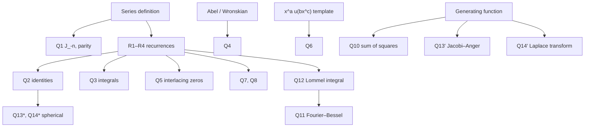

# Assignment 6 – Bessel Functions

Source: [[Assignment-6.pdf]] · Theory: [[Bessel's Equation and Bessel Functions of the First Kind]] · [[Bessel Function Properties and Recurrence Relations]] · [[Special Functions - MOC]] · Previous: [[Assignment 5 - Legendre Polynomials and Functions - Solutions]] · Next: [[Assignment 7 - Sturm-Liouville Problems - Solutions]] · Index: [[Problems - MOC]]

> [!abstract] Contents
> [[#0. Theory toolkit]] · [[#Q1]] · [[#Q2]] · [[#Q3]] · [[#Q4]] · [[#Q5]] · [[#Q6]] · [[#Q7]] · [[#Q8]] · [[#Q9]] · [[#Q10]] · [[#Q11]] · [[#Q12]] · [[#Q13*]] · [[#Q14*]] · [[#Q13′]] · [[#Q14′]] · [[#Summary]]

> [!info] Concept notes for this sheet
> | Questions | Concept note |
> |---|---|
> | Q1, Q2, Q7, Q8, Q14*, toolkit §0.2 | [[Bessel Function Properties and Recurrence Relations]] |
> | Q1, Q10, Q13′, Q14′, toolkit §0.3 | [[Bessel Generating Function]] |
> | Q4 (Wronskian), Q6 (Y and J₋ν) | [[Bessel Functions of the Second Kind and General Solution]] |
> | Q6 | [[Reducing Equations to Bessel Form]] (the template $y=x^au(bx^c)$) |
> | Q11, Q12 | [[Fourier-Bessel Series]] · [[Inner Product Spaces and Orthogonal Functions]] |
> | Q5 | zero interlacing: [[Bessel Function Properties and Recurrence Relations]] + Rolle's theorem |

> [!warning] Points where the sheet needs care
> All were checked numerically (see `Tools/de_a6a7.py`).
> - **Q3(c)** as printed has the wrong sign. The true result is $\displaystyle\int x^{-2}J_5\,dx=-x^{-2}J_4\;\mathbf{-}\;2x^{-3}J_3+C$. (The printed $+2x^{-3}J_3$ differs from the integral by a function that is not constant: the discrepancy over $[1,9]$ is $0.079$.)
> - **Q10**: the bound $|J_n|\le\sqrt{1/2}$ holds for $n\ge1$ only; $J_0(0)=1$.
> - **Q11(a)** cannot be finished in elementary terms: the coefficients contain $\int_0^{\alpha}J_0$, which has no closed form (it is tabulated).
> - The sheet numbers two questions "13" and "14" (the spherical-Bessel ones with a star, and the Jacobi–Anger / Laplace ones at the end). Here the second pair is written **Q13′** and **Q14′**.

---

## 0. Theory toolkit

### 0.1 Definition
$$x^2y''+xy'+(x^2-\nu^2)y=0,\qquad J_\nu(x)=\sum_{k\ge0}\frac{(-1)^k}{k!\,\Gamma(k+\nu+1)}\Big(\frac x2\Big)^{2k+\nu}.$$
$J_\nu$ and $J_{-\nu}$ are independent for $\nu\notin\mathbb Z$. For integer $\nu$ use $J_\nu,Y_\nu$ instead. The Wronskian is $W(J_\nu,Y_\nu)=\dfrac{2}{\pi x}$.

### 0.2 Derivative identities and recurrences
$$\big(x^{\nu}J_\nu\big)'=x^{\nu}J_{\nu-1}\ \ (\mathrm{R1}),\qquad \big(x^{-\nu}J_\nu\big)'=-x^{-\nu}J_{\nu+1}\ \ (\mathrm{R2})$$
Expanding the products:
$$J_\nu'=J_{\nu-1}-\frac\nu xJ_\nu\ \ (\mathrm{R1}'),\qquad J_\nu'=\frac\nu xJ_\nu-J_{\nu+1}\ \ (\mathrm{R2}')$$
Adding and subtracting:
$$J_{\nu-1}+J_{\nu+1}=\frac{2\nu}xJ_\nu\ \ (\mathrm{R3}),\qquad J_{\nu-1}-J_{\nu+1}=2J_\nu'\ \ (\mathrm{R4})$$
Special case: $J_0'=-J_1$.

### 0.3 Generating function and Jacobi–Anger
$$e^{\frac x2\left(t-\frac1t\right)}=\sum_{n=-\infty}^\infty J_n(x)t^n\ \xrightarrow{\ t=e^{i\theta}\ }\ e^{ix\sin\theta}=\sum_{n\in\mathbb Z}J_n(x)e^{in\theta}.$$
Taking real and imaginary parts and using $J_{-n}=(-1)^nJ_n$:
$$\cos(x\sin\theta)=J_0+2\sum_{k\ge1}J_{2k}\cos2k\theta,\qquad \sin(x\sin\theta)=2\sum_{k\ge0}J_{2k+1}\sin(2k+1)\theta.$$

### 0.4 Half-integer orders
$J_{1/2}=\sqrt{\tfrac2{\pi x}}\sin x$, $J_{-1/2}=\sqrt{\tfrac2{\pi x}}\cos x$; (R3) then produces all $J_{n+1/2}$.

### 0.5 Orthogonality (used by Q11, Q12)
With $\alpha_k$ the positive zeros of $J_\nu$:
$$\int_0^L xJ_\nu\Big(\frac{\alpha_jx}L\Big)J_\nu\Big(\frac{\alpha_kx}L\Big)dx=\frac{L^2}2J_{\nu+1}(\alpha_k)^2\,\delta_{jk}.$$
Q12 gives the orthogonality for free; the norm is its limit $b\to a$ (done below).

### 0.6 Reduction to Bessel form
$y=x^au(bx^c)$ turns Bessel's equation of order $n$ into
$$y''+\frac{1-2a}xy'+\Big(b^2c^2x^{2c-2}+\frac{a^2-n^2c^2}{x^2}\Big)y=0\qquad(\text{Lecture 26}).$$
Match coefficients to read off $a,b,c,n$.

### 0.7 Dependency map

---

## Q1

> [!question] Show that for integer $n$: $J_{-n}=(-1)^nJ_n$ and $J_n(-x)=(-1)^nJ_n(x)$.

**$J_{-n}$.** In $J_{-n}=\sum_k\dfrac{(-1)^k}{k!\,\Gamma(k-n+1)}(x/2)^{2k-n}$, the factor $1/\Gamma(k-n+1)$ is $0$ for $k=0,\dots,n-1$ (Γ has poles at $0,-1,-2,\dots$). So the sum starts at $k=n$. Put $k=m+n$:
$$J_{-n}=\sum_{m\ge0}\frac{(-1)^{m+n}}{(m+n)!\,m!}\Big(\frac x2\Big)^{2m+n}=(-1)^nJ_n.\ ∎$$

**Parity.** Every term of $J_n$ carries $x^{2k+n}$, so replacing $x\to-x$ multiplies each term by $(-1)^n$. ∎

*(Same result from the generating function: $t\to-1/t$ leaves $e^{\frac x2(t-1/t)}$ unchanged.)*

![[A6-fig1-basics.png]]

---

## Q2

> [!question] Prove (a)–(h).

**(b) first.** (R3) with $\nu=\tfrac12$: $J_{-1/2}+J_{3/2}=\dfrac1xJ_{1/2}$, so $J_{3/2}=x^{-1}J_{1/2}-J_{-1/2}$. ∎

**(a)** Insert $J_{\pm1/2}$ from §0.4 in (b):
$$J_{3/2}=\sqrt{\tfrac2{\pi x}}\Big(\frac{\sin x}x-\cos x\Big).\ ∎$$

**(c)** (R4) with $\nu=2$: $2J_2'=J_1-J_3$. ∎

**(e)** (R2′)/(R4) with $\nu=1$: $J_1'=\tfrac12(J_0-J_2)$. Since $J_0'=-J_1$, $J_0''=-J_1'=\tfrac12(J_2-J_0)$. ∎

**(d)** From (e) and (c): $J_0'''=\tfrac12(J_2'-J_0')=\tfrac12\big[\tfrac12(J_1-J_3)+J_1\big]=\tfrac34J_1-\tfrac14J_3$. Hence
$$J_3+3J_0'+4J_0'''=J_3-3J_1+(3J_1-J_3)=0.\ ∎$$

**(f)** $J_1'=J_0-\dfrac1xJ_1$ (R1′). Differentiate:
$$J_1''=J_0'-\frac{J_1'}x+\frac{J_1}{x^2}=-J_1-\frac{J_0}x+\frac{2J_1}{x^2}.$$
By (R3) with $\nu=1$: $J_2=\frac2xJ_1-J_0$, so $\frac1xJ_2=\frac{2J_1}{x^2}-\frac{J_0}x$. Therefore $J_1''=-J_1+\frac1xJ_2$. ∎

**(g)** $J_{1/2}J_{-1/2}=\dfrac2{\pi x}\sin x\cos x=\dfrac{\sin2x}{\pi x}$. ∎

**(h)** $J_{1/2}^2+J_{-1/2}^2=\dfrac2{\pi x}(\sin^2x+\cos^2x)=\dfrac2{\pi x}$. ∎

![[A6-fig2-identities.png]]

Left: $J_{\pm1/2},J_{3/2}$ with the $x^{-1/2}$ envelope. Middle: (g), (h). Right: residual of each identity on 300 points, at rounding level.

---

## Q3

> [!question] Show (a) $\int x^4J_0$ (b) $\int J_5$ (c) $\int x^{-2}J_5$ (d) the reduction formula for $\int x^pJ_\nu$.

**(d) first** (it is the engine for (a)). Write $x^pJ_\nu=x^{p-\nu-1}\cdot x^{\nu+1}J_\nu$ and use (R1) with $\nu\to\nu+1$: $x^{\nu+1}J_\nu=(x^{\nu+1}J_{\nu+1})'$. By parts:
$$\int x^pJ_\nu\,dx=x^{p-\nu-1}\,x^{\nu+1}J_{\nu+1}-(p-\nu-1)\int x^{p-\nu-2}\,x^{\nu+1}J_{\nu+1}\,dx=x^pJ_{\nu+1}-(p-\nu-1)\int x^{p-1}J_{\nu+1}\,dx.\ ∎$$

**(a)** Use $J_0'=-J_1$ and (R1) with $\nu=1$: $(xJ_1)'=xJ_0$. Three reductions:
- $\int x^4J_0=\int x^3(xJ_1)'=x^4J_1-3\int x^3J_1$.
- $\int x^3J_1=-\int x^3J_0'=-x^3J_0+3\int x^2J_0$.
- $\int x^2J_0=\int x(xJ_1)'=x^2J_1-\int xJ_1$, and $\int xJ_1=-\int xJ_0'=-xJ_0+\int J_0$.

Back-substituting: $\int x^2J_0=x^2J_1+xJ_0-\int J_0$, then $\int x^3J_1=-x^3J_0+3x^2J_1+3xJ_0-3\int J_0$, so
$$\int x^4J_0\,dx=(x^4-9x^2)J_1+(3x^3-9x)J_0+9\int J_0\,dx.\ ∎$$

**(b)** (R4) rearranged: $J_{k+1}=J_{k-1}-2J_k'$. Apply to $J_5,J_3,J_1$ and use $J_1=-J_0'$:
$$J_5=J_3-2J_4'=J_1-2J_2'-2J_4'=-J_0'-2J_2'-2J_4'.$$
Integrate: $\displaystyle\int J_5\,dx=-J_0-2J_2-2J_4+C=-2J_4-2J_2-J_0+C.$ ∎

**(c)** From (R2) with $\nu=4$: $J_5=-x^4(x^{-4}J_4)'$, so $x^{-2}J_5=-x^2(x^{-4}J_4)'$. By parts:
$$\int x^{-2}J_5=-x^{-2}J_4+2\int x^{-3}J_4\,dx.$$
(R2) with $\nu=3$: $(x^{-3}J_3)'=-x^{-3}J_4$, so $\int x^{-3}J_4=-x^{-3}J_3$. Hence
$$\boxed{\int x^{-2}J_5\,dx=-x^{-2}J_4-2x^{-3}J_3+C}$$

> [!warning] The sheet has $+2x^{-3}J_3$
> *Differentiation check.* $\big(-x^{-2}J_4\big)'=6x^{-3}J_4-x^{-2}J_3$ and $\big(-2x^{-3}J_3\big)'=2x^{-3}J_4$, total $8x^{-3}J_4-x^{-2}J_3$. By (R3) with $\nu=4$, $J_5=\frac8xJ_4-J_3$, so $x^{-2}J_5=8x^{-3}J_4-x^{-2}J_3$ ✓. With $+2x^{-3}J_3$ the derivative would be $4x^{-3}J_4-x^{-2}J_3$ ✗.

![[A6-fig3-integrals.png]]

Left: (a) needs the non-elementary $\int J_0$ (the closed form was evaluated with a tabulated $\int_0^xJ_0$). Middle: (b). Right: the corrected (c) matches quadrature, the printed one does not.

---

## Q4

> [!question] If $y_1,y_2$ solve Bessel's equation of order $\nu$, show $y_1y_2'-y_1'y_2=c/x$.

Put the equation in the form $y''+\dfrac1xy'+\Big(1-\dfrac{\nu^2}{x^2}\Big)y=0$. Let $W=y_1y_2'-y_1'y_2$. Then
$$W'=y_1y_2''-y_1''y_2=-\frac1x\,(y_1y_2'-y_1'y_2)=-\frac Wx$$
(the $\big(1-\nu^2/x^2\big)y_1y_2$ terms cancel). So $(xW)'=0$ and $W=c/x$. ∎ (This is Abel's formula, [[Abel's Formula]], with $p=1/x$.)

Constants: $c=\dfrac2\pi$ for $(J_\nu,Y_\nu)$; $c=-\dfrac{2\sin\nu\pi}\pi$ for $(J_\nu,J_{-\nu})$, which vanishes exactly when $\nu\in\mathbb Z$ (dependence).

---

## Q5

> [!question] Between consecutive positive zeros of $J_\nu$ there is exactly one zero of $J_{\nu+1}$ and exactly one of $J_{\nu-1}$.

Let $a<b$ be consecutive positive zeros of $J_\nu$.

**Existence.** $x^{-\nu}J_\nu$ vanishes at $a$ and $b$; by Rolle its derivative has a zero in $(a,b)$. By (R2) that derivative is $-x^{-\nu}J_{\nu+1}$, so $J_{\nu+1}$ has a zero in $(a,b)$. Likewise $x^\nu J_\nu$ has derivative $x^\nu J_{\nu-1}$ (R1), so $J_{\nu-1}$ has a zero in $(a,b)$.

**Uniqueness.** Suppose $J_{\nu+1}$ had two zeros $c<d$ in $(a,b)$. Then $x^{\nu+1}J_{\nu+1}$ vanishes at both, and by Rolle its derivative $x^{\nu+1}J_\nu$ (R1 with $\nu\to\nu+1$) has a zero in $(c,d)\subset(a,b)$, contradicting that $a,b$ are consecutive zeros of $J_\nu$. For $J_{\nu-1}$ use $(x^{-(\nu-1)}J_{\nu-1})'=-x^{-(\nu-1)}J_\nu$ in the same way. ∎

![[A6-fig4-wronskian-zeros.png]]

Left: $x\,W(J_\nu,Y_\nu)=2/\pi$ (Q4). Middle: zeros of $J_2$ (circles) with exactly one zero of $J_1$ and of $J_3$ between each pair. Right: the zero sets of $J_0,J_1,J_2$ interlace.

---

## Q6

> [!question] Solve in terms of Bessel functions with the indicated transformation.

Template (§0.6): $y=x^au(bx^c)$ solves $y''+\frac{1-2a}xy'+\big(b^2c^2x^{2c-2}+\frac{a^2-n^2c^2}{x^2}\big)y=0$. Write each equation in the form $y''+\dots$ and match. For integer $n$ the second solution is $Y_n$ (not $J_{-n}$).

**(a)** $y''+4xy=0$. No $y'$ term: $1-2a=0\Rightarrow a=\tfrac12$. $b^2c^2x^{2c-2}=4x\Rightarrow c=\tfrac32,\ b=\tfrac43$. $a^2=n^2c^2\Rightarrow n=\tfrac13$.
$$\boxed{y=\sqrt x\Big[A\,J_{1/3}\big(\tfrac43x^{3/2}\big)+B\,J_{-1/3}\big(\tfrac43x^{3/2}\big)\Big]}$$
*Direct check with $y=\sqrt x\,u(z)$, $z=\frac43x^{3/2}$, $z'=2\sqrt x$:* $y''+4xy=4x^{3/2}u''+3u'-\frac14x^{-3/2}u+4x^{3/2}u$. Multiply by $\frac49x^{3/2}$ and use $z^2=\frac{16}9x^3$, $zu'\to\frac43x^{3/2}u'$: $z^2u''+zu'+\big(z^2-\tfrac19\big)u=0$ ✓.

**(b)** $x^2y''-3xy'+4(x^4-3)y=0\ \Rightarrow\ y''-\frac3xy'+\big(4x^2-\frac{12}{x^2}\big)y=0$. $1-2a=-3\Rightarrow a=2$; $2c-2=2\Rightarrow c=2$, $b^2c^2=4\Rightarrow b=1$; $a^2-n^2c^2=-12\Rightarrow n^2=4$.
$$\boxed{y=x^2\big[A\,J_2(x^2)+B\,Y_2(x^2)\big]}$$
(Direct: $y=x^2u(z)$, $z=x^2$ gives $4x^6u''+4x^4u'+(4x^6-16x^2)u=0$, i.e. $z^2u''+zu'+(z^2-4)u=0$.)

**(c)** $x^2y''+xy'+(\lambda^2x^2-\nu^2)y=0$. With $z=\lambda x$ (so $y'=\lambda u'$, $y''=\lambda^2u''$) this is exactly $z^2u''+zu'+(z^2-\nu^2)u=0$ (here $a=0,c=1,b=\lambda,n=\nu$):
$$\boxed{y=A\,J_\nu(\lambda x)+B\,Y_\nu(\lambda x)}\quad(Y_\nu\to J_{-\nu}\text{ if }\nu\notin\mathbb Z)$$

**(d)** $y''+e^{-x}y=0$, $z=2e^{-x/2}$. Here $y=u(z)$ and $z'=-\frac z2$:
$$y'=-\frac z2u',\qquad y''=\frac z4u'+\frac{z^2}4u'',\qquad e^{-x}=\frac{z^2}4.$$
So $\frac{z^2}4u''+\frac z4u'+\frac{z^2}4u=0$, i.e. $z^2u''+zu'+z^2u=0$ (order $0$):
$$\boxed{y=A\,J_0\big(2e^{-x/2}\big)+B\,Y_0\big(2e^{-x/2}\big)}$$

**(e)** $xy''+(1+2p)y'+xy=0\Rightarrow y''+\frac{1+2p}xy'+y=0$. $1-2a=1+2p\Rightarrow a=-p$; $c=1,b=1$; $a^2-n^2=0\Rightarrow n=p$.
$$\boxed{y=x^{-p}\big[A\,J_p(x)+B\,J_{-p}(x)\big]}\quad(J_{-p}\to Y_p\text{ if }p\in\mathbb Z)$$
(Direct: with $y=x^{-p}u$ the terms $p(p+1)-p(1+2p)=-p^2$ remain, giving $x^2u''+xu'+(x^2-p^2)u=0$.)

**(f)** $xy''-5y'+xy=0\Rightarrow$ $1-2a=-5\Rightarrow a=3$; $c=b=1$; $9-n^2=0\Rightarrow n=3$ (this is (e) with $p=-3$).
$$\boxed{y=x^3\big[A\,J_3(x)+B\,Y_3(x)\big]}$$

**(g)** $xy''-(1+2p)y'+xy=0\Rightarrow y''-\frac{1+2p}xy'+y=0$. **Finding the transformation:** $1-2a=-(1+2p)\Rightarrow a=p+1$; $c=b=1$; $a^2-n^2=0\Rightarrow n=p+1$. So put $y=x^{p+1}u(x)$:
$$\boxed{y=x^{p+1}\big[A\,J_{p+1}(x)+B\,J_{-(p+1)}(x)\big]}\quad(J_{-(p+1)}\to Y_{p+1}\text{ if }p\in\mathbb Z)$$

**(h)** $y''+xy=0$ (Airy). **Finding the transformation:** no $y'$ term gives $a=\tfrac12$; $b^2c^2x^{2c-2}=x\Rightarrow c=\tfrac32,\ b=\tfrac23$; $n=a/c=\tfrac13$:
$$\boxed{y=\sqrt x\Big[A\,J_{1/3}\big(\tfrac23x^{3/2}\big)+B\,J_{-1/3}\big(\tfrac23x^{3/2}\big)\Big]}$$
(The same as (a) with $4x\to x$; (a) is (h) after the rescaling $x\to4^{1/3}x$.)

![[A6-fig5-transformations.png]]

Each closed form (thick) was also checked by substituting it into the original ODE at 30-digit precision (residual $<10^{-12}$ for both solutions of every part (a)–(h)), and the curves above agree with direct numerical integration of the ODE (dashed).

---

## Q7

> [!question] Using the recurrences, prove (i) and (ii).

Write $J_n'=\tfrac12\big(J_{n-1}-J_{n+1}\big)$ (R4) and $J_{n-1}+J_{n+1}=\frac{2n}xJ_n$ (R3).

**(i)**
$$\frac d{dx}J_n^2=2J_nJ_n'=J_n\big(J_{n-1}-J_{n+1}\big)=\frac x{2n}\big(J_{n-1}+J_{n+1}\big)\big(J_{n-1}-J_{n+1}\big)=\frac x{2n}\big[J_{n-1}^2-J_{n+1}^2\big].\ ∎$$

**(ii)** Use (R2′) for $J_n$ and (R1′) with $\nu=n+1$ for $J_{n+1}$:
$$J_n'=\frac nxJ_n-J_{n+1},\qquad J_{n+1}'=J_n-\frac{n+1}xJ_{n+1}.$$
$$\frac d{dx}\big[J_n^2+J_{n+1}^2\big]=2J_n\Big(\frac nxJ_n-J_{n+1}\Big)+2J_{n+1}\Big(J_n-\frac{n+1}xJ_{n+1}\Big)=2\Big[\frac nxJ_n^2-\frac{n+1}xJ_{n+1}^2\Big],$$
the cross terms $\mp2J_nJ_{n+1}$ cancelling. ∎

---

## Q8

> [!question] Express $J_4$ through $J_0,J_1$.

(R3) upwards, $J_{k+1}=\frac{2k}xJ_k-J_{k-1}$:
$$J_2=\frac2xJ_1-J_0,\qquad J_3=\frac4xJ_2-J_1=\Big(\frac8{x^2}-1\Big)J_1-\frac4xJ_0,$$
$$J_4=\frac6xJ_3-J_2=\frac6x\Big[\Big(\frac8{x^2}-1\Big)J_1-\frac4xJ_0\Big]-\frac2xJ_1+J_0.$$
$$\boxed{J_4(x)=\Big(\frac{48}{x^3}-\frac8x\Big)J_1(x)+\Big(1-\frac{24}{x^2}\Big)J_0(x)}$$
Check at $x=4$: $J_0=-0.397150$, $J_1=-0.066043$ give $J_4(4)=0.281129$ (tabulated $0.28113$) — the plot in Q1's figure (right) shows rounding-level agreement for all $x$.

---

## Q9

> [!question] Show $\displaystyle\int_0^rxJ_0(ax)\,dx=\frac raJ_1(ar)$.

Put $t=ax$:
$$\int_0^rxJ_0(ax)\,dx=\frac1{a^2}\int_0^{ar}tJ_0(t)\,dt=\frac1{a^2}\big[tJ_1(t)\big]_0^{ar}=\frac{ar\,J_1(ar)}{a^2}=\frac raJ_1(ar),$$
using $(tJ_1)'=tJ_0$ (R1, $\nu=1$). ∎

---

## Q10

> [!question] Prove $J_0^2+2\sum_{n\ge1}J_n^2=1$; deduce $|J_0|\le1$ and $|J_n|\le\sqrt{1/2}$.

Set $t=e^{i\theta}$ in the generating function: $e^{ix\sin\theta}=\sum_{n\in\mathbb Z}J_n(x)e^{in\theta}$. The left side has modulus $1$. The functions $e^{in\theta}$ are orthogonal on $[0,2\pi]$ and the $J_n(x)$ are real, so integrating $|\cdot|^2$ (Parseval):
$$1=\frac1{2\pi}\int_0^{2\pi}\Big|\sum_nJ_ne^{in\theta}\Big|^2d\theta=\sum_{n=-\infty}^\infty J_n(x)^2=J_0^2+2\sum_{n\ge1}J_n^2,$$
using $J_{-n}^2=J_n^2$ (Q1). ∎

**Bounds.** Every term is $\ge0$, so $J_0^2\le1\Rightarrow|J_0|\le1$, and for $n\ge1$: $2J_n^2\le1\Rightarrow|J_n|\le\sqrt{1/2}$. ∎ (Numerically $\max_x|J_1|=0.5819<0.7071$.)

![[A6-fig6-sums.png]]

Left: the partial sums rise to 1 for $x=0.5,3,10$ (a few terms are enough once $n>x$). Middle: the bounds. Right: Q12's closed form against quadrature.

---

## Q11

> [!question] Fourier–Bessel series (a)–(f).

**Setup** ([[Fourier-Bessel Series]], Lecture 27). On $[0,L]$ with $\alpha_n$ the positive zeros of $J_\nu$:
$$f(x)\sim\sum_{n\ge1}a_nJ_\nu\Big(\frac{\alpha_nx}L\Big),\qquad a_n=\frac{2}{L^2J_{\nu+1}(\alpha_n)^2}\int_0^Lx\,f(x)\,J_\nu\Big(\frac{\alpha_nx}L\Big)dx.$$
After the substitution $t=\alpha_nx/L$ every integral reduces to $\int t^{m}J_\nu(t)\,dt$, done with (R1) and Q3.

**(a) $f=x$ on $[0,1]$, $\nu=2$.** $a_n=\dfrac{2}{J_3(\alpha_n)^2\,\alpha_n^3}\displaystyle\int_0^{\alpha_n}t^2J_2(t)\,dt$. Write $t^2J_2=2tJ_1-t^2J_0$ and use Q3(a)'s ingredients:
$$\int_0^\alpha t^2J_2\,dt=3\int_0^\alpha J_0\,dt-3\alpha J_0(\alpha)-\alpha^2J_1(\alpha).$$
At a zero of $J_2$: $J_0=\frac2\alpha J_1$ (R3 with $\nu=1$) and $J_3=\frac4\alpha J_2-J_1=-J_1$. Hence
$$\boxed{x\sim\sum_{n}\frac{2\Big[3\displaystyle\int_0^{\alpha_n}J_0\,dt-(\alpha_n^2+6)J_1(\alpha_n)\Big]}{\alpha_n^3\,J_1(\alpha_n)^2}\,J_2(\alpha_nx),\qquad J_2(\alpha_n)=0}$$
First coefficients ($\alpha_1=5.1356,\ 8.4172,\ 11.6198,\dots$): $a_1=1.6739,\ a_2=-0.7775,\ a_3=0.8281,\ a_4=-0.6201$.

**(b) $f=1$ on $[0,3]$, $\nu=0$.** $\displaystyle\int_0^3xJ_0\Big(\frac{\alpha x}3\Big)dx=\frac9{\alpha^2}\int_0^\alpha tJ_0=\frac9{\alpha}J_1(\alpha)$ (Q9), so $a_n=\dfrac2{9J_1^2}\cdot\dfrac{9J_1}\alpha$:
$$\boxed{1\sim\sum_{n}\frac{2}{\alpha_n\,J_1(\alpha_n)}\,J_0\Big(\frac{\alpha_nx}3\Big)},\quad J_0(\alpha_n)=0$$
($\alpha_n=2.4048,5.5201,8.6537,\dots$; $a_1=1.6020,\ a_2=-1.0648,\ a_3=0.8514$.)

**(c) $f=x^3$ on $[0,3]$, $\nu=1$.** With $x=3t/\alpha$: $\int_0^3x^4J_1=(3/\alpha)^5\int_0^\alpha t^4J_1\,dt$. By parts with $(t^2J_2)'=t^2J_1$ and $(t^3J_3)'=t^3J_2$:
$$\int_0^\alpha t^4J_1=\alpha^4J_2(\alpha)-2\alpha^3J_3(\alpha).$$
At a zero of $J_1$: $J_3=\frac4\alpha J_2$ (R3, $\nu=2$ with $J_1=0$), so the integral is $\alpha^2(\alpha^2-8)J_2(\alpha)$, and with $a_n=\dfrac{2}{9J_2^2}\Big(\dfrac3\alpha\Big)^5\alpha^2(\alpha^2-8)J_2$:
$$\boxed{x^3\sim54\sum_{n}\frac{\alpha_n^2-8}{\alpha_n^3\,J_2(\alpha_n)}\,J_1\Big(\frac{\alpha_nx}3\Big)},\quad J_1(\alpha_n)=0$$
($\alpha_n=3.8317,7.0156,\dots$; $a_1=15.925,\ a_2=-21.479,\ a_3=19.614$.)

**(d) $f=x^2$ on $[0,2]$, $\nu=2$.** $\int_0^2x^3J_2\Big(\frac{\alpha x}2\Big)dx=\Big(\frac2\alpha\Big)^4\int_0^\alpha t^3J_2=\frac{16}{\alpha}J_3(\alpha)$ by (R1) ($\nu=3$), so $a_n=\dfrac{2}{4J_3^2}\cdot\dfrac{16J_3}\alpha$:
$$\boxed{x^2\sim\sum_{n}\frac{8}{\alpha_n\,J_3(\alpha_n)}\,J_2\Big(\frac{\alpha_nx}2\Big)},\quad J_2(\alpha_n)=0$$
($a_1=4.5861,\ a_2=-3.5022,\ a_3=2.9619$.) *(Compare the lecture's $x\sim\sum\frac{2}{\lambda_nJ_2(\lambda_n)}J_1(\lambda_nx)$ on $[0,1]$: same mechanism.)*

**(e) $f=\sqrt x$ on $[0,1]$, $\nu=\tfrac12$.** Since $J_{1/2}(x)=\sqrt{\tfrac2{\pi x}}\sin x$, the roots are **exactly** $\alpha_k=k\pi$. Then $J_{3/2}(\alpha_k)=\sqrt{\tfrac2{\pi\alpha_k}}\big(\tfrac{\sin\alpha_k}{\alpha_k}-\cos\alpha_k\big)=-(-1)^k\sqrt{\tfrac2{\pi\alpha_k}}$, so $J_{3/2}(\alpha_k)^2=\dfrac2{\pi\alpha_k}$. The integral:
$$\int_0^1x\sqrt x\,J_{1/2}(\alpha_kx)\,dx=\sqrt{\tfrac2{\pi\alpha_k}}\int_0^1x\sin\alpha_kx\,dx=\sqrt{\tfrac2{\pi\alpha_k}}\cdot\frac{(-1)^{k+1}}{k\pi}.$$
Therefore
$$a_k=2\cdot\frac{\pi\alpha_k}2\cdot\sqrt{\tfrac2{\pi\alpha_k}}\cdot\frac{(-1)^{k+1}}{k\pi}=\frac{\sqrt{2\pi\alpha_k}\,(-1)^{k+1}}{k\pi}=(-1)^{k+1}\sqrt{\frac2k}.$$
$$\boxed{\sqrt x=\sum_{k\ge1}(-1)^{k+1}\sqrt{\frac2k}\;J_{1/2}(k\pi x)}$$
*Sanity check.* Insert $J_{1/2}(k\pi x)=\dfrac{\sqrt2\,\sin k\pi x}{\pi\sqrt{kx}}$: the series becomes $\sqrt x=\dfrac{2}{\pi\sqrt x}\sum(-1)^{k+1}\dfrac{\sin k\pi x}k$, i.e. $x=\dfrac2\pi\sum(-1)^{k+1}\dfrac{\sin k\pi x}k$, the classical sine series of $x$ on $(0,1)$ ✓. Order $\tfrac12$ Fourier–Bessel is a sine series in disguise. Numerically $a_k=1.4142,-1,0.8165,-0.7071,\dots$

**(f) $f=1$ on $(0,\kappa)$, $0$ on $(\kappa,1)$, $\nu=0$** (called $k$ in the sheet; $\kappa$ here to keep $n$ as the index). With $L=1$:
$$a_n=\frac2{J_1(\alpha_n)^2}\int_0^\kappa xJ_0(\alpha_nx)\,dx=\frac{2\,\kappa\,J_1(\alpha_n\kappa)}{\alpha_n\,J_1(\alpha_n)^2},\qquad f\sim\sum_na_nJ_0(\alpha_nx),\ J_0(\alpha_n)=0.$$
(For $\kappa=0.4$: $a_1=0.5276,\ a_2=0.6945,\ a_3=0.1926,\ a_4=-0.3547$.)

**Convergence on $0<x<1$.** $f$ and $f'$ are piecewise continuous (the **Bessel expansion theorem** applies), so for every $0<x<1$ the series converges:
- to $f(x)$ ($=1$ or $0$) at each point of continuity, $x\ne\kappa$;
- to the midpoint $\tfrac12\big[f(\kappa^-)+f(\kappa^+)\big]=\tfrac12$ at the jump $x=\kappa$ (numerically $0.49994$ with $4000$ terms);
- **not uniformly** near $x=\kappa$: partial sums overshoot by about $9\%$ of the jump (Gibbs phenomenon), the same as for Fourier series.

At the endpoints: at $x=1$ every term has $J_0(\alpha_n)=0$, so the sum is $0=f(1^-)$; at $x=0$ the series is $\sum a_n\to1=f(0^+)$ (partial sums $0.932,0.979,0.989$ for $10^2,10^3,4\cdot10^3$ terms: slow, $a_n\sim n^{-1}$ in size).
![[A6-fig7-fourier-bessel.png]]

Thick grey: $f$. Coloured: partial sums with 3/8/25 terms (3/8/30 for (e), 5/15/30 for (f)). Every term vanishes at $x=L$ because $J_\nu(\alpha_n)=0$, so the series tends to $0$ at $x=L$ whatever $f(L)$ is. That is the drop at the right-hand end in (a)–(e), where $f(L)\ne0$; it is the Fourier–Bessel analogue of the sine series' boundary mismatch.

---

## Q12

> [!question] For $a\ne b$ prove $\displaystyle\int_0^cJ_\nu(ax)J_\nu(bx)\,x\,dx=\frac c{b^2-a^2}\Big[aJ_\nu(bc)J_{\nu-1}(ac)-bJ_\nu(ac)J_{\nu-1}(bc)\Big]$.

Let $u=J_\nu(ax)$ and $v=J_\nu(bx)$. They solve $(xu')'+\big(a^2x-\frac{\nu^2}x\big)u=0$ and $(xv')'+\big(b^2x-\frac{\nu^2}x\big)v=0$ (parametric Bessel equation in Sturm–Liouville form). Multiply the first by $v$, the second by $u$, subtract:
$$v(xu')'-u(xv')'+(a^2-b^2)xuv=0\ \Longrightarrow\ \big[x(u'v-uv')\big]'=(b^2-a^2)\,x\,uv.$$
Integrate over $[0,c]$. At $x=0$ the bracket vanishes ($\nu>0$: $x\cdot x^{\nu-1}x^\nu\to0$). So
$$(b^2-a^2)\int_0^cxuv\,dx=c\big[u'(c)v(c)-u(c)v'(c)\big].$$
By (R1′), $u'(c)=aJ_\nu'(ac)=aJ_{\nu-1}(ac)-\dfrac\nu cJ_\nu(ac)$ and $v'(c)=bJ_{\nu-1}(bc)-\dfrac\nu cJ_\nu(bc)$. In $u'v-uv'$ the $\nu/c$ terms cancel, leaving $aJ_{\nu-1}(ac)J_\nu(bc)-bJ_\nu(ac)J_{\nu-1}(bc)$. ∎

**Consequences** (the engine of Q11).
- If $ac,bc$ are zeros of $J_\nu$ the right side is $0$: **orthogonality** with weight $x$.
- Let $b\to a$ with $J_\nu(ac)=0$: by l'Hôpital the right side tends to $\dfrac{c^2}2J_\nu'(ac)J_{\nu-1}(ac)=\dfrac{c^2}2J_{\nu+1}(ac)^2$ (at a zero, (R3) gives $J_{\nu-1}=-J_{\nu+1}$ and (R2′) gives $J_\nu'=-J_{\nu+1}$). This is the norm in §0.5.

---

## Q13*

> [!question] Compute $j_0,j_1,j_2$.

Spherical Bessel functions: $j_n(x)=\sqrt{\dfrac\pi{2x}}\,J_{n+1/2}(x)$. From §0.4 and $J_{5/2}=\sqrt{\tfrac2{\pi x}}\big(\tfrac{3\sin x}{x^2}-\tfrac{3\cos x}x-\sin x\big)$ (R3 with $\nu=\tfrac32$):
$$\boxed{j_0=\frac{\sin x}x,\qquad j_1=\frac{\sin x}{x^2}-\frac{\cos x}x,\qquad j_2=\Big(\frac3{x^3}-\frac1x\Big)\sin x-\frac{3\cos x}{x^2}}$$
All three are finite at $0$ ($j_0(0)=1$, $j_n(0)=0$ for $n\ge1$, $j_n\sim\frac{x^n}{(2n+1)!!}$).

---

## Q14*

> [!question] Prove (a)–(d) for spherical Bessel functions.

Write $j_n=\sqrt{\pi/2}\;x^{-1/2}J_\nu$ with $\nu=n+\tfrac12$.

**(a)** $x^{n+1}j_n=\sqrt{\tfrac\pi2}\,x^{\nu}J_\nu$, so by (R1)
$$\frac d{dx}\big[x^{n+1}j_n\big]=\sqrt{\tfrac\pi2}\,x^\nu J_{\nu-1}=\sqrt{\tfrac\pi2}\,x^{n+\frac12}J_{n-\frac12}=x^{n+1}j_{n-1}.\ ∎$$
**(b)** $x^{-n}j_n=\sqrt{\tfrac\pi2}\,x^{-\nu}J_\nu$, so by (R2)
$$\frac d{dx}\big[x^{-n}j_n\big]=-\sqrt{\tfrac\pi2}\,x^{-\nu}J_{\nu+1}=-x^{-n}j_{n+1}.\ ∎$$
**(c)** (R3) with order $\nu=n+\tfrac12$: $J_{n-\frac12}+J_{n+\frac32}=\frac{2n+1}xJ_{n+\frac12}$; multiply by $\sqrt{\pi/2x}$:
$$j_{n-1}+j_{n+1}=\frac{2n+1}xj_n.\ ∎$$
**(d)** $j_n'=-\dfrac{j_n}{2x}+\sqrt{\tfrac\pi{2x}}J_\nu'=-\dfrac{j_n}{2x}+\tfrac12(j_{n-1}-j_{n+1})$ by (R4). By (c), $\dfrac{j_n}x=\dfrac{j_{n-1}+j_{n+1}}{2n+1}$. Therefore
$$(2n+1)j_n'=-\tfrac12(j_{n-1}+j_{n+1})+\tfrac{2n+1}2(j_{n-1}-j_{n+1})=n\,j_{n-1}-(n+1)\,j_{n+1}.\ ∎$$

![[A6-fig8-spherical-jacobi-laplace.png]]

Left: $j_0,\dots,j_3$ (Q13*, Q14*). Middle: partial sums of Q13′ at $x=3.7$. Right: Q14′.

---

## Q13′

> [!question] From the Jacobi (Jacobi–Anger) series prove (a) $\sin x=2J_1-2J_3+2J_5-\dots$ (b) $\cos x=J_0-2J_2+2J_4-\dots$ (c) $1=J_0+2J_2+2J_4+\dots$

Start from §0.3:
$$\cos(x\sin\theta)=J_0+2\sum_{k\ge1}J_{2k}\cos2k\theta,\qquad\sin(x\sin\theta)=2\sum_{k\ge0}J_{2k+1}\sin(2k+1)\theta.$$
(They come from the real and imaginary parts of $e^{ix\sin\theta}=\sum J_ne^{in\theta}$, pairing $n$ with $-n$ via $J_{-n}=(-1)^nJ_n$.)

**(a)** $\theta=\pi/2$: $\sin x=2\sum J_{2k+1}\sin\big((2k+1)\tfrac\pi2\big)=2\sum(-1)^kJ_{2k+1}=2J_1-2J_3+2J_5-\dots$ ∎

**(b)** $\theta=\pi/2$ in the cosine series: $\cos(2k\cdot\tfrac\pi2)=(-1)^k$, so $\cos x=J_0+2\sum_{k\ge1}(-1)^kJ_{2k}=J_0-2J_2+2J_4-\dots$ ∎

**(c)** $\theta=0$ in the cosine series: $\cos0=1$ and $\cos(2k\cdot0)=1$, so $1=J_0+2J_2+2J_4+\dots$ ∎

(At $x=3.7$ the partial sums converge to $\sin x,\cos x,1$ to $10^{-12}$ with a dozen terms; see the middle panel above.)

---

## Q14′

> [!question] Using the integral representation of $J_0$, compute $\int_0^\infty e^{-ax}J_0(bx)\,dx$ ($a>0$).

Use Bessel's integral $J_0(z)=\dfrac1\pi\displaystyle\int_0^\pi\cos(z\sin\theta)\,d\theta$ (the $\theta$-average of §0.3's cosine series, only $J_0$ survives). Swap the integrals:
$$\int_0^\infty e^{-ax}J_0(bx)\,dx=\frac1\pi\int_0^\pi\Big[\int_0^\infty e^{-ax}\cos(bx\sin\theta)\,dx\Big]d\theta=\frac1\pi\int_0^\pi\frac{a\,d\theta}{a^2+b^2\sin^2\theta}.$$
With $\tau=\tan\theta$ (twice the integral over $[0,\pi/2]$):
$$\int_0^{\pi}\frac{d\theta}{a^2+b^2\sin^2\theta}=2\int_0^\infty\frac{d\tau}{a^2+(a^2+b^2)\tau^2}=\frac{\pi}{a\sqrt{a^2+b^2}}.$$
$$\boxed{\int_0^\infty e^{-ax}J_0(bx)\,dx=\frac1{\sqrt{a^2+b^2}}}$$
(Equivalently $\mathcal L\{J_0(bx)\}=(s^2+b^2)^{-1/2}$.) Verified by quadrature for $(a,b)=(1.3,0.8)$ and $(0.5,2)$ to $10^{-9}$.

---

## Summary

> [!success] Results at a glance
> | Q | Result |
> |---|---|
> | 1 | $1/\Gamma$ kills the first $n$ terms of $J_{-n}$; parity from $x^{2k+n}$ |
> | 2 | (b) is (R3) at $\nu=\tfrac12$; (c)–(f) from (R1)–(R4); (g), (h) from $J_{\pm1/2}$ |
> | 3 | (d) by parts is the engine; (a) $\int x^4J_0=(x^4-9x^2)J_1+(3x^3-9x)J_0+9\int J_0$; (b) telescoping; **(c) is $-x^{-2}J_4-2x^{-3}J_3$** |
> | 4 | $W'=-W/x\Rightarrow W=c/x$; $c=2/\pi$ for $(J_\nu,Y_\nu)$ |
> | 5 | Rolle on $x^{\mp\nu}J_\nu$ (existence) and on $x^{\nu\pm1}$-weighted functions (uniqueness) |
> | 6 | (a) $\sqrt xZ_{1/3}(\frac43x^{3/2})$ · (b) $x^2Z_2(x^2)$ · (c) $Z_\nu(\lambda x)$ · (d) $Z_0(2e^{-x/2})$ · (e) $x^{-p}Z_p(x)$ · (f) $x^3Z_3(x)$ · (g) $x^{p+1}Z_{p+1}(x)$ · (h) $\sqrt xZ_{1/3}(\frac23x^{3/2})$ |
> | 7 | $2J_nJ_n'$ with (R3)+(R4); cross terms cancel in (ii) |
> | 8 | $J_4=(\frac{48}{x^3}-\frac8x)J_1+(1-\frac{24}{x^2})J_0$ |
> | 9 | substitute $t=ax$, $(tJ_1)'=tJ_0$ |
> | 10 | Parseval for $e^{ix\sin\theta}$; $|J_0|\le1$, $|J_n|\le1/\sqrt2$ ($n\ge1$) |
> | 11 | (a) with $\int J_0$ · (b) $\frac{2}{\alpha J_1(\alpha)}$ · (c) $\frac{54(\alpha^2-8)}{\alpha^3J_2(\alpha)}$ · (d) $\frac8{\alpha J_3(\alpha)}$ · (e) $(-1)^{k+1}\sqrt{2/k}$, $\alpha_k=k\pi$ · (f) $\frac{2\kappa J_1(\alpha\kappa)}{\alpha J_1(\alpha)^2}$ |
> | 12 | $[x(u'v-uv')]'=(b^2-a^2)xuv$; gives orthogonality and norm $\frac{c^2}2J_{\nu+1}^2$ |
> | 13*, 14* | $j_n=\sqrt{\pi/2x}\,J_{n+1/2}$; (a)–(d) are (R1)–(R4) in disguise |
> | 13′ | Jacobi–Anger at $\theta=\pi/2$ and $\theta=0$ |
> | 14′ | $1/\sqrt{a^2+b^2}$ |

### Quick revision
- [ ] R1–R4 (two derivative identities, two master recurrences) prove almost everything on this sheet
- [ ] Negative order and parity: $J_{-n}=(-1)^nJ_n$, $J_n(-x)=(-1)^nJ_n(x)$
- [ ] $\int x^pJ_\nu$ reduces by parts until $p=\nu+1$ (exact) or it ends in $\int J_0$
- [ ] Match $y''+\frac{1-2a}xy'+\dots$ to the template $x^au(bx^c)$ to read off $a,b,c,n$
- [ ] Fourier–Bessel coefficient: $\frac2{L^2J_{\nu+1}(\alpha_n)^2}\int_0^Lxf\,J_\nu(\alpha_nx/L)\,dx$
- [ ] Always differentiate a claimed antiderivative (it exposes the Q3(c) typo)

### Figure index
`A6-fig1` basics, $J_{-n}$, $J_4$ · `fig2` identities · `fig3` integrals · `fig4` Wronskian and zeros · `fig5` Q6 solutions · `fig6` Q10, Q12 · `fig7` Fourier–Bessel partial sums · `fig8` spherical, Jacobi–Anger, Laplace. All in `assets/`. Verification: `Tools/de_a6a7.py`.
