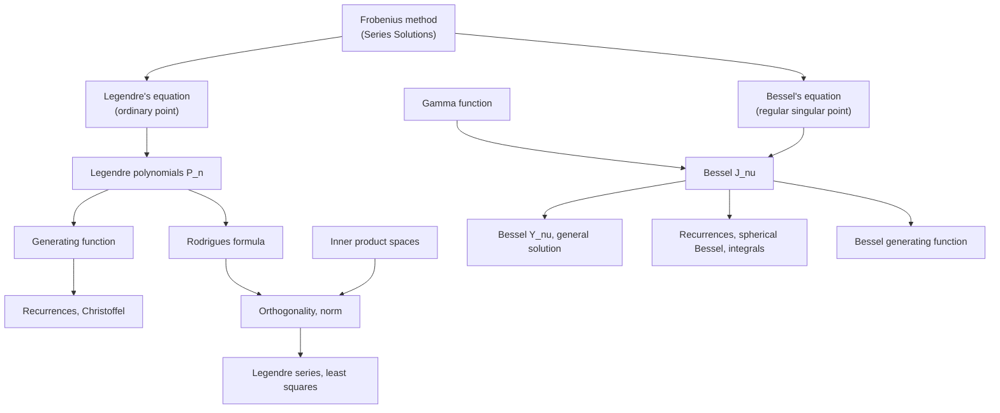

Map of content for the **Special Functions** lectures of MA 2102 (Lecture-18 through Lecture-28). Builds on [[Series Solutions - MOC]] (power series and Frobenius method) and ends where the tutorial sheets (Assignments 5–7) continue. Part of [[Differential Equations - MOC]].

## Legendre (Lectures 18–22)
1. [[Legendre Polynomials and Rodrigues' Formula]] — series solution, $P_n(1)=1$, explicit sum, Rodrigues (two derivations) · *L18–19*
2. [[Generating Function of Legendre Polynomials]] — $(1-2xt+t^2)^{-1/2}=\sum P_nt^n$ and its consequences · *L19*
3. [[Inner Product Spaces and Orthogonal Functions]] — vector spaces, inner products, norms, orthonormal sets, $L^2$ · *L20*
4. [[Orthogonality and Norm of Legendre Polynomials]] — Sturm–Liouville proof; $\frac2{2n+1}$ by Rodrigues and by $G$ · *L20–21*
5. [[Legendre Series and Fourier-Legendre Expansions]] — coefficients, examples, convergence theorem, least squares · *L21*
6. [[Legendre Recurrence Relations and Integrals]] — recurrences I–VI, Beltrami, Christoffel, integral evaluations · *L22*

## Gamma and Bessel (Lectures 23–25)
7. [[Gamma Function]] — factorial interpolation, $\Gamma(\frac12)$, negative arguments · *L23*
8. [[Bessel's Equation and Bessel Functions of the First Kind]] — Frobenius solution, $J_\nu$, three cases · *L23–24*
9. [[Bessel Functions of the Second Kind and General Solution]] — $Y_\nu$, integer-order series, $J$ vs $Y$ behaviour · *L24*
10. [[Bessel Function Properties and Recurrence Relations]] — derivative identities, recurrences, spherical Bessel, integrals · *L24–25*
11. [[Bessel Generating Function]] — $e^{\frac x2(t-1/t)}=\sum J_nt^n$ · *L25*

## Bessel transformations and Sturm–Liouville (Lectures 26–28)
12. [[Reducing Equations to Bessel Form]] — the template $y=x^au(bx^c)$, Airy as order $1/3$ · *L26*
13. [[Fourier-Bessel Series]] — orthogonality with weight $x$, coefficients, convergence · *L27*
14. [[Sturm-Liouville Problems]] — self-adjoint form, Lagrange identity, orthogonality, eigenfunction expansions · *L27–28*

## Lecture-to-note map (Lectures 15–28)

| Lecture | Topic | Note |
|---|---|---|
| 15 (and 16–17) | indicial equation, three cases, worked problems | [[Frobenius Method - Indicial Equation and Three Cases]], [[Frobenius Method - Worked Examples]] |
| 18 | Legendre equation and polynomials | [[Legendre Polynomials and Rodrigues' Formula]] |
| 19 | Rodrigues, generating function | same + [[Generating Function of Legendre Polynomials]] |
| 20 | inner product spaces, orthogonality | [[Inner Product Spaces and Orthogonal Functions]], [[Orthogonality and Norm of Legendre Polynomials]] |
| 21 | norms, Legendre series | [[Orthogonality and Norm of Legendre Polynomials]], [[Legendre Series and Fourier-Legendre Expansions]] |
| 22 | recurrences, Beltrami, Christoffel | [[Legendre Recurrence Relations and Integrals]] |
| 23 | Gamma function, Bessel equation | [[Gamma Function]], [[Bessel's Equation and Bessel Functions of the First Kind]] |
| 24 | second solutions, $Y_\nu$, properties | [[Bessel's Equation and Bessel Functions of the First Kind]], [[Bessel Functions of the Second Kind and General Solution]] |
| 25 | recurrences, spherical Bessel, generating function | [[Bessel Function Properties and Recurrence Relations]], [[Bessel Generating Function]] |
| 26 | converting equations to Bessel form, normal form | [[Reducing Equations to Bessel Form]] |
| 27 | zeros of Bessel functions, Bessel SL form, orthogonality, Fourier–Bessel series | [[Fourier-Bessel Series]], [[Bessel Function Properties and Recurrence Relations]] |
| 28 | Sturm–Liouville problems | [[Sturm-Liouville Problems]] |

## Problem sets
- [[Assignment 5 - Legendre Polynomials and Functions - Solutions]] ← Legendre notes (items 1–6)
- [[Assignment 4 - Series Solutions - Solutions]] ← Frobenius notes and Legendre equation
- [[Assignment 6 - Bessel Functions - Solutions]] ← Bessel notes (items 7–11) plus items 12–14
- [[Assignment 7 - Sturm-Liouville Problems - Solutions]] ← [[Sturm-Liouville Problems]] and the orthogonality theme of [[Inner Product Spaces and Orthogonal Functions]]

## Corrections to the lecture slides
The checks in `Tools/de_core.py` found these slide errors (details in each note):
- Lecture 15, slide 10: $y_2$ of Problem 1 is $x^{-1/2}(1-x-\tfrac{x^2}2-\cdots)$, not $1-x+x^2-\cdots$ ([[Frobenius Method - Worked Examples]]).
- Lecture 21, slide 9: for $f=x$ on $[0,1]$ (0 on $[-1,0]$), $a_2=\tfrac5{16}$ and $a_3=0$ ([[Legendre Series and Fourier-Legendre Expansions]]).

## Study log
- [ ] Legendre polynomials, Rodrigues, generating function
- [ ] Orthogonality and Legendre series
- [ ] Legendre recurrences and integrals
- [ ] Gamma function
- [ ] Bessel functions of first and second kind
- [ ] Bessel recurrences, integrals, generating function

## Continues in
- [[Heat Transfer - MOC]] — Bessel functions and Sturm–Liouville eigenfunctions in cylindrical conduction.

## Continues in
- [[PDEs - MOC]] — Lectures 29–37: more Sturm–Liouville examples ([[Sturm-Liouville Problems#Worked examples (Lecture 29)]]), then partial differential equations. The eigenfunctions of this unit are the building blocks of [[Separation of Variables]].
