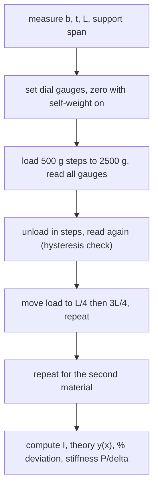

# Lab - Deflection of Beams (Three-Point Bending)

> [!abstract] The experiment in one line
> Load a simply supported beam with known weights, read the deflection on dial gauges, and compare with $\delta=PL^3/48EI$. If the numbers agree, you have verified beam theory *and* measured the stiffness of two materials.

## Aim and apparatus
**Aim:** study the deflection of a simply supported beam and compare experimental deflections with the theoretical values.
**Equipment:** dial gauges, meter scale, vernier caliper, weights and pan, aluminium and mild-steel rectangular beams, displacement sensor and load cell.

## Theory you need

Shear contributes to deflection, but for a slender beam (thickness $\ll$ length) it is neglected. For a point load $P$ at distance $a$ from the left support ($b=L-a$):

$$\delta_{\rm centre}=\frac{PL^3}{48EI}\ \ (a=L/2),\qquad y(x)=\frac{Pbx}{6LEI}\big(L^2-b^2-x^2\big)\ \ (0\le x\le a)$$

and for $x\ge a$ add $\dfrac{P(x-a)^3}{6EI}$. Here $I=bt^3/12$ for a rectangle of width $b$ and thickness $t$ (bending about the axis through the thickness). Full derivation: [[Double Integration and Macaulay's Method]] and [[Flexure Formula]].

![[AML-beam-deflection.png]]

**Figure:** Left, deflected shape for the same load at $L/2$, $L/4$ and $3L/4$ (illustrative aluminium beam $25\times6\times400$ mm). Right, midspan deflection against hanger load: a straight line of slope $L^3/48EI$, three times steeper for aluminium than steel because $E_{\rm Al}/E_{\rm steel}=70/210$.

> [!question]- 🎯 Predict first: with the load at $L/4$, where is the beam's largest deflection: under the load, or elsewhere?
> **Elsewhere.** The maximum is in the longer segment, at $x=L-\sqrt{(L^2-a^2)/3}$ measured from the near support. For $a=L/4$ that is $x=0.441L$, close to the middle, not under the load at $0.25L$. This is why the manual has you place gauges at several points.

## Procedure (condensed)
1. Place the beam on supports a known distance apart; measure width, thickness and span.
2. Put dial gauges at the centre and at $L/4$ and $3L/4$; **zero them after the self-weight settles** (so only the added load is measured).
3. Load the centre in steps of $500$ g up to $2500$ g, recording gauge and displacement-sensor readings, then **unload in the same steps**.
4. Move the load to $L/4$ (gauges at $L/2$ and $3L/4$) and then $3L/4$ (gauges at $L/4$ and $L/2$); repeat.
5. Repeat the whole sequence for the second material.

## Data reduction
1. **Convert** dial divisions to mm (use the gauge constant) and mass to force $P=mg$.
2. **Average** loading and unloading readings at each load (their difference is the hysteresis).
3. **Compute $I=bt^3/12$** and the theoretical $y$ from the formulas above for the same $P$ and position.
4. **Percentage deviation** $=\dfrac{y_{\rm exp}-y_{\rm theory}}{y_{\rm theory}}\times100$; tabulate.
5. **Stiffness** $k=P/\delta$ from the slope of the load–deflection line; compare materials and with $48EI/L^3$.

## Worked data-reduction example
> [!example]- 🔬 Aluminium $25\times6$ mm beam, span $400$ mm, $P=2500$ g at midspan (illustrative dimensions)
> $P=2.5\times9.81=24.5$ N; $I=25\cdot6^3/12=450$ mm⁴; $E=70$ GPa.
> $\delta=\dfrac{PL^3}{48EI}=\dfrac{24.5\cdot400^3}{48\cdot70{,}000\cdot450}=1.04$ mm. Stiffness $k=P/\delta=23.6$ N/mm.
> Same beam in steel: $\delta=0.35$ mm, $k=70.9$ N/mm.
> **Check:** the deflection ratio equals $E_{\rm steel}/E_{\rm Al}=3$ ✓. A dial gauge reads $0.01$ mm per division, so the aluminium run gives about $100$ divisions of travel and the steel run about $35$: both readable.

## Why experiment and theory differ (and how big each effect is)

| Source | Effect | Size here |
|---|---|---|
| Shear deflection (neglected in theory) | adds to deflection | ratio $\delta_s/\delta_b=\frac{E}{\kappa G}(t/L)^2\approx0.07\%$ for $t/L=0.015$ |
| Self-weight | bends the beam before you zero the gauges | $5wL^4/384EI\approx0.04$ mm, cancels because the response is linear |
| Support settlement, gauge friction, tip contact | random scatter | $\sim0.01$ mm per reading |
| Overhang beyond the supports | adds a small restoring moment | depends on the overhang length |
| Wrong $I$ (thickness measured to $0.1$ mm) | $t^3$ makes errors triple | $1.7\%$ error in $t$ at $t=6$ mm gives $5\%$ in $I$ |

> [!warning]- ⚠️ The thickness enters as $t^3$
> A $0.1$ mm error on a $6$ mm thickness is $1.7\%$ in $t$ but $5\%$ in $I$ and so in the predicted deflection. Measure $t$ at several points with the vernier and average.

> [!danger]- 💥 Forgetting the units of the gauge
> Dial gauges read in divisions; $1$ division is usually $0.01$ mm. A hundredfold slip here makes the beam look 100× stiffer or softer than any material on earth.

## Questions for the viva (with short answers)

> [!question]- 1. Can you verify Eq. (1) and (2)? Compute the % deviation.
> Yes: plot $y_{\rm exp}$ against $y_{\rm theory}$ at every load and position; points should fall on a $45^\circ$ line. Typical deviation a few percent, dominated by the measurement of $t$.

> [!question]- 2. Does the overhang affect the measured deflection?
> Slightly. Overhanging mass adds a small moment at each support that reduces midspan deflection; theory assumes none. Keep overhangs short and equal.

> [!question]- 3. For equal geometry, which deflects more, aluminium or steel? Why?
> Aluminium, by $E_{\rm steel}/E_{\rm Al}=3$: deflection is inversely proportional to $E$ at fixed $I$ and load.

> [!question]- 4. Does the moment of inertia matter?
> Yes, hugely: $\delta\propto1/I\propto1/t^3$. Doubling the thickness cuts deflection eight-fold; doubling the width only halves it. This is why beams are deep, not wide.

> [!question]- 5. Does self-weight matter? How do you account for it?
> It adds a deflection $5wL^4/384EI$. Because the beam is linear elastic, you remove it by **zeroing the gauges with the beam in place** and measuring only the *increase*.

> [!question]- 6. Is the deflection symmetric for a central load?
> Yes about the midspan; for a load at $L/4$ it is not, and the maximum shifts towards the middle of the longer segment.

> [!question]- 7. Is there a relationship between asymmetric loads and deflection?
> **Maxwell's reciprocal theorem:** the deflection at $B$ due to a load at $A$ equals the deflection at $A$ due to the same load at $B$. Check it with your $L/4$ and $3L/4$ runs: the gauge under $3L/4$ with the load at $L/4$ should match the gauge under $L/4$ with the load at $3L/4$.

## Connections
- **Theory:** [[Double Integration and Macaulay's Method]], [[Moment-Area Method]], [[Flexure Formula]], [[Stress-Strain Diagram and Hooke's Law]]
- **Related solved work:** [[Tutorial 8 - Deflection of Beams|Tutorial 8 — Deflection of Beams]]
- **Cross-domain:** [[Energy Methods - A Unified View]] (reciprocity follows from Castigliano) and [[Second Moments of Area - One Integral, Many Jobs]] ($I=bt^3/12$).
- **Next experiment:** [[Lab - Buckling of Struts]]

## Self-check
- [ ] I can write the midspan formula and the general $y(x)$ and say where $I$ comes from.
- [ ] I can explain why the gauges are zeroed after self-weight and why loading and unloading are both recorded.
- [ ] I can list two reasons experiment differs from theory and estimate one of them.

## Metadata
- **Status:** draft · **Type:** concept (lab) · **Difficulty:** beginner–intermediate
- **Course map:** [[Applied Mechanics Lab - MOC]]
