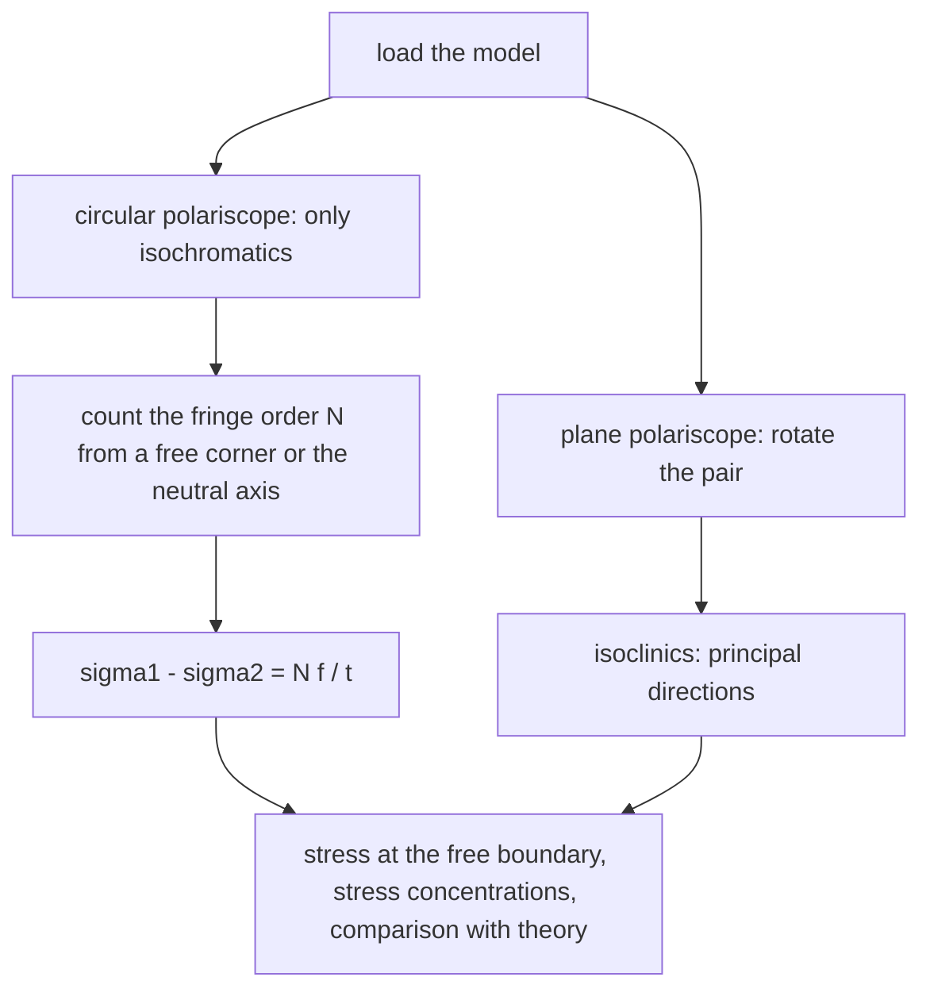

# Lab - Photoelasticity: Fringes and Stress

> [!abstract] The experiment in one line
> A transparent polymer model under load becomes **birefringent**: between crossed polarisers it shows coloured or dark bands (**fringes**) whose order $N$ is proportional to the principal-stress difference, $\sigma_1-\sigma_2=Nf_\sigma/t$. Count the fringes and you have a full-field picture of the stress, with no gauges.

## Aim and apparatus
**Aim:** observe the fringe patterns of loaded models (a disk under diametral compression, a beam under pure bending) in a polariscope and determine stresses from the fringe order and the material fringe value.
**Apparatus:** a **polariscope** (light source, polariser, two quarter-wave plates, analyser, with a loading frame between them); photoelastic models in polycarbonate or similar; a calibration disk; calipers; weights.

## Theory

**Temporary double refraction.** Under stress the material has two refractive indices along the principal-stress directions. Light polarised along each axis travels at a different speed, so the two components emerge out of step by the **relative retardation**
$$\Delta=C\,t\,(\sigma_1-\sigma_2)$$
(**stress-optic law**), with $t$ the thickness and $C$ the stress-optic coefficient. The analyser makes them interfere. Extinction (a dark band in monochromatic light) occurs when $\Delta$ is a whole number of wavelengths, $\Delta=N\lambda$. Writing $f_\sigma=\lambda/C$:
$$\boxed{\ \sigma_1-\sigma_2=\frac{N\,f_\sigma}{t}\ }$$
$N$ is the **fringe order** and $f_\sigma$ the **material fringe value** in N/mm per fringe (it depends on the material and the wavelength). A **small** $f_\sigma$ means a sensitive material: many fringes per unit stress.

**Two families of fringes.**

| Fringe | What it is | Depends on |
|---|---|---|
| **Isochromatics** | loci of equal $\sigma_1-\sigma_2$ (equal $\tau_{max}$): colour bands, or dark bands in monochromatic light | load, thickness, $f_\sigma$ |
| **Isoclinics** | loci where a principal-stress direction is parallel to the polariser axis: a black band that moves when the polariser and analyser are rotated together | the principal directions only |

**Plane and circular polariscopes.** In a plane (linear) polariscope with the polariser and analyser crossed, both families appear together. Adding a **quarter-wave plate** on each side makes the light circularly polarised, so the extinction no longer depends on the principal direction: the isoclinics vanish and **only isochromatics** remain. With the analyser crossed (dark field) whole-number orders $N=0,1,2,\ldots$ are dark; with it parallel (light field) the half orders $N=\tfrac12,\tfrac32,\ldots$ are dark.

**Colours in white light.** The sequence from $N=0$ (black) is grey, white, yellow, orange, red, then a sharp **tint of passage** (violet-blue at the first order) and the pattern repeats with faded colours. The tint of passage marks whole orders: the first (red to blue, purple) is $N=1$, the second (**rose red to green**) is $N=2$, the third (pink to green) is $N=3$. Fringes are counted from a point of known order: a free corner or a neutral axis, $N=0$.

**What the fringe order tells you.** It gives $\sigma_1-\sigma_2$ (twice the maximum shear stress) everywhere. On a **free boundary** one principal stress is zero, so $\sigma=Nf_\sigma/t$ is the boundary stress directly. It does not give the sign, or $\sigma_1$ and $\sigma_2$ separately in the interior (more work: isoclinics plus shear-difference).

## The two standard models

![[AML-photoelastic-fringes.png]]

**Figure:** computed dark-field patterns. Left and centre: the same disk and the same load of $50$ N in two materials (polycarbonate $f_\sigma=8$ N/mm/fringe, polyurethane $f_\sigma=0.2$): the soft, sensitive polyurethane carries **40 times as many fringes**, $N\propto1/f_\sigma$. Right: pure bending, fringes parallel to the axis, linear in the distance from the neutral axis ($N=0$ there).

**Disk in diametral compression** (diameter $D$, thickness $t$, load $P$). At the centre, $\sigma_x=+\dfrac{2P}{\pi Dt}$ (tension) and $\sigma_y=-\dfrac{6P}{\pi Dt}$ (compression), so
$$\sigma_1-\sigma_2\Big|_{centre}=\frac{8P}{\pi Dt}\quad\Rightarrow\quad N_c=\frac{8P}{\pi D\,f_\sigma},\qquad f_\sigma=\frac{8P}{\pi DN_c}.$$
This is the standard **calibration** of $f_\sigma$: load a disk, count the fringes at the centre, compute $f_\sigma$. The thickness cancels: for a given total load $P$, a thicker disk has proportionally lower stress and proportionally more retardation. So $N_c$ depends on $P$, $D$ and $f_\sigma$ only ($N_c\propto P$, $\propto1/D$, $\propto1/f_\sigma$).

**Beam in pure bending.** $\sigma=\dfrac{My}{I}$ is uniaxial, so $\sigma_1-\sigma=\sigma$ and the fringe order is linear in $y$: $N=\dfrac{\sigma t}{f_\sigma}=\dfrac{Mt\,y}{If_\sigma}$. The fringes are parallel to the beam axis, evenly spaced, with $N=0$ at the neutral axis and the highest order at the outer fibres. The spacing of the fringes confirms linear stress variation.

## Procedure (condensed)
1. Set up the polariscope in the circular, dark-field arrangement; place the unloaded model and check there are no fringes (no residual stress).
2. Load the disk in steps; at each step count the fringes at the centre and the order along the loaded diameter (use white light to locate $N=1,2,\ldots$ by the tints of passage). Calibrate $f_\sigma$.
3. Load the beam in four-point or pure-bending and count the fringes from the neutral axis to the edges; sketch the pattern.
4. Rotate the polariser and analyser together in the plane polariscope to follow the isoclinics.

## Worked examples
> [!example]- 🔬 Calibrating $f_\sigma$ with a disk
> Polycarbonate disk, $D=40$ mm, load $P=500$ N, the central fringe order is counted as $N_c=4$. Then
> $f_\sigma=\dfrac{8P}{\pi DN_c}=\dfrac{8(500)}{\pi(40)(4)}=\mathbf{7.96}$ N/mm per fringe. The predicted order for $f_\sigma=8$ is $3.98$ ✓.

> [!example]- 🔬 A beam in pure bending
> A $6$ mm thick, $20$ mm deep beam shows $N=6$ at the extreme fibre; $f_\sigma=10.5$ N/mm/fringe.
> $\sigma_{max}=\dfrac{Nf_\sigma}{t}=\dfrac{6(10.5)}{6}=\mathbf{10.5}$ MPa, so $M=\sigma\dfrac{td^2}{6}=10.5\times\dfrac{6(20)^2}{6}=4200$ N·mm. At a quarter of the depth below the neutral axis the order is $N=3$.

> [!example]- 🔬 Which material shows more fringes, and by how much?
> Disk loaded the same in polyurethane ($f_\sigma=0.2$) and polycarbonate ($f_\sigma=8$): the ratio of fringe orders is $8/0.2=\mathbf{40}$. The polyurethane disk would need only a fortieth of the load to show the same pattern, which is why soft sensitive models are used for low-load demonstrations and stiff polycarbonate for loads up to hundreds of newtons.

> [!question]- 🎯 Predict first: the load on a photoelastic disk is doubled. What happens to the fringes?
> The order at every point **doubles** ($N\propto P$); existing fringes move outward and new ones appear at the load points. The *shape* of the pattern is the same.

> [!warning]- ⚠️ Typical errors
> - Counting the first dark band as $N=1$: in a dark field the unstressed black is $N=0$.
> - Confusing isoclinics (move on rotating the polarisers, black, not coloured) with isochromatics (fixed for a given load, coloured in white light).
> - Using the calibration of one wavelength with another light source.
> - Residual (moulding) stresses in the model that already show fringes.
> - Edge effects: the stress at the loading points is a singularity; count away from them.

## Questions (with answers)

> [!question]- 1. What is polarisation of light?
> Restricting the light wave's electric vector to oscillate in one plane (or in a definite pattern such as a circle). A polariser passes only the component along its axis; it is not refraction, diffraction or scattering.

> [!question]- 2. Why is a circular polariscope used for counting fringes?
> The two quarter-wave plates make the light circularly polarised, so the extinction condition no longer depends on the angle between the polariser and the principal axes. The isoclinics disappear and the isochromatics stand out clearly.

> [!question]- 3. What is the relation between fringe order and stress?
> $\sigma_1-\sigma_2=Nf_\sigma/t$. The fringe order is proportional to the principal-stress difference (twice the maximum shear stress) and to the thickness, and inversely proportional to the material fringe value.

> [!question]- 4. What are the advantages and limits of photoelasticity?
> Advantages: full-field, shows stress concentrations and load paths immediately, gives the maximum shear stress everywhere and the boundary stress directly. Limits: needs a transparent birefringent model (a scaled plastic one, not the real part), gives $\sigma_1-\sigma_2$ rather than each stress, is a two-dimensional (or frozen-stress) method, and is affected by creep and edge effects in polymers.

## Connections
- **Stress at a point:** [[Plane Stress Transformation]] and [[Mohr's Circle for Stress]] ($\sigma_1-\sigma_2=2\tau_{max}$, the isochromatic quantity); [[Flexure Formula]] (the bending-beam pattern).
- **Stress concentration:** [[Fatigue Failure - S-N Curve, Marin Factors and Goodman Diagram]] (notch factors are measured this way).
- **Exam practice:** [[Applied Mechanics Lab - Mock Papers]].
- **Next:** [[Lab - Strain Gauge Measurement on a Cantilever Beam]] (the point-wise counterpart: one gauge per location).

## Self-check
- [ ] I can state the stress-optic law and say what $f_\sigma$ measures.
- [ ] I can tell isoclinics from isochromatics and say which polariscope removes which.
- [ ] I can compute $N$ for a disk and the stress at a fringe on a bent beam.
