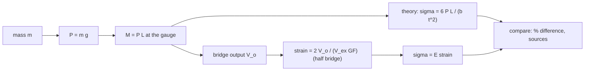

# Lab - Strain Gauge Measurement on a Cantilever Beam

> [!abstract] The experiment in one line
> Bond a foil strain gauge at the root of a cantilever, hang weights from the free end, read the strain from a Wheatstone bridge and convert it to bending stress with $\sigma=E\varepsilon$; compare with $\sigma=6PL/bt^2$. The skill is the **bridge arrangement**: one gauge reads temperature as well as strain, two gauges in the right arms read only strain, and twice as much of it.

## Aim and apparatus
**Aim:** determine the bending stress produced in a cantilever by a transverse point load at its free end, using strain gauges.
**Apparatus:** a steel or aluminium cantilever clamped at one end; foil strain gauges (typically $R=120\ \Omega$, gauge factor $\approx2$) bonded at the root, on the top and bottom faces; a Wheatstone-bridge board with a dummy gauge or completion resistors; excitation supply and a strain indicator or millivoltmeter; hanger and weights; vernier calipers.

## Theory

**Gauge factor.** A foil grid changes resistance with strain,
$$GF=\frac{\Delta R/R}{\varepsilon},\qquad \Delta R=GF\,R\,\varepsilon.$$
$GF\approx2$ for most metal foils. For $\varepsilon=1000\ \mu\varepsilon$ and $R=120\ \Omega$, $\Delta R=0.24\ \Omega$ (0.2 %): too small to read directly, so the gauge goes in a bridge.

**Cantilever.** With the load $P$ at a distance $L$ from the gauge, the bending moment at the gauge is $M=PL$. The surface stress and strain are
$$\sigma=\frac{Mc}{I}=\frac{6PL}{bt^2},\qquad\varepsilon=\frac{\sigma}{E}=\frac{6PL}{Ebt^2},$$
with $b$ the width and $t$ the thickness. The gauge sits near the **root** because $M$ is largest there and the strain is the biggest signal; it must be far enough from the clamp to avoid the end effect. The gauge reads the strain **along its grid**, so it is aligned with the beam axis (the direction of the bending stress, a uniaxial state at the surface).

**Wheatstone bridge.** Four arms $R_1\ldots R_4$ in sequence round a diamond, excitation $V_{ex}$ across one diagonal, output $V_o$ across the other. For small changes
$$V_o=\frac{V_{ex}}{4}\,GF\,(\varepsilon_1-\varepsilon_2+\varepsilon_3-\varepsilon_4),$$
where $\varepsilon_i$ is the strain (and the apparent strain from temperature) seen by the gauge in arm $i$. **Neighbouring arms subtract; opposite arms add.**

![[AML-bridge-configs.png]]

**Figure:** the three standard arrangements. Quarter bridge with a dummy gauge: one active gauge, one unstrained gauge of the same type at the same temperature in the adjacent arm. Half bridge: for bending, one gauge on top (tension) and one underneath (compression). Full bridge: four active gauges (load cells).

| Arrangement | Output | Temperature | Notes |
|---|---|---|---|
| One gauge, no dummy | $V_{ex}GF\varepsilon/4$ | **not compensated** | thermal output adds to the strain signal |
| Quarter bridge + dummy (adjacent arm) | $V_{ex}GF\varepsilon/4$ | cancels | needs an identical unloaded gauge on the same material at the same temperature |
| **Half bridge**, top and bottom gauges in adjacent arms | $V_{ex}GF\varepsilon/2$ | cancels | doubles the signal; the preferred arrangement for a bending beam |
| Full bridge (two top, two bottom) | $V_{ex}GF\varepsilon$ | cancels | four times the quarter bridge; also cancels axial strain |

**Why temperature cancels.** A temperature change $\Delta T$ changes each gauge's resistance by the same $\Delta R_T$ (the grid's own coefficient, plus the mismatch between grid and beam expansion). Equal changes in **adjacent** arms cancel in $\varepsilon_1-\varepsilon_2$; the bending strain is $+\varepsilon$ on top and $-\varepsilon$ underneath, so it adds.

## Procedure (condensed)
1. Measure $b$, $t$, the distance $L$ from the gauge to the load point; note $E$ (steel $\approx200$ GPa, aluminium $\approx70$ GPa).
2. Connect the gauges into the chosen bridge; balance (zero) the output with the hanger on.
3. Add weights in steps; read the output after each, waiting for it to settle; unload in the same steps.
4. Convert: strain from the output, stress from $\sigma=E\varepsilon$; compare with $6PL/bt^2$.

## Data reduction
Strain from the output: quarter $\varepsilon=\dfrac{4V_o}{V_{ex}GF}$, half $\varepsilon=\dfrac{2V_o}{V_{ex}GF}$ (per gauge), full $\varepsilon=\dfrac{V_o}{V_{ex}GF}$. Then $\sigma_{exp}=E\varepsilon$ and the percentage difference from $6PL/bt^2$. The slope of $V_o$ against $P$ is constant: its slope gives the calibration of the beam as a load cell.

## Worked example
> [!example]- 🔬 Illustrative: steel cantilever $25\times6$ mm, $P=20$ N at $L=300$ mm from the gauge, $R=120\ \Omega$, $GF=2.1$, $V_{ex}=5$ V
> $\sigma=\dfrac{6(20)(300)}{25(6)^2}=40$ MPa, so $\varepsilon=\dfrac{40}{200\,000}=200\ \mu\varepsilon$.
> $\Delta R=GF\,R\,\varepsilon=2.1(120)(200\times10^{-6})=0.0504\ \Omega$.
> Quarter bridge: $V_o=\dfrac{5(2.1)(200\times10^{-6})}{4}=0.525$ mV. **Half bridge:** $1.05$ mV. Full bridge: $2.10$ mV.
> The signals are millivolts: they need an amplifier (a strain indicator), and lead-wire resistance and thermal EMFs matter.
> **Check:** peak stress $40$ MPa is far below yield, so the linear relation holds ✓.

> [!question]- 🎯 Predict first: the single gauge at the root reads $+50\ \mu\varepsilon$ after the room warms by 5 °C with no load. Is the beam stressed?
> No. That is **apparent strain**: the gauge resistance changes with temperature (and the grid and beam expand differently). For an uncompensated gauge on steel the thermal output is of the order of $10\ \mu\varepsilon$ per °C (self-temperature-compensated gauges cut this to 1–2), so 5 °C can mimic $50\ \mu\varepsilon$, which would read as $200\,000\times50\times10^{-6}=10$ MPa of stress. A dummy gauge or a half bridge removes it.

> [!warning]- ⚠️ Errors and their size
> | Source | Effect |
> |---|---|
> | Temperature drift with one gauge | apparent strain, tens of $\mu\varepsilon$ per °C |
> | Gauge misalignment by $\theta$ | reads $\varepsilon(\cos^2\theta-\nu\sin^2\theta)$: error below 0.3 % for $\theta<3^\circ$ |
> | Wrong $L$ (distance to the gauge, not to the clamp) | $\sigma\propto L$: a 5 mm slip in 300 mm is 1.7 % |
> | Thickness measured once | $\sigma\propto1/t^2$: a 0.1 mm error on 6 mm is 3.3 % |
> | Lead-wire resistance, poor zero | offsets and a reduced gauge factor; use three-wire hook-up |
> | Self-heating (high excitation) | drift; use the lowest excitation that gives a clean signal |

## Questions (with answers)

> [!question]- 1. What modification makes the result independent of temperature, and why?
> Add a **dummy gauge** (same type, same material, unstrained, same temperature) in the adjacent arm, or better mount a second **active** gauge on the underside and wire both in adjacent arms (half bridge). Temperature changes both gauges equally; in adjacent arms the equal changes cancel, while the bending strain, being $+\varepsilon$ and $-\varepsilon$ on the two faces, adds. The half bridge also doubles the output.

> [!question]- 2. Define the gauge factor.
> The ratio of the fractional change in resistance to the applied strain, $GF=(\Delta R/R)/\varepsilon$. It is a constant of the gauge, about $2$ for metal foil (the sum of the geometric change, $1+2\nu$, and the change of resistivity). Semiconductor gauges have $GF\approx100$ or more but are temperature sensitive.

> [!question]- 3. Why is the gauge fixed near the root of the cantilever and aligned with its axis?
> The bending moment $M=PL$ is greatest at the root, giving the largest strain and best signal-to-noise; the surface stress there is uniaxial along the beam axis, which is the direction the gauge senses.

> [!question]- 4. How would you also measure Poisson's ratio with the same beam?
> Add a second gauge perpendicular to the first on the same face. The ratio of the transverse to the axial reading gives $\nu=-\varepsilon_t/\varepsilon_a$ (for a beam in bending with a narrow section the surface state is nearly uniaxial). In a half bridge, with the two gauges in adjacent arms, the output is $(1+\nu)$ times a quarter-bridge signal.

## Connections
- **Sensors and bridge circuits:** [[Sensors and Signal Conditioning]] (thermocouple, RTD, LVDT and the amplifier chain) and the physics-lab version [[Lab - Young's Modulus of Wood by Strain Gauge]].
- **Theory:** [[Flexure Formula]] ($\sigma=Mc/I$), [[Stress-Strain Diagram and Hooke's Law]] ($\sigma=E\varepsilon$), [[Strain Transformation and Rosettes]] (three gauges when the directions are not known).
- **Exam practice:** [[Applied Mechanics Lab - Mock Papers]].
- **Previous:** [[Lab - Torsion of Circular Shafts]].

## Self-check
- [ ] I can write $V_o$ for a quarter, half and full bridge and say which arms are adjacent.
- [ ] I can explain temperature compensation in two sentences.
- [ ] I can go from the weights to $M$, $\sigma$, $\varepsilon$, $\Delta R$ and $V_o$ by hand.
