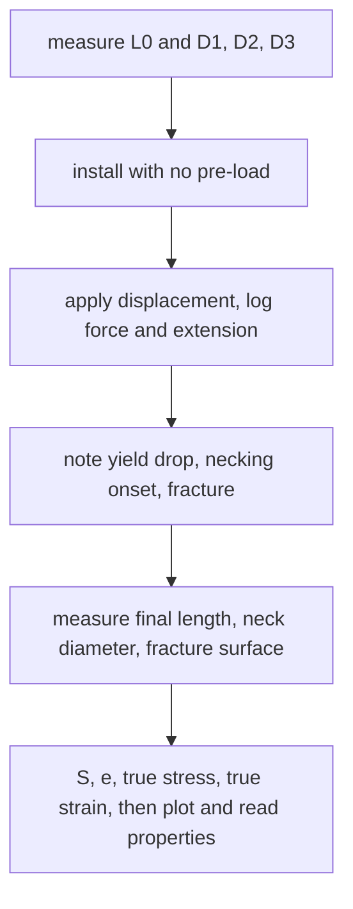

# Lab - Tensile Test of Mild Steel with DIC

> [!abstract] The experiment in one line
> Pull a round mild-steel bar to fracture on a displacement-controlled hydraulic machine, record force against deflection (and, where digital image correlation is used, the full-field strain), and extract the proportional limit, tangent modulus, yield strength, UTS, % elongation and % area reduction, in both engineering and true terms.

## Aim and background
**Aim:** determine the mechanical properties of mild steel. A round tensile bar is loaded in tension; the force–deflection curve to failure gives:

| Quantity | Definition |
|---|---|
| Engineering stress $S$ | $F/A_0$ (force per **original** area) |
| Engineering strain $e$ | $\Delta L/L_0$ |
| True stress $\sigma$ | $F/A$ (force per **current** area) |
| True strain $\varepsilon$ | $\ln(L/L_0)$ (from the instantaneous gauge length) |

Before necking the volume is conserved ($A\,L=A_0L_0$), which gives the conversions

$$\sigma=S\,(1+e),\qquad\varepsilon=\ln(1+e)\qquad(\text{valid only up to the onset of necking}).$$

After necking begins, strain concentrates in a small region and these formulas no longer describe the whole bar; true stress then requires measuring the *neck's* diameter.

![[AML-tensile-curves.png]]

**Figure:** Mild steel (schematic): the engineering curve peaks at the UTS and then falls (the neck is carrying the load on a shrinking area), while the true curve keeps rising. Use the zoom to see how yield is defined by the $0.2\%$ offset line.

## Procedure (condensed)
1. Measure the length of the uniform section $L_0$ and the diameter at **three** places; take the mean $D$.
2. Familiarise yourself with the force and deflection measurement; **install without pre-loading**.
3. Hold one end fixed and apply displacement at the other (hydraulic actuator).
4. Watch plastic deformation, necking and fracture; **record force and extension**, plus extra points wherever the data suddenly changes (yield drop, serrations).
5. Note the load at which necking first appears (localisation of deformation).
6. After failure record the fracture load, the final diameter at the neck, the final length of the uniform section, and the **fracture surface** (cup-and-cone for ductile steel).

## What to extract from the curve

| Property | How to get it |
|---|---|
| Proportional limit $\sigma_{pl}$ | stress where the straight line ends |
| Tangent modulus $E_t$ | slope of the stress–strain curve (in the elastic part, Young's modulus) |
| Yield strength $\sigma_y$ | draw a line parallel to the elastic slope, offset by $\varepsilon=0.002$; where it meets the curve |
| Ultimate tensile strength | highest engineering stress reached |
| % elongation | $\dfrac{L_f-L_0}{L_0}\times100$ (ductility) |
| % area reduction | $\dfrac{A_0-A_f}{A_0}\times100$ (ductility, from the neck diameter) |

## Worked example
> [!example]- 🔬 Illustrative numbers for a $10$ mm bar (not measured data)
> $D=10$ mm gives $A_0=78.5$ mm². At $F=19.6$ kN the engineering stress is $S=250$ MPa (yield). At the peak, $F=31.4$ kN gives UTS $=400$ MPa.
> If the extension at $F=31.4$ kN is $e=0.16$, the true stress is $\sigma=S(1+e)=400\times1.16=464$ MPa and $\varepsilon=\ln1.16=0.148$.
> If the neck ends at $D_f=6$ mm, area reduction $=(10^2-6^2)/10^2=64\%$.
> **Check:** the true stress is always above the engineering stress while the bar lengthens, by the factor $1+e$; the two curves agree to within $5\%$ only below $e=0.05$.

## Discussion questions (with answers)

> [!question]- Why is steel such a popular structural material?
> High stiffness ($E=210$ GPa), good strength, large ductility (it gives warning by yielding and necking before breaking), weldable, cheap, recyclable, and its properties are predictable and well documented.

> [!question]- In load control instead of displacement control, how would the curve change?
> You cannot follow the falling branch: past the UTS the specimen can no longer carry more load, so under rising force it fails suddenly. The measured curve would end at the UTS (with a jump in strain), and the yield plateau would show as a step.

> [!question]- Is your tangent modulus near $210$ GPa? If not, why?
> Usually lower. Extension measured from the machine crosshead includes grip slip, machine compliance and seating; the specimen's elastic stretch is tiny. Use an extensometer or DIC on the gauge section for the true $E$.

> [!question]- Up to what strain is the difference between true and engineering stress below $5\%$?
> $\sigma/S=1+e$, so $e\le0.05$ (about $5\%$ strain) before necking.

> [!warning]- ⚠️ Using the true-stress formulas past necking
> $\sigma=S(1+e)$ assumes uniform deformation. Beyond the UTS the neck is not uniform, so the formula underestimates the true stress at the neck. Compute true stress there from the measured neck diameter.

> [!danger]- 💥 Reading yield off an arbitrary "bend"
> Mild steel often shows an upper and lower yield point and a plateau; others (aluminium, stainless) have no distinct yield. Use the $0.2\%$ offset for those, and say which definition you used in the report.

## Connections
- **Theory:** [[Stress-Strain Diagram and Hooke's Law]], [[Concept of Stress]], [[Axial Deformation]], [[Strain Transformation and Rosettes]] (DIC gives the full strain field, from which principal strains follow).
- **Cross-domain:** [[Energy Methods - A Unified View]] (area under the curve is energy absorbed to fracture) and [[Fluids and Solids - Pressure, Stress and Constitutive Laws]].
- **Previous:** [[Lab - Tensile Test on the ES6 Tester]] · **Next:** [[Lab - Torsion of Circular Shafts]]

## Self-check
- [ ] I can convert engineering to true stress and strain, and state where those formulas stop being valid.
- [ ] I can find the $0.2\%$ offset yield strength graphically.
- [ ] I can explain why the engineering curve falls after the UTS while the true curve does not.

## Metadata
- **Status:** draft · **Type:** concept (lab) · **Difficulty:** intermediate
- **Course map:** [[Applied Mechanics Lab - MOC]]
