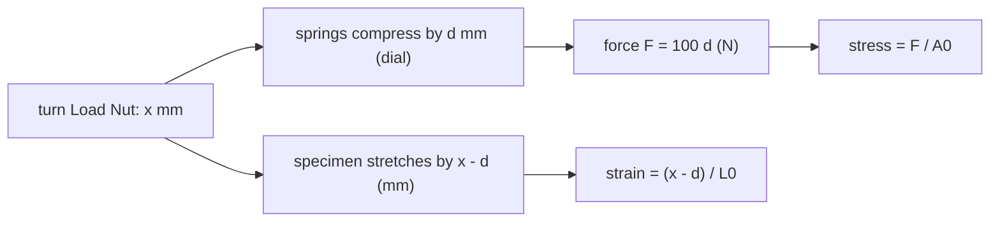

# Lab - Tensile Test on the ES6 Tester

> [!abstract] The experiment in one line
> Pull small flat specimens of aluminium, aluminium HE30, mild steel and PVC on a hand-cranked tester, turn the dial-indicator readings into force and the leftover turns into extension, plot stress against strain, and read off stiffness, yield, strength and ductility.

## How the machine works

The **Load Nut** pulls the top chuck up by $1$ mm per complete turn (the nut has a ten-division scale, so $0.1$ mm per division). The bottom chuck is attached to two springs of combined rate **$100$ N/mm**; a **dial indicator** measures how far they compress.

$$F=\text{(dial reading in mm)}\times100\ \text{N},\qquad \text{extension}=\text{(nut movement)}-\text{(dial reading)}$$

The springs soak up most of the nut's movement as the force rises; what is left over is the specimen's real stretch. Do not exceed $1000$ N, and only use the supplied specimens.

## Specimens
Aluminium alloy (marked with a small notch), **aluminium HE30** (a high-specification alloy, also notched), **mild steel** (heavier, magnetic) and **PVC** (light, dark colour; remove the protective film first). All have the same nominal dimensions: wide flat ends and a thin central section; the thin section's length is the **gauge length** $L_0$. Measure width and thickness of the thin part with the dial caliper to get $A_0$.

## Procedure (condensed)
1. Measure $A_0=w\,t$ and the original gauge length $L_0$.
2. Fit the specimen, turn the nut clockwise until the dial *just* moves with the nut notch on a scale mark, then **zero the dial** with the outer bezel and note the vertical-scale reading.
3. Turn the nut in $0.2$ mm steps up to $5$ mm, then $1$ mm and $10$ mm steps until the specimen breaks. Keep a **consistent rate** (about $5$ s per $0.2$ mm turn, then $5$ s to read).
4. After fracture, push the two halves together and measure the final gauge length.
5. Convert to $F$, extension, stress and strain; plot (each material has its own chart paper); read yield, tensile strength and the slope of the elastic region.

## Data reduction

$$\sigma=\frac{F}{A_0},\qquad\varepsilon=\frac{\Delta L}{L_0},\qquad E\approx\text{slope of the straight part},\qquad\%\text{elongation}=\frac{L_f-L_0}{L_0}\times100$$

(Stress in N/mm² is the same as MPa. These are *engineering* values: $A_0$ is used even though the area shrinks.) See [[Stress-Strain Diagram and Hooke's Law]] and [[Concept of Stress]].

![[AML-tensile-curves.png]]

**Figure:** Left, the labelled curve of a ductile metal (engineering and true), with a zoom on the elastic region and the $0.2\%$ offset construction for yield. Right, schematic comparison of the four kit materials' behaviour (one steel, one aluminium, PVC): steel and aluminium are stiff; PVC is about $70\times$ more compliant and stretches by tens of millimetres.

> [!question]- 🎯 Predict first: which two kit specimens give nearly the same slope in the elastic region?
> **Aluminium and aluminium HE30.** The slope is Young's modulus, and all aluminium alloys have $E\approx70$ GPa; what differs is *strength*. HE30 yields and fails at a much higher stress, so its curve continues up the same line for longer. (Alloying and heat treatment change strength, not stiffness.)

## Worked arithmetic
> [!example]- 🔬 One row of the table, using the manual's own numbers
> Nut turned $3.00$ mm, dial reads $2.83$ mm. Then $F=2.83\times100=283$ N and extension $=3.00-2.83=0.17$ mm.
> With an illustrative thin section $A_0=9$ mm² and $L_0=31$ mm: $\sigma=283/9=31$ MPa, $\varepsilon=0.17/31=0.0055$.
> Elongation after fracture (manual's example): $L_0=31$ mm, $L_f=33$ mm gives $(33-31)/31\times100=6.45\%$.

> [!warning]- ⚠️ The elastic region of steel is almost invisible with this method
> Steel at $31$ MPa stretches only $31/210{,}000=1.5\times10^{-4}$ strain: about $0.005$ mm over $31$ mm, below the dial's resolution ($0.01$ mm) and smaller than the grip and spring play. Expect an *apparent* modulus far below $210$ GPa for metals; the kit is best at showing *shape* (yield, hardening, necking) and PVC's behaviour. Use an extensometer or [[Lab - Tensile Test of Mild Steel with DIC]] for a true modulus.

## Questions
> [!question]- Why do two materials give similar gradients?
> See the prediction above: both are aluminium alloys, sharing $E$.

> [!question]- Why do a constant load rate and a constant temperature matter so much for PVC?
> PVC is **viscoelastic**: its stiffness and yield depend on loading rate and temperature (it creeps). After yield the dial reading keeps *falling* as the specimen flows, so you must record the value immediately after each turn, at the same rate every time, or the curve changes shape from run to run.

> [!danger]- 💥 Reading the dial late on PVC
> Waiting a minute between turn and reading lets the force relax by a large amount; the plot then looks as if the material softens early. Always read at the same delay.

## Connections
- **Theory:** [[Stress-Strain Diagram and Hooke's Law]], [[Concept of Stress]], [[Generalized Hooke's Law and Poisson's Ratio]], [[Axial Deformation]]
- **Cross-domain:** [[Exponential Decay - Time Constants, Damping and Spatial Relaxation]] (PVC relaxation is an exponential approach to a lower force); [[Energy Methods - A Unified View]] (area under the curve is strain energy per volume, a measure of toughness).
- **Previous:** [[Lab - Buckling of Struts]] · **Next:** [[Lab - Tensile Test of Mild Steel with DIC]]

## Self-check
- [ ] I can convert dial and nut readings to force and extension, and explain why the springs are there.
- [ ] I can find yield, tensile strength, modulus and % elongation from my plot.
- [ ] I can explain why aluminium and HE30 share a slope but not a strength, and why PVC is rate-sensitive.

## Metadata
- **Status:** draft · **Type:** concept (lab) · **Difficulty:** beginner–intermediate
- **Course map:** [[Applied Mechanics Lab - MOC]]
