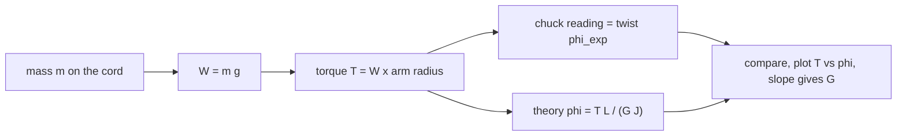

# Lab - Torsion of Circular Shafts

> [!abstract] The experiment in one line
> Twist thin brass, steel and aluminium rods by hanging weights from a moment arm, read the twist angle on a rotating chuck, and compare with $\phi=TL/GJ$. The slope of torque against twist gives the shear modulus $G$.

## Aim and apparatus
**Aim:** determine the angle of twist and validate the torsion equation theoretically and experimentally.
**Apparatus:** work panels that hold the specimen, weight hangers and pans that load the shaft in **pure torsion**, and a rotating chuck with an angular scale that reads the twist.

## Theory

For a circular shaft of constant section under a uniform torque $T$:

$$\frac{T}{J}=\frac{\tau}{r}=\frac{G\phi}{L},\qquad J=\frac{\pi r^4}{2},\qquad\phi=\frac{TL}{GJ}$$

$J$ is the polar second moment of area, $\tau$ the shear stress at radius $r$, $G$ the shear modulus, $\phi$ the angle of twist (radians) and $L$ the length. Theory and worked problems: [[Torsion of Circular Shafts]] and [[Tutorial 6 - Torsional Members|Tutorial 6]]. Reference moduli from the manual: **brass $G=38$ GPa, steel $79.6$ GPa, aluminium $25.5$ GPa**.

![[AML-torsion-twist.png]]

**Figure:** Illustrative $r=2.5$ mm, $L=300$ mm shaft with a $50$ mm moment arm. Left, twist against torque is a straight line whose slope is $L/GJ$; the stiffer the material, the shallower the line. Right, at fixed torque the twist grows linearly with the length.

> [!question]- 🎯 Predict first: if the shaft length doubles under the same weight, what happens to the twist angle? And if the radius doubles?
> Length doubles $\Rightarrow$ twist **doubles** ($\phi\propto L$). Radius doubles $\Rightarrow$ twist drops **sixteen-fold** ($\phi\propto1/J\propto1/r^4$). A slightly thicker shaft is dramatically stiffer.

## Procedure (condensed)
1. Measure the section dimensions (radius $r$) and the length $L$; fix the shaft in the panel.
2. Adjust the rotating chuck so that, **with the empty hanger on**, the reading is zero.
3. Add weights in $100$ g steps up to $500$ g; **tap the panel** each time to cut friction; record the twist at the moment arm.
4. Work out how the cord and moment arm apply a *pure* torque $T=W\times(\text{arm radius})$ with no bending, and how to turn the chuck reading into an angle of twist.
5. Repeat for brass, steel and aluminium; draw the free-body diagram and plot torque against twist.

## Data reduction
For each load: $W=mg$, $T=W\,r_{\rm arm}$, experimental twist (degrees $\to$ radians $\times\pi/180$), theoretical twist $TL/GJ$. Plot $T$ against $\phi$ for each material and fit a line through the origin: the slope is $GJ/L$, so

$$G_{\rm exp}=\frac{L}{J}\times\text{slope}.$$

## Reading small twists optically: mirror and scale
A twist of a fraction of a degree is hard to read on a protractor. A **mirror** fixed to the shaft turns with it by the twist $\phi$, and a ray of light reflected from it turns by **twice** that angle. A scale placed at a distance $D$ shows the shift $s$ of the reflected spot:

![[AML-mirror-twist.png]]

$$\tan2\phi=\frac{s}{D}\quad\Rightarrow\quad\phi=\frac12\arctan\frac{s}{D}\approx\frac{s}{2D}\ \ (\text{radians}).$$

Reading $s$ against $D$ gives a lever arm of $2D$: the doubling from the reflection and the long arm make a $0.01$ mm shift on a $1$ m scale resolve $5\ \mu$rad. **Worked check:** the reading changes by $5$ mm with the scale $50$ mm from the mirror: $2\phi=\arctan0.1=5.71^\circ$, so $\phi=\mathbf{2.86^\circ}=0.0498$ rad (the small-angle form $s/2D=0.050$ rad agrees to 0.3 %). With $T$, $L$ and $J$ the shear modulus follows from $G=TL/J\phi$.

## Worked example
> [!example]- 🔬 Illustrative steel shaft, $r=2.5$ mm, $L=300$ mm, $500$ g on a $50$ mm arm
> $T=0.5(9.81)(0.050)=0.245$ N·m $=245$ N·mm. $J=\pi(2.5)^4/2=61.4$ mm⁴.
> $\phi=\dfrac{TL}{GJ}=\dfrac{245\cdot300}{79{,}600\cdot61.4}=0.0150\text{ rad}=0.86^\circ$.
> Brass ($G=38$ GPa): $1.81^\circ$. Aluminium ($G=25.5$ GPa): $2.69^\circ$. Ratios are $G_{\rm steel}/G$.
> **Check:** peak shear stress $\tau=Tr/J=245\cdot2.5/61.4=10$ MPa, far below yield, so the shaft is elastic and $G$ is constant ✓.

> [!warning]- ⚠️ Twist angles are tiny
> Less than a degree for steel with this loading. The chuck's scale resolution then limits accuracy: use the largest load, read both loading and unloading, and average. Report $G$ with its uncertainty.

> [!danger]- 💥 Confusing the angle of twist with the rotation of the loading arm
> The twist is the *difference* between the ends of the gauge length. If the fixed end of the shaft slips in its chuck, the arm rotates more than the shaft twisted; $G$ then comes out far too low.

## Questions (with answers)

> [!question]- 1. How is the shear modulus related to Young's modulus?
> $G=\dfrac{E}{2(1+\nu)}$. For steel ($E=210$ GPa, $\nu=0.3$) this gives $80.8$ GPa; for aluminium ($E=70$ GPa, $\nu=0.33$) it gives $26.3$ GPa, matching the quoted $79.6$ and $25.5$ GPa to within $3\%$.

> [!question]- 2. Do the results show torque ∝ twist?
> They should: $\phi/T=L/GJ$ is constant. A straight line through the origin confirms linear elasticity; a curve means friction, slip or yielding.

> [!question]- 3. Does the experiment show twist ∝ length, and what are the error sources?
> Yes, at constant load, if you repeat with several lengths. Errors: friction at the pulley or cord, specimen slip in the chuck, small angles near the scale's resolution, and radius measured to $\pm0.05$ mm (which gives $\pm8\%$ in $J\propto r^4$ for a $2.5$ mm rod).

## Connections
- **Theory:** [[Torsion of Circular Shafts]], [[Power Transmission by Shafts]], [[Generalized Hooke's Law and Poisson's Ratio]] ($G=E/2(1+\nu)$)
- **Related solved work:** [[Tutorial 6 - Torsional Members|Tutorial 6 — Torsional Members]]
- **Cross-domain:** [[Second Moments of Area - One Integral, Many Jobs]] ($J$ is the polar second moment) and [[Simple Harmonic Motion]] (a twisted rod is a torsional spring with $k_t=GJ/L$, giving a torsion pendulum).
- **Previous:** [[Lab - Tensile Test of Mild Steel with DIC]]

## Self-check
- [ ] I can compute $T$, $J$ and the theoretical twist from the data sheet.
- [ ] I can get $G_{\rm exp}$ from the slope of a $T$–$\phi$ plot.
- [ ] I can explain why $r$ must be measured carefully ($J\propto r^4$).

## Metadata
- **Status:** draft · **Type:** concept (lab) · **Difficulty:** beginner–intermediate
- **Course map:** [[Applied Mechanics Lab - MOC]]
