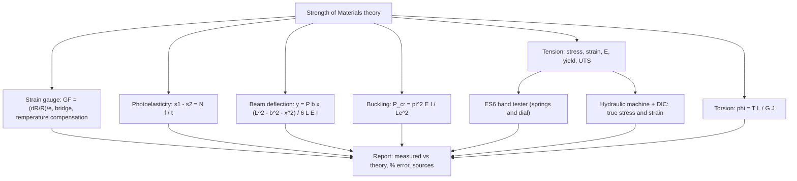
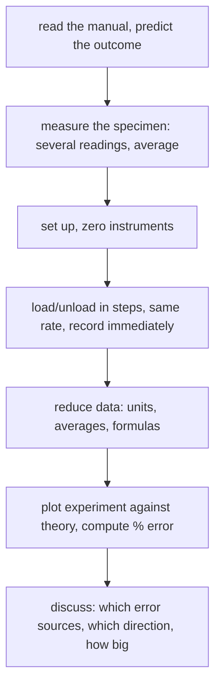

# Applied Mechanics Lab — Map of Content

Seven solid-mechanics experiments that test the theory of [[Strength of Materials - MOC]]: beam deflection, column buckling, two tensile tests, torsion, strain gauges and photoelasticity. The folder is called `Fluid Mechanics Lab/` for historical reasons, but the manuals in it are the AM2540 *solid-mechanics* sessions. Each note turns a manual (or, for strain gauges and photoelasticity, the lecture material) into: aim, theory, procedure, data reduction, a worked example, error sources and answered viva questions. Exam preparation: [[Applied Mechanics Lab - Mock Papers]].

> [!abstract] The lab in one line
> **Apply a known load, measure a small displacement, and check it against a formula from lectures, then explain the gap.** The numbers are easy; the skill is understanding why they disagree.

## Course Overview
- **Course:** Applied Mechanics / Fluid Mechanics Lab, AM2540 (0-0-0-3-0, 3 credits), Semester 3.
- **Core purpose:** connect the formulas of Strength of Materials to real measurements and learn to report them with honest uncertainty.
- **Prerequisites:** [[Strength of Materials - MOC]] (Modules 1–9), [[Error Analysis - Uncertainty and Propagation]].
- **Tools:** dial gauges, vernier calipers, load cells, weights, spring dial indicator, hydraulic tensile machine (optionally with DIC).

## Concept Map

## Main Spine

| # | Experiment | Measures | Theory note |
|---|---|---|---|
| 1 | [[Lab - Deflection of Beams (Three-Point Bending)]] | deflection of a simply supported beam, stiffness of Al and steel | [[Double Integration and Macaulay's Method]] |
| 2 | [[Lab - Buckling of Struts]] | Euler buckling load for different end conditions | [[Euler Buckling of Columns]] |
| 3 | [[Lab - Tensile Test on the ES6 Tester]] | stress–strain of Al, HE30, steel and PVC | [[Stress-Strain Diagram and Hooke's Law]] |
| 4 | [[Lab - Tensile Test of Mild Steel with DIC]] | proportional limit, yield, UTS, true stress–strain | [[Concept of Stress]] |
| 5 | [[Lab - Torsion of Circular Shafts]] | twist angle (also by mirror and scale), shear modulus $G$ | [[Torsion of Circular Shafts]] |
| 6 | [[Lab - Strain Gauge Measurement on a Cantilever Beam]] | surface strain and bending stress; gauge factor; bridge arrangements and temperature compensation | [[Flexure Formula]], [[Sensors and Signal Conditioning]] |
| 7 | [[Lab - Photoelasticity - Fringes and Stress]] | fringe order, principal-stress difference, material fringe value; disk and bent beam | [[Mohr's Circle for Stress]], [[Plane Stress Transformation]] |

## Methods and Problem Types

| What the manual asks | Do this | Where |
|---|---|---|
| "Compare experimental and theoretical values" | compute theory from the **measured** dimensions; tabulate % deviation | all |
| "Evaluate the stiffness" | slope of load–deflection or torque–twist line | [[Lab - Deflection of Beams (Three-Point Bending)]], [[Lab - Torsion of Circular Shafts]] |
| "Plot a graph with theory and experiment" | both on one axis, labelled, with units | [[Lab - Buckling of Struts]] |
| "Find yield and tensile strength" | $0.2\%$ offset, peak engineering stress | [[Lab - Tensile Test of Mild Steel with DIC]] |
| "Discuss the difference" | list sources, give direction (raises/lowers) and size | every note's error table |

### A lab session as a flowchart

## Instrument and Unit Cheat-Sheet

| Instrument | Reads | Watch out for |
|---|---|---|
| Dial gauge | $0.01$ mm per division | tip contact, zero after self-weight, divisions $\ne$ mm |
| Vernier / dial caliper | length, width, thickness | measure at several places and average ($t^3$ makes errors triple in $I$) |
| Load cell + display | force in N | zero it before every run |
| Weights | grams $\to$ $mg$ in N | $1$ g $=0.00981$ N |
| ES6 spring dial | $100$ N per mm | load limit $1000$ N |

## Common Errors Across All Experiments

| Error | Effect | Fix |
|---|---|---|
| Not zeroing after self-weight / pre-load | offset in every reading | zero with everything in place |
| Single measurement of a dimension | $I\propto t^3$, $J\propto r^4$ amplify errors | measure repeatedly |
| Different loading rate | PVC creep, friction | constant rate, read at a fixed delay |
| Plotting before checking units | factor $10^2$–$10^3$ mistakes | convert first |
| Not reporting uncertainty | result is not comparable | use [[Error Analysis - Uncertainty and Propagation]] |

## Cross-Domain Links
- [[Resonance and Buckling - Instability as an Eigenvalue Problem]]: the buckling lab is the eigenvalue problem made physical.
- [[Energy Methods - A Unified View]]: reciprocity in the beam lab, toughness in the tensile lab.
- [[Simple Harmonic Motion]]: torsion rod and beam are springs, with $k=GJ/L$ and $k=48EI/L^3$.

## Exam / Revision Map
- **Practice papers:** [[Applied Mechanics Lab - Mock Papers]]: three timed mock papers in the style of the end-semester paper, plus [[Applied Mechanics Lab - Past Paper Pattern and Model Answers|the 2023 paper analysed and answered]]. Failure-plane sketches: [[Failure Planes - Ductile and Brittle Fracture]].
- **Know cold:** $\delta=PL^3/48EI$, $P_{cr}=\pi^2EI/L_e^2$ with $L_e=L,\ L/\sqrt2,\ L/2$, $\sigma=F/A$, $\varepsilon=\Delta L/L$, $\sigma_{\rm true}=S(1+e)$, $\phi=TL/GJ$, $G=E/2(1+\nu)$.
- **Commonly confused:** engineering vs true stress; $I_{xx}$ vs $I_{yy}$ (use the smaller for buckling); angle of twist vs arm rotation; stiffness ($P/\delta$) vs modulus ($E$).

## Study Progress
- [ ] Beam deflection report
- [ ] Buckling report
- [ ] ES6 tensile report
- [ ] DIC tensile report
- [ ] Torsion report
- [ ] Strain gauge report
- [ ] Photoelasticity report
- [ ] Mock papers 1–3 done under time

## MOC Maintenance Rules
1. New experiment manual $\to$ one lab note, linked above.
2. Keep illustrative numbers labelled as such; real measurements go in your own report, not here.
3. Re-run `Tools/aml_figs.py` and `Tools/aml_check.py` after changing a formula; the mock-paper numbers and figures come from `Tools/aml_mock_core.py` and `Tools/aml_mock_figs.py`.

## Quick Navigation
- **Theory:** [[Strength of Materials - MOC]] · [[Euler Buckling of Columns]] · [[Torsion of Circular Shafts]]
- **Back to:** [[Mechanical Engineering Curriculum - MOC]]
