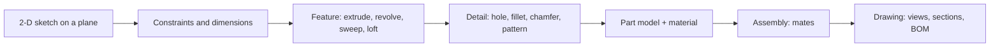

# Assembly Drawings, 3D Modelling and Bills of Materials

> [!abstract] In one breath
> A parametric 3-D model is built from **sketches with constraints**, turned into solids by **features** (extrude, revolve, hole, fillet), and combined in an **assembly** by **mates** that remove degrees of freedom. The assembly drawing then carries **views, balloons numbered to a bill of materials**; the part drawings carry the tolerances. The model, the drawing and the BOM stay linked, so change one and the others follow.

Part of [[Computer Aided Machine Drawing - MOC]]. Previous: [[Surface Finish, Machining Symbols and Production Drawings]].

## 1. From sketch to part

- **Sketch:** geometry (lines, arcs, circles) with **geometric constraints** (horizontal, tangent, concentric, equal) and **dimensional constraints**. A sketch is **fully defined** when no element can move: always aim for that (a black sketch, not a blue one).
- **Features:** *extrude* (a sketch pushed along a direction), *revolve* (about an axis: shafts, bushes), *sweep* and *loft* (along a path or between sections), *cut* versions of each, and *hole wizards* that carry the tap and clearance data.
- **Design intent:** put the **base feature** and the **dimensions** in the order that the part would change: make the thickness a parameter, hole spacing a pattern, and tie the fillet to the edge so the model survives edits. **Parameters and equations** drive families of parts (all bolt lengths from one table).
- **History tree** and **suppression**: the feature order matters; deleting a parent can break the children.

## 2. Assembly and mates

An assembly places each part with **mates**: constraints between faces, edges and axes. A free rigid part has **6 degrees of freedom**. Each mate removes some of them:

| Mate | Removes | Example |
| --- | --- | --- |
| **Coincident (face to face)** | 3 (one translation, two rotations) | head of a bolt on the plate |
| **Concentric (axis to axis)** | 4 (two translations, two rotations) | bolt in a hole |
| **Distance, angle** | 1 each | offset between faces |
| **Parallel, perpendicular** | 2 or 1 | orientation of a face |
| **Tangent** | 1 | cam and follower, cylinder on a plane |
| **Fixed (grounded)** | 6 | the base or frame |

**Worked count: a bolt in a plate.** The bolt starts with 6 DOF. A *concentric* mate with the hole leaves 2 (slide along the axis, spin about it). A *coincident* mate between the head and the plate nominally removes 3, but two of those are the rotations that concentric already removed: only **1** is new, leaving 1 (spin about the axis, which is harmless). CAD flags the redundant part as **over-defined**: the model still works, but redundant mates can conflict and make the assembly fail to rebuild after an edit. This is the mobility count of [[Mobility - Kutzbach Equation and Exceptions]] in three dimensions, and the redundant constraint is the same idea as a redundant link.

![[CAMD-6-assembly.png]]

**Assembly checks:** interference detection (parts occupying the same space), clearance, motion study (do the joints move as intended), and **tolerance stack-up**.

**Mechanisms:** a four-bar is modelled with revolute (concentric + coincident) mates and one driven angle: the same linkage as in [[Grashof Criterion and Four-Bar Inversions]]; a slider-crank adds a slider mate for the piston.

## 3. The assembly drawing

An assembly drawing shows **how the parts fit together**, not how each is made.

- **Views:** the front view (usually a **section**) and as many others as are needed; **exploded view** to show the order of assembly; hatching in opposite directions on adjacent parts ([[Sectional Views and Hatching Conventions]]); bolts, shafts and keys unsectioned.
- **Balloons (item numbers):** a circle with a leader to each part, in a clockwise or counter-clockwise order, aligned in rows and columns; the number refers to the BOM.
- **Dimensions:** only overall sizes, **fits** between mating parts (Ø25 H7/g6), and the key assembly dimensions: no detail dimensions.
- **Title block and BOM** (parts list) at the bottom right of the sheet.

## 4. The bill of materials

A **BOM** lists every part with one row per distinct part:

| Item | Part number | Description | Qty | Material / standard |
| --- | --- | --- | --- | --- |
| 1 | FC-01 | Flange half-coupling, Ø25 H7 bore | 2 | C45 steel |
| 2 | — | Key 8 × 7 × 30 | 1 | IS 2048, C45 |
| 3 | — | Hex bolt M10 × 50, grade 8.8 | 4 | IS 1364 |
| 4 | — | Hex nut M10 | 4 | IS 1363 |
| 5 | — | Washer 10 | 8 | IS 2016 |

Order: assemblies first, then parts, or by item number; **standard parts** (bolts, nuts, washers, bearings, keys) are listed by designation, not drawn individually. The BOM is generated from the assembly model, so the quantities cannot disagree with the drawing; mass and cost roll-ups come from the same list.

## 5. A good model, a good drawing

- Model the **function** first (the datums, the mating features); add cosmetic detail last.
- Name parts and features meaningfully; use standard libraries for fasteners.
- Draw the part drawing from the part model: dimensions come from the sketch (driven), tolerances and finishes are added as annotations ([[Limits, Fits and Tolerances]], [[Surface Finish, Machining Symbols and Production Drawings]]).
- Keep one model: assembly, part drawings and BOM follow its changes (revision control).

> [!warning] Traps
> - Leaving sketches under-defined: they move unexpectedly when dimensions change.
> - Over-defining mates (redundant or conflicting): the assembly will not rebuild.
> - Dimensioning an assembly drawing with detail sizes.
> - Listing the same standard part under two item numbers.
> - Hatching a bolt or a key in the assembly section.

> [!question]- Predict first: two plates joined by a bolt and nut. How many DOF has the nut after being mated concentric with the bolt?
> 2 (slide along the axis and spin about it): concentric removes 4 of 6. A coincident mate between the nut face and the plate removes 1 new DOF (the slide); the spin remains until a friction or torque model is added.

> [!question]- Why are balloons numbered to the BOM rather than labelled with the part names?
> The number is unambiguous and short, the BOM carries the description, quantity and standard; changing a part's name or supplier changes one BOM row, not every view.

## 6. Connections

- [[Mobility - Kutzbach Equation and Exceptions]] and [[Kinematic Pairs, Links and Chains]] — mates are joint constraints; redundant constraints appear in both.
- [[Screw Threads and Threaded Fasteners]], [[Keys, Rivets and Welds]] — the standard parts in the BOM.
- [[Jigs and Fixtures - The 3-2-1 Location Principle]] — fixing six DOF with six point contacts, the manufacturing counterpart of mates.
- [[Introduction to Machine Design - MOC]] — the sized shaft, key, gears and bolts that are modelled and listed here.
