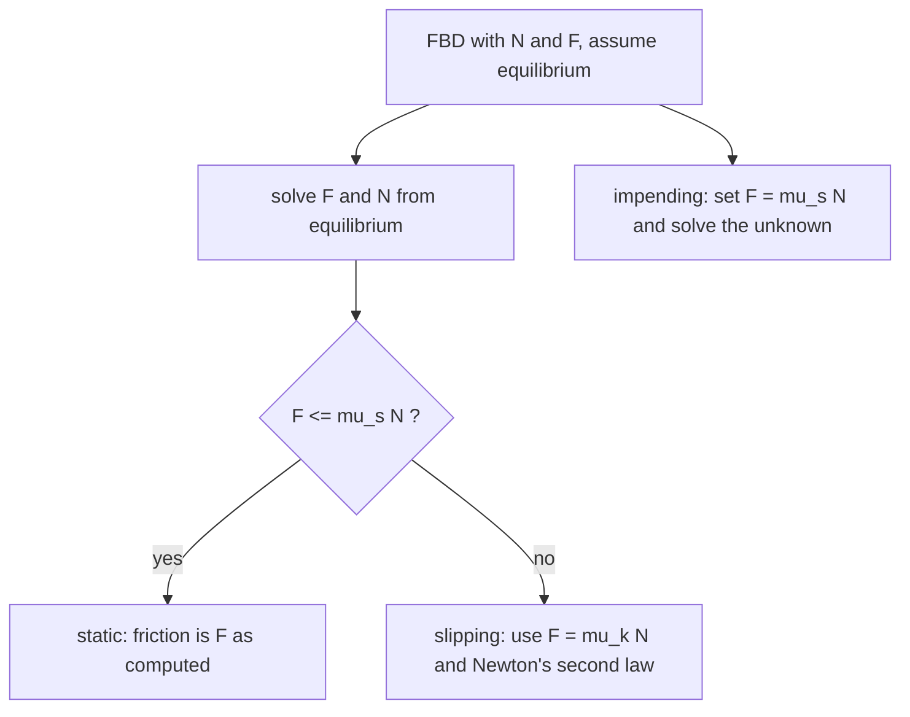

# Dry Friction

> [!abstract] The big idea
> Between two dry surfaces the friction force **adjusts itself** to whatever is needed to keep them from sliding, **up to a maximum** $F_{\max}=\mu_sN$. Beyond that, the surfaces slip and friction drops to $F=\mu_kN$. So friction is *not* always $\mu N$: before slipping it is whatever balances the other forces.

## Coulomb's law

| State | Friction force | Direction |
|---|---|---|
| **Static** (no slip) | $F\le\mu_sN$ (found by equilibrium) | opposes the *tendency* to slip |
| **Impending slip** | $F=\mu_sN$ | opposes the tendency to slip |
| **Kinetic** (sliding) | $F=\mu_kN$, with $\mu_k<\mu_s$ | opposes the *actual* sliding |

The **angle of friction** $\phi_s=\tan^{-1}\mu_s$ is the angle between the total contact force $\sqrt{N^2+F^2}$ and the normal at impending slip.

![[EM-friction-law.png]]

**Figure:** Left, pull a $200$ N-normal-force block with a growing force $P$: friction rises exactly with $P$ (the block is at rest) until $\mu_sN=100$ N, then drops to $\mu_kN=80$ N and the block accelerates. Right, on an incline the friction needed to hold a block is $\tan\theta$ per unit normal force; slipping starts at $\theta=\tan^{-1}\mu_s$ ($26.6^\circ$ for $\mu_s=0.5$): the **angle of repose**.

> [!question]- 🎯 Predict first: you push a heavy crate with a force just below the limit. Is the friction force $\mu_sN$?
> **No.** It equals your push (as long as the crate stays still). Only at the verge of sliding does friction reach $\mu_sN$. A common wrong step is to *write* $F=\mu_sN$ in every static problem.

## Method (three question types)
1. **Is it in equilibrium?** Assume it is, solve for the needed $F$ and $N$; if $F\le\mu_sN$ it stays; otherwise it slips.
2. **At impending motion:** set $F=\mu_sN$ and solve for the unknown (an angle, a force, a position).
3. **Tip or slip?** Compute the force that would **slip** it ($P=\mu_sW$) and the force that would **tip** it ($Py=Wb/2$) and compare: the smaller one happens first.

## Worked examples
> [!example]- 🔬 A $50$ kg block on a $25^\circ$ incline, $\mu_s=0.5$: does it slide?
> Needed friction: $F=mg\sin25^\circ=207$ N. Available: $\mu_sN=0.5(50)(9.81)\cos25^\circ=222$ N. Since $207<222$ it **stays**, and the friction force is $207$ N (not $222$ N).
> It would start to slide at $\theta=\tan^{-1}0.5=26.6^\circ$. **Check:** $\tan25^\circ=0.466<0.5$ ✓.

> [!example]- 🔬 Ladder on a rough floor against a smooth wall at $60^\circ$: minimum $\mu_s$?
> Moments about the foot: $N_wL\sin\theta=W\frac L2\cos\theta\Rightarrow N_w=\frac W2\cot\theta$. Horizontal equilibrium: $F=N_w$; vertical: $N=W$. Need $F\le\mu_sW$: $\mu_s\ge\tfrac12\cot\theta=0.289$ at $60^\circ$ (and $0.5$ at $45^\circ$, $0.134$ at $75^\circ$). A steeper ladder is safer.

> [!example]- 🔬 Tip or slip? A crate $0.6$ m wide pushed at height $1.0$ m, $\mu_s=0.4$
> Slip force: $\mu_sW=0.40\,W$. Tip force: $P\cdot1.0=W(0.3)\Rightarrow P=0.30\,W$. Tipping needs less force, so the crate **tips first**. It would slip first only if $\mu_s<b/(2y)=0.30$.

> [!warning]- ⚠️ Taking $N=W$ on an incline or with an inclined pull
> $N$ is whatever vertical equilibrium gives: $mg\cos\theta$ on an incline, $W-P\sin\alpha$ if you pull upward at angle $\alpha$. An angled pull can **reduce** the friction by lowering $N$.

> [!danger]- 💥 Drawing friction in the wrong direction after slipping starts
> Kinetic friction always opposes the *actual* relative sliding. Static friction opposes the *tendency* to slide; if you are unsure, assume a direction: a negative result flips it.

## Quick quiz
> [!question]- Q1. Why is $\mu_k$ usually less than $\mu_s$?
> Surface bonds that form while at rest (microscopic welds, interlocking asperities) are broken once motion begins; sliding surfaces have less time to bond. It is why a car skids further than the ABS-limited stop.

> [!question]- Q2. A book rests on a table you tilt slowly. Does the angle at which it slips depend on its weight?
> **No.** $\tan\theta=\mu_s$: weight cancels. It does not depend on contact area either (Coulomb's law).

## Connections
- **Prerequisites:** [[Free-Body Diagrams and Equilibrium of Rigid Bodies]], [[Distributed Loads and Equivalent Point Loads]]
- **Next:** [[Friction in Machines - Belts, Screws and Wedges]]
- **Cross-domain:** [[Damped Oscillations]] (Coulomb friction is damping, but with constant magnitude, giving *linear* decay of amplitude instead of exponential); [[Inertial and Non-Inertial Frames]] (in a braking train the pseudo-force is what friction must resist).

## Self-check
- [ ] I can tell static from kinetic friction and use $F\le\mu_sN$ correctly.
- [ ] I can solve impending-slip and tip-or-slip problems.
- [ ] I can compute the angle of repose.

## Metadata
- **Status:** draft · **Type:** concept · **Difficulty:** intermediate
- **Course map:** [[Engineering Mechanics - MOC]]
