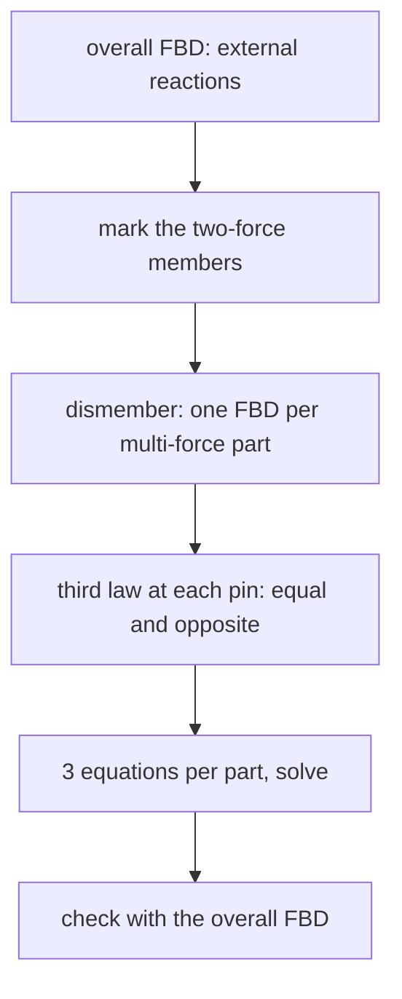

# Frames and Machines

> [!abstract] The big idea
> A truss has only two-force members; a **frame** or **machine** contains at least one **multi-force member** (three or more forces, or couples). Frames hold loads; machines transmit and amplify forces (pliers, a toggle clamp). To solve them you **dismember** the structure, draw an FBD for every piece, and let Newton's third law pair up the forces at each pin: equal and opposite on the two parts.

## Procedure

1. **Overall FBD first** (if the supports are the only unknowns): gives external reactions without touching the pins.
2. **Identify two-force members**: their force is along the line through their pins. Solve for them in terms of one unknown.
3. **Dismember**: draw each multi-force member separately; at a shared pin the force on one member is the **opposite** of the force on the other (third law). Be consistent with directions.
4. **Write 3 equations per rigid body** (2-D) and solve; count unknowns and equations first.
5. **Check** with the overall FBD.

![[EM-frame.png]]

**Figure:** Horizontal member AB (pinned to the wall at A) is held up by member BC, pinned to the wall at C. BC carries force only at its two pins, so it is a **two-force member** and its force acts along BC at $45^\circ$. Taking moments of AB about A leaves one unknown.

> [!question]- 🎯 Predict first: does the two-force member BC pull on B or push on it?
> It **pushes** up and out ($\text{compression}$). AB sags under its load, and BC must resist from below; a bar below a joint holding a load up is in compression. The moment equation (positive answer for a compressive force) confirms it.

## Method (a quick algorithm)

## Worked example
> [!example]- 🔬 Frame of the figure: $20$ kN at the midpoint of AB; AB is $4$ m; C is $4$ m below A
> BC is two-force along $45^\circ$. Moments about A for AB: $F_{BC}\sin45^\circ\cdot4=20\cdot2\Rightarrow F_{BC}=\dfrac{40}{4\sin45^\circ}=14.14$ kN (compression).
> Its components on B: $10$ kN up and $10$ kN away from the wall. So the pin A must supply $A_x=-10$ kN (towards the wall) and $A_y=+10$ kN.
> **Check:** $\sum F_y$ on AB: $A_y+10-20=0$ ✓; $\sum F_x$: $A_x+10=0$ ✓; and the overall frame: moments about C also close.

> [!warning]- ⚠️ Applying the same force twice at a pin
> Put the pin's force on *one* member only, or draw the pin as a separate small body. And never forget that the pin force on the second member is the **reverse**.

> [!danger]- 💥 Putting a load that acts on a pin onto one member by default
> If a load acts directly at a pin shared by three parts, decide explicitly which member (or the pin) carries it; stating it prevents a missing or doubled load.

## Quick quiz
> [!question]- Q1. Why solve the two-force member first?
> Its direction is known, so it adds only one unknown (the magnitude) instead of two components.

> [!question]- Q2. Pliers: handle length $L_h=12$ cm, jaw length $L_j=3$ cm from the pin. What force amplification?
> Moments about the pin: $F_{\rm jaw}L_j=F_{\rm hand}L_h$, so the jaw force is $4\times$ the hand force. The pin also takes $5\times F_{\rm hand}$.

## Connections
- **Prerequisites:** [[Free-Body Diagrams and Equilibrium of Rigid Bodies]], [[Plane Trusses - Method of Joints and Sections]]
- **Next:** [[Distributed Loads and Equivalent Point Loads]]
- **Cross-domain:** [[KDoMs - MOC]] (mechanisms are machines in motion; static force analysis is the $\omega\to0$ limit); [[Gears, Transformers and Reflected Impedance]] (force/lever amplification is "reflected load").

## Self-check
- [ ] I can dismember a frame and apply the third law at pins.
- [ ] I can spot and use two-force members.
- [ ] I can verify with the overall FBD.

## Metadata
- **Status:** draft · **Type:** concept · **Difficulty:** intermediate
- **Course map:** [[Engineering Mechanics - MOC]]
