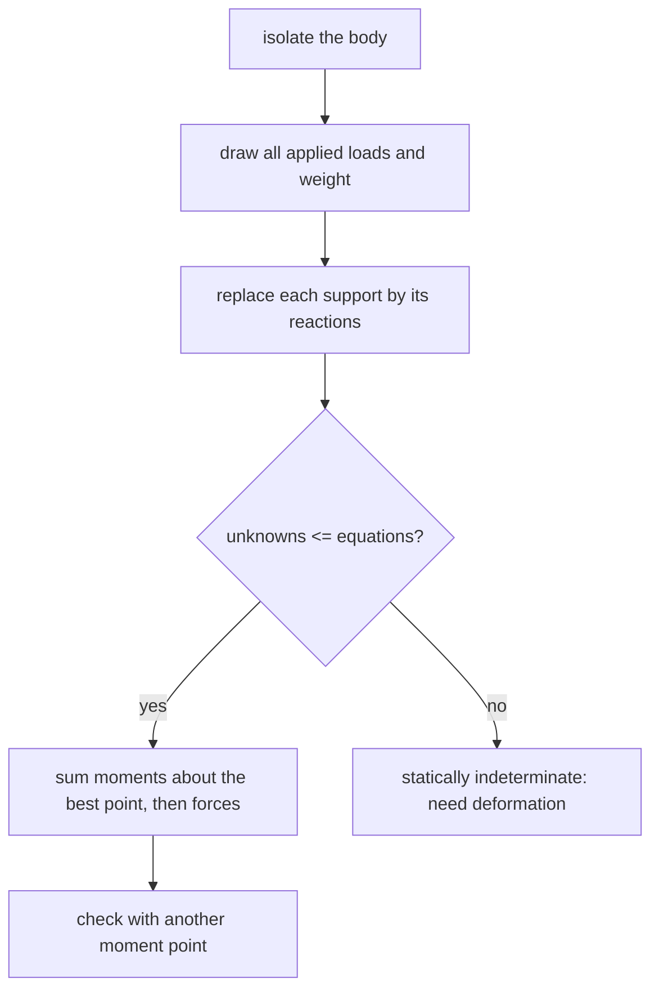

# Free-Body Diagrams and Equilibrium of Rigid Bodies

> [!abstract] The big idea
> **Equilibrium** means no net force and no net moment: $\sum\mathbf F=\mathbf0$ and $\sum\mathbf M=\mathbf0$. Statics is the art of drawing **one** body with **every** force acting on it (the **free-body diagram**, FBD), then writing those equations. A correct FBD is 80% of every statics problem.

## Equations of equilibrium

- **2-D (three equations):** $\sum F_x=0,\ \sum F_y=0,\ \sum M_O=0$ (any point O).
- **3-D (six equations):** $\sum F_x=\sum F_y=\sum F_z=0$ and $\sum M_x=\sum M_y=\sum M_z=0$.

A body is **statically determinate** if the unknown reactions equal the independent equations (3 in 2-D); with more unknowns it is **statically indeterminate** and needs deformation (see [[Statically Indeterminate Axial Members]]); with fewer it is a mechanism.

## Support reactions

![[EM-supports.png]]

**Figure:** One reaction per motion a support prevents. Roller or smooth surface: one force $\perp$ the surface. Pin: two force components. Fixed support: two components and a moment. Cable or two-force link: a force along its axis (tension only for a cable).

## Special members
- **Two-force member** (forces at two points only, no couples): the two forces are equal, opposite and **along the line joining the points**. Recognising one saves a whole unknown.
- **Three-force member:** the three lines of action are concurrent (or all parallel). Useful for finding an unknown direction.

> [!question]- 🎯 Predict first: a uniform ladder leans against a smooth wall and rests on rough ground. How many unknown forces are on its FBD?
> **Three:** the wall's push (horizontal only, since the wall is smooth), and at the ground a normal force and a friction force. Weight is known. Three unknowns, three equations: determinate. Draw only forces from *outside* the ladder.

## Method (the FBD recipe)
1. **Isolate the body:** sketch it alone, with the geometry.
2. **Draw every external force:** loads, weight (at the centre of gravity), and a reaction for each support or contact the body had.
3. **Label unknowns** with assumed directions; a negative answer just means the other way.
4. **Choose the equations cleverly:** take moments about the point where most unknowns meet.
5. **Check:** a different moment point must also sum to zero.

## Worked example
> [!example]- 🔬 Simply supported beam, $6$ m span, $12$ kN point load $2$ m from A
> $\sum M_A=0$: $R_B(6)-12(2)=0\Rightarrow R_B=4$ kN. $\sum F_y=0$: $R_A+R_B=12\Rightarrow R_A=8$ kN.
> **Check:** moments about B: $R_A(6)-12(4)=48-48=0$ ✓. The reaction nearer the load is larger, as intuition says.

> [!warning]- ⚠️ Putting internal forces on the FBD
> Forces between parts *inside* the isolated body cancel and do not appear. If you cut through a structure, the cut forces become external to each piece.

> [!danger]- 💥 Forgetting a reaction moment at a fixed support
> A cantilever's wall prevents rotation too: three unknowns, not two. Leaving out $M$ makes the problem look overdetermined and impossible.

## Quick quiz
> [!question]- Q1. A pin-supported beam rests also on a roller. How many unknowns, and is it determinate?
> $2+1=3$ unknowns, 3 equations: statically determinate (a simply supported beam).

> [!question]- Q2. A beam with pins at both ends: how many unknowns?
> $2+2=4>3$: indeterminate to the first degree (axially loads can be shared).

## Connections
- **Prerequisites:** [[Force Systems and Resultants]], [[Moments, Couples and Equivalent Force Systems]]
- **Next:** [[Plane Trusses - Method of Joints and Sections]], [[Frames and Machines]]
- **Cross-domain:** [[Shear Force and Bending Moment Diagrams]] (internal forces come from cutting a beam and writing equilibrium for one piece); [[Hydrostatic Force on Plane Surfaces and Centre of Pressure]] (an equilibrium problem with a distributed load).

## Self-check
- [ ] I can draw an FBD with the right reaction for each support.
- [ ] I can pick a moment point to isolate one unknown.
- [ ] I can tell determinate from indeterminate.

## Metadata
- **Status:** draft · **Type:** concept · **Difficulty:** beginner–intermediate
- **Course map:** [[Engineering Mechanics - MOC]]
