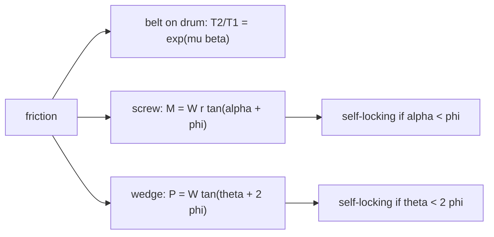

# Friction in Machines - Belts, Screws and Wedges

> [!abstract] The big idea
> Friction is a nuisance in bearings but the **working principle** of belts, brakes, clutches, screws and wedges. In each, a small force wins against a large load because friction can multiply: a rope wound a few turns round a post can hold a ship with one hand.

## Belt friction (flat belt or rope on a drum)

When a belt is about to slip over a drum through contact angle $\beta$ (radians), the tension ratio is
$$\boxed{\frac{T_2}{T_1}=e^{\mu\beta}}\qquad(T_2>T_1,\ \text{impending slip}).$$
It is independent of the drum radius. Power transmitted at belt speed $v$: $P=(T_2-T_1)v$.

![[EM-belt-friction.png]]

**Figure:** Left, $T_2/T_1$ against wrap angle for four coefficients of friction (log scale): a straight line, i.e. **exponential in the angle**. Three full turns ($\beta=6\pi$) at $\mu=0.3$ multiply the force by $286$. Right, the capstan: a small hold $T_1$ resists a large load $T_2$.

> [!question]- 🎯 Predict first: a dockhand wraps a rope three times round a bollard ($\mu=0.3$). How hard must they pull to hold a $1000$ N tug?
> $T_1=1000/e^{0.3\cdot6\pi}=1000/286=\mathbf{3.5\ N}$, about the weight of a small apple. Sailors have always known this; the exponential is why.

## Screws (square thread)
With lead angle $\alpha$ (so $\tan\alpha=\text{lead}/2\pi r$) and friction angle $\phi=\tan^{-1}\mu$:
- **Raising a load $W$:** torque $M=Wr\tan(\alpha+\phi)$.
- **Lowering:** $M=Wr\tan(\phi-\alpha)$. If $\alpha<\phi$ this is **positive**: the screw is **self-locking** (holds the load without help); if $\alpha>\phi$ it overhauls (the load drives it).
- **Efficiency** when raising: $\eta=\tan\alpha/\tan(\alpha+\phi)$ (a self-locking screw has $\eta<50\%$).

## Wedges
A wedge of angle $\theta$ lifts a load by sliding under it; with friction angle $\phi$ on both faces the force needed is of the form $P=W\tan(\theta+2\phi)$ (for a symmetric wedge arrangement) and it stays in place when pulled out only if $\theta<2\phi$ (self-locking). The same $\tan(\text{geometry}\pm\phi)$ structure as the screw: a screw is a wedge wrapped round a cylinder.

## Method
1. **Draw the FBD** of the drum, block or wedge; decide the direction of impending slip.
2. **Pick the right formula:** belt $e^{\mu\beta}$; screw $\tan(\alpha\pm\phi)$; wedge: resolve with friction angle.
3. **Convert** turns to radians ($1$ turn $=2\pi$).
4. **Check** the self-locking condition if the load must stay put.

## Worked examples
> [!example]- 🔬 Flat belt over a pulley: $\mu=0.3$, contact angle $\pi$ (half a turn), $T_1=200$ N
> $T_2/T_1=e^{0.3\pi}=2.566\Rightarrow T_2=513$ N at impending slip. At belt speed $10$ m/s the power is $(513-200)(10)=3.1$ kW. A larger wrap angle (idler pulleys) raises the allowable $T_2/T_1$.

> [!example]- 🔬 Jack screw: mean radius $20$ mm, lead $8$ mm, $\mu=0.15$, load $10$ kN
> $\alpha=\tan^{-1}\!\big(8/(2\pi\cdot20)\big)=3.64^\circ$ and $\phi=\tan^{-1}0.15=8.53^\circ$.
> Raise: $M=10{,}000(0.020)\tan12.17^\circ=43.1$ N·m. Since $\alpha<\phi$ the screw is **self-locking**; lowering still needs $M=10{,}000(0.020)\tan4.89^\circ=17.1$ N·m.
> Efficiency $\tan\alpha/\tan(\alpha+\phi)=0.0636/0.2156=29.5\%$.

> [!warning]- ⚠️ Using degrees for the wrap angle in $e^{\mu\beta}$
> $\beta$ must be in **radians**: a half turn is $\pi$, not $180$. Using $180$ gives a ridiculous $e^{54}$.

> [!danger]- 💥 Assuming a self-locking screw is also efficient
> The same friction that holds the load costs you more than half the input work when raising. Self-locking and high efficiency are opposed.

## Quick quiz
> [!question]- Q1. Does the drum's radius matter in $T_2/T_1=e^{\mu\beta}$?
> No, only the **angle** $\beta$ in contact. A rope on a thin pole and on a thick drum behave the same for the same wrap angle.

> [!question]- Q2. A screw has $\mu=0.1$. What lead angle makes it just self-locking?
> $\alpha=\phi=\tan^{-1}0.1=5.7^\circ$. Steeper than that, it overhauls.

## Connections
- **Prerequisites:** [[Dry Friction]]
- **Next:** [[Virtual Work and Potential Energy Stability]]
- **Cross-domain:** [[Exponential Decay - Time Constants, Damping and Spatial Relaxation]] (an exponential in angle, like decay in time); [[Power Transmission by Shafts]] (belts and shafts both transmit $P=T\omega$); [[Gears, Transformers and Reflected Impedance]] (belts and gears as ratio changers).

## Self-check
- [ ] I can apply $e^{\mu\beta}$ with the angle in radians.
- [ ] I can compute raising and lowering torque for a screw and tell if it self-locks.
- [ ] I can explain the common wedge–screw structure.

## Metadata
- **Status:** draft · **Type:** concept · **Difficulty:** intermediate
- **Course map:** [[Engineering Mechanics - MOC]]
